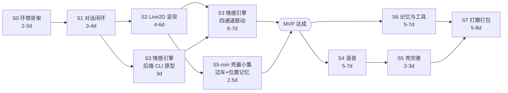

# Mochi 实施作战手册：架构拆解 · 路线图 · MVP 任务清单

> 输入基线：[情感桌宠项目计划书 v1.0](./情感桌宠项目计划书.md)（下称"计划书"）
> 文档定位：计划书解决 **做什么 / 为什么这么做**；本文件解决 **怎么拆 / 按什么顺序做 / 怎么验收**。
> 使用方式：开发时只看本文件第 4 章的任务清单；遇到设计争议回查第 1 章的不变量与 ADR；对验收标准有疑问回查第 3 章。
> 阅读前提：本文件不重复计划书已有内容，只做**拆解、补充、修正与可执行化**。

**目录**

| 章 | 内容 | 什么时候看 |
| --- | --- | --- |
| [0](#0-一页纸总览) | 价值公式 / 关键路径 / **MVP 边界** / 里程碑 / 时间盒 | 每次排期与砍需求时 |
| [1](#1-核心架构拆解) | 六条不变量 / 三层编排 / 情感引擎 / 横切链路 / ADR | 设计有争议、要动架构时 |
| [2](#2-分阶段实施路线图) | 依赖图（含并行机会）/ 阶段详表 / 对计划书的修正 / 周节奏 | 每阶段开工前 |
| [3](#3-mvp-里程碑与技术难点) | 验收矩阵 / 演示脚本 / 难点分级 / **5 个 Spike 实验** / 隐藏难点 / 降级止损 | 阶段第 1 天、验收时 |
| [4](#4-可执行开发任务清单) | **S0–S7 + 跨阶段，共 117 项可勾选任务** | 每天开工时 |
| [5](#5-执行机制) | 开工收工清单 / 质量门禁 / 调参闭环 / 变更管理 / 风险看板 | 每周复盘时 |
| [附录](#附录) | 指标埋点 / 测试矩阵 / 术语 | 需要时查阅 |

---

## 0. 一页纸总览

### 0.1 价值公式

```
Mochi = 三层编排（骨架） × 情感引擎（灵魂） × 原生桌面壳（形态） × 四通道表现（说服力）
```

四项是**乘法关系**，任何一项趋近 0，产品就退化为：

| 缺项 | 退化为 | 计划书对应 |
| --- | --- | --- |
| 三层编排 | 又贵又慢又 OOC 的套皮聊天窗 | 2.2 / 5.1 |
| 情感引擎 | 每轮重新表演情绪的"人格滤镜" | 2.8 缺口一 / 5.2 |
| 桌面壳 | 浏览器标签页里的 Live2D 玩具 | 2.8 缺口二 / 5.7 |
| 四通道表现 | 有内心戏但面瘫的角色 | 5.2.9 / 5.6 |

**推论**：排期冲突时，优先级永远按上表从上往下砍——先砍打磨，再砍工具与记忆，最后才动情感引擎；**三层编排与情感引擎不可裁剪**。

### 0.2 关键路径（Critical Path）

```
S0 环境骨架 ──▶ S1 对话闭环 ──▶ S2 Live2D 呈现 ──▶ S3 情感引擎 ──▶ MVP
                                    │                  │
                                    └──▶ S5桌面壳 ─────┘（仅"边车托管+位置记忆"最小集）
S4 语音 ∥ S6 记忆工具 ∥ S7 打磨 —— 均在 MVP 之后，可并行、可裁剪
```

四个**不可压缩**的节点，任何一个延期都直接推迟 MVP：

1. **S0 的契约链路**（Pydantic → TS 类型自动生成）：晚一天建立，后面每一天都在制造漂移债务。
2. **S1 的流式链路**（首字 < 2.5s）：这是体验的地板，后期优化成本是前期的 5 倍。
3. **S2 的透明窗 + 口型**：透明窗是"桌宠形态"的物理前提；口型是"活着"的最低感知阈值。
4. **S3 的情感引擎**：本项目的全部差异化，计划书已明确"宁可砍阶段 6，不可压缩阶段 3"。

### 0.3 MVP 边界定义（本文件重新界定）

计划书的 1.4 节以 D1–D7 定义成果，7 章以 S0–S7 定义阶段，但**未明确"MVP 到底到哪一步为止"**。本文件给出界定与判据。

**Mochi MVP = S0 + S1 + S2 + S3 +（S5 的窗口最小集）**

| 判据（三条全满足才进入 MVP） | 语音 S4 | 记忆/工具 S6 | 边车托管 S5-min |
| --- | --- | --- | --- |
| ① 是否直接验证核心假设（真情绪 / 真桌宠） | ❌（文字+表情已可验证情绪） | ❌ | ✅（"双击即启动"属于桌宠形态） |
| ② 是否阻塞其它 MVP 任务 | ❌ | ❌ | ✅（否则每次演示都要手动起后端） |
| ③ 砍掉后是否让 MVP 无法演示 | ❌ | ❌ | ✅ |

**MVP 交付物（演示级验收）**：

> 双击一个 `.exe` → 桌面出现透明置顶的 Live2D 角色，会呼吸/眨眼/视线跟随 → 输入文字，2.5s 内开始流式吐字，语气符合人设 → 夸奖它时表情在 300ms 内变成 `shy` 且带 300ms 缓动、TTS 参数（pitch +7%）同步产出 → 放置 1 小时不动，情绪平滑转向 `lonely` 并最多主动搭话 3 次 → 打开调试面板能看到 PAD 三条曲线与触发源时间轴 → 关闭 8 小时（可用时间旅行模拟）后重开，播放"重逢"开场白。

**MVP 明确不含**：语音输入/输出、长期记忆、Skills、工具调用、任务型对话、多角色卡打包、安装包。这些属于 v1.0（S4–S7）。

### 0.4 里程碑总表

| 里程碑 | 一句话定义 | 阶段 | 可演示脚本 | 累计工时 |
| --- | --- | --- | --- | --- |
| **M0 可连** | 三层空壳跑通 | S0 | 透明窗出现占位圆，WS 握手成功，kill 后端 5s 内自动重连 | 2–3 d |
| **M1 可聊** | 有人设的流式对话 | S1 | 输入"你好"，逐字吐字，`/role set` 切换风格，断网有降级文案 | 5–7 d |
| **M2 可动** | 会呼吸的 Live2D | S2 | 静置 30s 无一刻静止；点头部有反应；拖拽移位并记忆；测试音频口型同步 | 9–13 d |
| **M3 有情绪（MVP）** | 四通道联动的情绪系统 | S3 | 调试面板看曲线；连夸 3 次增幅递减；同句侮辱两种人格不同反应；1h 冷落转 lonely | 16–23 d |
| **M4 会说话** | 语音闭环 | S4 | 按住说→实时字幕→语音回复→口型同步→点击打断 0.3s 静音 | 21–30 d |
| **M5 真桌宠** | 完整桌面应用 | S5 | 双击即用；kill Python 自动重启；托盘常驻；穿透+热区唤回；开机自启 | 25–35 d |
| **M6 记得你** | 记忆与工具 | S6 | 重启仍记得称呼；40 轮后 Token 不线性增长；"帮我记一下"→ack+后台建提醒 | 30–42 d |
| **M7 可分发** | 打磨与打包 | S7 | 干净 Windows 机器安装→引导→对话 ≤5 分钟；24h 无泄漏；3 位用户中 ≥2 人主动说"它有心情变化" | 35–50 d |

### 0.5 时间盒与缓冲

- 计划书工时按"1 人 + AI 辅助"估算，本文件**沿用不改**，但在排期上追加 **30% 缓冲**（情感调参与窗口特性返工是必然项）。
- 单人开发的真实节奏：**每阶段末必须产出一个可演示的 Demo**，不接受"底层完成 80% 但看不到东西"。
- 若累计延期 > 20%：按 0.3 节的裁剪顺序执行，**不延后 MVP 定义**。

---

## 1. 核心架构拆解

### 1.1 三句话讲清整个系统

1. 一个**进程内单例**的 Python 服务，通过 WebSocket 事件与一个 WebView 前端通信；**前端只负责表现，不做任何决策**。
2. 每一条用户输入都走**唯一入口 `Orchestrator.handle()`**，由 Decision 层选择"用哪一套上下文方案"来回答。
3. 有一个**独立于对话的 250ms 时钟**在后台持续演化情绪；对话只是情绪的**刺激源之一**，而不是情绪的触发器。

这三句话分别对应 1.2 节的 I1、I5、I2 三条不变量。**记住这三句，就记住了这个系统的形状。**

### 1.2 六条架构不变量（违反即返工）

| # | 不变量 | 违反后的具体症状 | 强制手段 |
| --- | --- | --- | --- |
| **I1** | 情绪状态的唯一权威源是后端 `EmotionEngine` | 前端自行插值"猜"情绪 → 与后端快照不一致 → 调试面板与画面矛盾，无法调参 | 前端只消费 `emotion.update`/`performance.cue`，代码 review 检查项 |
| **I2** | Roleplay 层的 prompt 中**不得出现任何工具 schema / Skill 内容** | 人设稀释、回复开始输出 JSON、Token 成本翻倍 | `ContextBuilder(layer="roleplay")` 中 `tools_schema` 预算硬编码为 0；单测断言 |
| **I3** | 一次 turn 内，表情/动作/TTS 参数必须来自**同一份不可变快照** | "表情是 shy、TTS 是 happy"；用户感知为"精神分裂" | `EmotionSnapshot` 用 `frozen dataclass`；turn 开始时冻结 cue |
| **I4** | 前后端契约只有一个真相源：后端 Pydantic → JSON Schema → TS 类型 | 字段名/枚举值各写各的，运行时静默失败（如 `secondary_label` 拼错） | CI 中 `gen-types` 后 `git diff --exit-code` |
| **I5** | 所有 LLM / TTS / ASR 调用必须经 `Provider` 接口，禁止业务层直连 SDK | 换供应商要改 10 个文件；本地 Ollama 模式无法启用 | `ruff` 规则禁止 `orchestration/`、`emotion/` 导入 `openai` |
| **I6** | 后端单进程单 worker，状态为进程内单例 | 多 worker 导致情绪状态分裂、tick 重复跑、WS 推送错连接 | uvicorn 启动参数固定；`bootstrap()` 不做多实例化 |

> 这六条的价值在于：它们是可以被**自动化检查**的。I2/I4/I5 应写成 CI 断言，而不是"约定"。

### 1.3 三层编排拆解

#### 1.3.1 本质洞察：不是"三个 LLM 调用"，而是"三套上下文策略"

这是理解三层架构最关键的一句话。三层分离之所以有效，不是因为调用了三次模型，而是因为**同一条用户输入，在三层里需要的上下文完全不同**：

| 维度 | Decision | Roleplay | Agent Core |
| --- | --- | --- | --- |
| 上下文内容 | 系统角色 + 用户输入 + 最近 3 轮摘要 | 人格 + 情绪 + 记忆 + 表达约束 | 任务指令 + 工具 schema + 任务相关记忆 |
| 历史深度 | 3 轮（摘要） | 20 轮原文 + 摘要 | 当前任务内的 messages |
| 工具 schema | **0**（只给一句清单） | **0（硬约束）** | 全量（约 1500 tok） |
| 人设内核 | 极简（一句身份） | **完整（900 tok）** | 极简或省略 |
| 输出约束 | 强制 JSON，`max_tokens=64` | 正文 + 情绪 JSON 块 | 原生 tool_calls |
| 延迟目标 | < 1ms（规则）/ < 500ms（LLM） | 首字 < 2.5s | 无上限（后台） |
| 失败后果 | 路由错误（可降级为 CHAT） | 体验崩塌 | 任务失败（可汇报） |

**实现推论**：代码上不应有"三个独立的 prompt 拼接函数"，而应有一个 `ContextBuilder`，接收 `layer` 参数与预算表。这样"纯净上下文"就是一个**参数**而非"记得别加"的口头约定。

#### 1.3.2 Decision 层

**输入**：`UserInput`（text / modality / client_context）+ 最近 3 轮摘要
**输出**：`DecisionResult`（route / confidence / matched_rule / emotion_hint / latency_ms）

结构必须拆成三段纯逻辑，便于单测：

```
① classify_by_rules(text) -> DecisionResult | None      # 纯函数，无 IO，< 1ms
② classify_by_llm(text, summary) -> DecisionResult      # 仅 ① 返回 None 时调用
③ merge(result, route_mode) -> DecisionResult           # 应用 auto/chat_only/force_agent
```

**规则表的组织方式**（`orchestration/rules.py`）：

| 优先级 | 规则类型 | 示例 | 命中后 |
| --- | --- | --- | --- |
| 100 | 命令前缀 | `/new` `/role` `/emotion` `/route` | `COMMAND`，直接分发，**不走任何 LLM** |
| 90 | 任务动词正则 | `^(帮我\|请\|给我).*(写\|生成\|搜索\|查\|计算\|记录\|提醒)` | `TASK` |
| 80 | 强情绪词典 | `我好难过\|我生气了\|谢谢你\|你最棒了` | `EMOTIONAL` + `emotion_hint` |
| 10 | 兜底 | —— | 返回 `None`，交给 LLM |

**失败模式与兜底**（必须实现，否则体验会断）：

| 失败 | 处理 | 日志 |
| --- | --- | --- |
| LLM 超时（> 800ms） | 直接降级 `CHAT` | WARN `decision_timeout` |
| JSON 解析失败 | 降级 `CHAT` | WARN `decision_bad_json`，附带原文前 200 字符 |
| 置信度 < 0.6 | 降级 `CHAT`（宁可少做事，不可乱做事） | DEBUG |
| 返回非法 route | 降级 `CHAT` | WARN |

> **注意**：Decision 层**不允许抛异常向上传播**。它是链路上最便宜的一环，但一旦抛错就会中断整轮对话——用一个 `try/except Exception → CHAT` 把它包死。

#### 1.3.3 Roleplay 层

**职责**：在"纯净上下文"下生成符合人设与当前情绪的回复，并同时产出情绪建议与动作建议。

**四个 context slot（顺序固定，位置敏感）**：

```
[开头·高注意力]  ① 人格内核（角色卡 identity：身份/性格/说话风格/禁忌）
                 ② 当前情绪块（EmotionEngine.prompt_block()）
[中间·可检索]    ③ 关系与记忆（画像 + 长期召回 + 会话摘要 + 最近轮次）
[结尾·高注意力]  ④ 表达约束（字数/语气词/禁忌/输出格式）
```

**输出协议**（本项目的关键设计，也是最大的隐藏难点，见 3.5.1）：

```
<正文流式输出>
<<<MOOD>>>
{"emotion": {...}, "action": {...}}
```

三条工程约束：

1. **解析器必须是状态机，不是 `split()`**：分隔符 `<<<MOOD>>>` 可能被拆到两个 chunk（`<<<MO` + `OD>>>`），`split` 会漏。必须逐 chunk 喂入、维护缓冲区、识别到完整分隔符才切换模式。
2. **JSON 块永远不进字幕、不进 TTS**：模式切换后，后续内容只进解析缓冲，不推 `chat.agent_delta`。
3. **字数上限要在流式时软截断**：不能等生成完再截（那样 TTS 会读全量）。做法：累计长度超过 `max_len × 1.2` 时主动停止请求（close stream）并补一个句号。

**防 OOC 的三重校验，按成本从低到高排**：

| 顺序 | 手段 | 成本 | 拦截率 |
| --- | --- | --- | --- |
| 1 | `forbidden` 词后置过滤（"作为 AI"/"语言模型"/"我无法"） | 0 | 高 |
| 2 | 输出格式校验（缺 `<<<MOOD>>>` → 只取正文） | 0 | —— |
| 3 | 文本情感与标签一致性校验（`label=angry` 但文本是撒娇 → 以文本为准重推） | 低（词典） | 中 |

#### 1.3.4 Agent Core 层

**循环骨架**沿用计划书 5.1.2c 的伪码，此处只补充计划书未强调的三点：

**① 第五道护栏：整体墙钟上限**

计划书的四道护栏（步数 8 / 单工具 30s / 可取消 / 参数校验）漏了一种情况：**8 步 × 每步 30s = 240s**，用户早已离开。必须补 `max_wall_clock_seconds = 120`。

**② ack 文案必须由 Roleplay 层生成，不能写死**

写死"好嘞，我这就去做喵~"会与当前情绪冲突（生气时应该冷淡）。正确做法：`ack` 是一次极短的 Roleplay 调用（`max_tokens=32`，注入当前情绪块），或从角色卡的 `ack_templates` 中按标签选取。

**③ 任务结果如何回到对话**

计划书说"完成后由 Roleplay 层用人设汇报"，但没说**怎么触发**。落地方案：

```
TaskResult 完成
  → 写入 pending_reports 队列（含 turn_id / 结果 / 完成时刻的情绪快照）
  → 若用户此刻空闲（无正在生成的 turn）→ 立即触发一次"汇报 turn"
  → 若用户正在对话 → 排队，等当前 turn 结束后插入
  → 汇报 turn 使用"完成时刻"的情绪快照，而非"发起时刻"
```

**工具分层**（计划书 5.4.5 已有 `layer` 字段，此处明确其在编排中的含义）：

| layer | 暴露给 | 例子 |
| --- | --- | --- |
| `agent` | 仅 Agent Core | `web_search` `set_reminder` |
| `roleplay` | 仅 Roleplay（本项目 MVP 为空集） | —— |
| `system` | 仅命令分发器 | `desktop_control` |

#### 1.3.5 三条数据流与取消传播

**三条流**：

| 流 | 触发 | 同步性 | 用户感知 |
| --- | --- | --- | --- |
| chat 流 | `Route.CHAT / EMOTIONAL` | 同步流式 | 立刻回复 |
| task 流 | `Route.TASK` | 异步（ack + 汇报） | 先"收到"，后"办好了" |
| proactive 流 | 引擎主动触发 | 异步推送 | 它自己开口 |

**取消传播链（6 个环节，漏一个就会出现"打断了它还在说"）**：

| # | 环节 | 取消动作 | 超时 |
| --- | --- | --- | --- |
| 1 | WS 收到 `chat.interrupt` | 查 `turn_registry[turn_id]` | 立即 |
| 2 | `turn_registry` | `asyncio.Task.cancel()` | 立即 |
| 3 | LLM 流 | 关闭 stream（`aclose()`） | < 100ms |
| 4 | Agent Core（若在跑） | 取消当前工具 `wait_for` + 标记任务为 `cancelled` | < 100ms |
| 5 | TTS 合成 | 取消未完成的 `synthesize` 迭代器 | < 100ms |
| 6 | 前端音频队列 | 收 `audio.stop` → `source.stop()` + 清空队列 + 恢复收音 | < 300ms |

> **验收锚点**：计划书 S4 验收要求"播放中点击桌宠 → 0.3s 内静音"。这个 0.3s 覆盖了上表 1–6 的全部耗时，所以**必须在 S1 阶段就把 `turn_registry` 建好**，而不是等到 S4 才做取消。

#### 1.3.6 编排层失败模式矩阵（计划书未列，实施必备）

| 故障点 | 用户可见现象 | 检测方式 | 处理策略 |
| --- | --- | --- | --- |
| Decision 超时 | 首字延迟突增 | 打点 `decision.latency_ms` | 降级 CHAT |
| Roleplay LLM 401/403 | 无回复 | HTTP 状态码 | `sys.error{LLM_AUTH_FAILED}` + 人设化文案 |
| Roleplay 流中断（网络） | 半句话 | 流异常 | 保留已出文本 + 补"…（信号不太好）" |
| 缺 `<<<MOOD>>>` 块 | 无表情变化 | 解析器标志位 | 只用引擎自身状态，记 WARN |
| 情绪标签非法 | 表情不切换 | 白名单校验 | 回落到 `infer_label()` 结果 |
| 工具执行抛异常 | 任务卡住 | `ToolResult.ok=False` | **错误回灌**，让模型自我修正 |
| 工具步数超限 | 任务无结果 | `step == max_steps` | 中止 + Roleplay 汇报"这个我搞不定" |
| TTS 失败 | 无声音 | Provider 异常 | 降级纯文字气泡，**不阻塞** |
| 情绪引擎抛异常 | —— | try/except 包裹 | 返回上次有效状态 + `neutral`，绝不断对话 |
| WS 断线 | 界面卡住 | 心跳超时 60s | 指数退避重连 + `sys.hello` 拉全量状态 |

#### 1.3.7 编排层的实现骨架（文件级职责）

```
orchestration/
├─ orchestrator.py   # handle()：决策 → 情绪刺激 → 分发 → turn 生命周期登记
├─ decision.py       # 三段式：rules → llm → merge（每段可独立单测）
├─ roleplay.py       # ContextBuilder(layer="roleplay") + 流式解析状态机 + 后置校验
├─ agent_core.py     # 工具循环 + 五道护栏 + pending_reports 队列
├─ commands.py       # 斜杠命令表（dict[str, Handler]）
├─ rules.py          # 规则表（纯数据，可直接被单测加载）
└─ turn_registry.py  # turn_id → Task 映射、取消、超时、清理
```

> `turn_registry.py` 是计划书目录树中**没有但必须有**的文件。取消传播、并发上限、turn 生命周期全在这里，缺它则 `chat.interrupt` 无法落地。

### 1.4 情感引擎拆解

#### 1.4.1 一句话本质

> 把"情绪"从**形容词**（prompt 里写"你很高兴"）变成**状态量**（一个持续演化、可观测、可裁决的三维向量 + 离散标签）。

计划书 5.2 的算法本身都不难（指数衰减、高斯核、软饱和都是十行代码）。**难的是状态管理与时间**——这也是本文件在 1.4.7 单独拆解可测试性设计的原因。

#### 1.4.2 数据流七段

```
① 刺激采集      Stimulus(source, tag, magnitude, dval/darousal/ddominance, confidence)
      │          来源：文本分析 / 交互事件 / 时间节律 / 随机扰动 / 任务结果 / 离线重逢
      ▼
② 人格调制      modulate(stimulus, persona, state) → amplified PAD delta
      │          reactivity 增益 × mood 一致性偏差 × affinity/trust × magnitude × confidence
      ▼
③ 软饱和        soft_step(current, delta, lo, hi) → new PAD
      │          边界附近自动压缩步长，避免"顶格后无响应"
      ▼
④ 标签推导      infer_label(pad, labels, persona.label_bias) → (label, score, secondary)
      │          加权高斯距离；score < 0.35 回落 neutral；前二差 < 0.12 判为混合情绪
      ▼
⑤ 状态机裁决    transitions.evaluate(from, to, context) → allowed?
      │          三条约束：不应期 / 最小强度门槛 / 禁止直跳
      ▼
⑥ 表现映射      PresentationMapper → PresentationCue（expression / motion / tts / style）
      │          白名单校验 + 权重 = 0.4 + 0.6×intensity（克制原则）
      ▼
⑦ 广播与落库    emotion.update（状态） + performance.cue（表现），共享 turn_id
```

每一步对应的模块与文件见计划书第 10 章；**①–⑥ 全部应为纯函数**，⑦ 才允许有 IO。

#### 1.4.3 七个计算原语（先用单测锁死，再写引擎）

| # | 原语 | 签名 | 关键性质 | 必测用例 |
| --- | --- | --- | --- | --- |
| 1 | `soft_step` | `(current, delta, lo, hi) -> float` | 边界附近增量自动衰减；不会越界 | 顶格时增量为正仍不越界；中间区域近似线性 |
| 2 | `decay_toward` | `(pad, mood, dt, tau) -> PAD` | 指数回归；`dt=0` 恒等 | 半衰期 ≈ 0.693τ；长 dt 收敛到 mood |
| 3 | `update_mood` | `(mood, pad, dt, baseline) -> PAD` | 慢变；同时向 pad 与 baseline 回归 | 1h 内变化 < 0.05；1 天回归 baseline |
| 4 | `compute_intensity` | `(pad, mood, arousal, last_stimulus_at, now) -> float` | 值域 [0,1]；recency 衰减 | 刚刺激后 > 0.5；5 分钟后显著下降 |
| 5 | `apply_habituation` | `(delta, recent_tag_count, window, factor) -> PAD` | 同 tag 60s 内按 0.7^n 递减 | n=0 不变；n=3 约 0.343 倍 |
| 6 | `infer_label` | `(pad, catalog, bias) -> (label, score, secondary)` | 高斯核加权距离；阈值回落 | 四种典型 PAD → 四种预期标签 |
| 7 | `modulate` | `(stimulus, persona, state) -> PAD` | 人格/心情/关系三重调制 | 同刺激两种人格结果不同；心情差时正性打折 |

> **工程要求**：这七个原语必须在 `emotion/decay.py` / `labels.py` / `persona.py` 中实现为**无副作用纯函数**，`engine.py` 只做编排。这是达成计划书"情感引擎单测覆盖率 ≥ 80%"的唯一现实路径——如果状态藏在实例属性里、时间取自 `time.time()`，测试就只能写集成测试，覆盖率永远上不去。

#### 1.4.4 三个驱动源与两个时间尺度

**两个时间尺度**（这是"情绪有记忆"的关键）：

| 尺度 | 变量 | 时间常数 | 谁改它 | 作用 |
| --- | --- | --- | --- | --- |
| 快 | `pad` | 8s–1800s（按标签） | 刺激增加、tick 衰减 | 即时反应 |
| 慢 | `mood` | 3600s（吸收）+ 86400s（回归基线） | 每 tick 微调 | "今天心情不太好" |

**三个驱动源**（缺一则情绪要么死板要么神经质）：

| 驱动 | 频率 | 作用 | 缺了会怎样 |
| --- | --- | --- | --- |
| 刺激（离散事件） | 不规则 | 产生方向性变化 | 情绪永远不动 |
| 衰减（连续） | 250ms tick | 回归 mood | 生气一小时后还满格 |
| 噪声（连续+泊松） | tick + 15min | 曲线不是直线；自发念头 | 机械感、"假人" |

**判断"该改 mood 还是改 emotion"的一句话规则**：
> 如果这个变化应该**在 5 分钟后仍然影响新刺激的反应强度**，它就该进 mood；否则只进 pad。

#### 1.4.5 权威边界：LLM 的建议在什么情况下必须被拒绝

计划书 5.2.10 给出了职责划分，此处补充**可编码的拒绝条件**（`apply_llm_hint` 内部按顺序检查）：

| # | 拒绝条件 | 处理 |
| --- | --- | --- |
| 1 | `label` 不在 16 值枚举内 | 忽略 label，仅采用 delta |
| 2 | `\|delta_*\| > 0.5` | 裁剪到 ±0.5（单次刺激硬上限） |
| 3 | 目标标签在 `persona.forbidden_labels` 中（未解锁） | 忽略 |
| 4 | 状态机判定该转移非法 | 忽略 label，保留 PAD 增量 |
| 5 | 处于不应期（距上次标签变更 < refractory） | 只累积 PAD，不改标签 |
| 6 | `confidence < 0.4` | 整体按 0.5 权重融合 |
| 7 | 与词典分析矛盾度 > 0.5 | 引擎占 0.6 权重，LLM 占 0.4，记日志供调参 |

> **设计意图**：LLM 提供的是"语境理解"，引擎提供的是"物理约束"。两者的权重不是 50/50 的民主，而是**引擎拥有否决权**。

#### 1.4.6 与三层编排的 5 个耦合点（关键设计）

情感引擎必须能**独立于对话系统开发与测试**。做到这一点的前提是：它与编排层只有 5 个接触面。

| # | 位置 | 调用 | 是否阻塞 | 说明 |
| --- | --- | --- | --- | --- |
| 1 | `Orchestrator.handle()` 入口 | `apply_stimulus(Stimulus.from_user_input(...))` | 否（异步） | 无论走哪条 route 都要触发 |
| 2 | Gateway 收到 `interaction.event` | `apply_interaction(ev)` | 否 | A 类触发情绪、C 类只记时间戳 |
| 3 | Roleplay 构建 prompt 前 | `prompt_block()` + `style_constraints()` | 是（读快照） | 只读，加锁最小化 |
| 4 | Roleplay 流结束 | `apply_llm_hint(hint)` | 否 | 引擎裁决 |
| 5 | Agent Core 任务结束 | `apply_stimulus(task_result)` | 否 | `task_success` / `task_fail` |

**推论**：S3 的前 3 天可以完全用 CLI 开发（`python -m app.emotion.repl` 手动注入刺激，打印 PAD 曲线），不依赖前端与 LLM。这个中间产物应被显式列入任务清单（T3-01）。

#### 1.4.7 可测试性设计（能否达标 80% 覆盖率的唯一路径）

四条硬性设计：

1. **时钟注入**：`EmotionEngine` 构造时接收 `clock: Callable[[], float]`，生产用 `time.time`，测试用 `FakeClock`。**禁止在 `emotion/` 下直接调用 `time.time()`**（用 ruff 的 `flake8-tidy-imports` 或自定义 lint 禁用）。
2. **状态不可变**：`EmotionState` 用 `frozen=True`，所有变更通过 `dataclasses.replace` 返回新对象。好处：调试面板拿到快照后不会被 tick 偷偷改。
3. **引擎外壳薄**：`engine.py` 只做「队列 → 出队 → 调纯函数 → 广播 → 偶尔落库」，任何计算都要下沉到原语模块。
4. **时间旅行 API**：`advance(seconds: float)` 一次性推进 N 秒（内部循环 tick 但不 sleep）。这是 S3 验收"关闭 8 小时后重开"唯一可行的测试手段——总不能真等 8 小时。

```python
# 期望的接口形态
engine.advance(8 * 3600)          # 模拟离线 8 小时
assert engine.state.pending_greeting == "long_absence"
assert engine.state.pad.valence > 0        # affinity > 0.5 时重逢为正向
```

#### 1.4.8 情感引擎的最小可用子集（MVP 裁剪线）

如果 S3 超期，按此顺序裁剪——**从上往下砍，绝不横向砍**：

| 优先级 | 内容 | 是否可砍 | 砍掉的代价 |
| --- | --- | --- | --- |
| P0 | PAD / 16 标签 / decay / mood / intensity / infer_label / 状态机 / 不应期 / 持久化 / prompt_block / 表现映射 | **不可砍** | 缺任一则"情绪不成立" |
| P0 | 调试面板（PAD 曲线 + 刺激注入器） | **不可砍** | 无法调参 = 无法交付 |
| P1 | habituation / 共情反转 / 混合情绪（secondary_label） | 不建议 | "连夸三次越夸越开心"会被用户发现 |
| P2 | 时间节律 / 随机扰动 / 自发念头 | 可砍 | 情绪略机械，但不影响主体验 |
| P2 | 主动性触发 + 打扰预算 | 可砍 | 少一个亮点，但减少"打扰用户"风险 |
| P3 | 离线重逢 / 生日纪念日 / 情绪化待机 | 可砍 | 少"惊喜感" |

> 按此裁剪，S3 可从 10 天压到 7 天，且**不影响 MVP 的演示脚本**（0.3 节）。但状态机与不应期不可砍——它们决定了"情绪是否像个东西"。

### 1.5 两条横切链路

#### 1.5.1 契约链路（I4 的落地）

```
server/app/**/models.py (Pydantic v2)
   │  python -m scripts.export_schema
   ▼
shared/schema/protocol.schema.json + emotions.schema.json
   │  pnpm gen:types    (json-schema-to-typescript)
   ▼
frontend/src/types/protocol.ts  (discriminated union)
```

三条纪律：

1. **枚举只有一个来源**：16 个情绪标签、17 个表情名、motion 名，全部从后端 YAML/Pydantic 导出，前端不允许手写第二份。
2. **CI 漂移检查**：`pnpm gen:types && git diff --exit-code shared/ frontend/src/types/`，任何手改都会挂 CI。
3. **契约变更走评审**：`protocol.schema.json` 的 diff 必须在 PR 描述里显式贴出，因为它同时影响前后端两个仓目录。

#### 1.5.2 可观测链路（三层，缺一不可）

| 层 | 面向 | 产出 | 落点 |
| --- | --- | --- | --- |
| 日志 | 事后诊断 | 结构化 JSON 日志（turn_id 贯穿） | `%APPDATA%/Mochi/logs/` |
| 指标 | 验收与回归 | 首字延迟 P50/P95、TTS 首包、tick 抖动、取消率、日 token | `metrics` 表 + 启动时日志摘要 |
| 面板 | 实时调参 | PAD 曲线、标签时间轴、刺激注入器、人格滑杆 | 前端 DevPanel（`Ctrl+Shift+E`） |

**最小指标集（从 S1 就要开始打点，不要等到 S7）**：

| 指标 | 定义 | MVP 目标 | 打点位置 |
| --- | --- | --- | --- |
| `first_token_ms` | 用户回车 → 首个 `agent_delta` | P50 < 2.5s | roleplay.py |
| `first_audio_ms` | 回车 → 首个 `audio.out` | P50 < 1.5s（S4 起） | voice/pipeline.py |
| `decision_ms` | Decision 层耗时 | 规则 < 1ms，LLM < 800ms | decision.py |
| `emotion_tick_jitter_ms` | tick 实际间隔 − 250ms | < 20ms（P95） | engine.py |
| `turn_cancel_rate` | 取消 turn / 总 turn | 观测项，不设目标 | turn_registry.py |
| `tokens_per_day` | 当日累计 token | 监控项（预算 2M） | providers/usage.py |

### 1.6 架构决策记录（ADR 摘要）

**已定（沿用计划书，不再讨论）**：

| # | 决策 | 依据 |
| --- | --- | --- |
| ADR-1 | Python + FastAPI 后端，Tauri 壳 + WebView 前端 | 计划书 4.2 / 4.5 |
| ADR-2 | 三层编排 + 情感引擎横切 | 计划书 5.1 / 5.2 |
| ADR-3 | OpenAI 兼容协议 + 多模型分工 | 计划书 4.3 |
| ADR-4 | SQLite + 单写者队列 | 计划书 4.7 |
| ADR-5 | 半双工语音 + 显式打断（MVP） | 计划书 9.2.5 |
| ADR-6 | 情绪映射数据驱动（角色卡 YAML） | 计划书 5.2.9 |
| ADR-7 | MVP 不含 QQ/Telegram/多用户 | 计划书 1.5 |
| ADR-8 | 前端零 Tauri 依赖（ShellAdapter 抽象） | 计划书 5.7.5 |

**待定（需在对应阶段开工前决策，避免返工）**：

| # | 待决事项 | 决策点 | 建议 |
| --- | --- | --- | --- |
| ADR-9 | 长期记忆检索用 FTS5 还是 `LIKE` | S6 开工前 | 直接用 FTS5：SQLite 内置、零依赖、中文效果尚可（配 `unicode61` 分词）；`LIKE` 在 500 条后就开始退化 |
| ADR-10 | 情绪落库节流参数 | S3 第 1 周 | 变化 > 0.05 或距上次 > 5s（沿用计划书），另加"标签变更必落库" |
| ADR-11 | turn 并发模型：`asyncio.Task` 还是 `TaskGroup` | S1 开工前 | Python 3.11+ 用 `TaskGroup` 管理单个 turn 的内部并发（LLM+TTS 预取），跨 turn 用裸 Task + 注册表 |
| ADR-12 | DevPanel 与主窗口的关系 | S3 第 1 周 | 独立窗口（Tauri 第二个 window），避免遮挡桌宠本体；开发期退化为浏览器新标签页 |

---

## 2. 分阶段实施路线图

### 2.1 阶段依赖图（含并行机会）



**三处可并行（单人开发时表现为"交替推进"）**：

| 并行对 | 为什么能并行 | 前置条件 |
| --- | --- | --- |
| S2（前端）∥ S3a（后端情感引擎 CLI） | 两者只通过 `performance.cue` 契约耦合，S3a 不需要前端 | S0 完成契约定义 |
| S4（语音）∥ S6（记忆工具） | 语音改的是 Gateway 与 voice/ 目录；记忆改的是 memory/ 与 store/ | MVP 已完成，WS 协议稳定 |
| S5full（壳）∥ S6（记忆工具） | 壳只碰 desktop/ + ShellAdapter；记忆只碰后端 | S5min 已完成 |

### 2.2 阶段详表

每个阶段给出「做什么 → 退出标准 → 工时 → 主要风险」。任务级拆解见第 4 章。

#### S0 环境骨架（2–3 d）

- **做完什么**：三层空壳可启动、可连通、可断线重连；契约生成链路打通；工程规范（lint/type/test）落地。
- **退出标准**：计划书阶段 0 的 6 条验收 + **本文件追加 2 条**：
  - ✅ `pnpm gen:types` 后 `git diff --exit-code` 通过（契约链路生效）
  - ✅ 透明窗 + 置顶 + 穿透 + 麦克风的**半日 Spike** 通过（计划书 9.2.3 决策点，不过则立刻评估 Electron）
- **主要风险**：Tauri 环境（cargo/WebView2）配置耗时超预期；Windows 透明窗黑边。
- **产出物**：`scripts/doctor.py`、`server/app/main.py`、`frontend/src/net/WSClient.ts`、`desktop/src-tauri/tauri.conf.json`、`shared/schema/*`。

#### S1 最小对话闭环（3–4 d）

- **做完什么**：能打字、能收到人设化的流式回复；角色卡可切换；`turn_registry` 与取消链路就位；首字延迟打点。
- **退出标准**：计划书阶段 1 的 5 条 + **追加 3 条**：
  - ✅ `turn_registry` 支持 `chat.interrupt`：正在生成时打断，服务端 100ms 内停止推送 delta（S4 的 0.3s 验收依赖此）
  - ✅ `first_token_ms` 已打点并写入日志
  - ✅ `<<<MOOD>>>` 解析器有单测：覆盖"分隔符被拆到两个 chunk""无分隔符""JSON 残缺"三种情况
- **主要风险**：LLM 供应商连接/限流；流式解析边界。
- **产出物**：`providers/openai_compatible.py`、`orchestration/roleplay.py`、`orchestration/turn_registry.py`、`characters/*.yaml`、`ui/ChatBubble.tsx`。

#### S2 Live2D 呈现（4–6 d）

- **做完什么**：模型加载/兜底、Idle 系统、表情权重叠加、动作优先级队列、hitTest 交互、拖拽移位、振幅法口型、模型管理 REST。
- **退出标准**：计划书阶段 2 的 6 条 + **追加 2 条**：
  - ✅ 表情切换有 300ms 缓动（录屏逐帧确认，非硬切）
  - ✅ 角色卡的 `expression_map` / `motion_map` 与模型 manifest 做**启动时交叉校验**，缺失项在控制台告警（计划书 5.8.3 的 `cross_check_with_model`）
- **主要风险**：pixi 7 与 pixi-live2d-display 0.4 的版本敏感（锁死版本）；口型抖动。
- **产出物**：`live2d/*.ts`、`audio/Analyser.ts`、`fallback/*.png`、`rest.py` 的 live2d 路由。

#### S3 情感引擎（7–10 d，核心阶段）

- **做完什么**：七个计算原语 + 引擎外壳 + 状态机 + 四类刺激源 + 人格调制 + 表现映射 + prompt 注入 + 主动性与调试面板。
- **退出标准**：计划书阶段 3 的 12 条 + **追加 3 条**：
  - ✅ 七个原语均有单测，`emotion/` 覆盖率 ≥ 80%
  - ✅ `engine.advance(seconds)` 时间旅行可用，"离线 8 小时重逢"验收用此模拟（不真等 8 小时）
  - ✅ 引擎在 `emotion/` 内**零处**直接调用 `time.time()`（lint 保证）
- **主要风险**：调参黑洞（R10）；表现幅度过夸张。缓解手段：DevPanel 第 1 天就上线；默认表现权重按 0.4 + 0.6×intensity 打折。
- **产出物**：`emotion/` 全目录、`emotion/data/*.yaml`、`debug/*.tsx`、`performance.cue` 推送。

#### S4 语音链路（5–7 d，MVP 之后）

- **做完什么**：faster-whisper + VAD + 前端录音两模式 + edge-tts 流式 + 情绪化韵律 + 真口型 + 半双工 + 显式打断。
- **退出标准**：计划书阶段 4 的 7 条。
- **主要风险**：ASR 中文识别率；音频时钟漂移（段间 `start(when)` 用上一段结束时间）。
- **产出物**：`voice/` 全目录、`audio/Recorder.ts`、`audio/Player.ts`、`audio/HalfDuplex.ts`。

#### S5 桌面壳（最小集 2.5 d / 完整 4–5 d）

- **最小集（进 MVP）**：sidecar 打包脚本（T5-01）+ 边车托管（T5-02：端口探测 + token + 健康探活 + 崩溃重启）+ 位置记忆与 DPI（T5-03）+ 优雅关闭（T5-12）。
- **完整（MVP 后）**：托盘菜单全项、开机自启、点击穿透 + 唤回热区、全局快捷键、单实例、CSP/token 安全、设置面板、启动淡入。
- **退出标准**：计划书阶段 5 的 7 条。
- **主要风险**：PyInstaller 产物路径（用 `resolveResource()`）；WebView2 麦克风权限。
- **产出物**：`desktop/src-tauri/src/*.rs`、`scripts/build-sidecar.py`、`SettingsPanel.tsx`。

#### S6 记忆、Skills 与工具（5–7 d）

- **做完什么**：SQLite 全量建表 + 会话管理 + 摘要压缩 + 长期记忆（档位 1）+ 画像 + Decision 双引擎 + Agent Core + 12 个内置工具 + Skills 三工具 + 提醒调度 + 危险操作确认。
- **退出标准**：计划书阶段 6 的 9 条。
- **主要风险**：Token 增长失控（摘要滚动合并）；工具循环死循环（五道护栏）。
- **产出物**：`memory/`、`store/`、`tools/`、`skills/`、`scheduler/reminders.py`。

#### S7 打磨与打包（5–8 d）

- **做完什么**：调参、自然度打磨、性能优化、PyInstaller + tauri-bundler、OOBE、日志诊断、文档、测试补齐、Plan B 验证。
- **退出标准**：计划书阶段 7 的 7 条。
- **主要风险**：干净机器安装（WebView2 缺失）；长跑内存泄漏。
- **产出物**：`*.msi`/`*.exe`、`docs/*.md`、`scripts/export-diagnostics.py`。

### 2.3 对计划书阶段划分的三处修正建议

| # | 计划书原安排 | 问题 | 修正 |
| --- | --- | --- | --- |
| 1 | 契约（信封/Pydantic/TS 类型生成）作为 S0 的一个子任务，TS 类型"可由 OpenAPI 生成" | 表述是"可以"，实施中没有强制点，S1 就会开始手写类型 | **S0 必须交付生成脚本 + CI 漂移检查**，把"可以生成"变成"必须生成" |
| 2 | DevPanel 列在 S3 任务表最后一行 | 与计划书 9.2.2 的"调试面板必须在第一天就搭起来"直接矛盾 | **拆分为 T3-01（第 1 天：曲线+注入器最小版）与 T3-14（阶段末：状态机可视化/导出）** |
| 3 | 阶段 3 验收含"关闭程序 8 小时后重开" | 无法在开发期反复验证 | **在 S3 引入 `engine.advance(seconds)` 时间旅行 API**，验收脚本用 `advance(8*3600)` |

另补一条**顺序建议**：计划书 S5 全量排在 S4 之后。建议把 S5 的「边车托管 + 位置记忆」提前到 S2 之后（即 MVP 内），原因见 0.3 节判据③——"双击即启动"是桌宠形态的一部分，不是体验优化。

### 2.4 单人开发的周节奏建议

| 时段 | 内容 | 理由 |
| --- | --- | --- |
| 周一上午 | 本周任务过一遍，确认依赖与验收 | 避免做到一半发现前置没做完 |
| 周一–周三 | 攻克本周唯一"难任务"（唯一一个 P0） | 精力峰值给最难的事 |
| 周四 | 联调 + 补测试 + 更新任务清单状态 | 联调问题往往需要整块时间 |
| 周五上午 | 阶段验收：跑一遍退出标准清单 | 防止"感觉做完了" |
| 周五下午 | 调参/复盘/写 ADR 或踩坑记录 | 沉淀比冲刺更重要 |

**硬纪律**：任何一天结束时，`main` 分支必须可运行。不允许"跨天的半成品重构"。

---


## 3. MVP 里程碑与技术难点

### 3.1 MVP 验收矩阵（对齐计划书 1.4 的 D1–D7）

| 编号 | 计划书成果 | 是否进 MVP | MVP 内的验收方式 | 延后到 |
| --- | --- | --- | --- | --- |
| D1 | 可运行桌面悬浮窗（可拖拽、托盘） | ✅ **部分** | 双击 exe 出现透明置顶窗，可拖拽、位置记忆、托盘退出 | 托盘全菜单/自启 → S5 |
| D2 | 文字+语音双通道、口型同步 | ⚠️ **拆半** | MVP 只验文字通道 + **假音频口型**（固定测试音频）；真语音链路延后 | S4 |
| D3 | 情感引擎（含调试面板） | ✅ **完整** | 12 条验收全过（含时间旅行模拟离线） | —— |
| D4 | ≥3 张角色卡 | ⚠️ **2 张** | 傲娇 + 元气即可证明"同刺激不同反应"；第三张延后 | S7 |
| D5 | ≥5 工具 + ≥3 Skill | ❌ | 不验 | S6 |
| D6 | 长期记忆 | ❌ | 不验（但 `affinity` 需有可配置初值，避免阻塞情绪） | S6 |
| D7 | 文档与安装包 | ⚠️ **部分** | README（能跑起开发环境）+ 架构文档；安装包延后 | S7 |

> **为什么 D2 要拆半**：情绪的价值可以在文字 + 表情 + TTS 参数（可见于调试面板）上完整验证，不需要真的出声。而语音链路的调试成本（录音、回声、延迟）会拖垮 S3 的注意力。先让情绪"看起来对"，再让它"听起来对"。

### 3.2 里程碑演示脚本（照读即可演示）

**M0 可连（S0 末）**

1. 双击启动 → 屏幕右下角出现 420×560 透明窗，窗内一个占位圆。
2. Alt+Tab 切到浏览器 → 桌宠仍置顶可见，无白底、无黑边。
3. 控制台看 WS 日志：`sys.hello` → `hello_ack`（含后端版本）。
4. 任务管理器 kill 掉 Python 进程 → 5 秒内前端显示"连接断开"，随后自动重连成功。
5. 跑 `pnpm gen:types && git diff --exit-code` → 退出码 0。

**M1 可聊（S1 末）**

1. 在输入框打字"你好" → 回车 → 计时器启动，字幕在 2.5s 内开始逐字出现。
2. 连说 10 轮，让它自我介绍 → 回复中不出现"作为 AI/语言模型"。
3. 输入 `/role set genki` → 下一句语气明显变活泼。
4. 生成中途按 Esc → 服务端日志显示 `turn cancelled`，字幕立刻停止增长。
5. 拔网线 → 收到人设化的失败文案（"唔…我这边好像连不上网了"），不崩溃。
6. 检查日志：`first_token_ms=1.8s`、`prompt_tokens=1284`。

**M2 可动（S2 末）**

1. 静置 30 秒不操作 → 录屏回放，任何 1 秒片段内都有呼吸或眨眼，不存在完全静止。
2. 鼠标在窗口内移动 → 眼球跟随，幅度受限、有轻微延迟。
3. 点头部 → 播放摸头动作；10 秒内再点头部 → 不重复播放同一动作。
4. 按住角色拖动 → 整个窗口跟随移动；重启程序 → 回到拖动后的位置。
5. 播放 `test.wav` → 嘴部开合与音量明显相关；静音段嘴完全闭合（`ParamMouthOpenY == 0`）。
6. 把模型目录改名 → 启动后显示静态立绘 + 控制台告警，不白屏。

**M3 有情绪（MVP 达成）**

1. 打开 `Ctrl+Shift+E` → 三条 PAD 曲线在动，标签时间轴有彩色条带。
2. 在刺激注入器连续注入 3 次 `user_praise` → valence 上升，但第 2、3 次**增幅明显递减**。
3. 说"你真笨" → 傲娇卡进入 `angry`/`hurt`；切成元气卡重说 → 进入 `amused`。
4. 说"今天辛苦啦，摸摸头" → 表情 `shy`（0.7）+ `smile`（0.3），300ms 缓动；`performance.cue` 里 pitch = +7.0。
5. 停止互动 5 分钟 → 曲线平滑回归 mood，无跳变；日志无"情绪震荡"告警。
6. 时间旅行 `advance(8*3600)` 后启动 → 播放 `long_absence` 开场白，情绪正向。
7. 时间旅行 `advance(3600)`（无互动）→ 标签转 `lonely`，主动搭话次数 ≤ 3 次/小时。

### 3.3 技术难点分级

| 等级 | 定义 | 难点 | 归属 |
| --- | --- | --- | --- |
| **P0** | 不解决则 MVP 不成立 | ① 透明窗/置顶/穿透/麦克风四件套（Windows 特性） | 计划书 9.2.3 |
| **P0** | 同上 | ② 情感自然度（"像有心情"而非"在演情绪"） | 计划书 9.2.2 |
| **P0** | 同上 | ③ 流式双通道解析（正文流 + 尾部 JSON） | 本文件 3.5.1（计划书未单列） |
| **P0** | 同上 | ④ 口型不抖动 | 计划书 9.2.1 |
| **P0** | 同上 | ⑤ 首字延迟 < 2.5s | 计划书 9.2.4 |
| **P1** | 影响体验但不阻塞 | ⑥ 取消传播（6 环节） | 本文件 3.5.2 |
| **P1** | 同上 | ⑦ TTS 分句与情绪错位 | 本文件 3.5.3 |
| **P1** | 同上 | ⑧ 实时语音（回声/端点/打断） | 计划书 9.2.5 |
| **P2** | 可延后 | ⑨ PyInstaller 打包体积与路径 | 计划书 9.2.3 / 9.2.6 |
| **P2** | 同上 | ⑩ 多显示器 DPI | 计划书 9.2.3 |
| **P2** | 同上 | ⑪ 长期运行内存泄漏 | 计划书 R15 |

### 3.4 五个 P0 难点的最小验证实验（Spike）

原则：**每个 Spike 不超过半天，只验证"能不能"，不写业务代码**。全部安排在对应阶段的第一天，失败则立刻切换到 Plan B，不拖到阶段末。

| # | Spike | 实验设计 | 通过判据 | Plan B |
| --- | --- | --- | --- | --- |
| SP1 | 窗口四件套 | 建一个纯 Tauri demo：透明窗 + `alwaysOnTop` + `setIgnoreCursorEvents` + `getUserMedia` 录音 3 秒 | 四项全部可用；透明窗边缘无黑边；麦克风能拿到 16kHz PCM | 切 Electron（`ShellAdapter` 已对冲，约 1 天） |
| SP2 | 流式双通道解析 | 用真实 LLM 跑 50 次带 `<<<MOOD>>>` 的输出，喂入解析器状态机 | 50 次全部正确切分；JSON 块 0 次泄漏到正文；分隔符被拆 chunk 时仍正确 | 改用"两段式生成"：先出正文（流式），结束后单独一次极短调用产出情绪 JSON |
| SP3 | 口型平滑 | 用固定测试音频驱动 `ParamMouthOpenY`，录屏逐帧看 | 3 秒内人眼不可见抖动；静音时完全闭合；开快合慢 | 降低口型幅度上限至 0.7，或仅在高音量段驱动 |
| SP4 | 情感可比对 | 用 CLI 原型跑 200 次随机刺激序列，导出 PAD 轨迹 JSON | "同一刺激 ×3 的幅度比" ≈ 1 : 0.7 : 0.49；标签切换 4–12 次/小时；无一阶差分 > 0.3/s | 降低所有 reactivity 至 0.6 倍，走"克制路线" |
| SP5 | 首字延迟 | 用真实 API Key 跑 20 次典型 prompt（约 1200 token 输入） | P50 < 2.5s、P95 < 3.5s | 缩短 recent_dialog 预算；或换更快模型做 roleplay |

**SP4 的判定指标说明**（这是"情感自然度"唯一可量化的抓手，计划书未给出）：

| 指标 | 计算方式 | 健康区间 | 异常含义 |
| --- | --- | --- | --- |
| 标签切换率 | 标签变更次数 / 小时（仅统计有互动的时段） | 4–12 次/h | > 30 = 情绪癫痫；< 2 = 面瘫 |
| 平均停留时长 | 各标签持续时间均值 | ≈ 1.2 × 该标签 τ | 远小于 τ = 被刺激打乱；远大于 = 衰减失效 |
| 一阶差分极值 | `max\|Δpad\| / Δt` | < 0.3 / s | 跳变 = 缺软饱和或状态机失效 |
| 重复刺激衰减比 | 同 tag 连续 3 次的实际增幅 | 1 : 0.7 : 0.49 | 不符 = habituation 未生效 |
| 静默期活跃度 | 无刺激 10 分钟内 pad 变化总量 | > 0.01 | 为 0 = 缺噪声，曲线是死的 |

### 3.5 五个隐藏难点（计划书未充分展开，但会真实拖垮进度）

#### 3.5.1 流式双通道解析

**为什么会出问题**：
- `<<<MOOD>>>` 可能被 token 边界切成 `<<<MO` + `OD>>>`；
- LLM 可能"复述"分隔符（在正文里解释输出格式）；
- JSON 块可能没闭合（被 `max_tokens` 截断）；
- 正文中可能出现类似的尖括号。

**设计**：一个 4 态解析器（`TEXT` → `PENDING` → `JSON` → `DONE`），逐 chunk 喂入：

```
状态 TEXT：扫描到 `<<<` 则进入 PENDING（把 `<<<` 之前的部分作为 delta 正常下发）
状态 PENDING：累积字符，若匹配 `<<<MOOD>>>` 前缀则继续，若失配则整段回吐给 TEXT
状态 JSON：不再下发 delta，累积到 JSON 完整（`json.loads` 成功）或 turn 结束
状态 DONE：忽略一切后续内容
```

**兜底**：turn 结束时若 JSON 未成功解析，**丢弃该块但保留正文**，并记 WARN（正文永远优先）。

#### 3.5.2 取消传播

见 1.3.5 的 6 环节表。**关键认知**：取消不是"发一个信号"，而是**6 个组件各自检查取消标志并释放资源**。任何一个环节只"忽略后续数据"而不"停止生产"，都会造成资源泄漏（LLM 流量继续计费、TTS 继续合成）。

**最小实现**：`turn_registry` 为每个 turn 建一个 `asyncio.Event`（`cancelled`），所有异步循环在每轮迭代检查 `if cancelled.is_set(): raise CancelledTurn`。比 `task.cancel()` 更好调试（`task.cancel()` 会在任意 await 点抛出，清理逻辑容易被跳过）。

#### 3.5.3 TTS 分句与情绪错位

**问题**：一段 4 句的回复，第 1 句在 t=0 合成、第 4 句在 t=2.5s 才合成。如果情绪在这 2.5s 内从 `happy` 衰减到接近 `neutral`，第 4 句会用不同参数，听起来"一句话换了个人"。

**解法**：**TTS 韵律参数在 turn 开始时冻结**，整轮复用同一份 `cue.tts`。情绪变化只影响**下一轮**。

这条规则同样适用于表情：一个 turn 内表情只在"情绪标签变更"时切换，不随每 250ms 的 tick 抖动。

#### 3.5.4 SQLite 单写者队列与优雅关闭

**问题**：tick 每 5 秒落一次库，写操作走单写者队列（避免 `database is locked`）。程序被 `kill` 时，队列里的最后 N 条状态会丢失——用户下次打开会发现"情绪回到了半小时前"。

**解法**：
1. 开启 WAL 模式（`PRAGMA journal_mode=WAL`），读写不互斥。
2. 优雅关闭钩子：`SIGTERM` → 停止接收新任务 → **flush 写队列（最多等 1s）** → 关闭连接。
3. Tauri 侧 kill sidecar 时先发 HTTP `POST /shutdown`，2s 后再强杀（对应计划书 5.7.4）。
4. 兜底：启动时若发现 `updated_at` 比库内最后快照新，按离线衰减重算（不信任旧值）。

#### 3.5.5 前端音频会话状态机

**问题**：麦克风、播放队列、WS 三条异步流交织，用若干布尔变量（`isRecording` / `isPlaying` / `isSpeaking`）控制必然出 bug——典型症状：打断后麦克风永久关闭，或播放结束后麦克风一直开着录自己。

**解法**：显式五态机，事件驱动，非法转移记日志：

```
IDLE ──(按下录音)──▶ LISTENING ──(VAD 结束/松手)──▶ THINKING
  ▲                        │                          │
  │                   (取消录音)                  (首个 delta/audio)
  │                        ▼                          ▼
  └──────────────────── INTERRUPTED ◀──(打断)── SPEAKING
                                                    │
                                             (播放结束)
                                                    ▼
                                                  IDLE
```

**规则**：
- `SPEAKING` 期间**不向 WS 发送音频**（半双工的落地点，一处实现，全局生效）。
- 进入 `INTERRUPTED` 时必须完成三件事：停播放、清队列、恢复收音——用 `finally` 保证。
- 单测：对合法/非法转移各写 3 个用例。

### 3.6 降级与止损线

| 触发条件 | 降级动作 | 用户可感知的变化 |
| --- | --- | --- |
| TTS 后端失败 > 3 次/分钟 | 关闭语音输出，保留字幕 | 只出声不出字 → 只有字 |
| 情绪引擎连续抛异常 > 5 次 | 固定 `neutral` 快照，停止 tick | 表情不再变，但对话正常 |
| LLM 超时率 > 20% | 缩短 `recent_dialog` 预算至 1200 tok、关闭记忆召回 | 回复变短、忘性变大 |
| 日 token 超预算 | 关闭记忆抽取、主动性降为 0 | 不再主动搭话 |
| 首字延迟 P95 > 6s 持续 1 天 | 切 Ollama 本地模型或降级小模型 | 质量下降但可用 |
| S3 超期 > 5 天 | 按 1.4.8 的 P2/P3 裁剪 | 少时间节律/主动性/重逢 |
| Tauri 阻塞性问题 | 切 Electron（ADR-8 已对冲） | 体积变大，功能不变 |

**止损线（Stop-loss）**：若 S3 结束时"连夸 3 次增幅递减""同刺激不同人格不同反应"两条不通过，则**暂停 S4/S6，全部精力回到情感调参**——因为这两条不通过意味着产品假设不成立。

---

## 4. 可执行开发任务清单

### 4.0 使用说明

- **ID 规则**：`T<阶段号>-<序号>`，跨阶段任务用 `TX-`。ID 一经分配不改，便于在提交信息、日志、issue 中引用（如 `feat(T3-06): 引擎外壳与 tick 循环`）。
- **流标记**：`[BE]` 后端 / `[FE]` 前端 / `[SH]` 桌面壳 / `[OPS]` 工程与打包 / `[EVAL]` 评测调参。
- **依赖**：`←` 后为前置任务号。无 `←` 的任务可与同阶段其它任务并行。
- **估时**：`0.25d` / `0.5d` / `1d`，按"1 人 + AI 辅助"计。单个任务超过 2d 必须再拆。
- **完成定义（DoD）**：产出物存在 + 验收项可复现 + 状态在本文档勾选 + `main` 可运行。四者缺一不算完成。
- **执行顺序**：同一阶段内按编号顺序做；阶段之间的依赖见 2.1。
- **不做的事**：任何不在本清单里的功能，先记到 5.4 的变更记录，不当场实现。

### 4.1 S0 环境骨架（2–3 d，12 项）

- [ ] **T0-01** `[OPS]` **环境体检脚本** · 0.5d ▸ 脚本已交付，本机 pnpm/cargo 仍缺
  - 产出 `scripts/doctor.py` ｜ 验收：Python≥3.11 / Node≥20 / pnpm≥9 / cargo / WebView2 五项检测全绿，缺项输出可直接复制的安装命令
- [x] **T0-02** `[BE]` **后端骨架与健康检查** · 0.5d
  - 产出 `server/app/main.py` + `GET /health` + 优雅关闭骨架 ｜ 验收：`uvicorn app.main:app` 启动，`/health` 返回 200 与版本号
- [x] **T0-03** `[BE]` **Settings 配置系统** · 0.5d ← T0-02
  - 产出 `config/settings.py`（Pydantic）+ `.env.example` ｜ 验收：缺失 API Key 时给出明确错误而非 KeyError；`settings.json` 可读写
- [x] **T0-04** `[BE]` **契约模型与 schema 导出** · 0.5d ← T0-02
  - 产出 `shared/schema/protocol.schema.json` + `scripts/export_schema.py` ｜ 验收：Envelope + `sys.*` 消息可导出为合法 JSON Schema
- [x] **T0-05** `[OPS]` **TS 类型生成与漂移检查** · 0.5d ← T0-04 ▸ 生成幂等已验证，CI 待接入 git 仓库
  - 产出 `shared/scripts/gen-types.ts` + CI 步骤 ｜ 验收：`gen:types` 后 `git diff --exit-code` 退出码 0
- [x] **T0-06** `[BE]` **WS 信封与握手/心跳/错误** · 1d ← T0-04
  - 产出 `gateway/ws.py` + `gateway/errors.py` ｜ 验收：脚本发 `sys.hello` 收到 `hello_ack`；20s 心跳；60s 无心跳断线
- [ ] **T0-07** `[FE]` **WSClient（重连/心跳/分发）** · 1d ← T0-06 ▸ 连接/心跳/分发已验证；断线重连未端到端验证
  - 产出 `net/WSClient.ts` ｜ 验收：kill 后端后 5s 内显示断开并在后端恢复后自动连上；指数退避 1→2→4→…→30s
- [x] **T0-08** `[FE]` **Vite 项目与透明画布** · 0.5d
  - 产出 `frontend/` 骨架 + pixi 空画布 ｜ 验收：`backgroundAlpha: 0`，`html/body/#app` 全链路透明
- [x] **T0-09** `[SH]` **Tauri 透明置顶窗 + ShellAdapter** · 1d ← T0-08 ▸ 2026-10-22 已编译通过（GNU 工具链路线，见 4.14）
  - 产出 `desktop/src-tauri/tauri.conf.json` + `src/window.rs`（10 个窗口命令）+ `shell/ShellAdapter.ts`/`WebAdapter.ts`/`TauriAdapter.ts` ｜ 验收：窗口枚举取证 `class=Tauri Window size=420x560 topmost=True`，左上角与桌面同色（透明）；浏览器下 WebAdapter 不报错
- [ ] **T0-10** `[SH]` **窗口四件套 Spike（SP1）** · 0.5d ← T0-09 ▸ 透明/置顶已验证，穿透与麦克风待 S5
  - 产出 Spike 结论记录（含截图） ｜ 验收：透明/置顶/穿透/麦克风四项全部可用；任一项失败则触发 Electron 评估并 24h 内决策
- [x] **T0-11** `[OPS]` **工程规范落地** · 0.5d ← T0-02
  - 产出 `pyproject.toml`（ruff/mypy/pytest）+ eslint/prettier + pre-commit ｜ 验收：`ruff check`、`mypy`、`pytest` 全绿（允许 0 测试）
- [ ] **T0-12** `[OPS]` **一键开发脚本** · 0.25d ← T0-09,T0-11 ▸ 脚本已交付，未实跑
  - 产出 `scripts/dev.ps1`（并行启动后端 + 前端 + 壳） ｜ 验收：单条命令进入可开发状态

### 4.2 S1 最小对话闭环（3–4 d，13 项）

- [x] **T1-01** `[BE]` **Provider 抽象与 OpenAI 兼容实现** · 1d ← T0-03
  - 产出 `providers/base.py` + `providers/openai_compatible.py` ｜ 验收：DeepSeek `chat()` 与 `stream()` 均跑通；换 `base_url` 即可接 Ollama
- [x] **T1-02** `[BE]` **多模型分工工厂** · 0.5d ← T1-01
  - 产出 `providers/factory.py` ｜ 验收：chat/decision/summary 三类模型可独立配置，日志打印实际使用的模型名
- [x] **T1-03** `[BE]` **重试与用量统计** · 0.5d ← T1-01
  - 产出 `providers/retry.py` + `usage.py` ｜ 验收：429/超时自动退避重试 ≤2 次；每次调用写入 usage 日志（prompt/completion/total）
- [x] **T1-04** `[BE]` **角色卡模型与 2 张内置卡** · 0.5d ← T0-03
  - 产出 `config/character_card.py` + `characters/tsundere.yaml` + `genki.yaml` ｜ 验收：字段缺失时给出**可读**错误；未知字段告警而非静默忽略
- [x] **T1-05** `[BE]` **ContextBuilder（roleplay 最小版）** · 1d ← T1-04
  - 产出 `memory/context_builder.py` + `runtime/system_prompt.py` ｜ 验收：`layer="roleplay"` 时 `tools_schema` 预算恒为 0（单测断言）；按**完整轮次**截断，不出现孤立 assistant 消息
- [x] **T1-06** `[BE]` **流式生成与双通道解析状态机** · 1.5d ← T1-05
  - 产出 `orchestration/roleplay.py` + `mood_parser.py` ｜ 验收：SP2 的 50 次真实输出全部正确切分；分隔符跨 chunk / JSON 残缺 / 无分隔符三种单测通过
- [x] **T1-07** `[BE]` **turn_registry 与打断** · 0.5d ← T1-06
  - 产出 `orchestration/turn_registry.py` ｜ 验收：`chat.interrupt` 后 100ms 内停止推送 delta；取消后无残留 Task（`asyncio.all_tasks()` 断言）
- [x] **T1-08** `[BE]` **Orchestrator 与 Decision 规则最小版** · 0.5d ← T1-06
  - 产出 `orchestration/orchestrator.py` + `rules.py`（仅 command / chat 两类） ｜ 验收：`/` 前缀走命令；其余走 chat；单测覆盖规则优先级
- [x] **T1-09** `[BE]` **对话类 WS 消息与错误码** · 0.5d ← T1-06
  - 产出 `chat.user_input` / `agent_delta` / `agent_final` / `chat.interrupt` / `sys.error` ｜ 验收：一次完整对话的 4 类消息均可被前端消费；错误码有 enum 定义
- [x] **T1-10** `[FE]` **流式字幕与输入栏** · 1d ← T0-07,T1-09
  - 产出 `ui/ChatBubble.tsx` + `ui/InputBar.tsx` ｜ 验收：逐字渲染无卡顿；生成中可 Esc 打断；长文本自动折叠
- [x] **T1-11** `[BE]` **斜杠命令最小集** · 0.5d ← T1-08
  - 产出 `orchestration/commands.py`：`/role list|set`、`/new`、`/help` ｜ 验收：`/role set genki` 后风格明显变化且不重启
- [x] **T1-12** `[BE]` **首字延迟埋点** · 0.25d ← T1-09
  - 产出 `first_token_ms` / `prompt_tokens` 日志字段 ｜ 验收：日志可直接 grep 出每次请求的延迟与 token
- [x] **T1-13** `[BE]` **LLM 故障降级文案** · 0.25d ← T1-09
  - 产出 401/超时/网络三类错误的人设化文案 ｜ 验收：拔网线后显示角色口吻的提示，进程不崩溃、下一轮可恢复

### 4.3 S2 Live2D 呈现（4–6 d，14 项）

> **实施说明（2026-10-22 收尾）**：控制器按计划书 5.6.2 拆成独立模块（`Live2DStage` / `MotionController` / `ExpressionController` / `IdleController` / `GazeController` / `LipSync` / `AudioPlayer` / `InteractionHandler` / `CueDispatcher`），`ui/DevPanel.tsx` 提供"一键 S2 自检"作为取证工具；壳层改用 GNU 工具链 + `rust-lld` 完成编译（细节见 4.14）。衣柜仍用"扫描本地目录"替代 zip 上传（T2-01 的未做项保留）。

- [x] **T2-01** `[BE]` **模型资源 REST** · 1d ← T0-06
  - 实际产出 `GET /api/v1/live2d/models`（扫描 + 动作组/表情名/命中区/LipSync 参数清单）＋ `scripts/fetch_live2d.py`（稀疏克隆）、`scripts/live2d_pick.py`（选型/预览/安装）；zip 上传与非法 zip 校验仍不做
- [x] **T2-02** `[FE]` **Live2DStage** · 1d ← T0-08
  - 产出 `live2d/Live2DStage.ts` ｜ 验收：模型居中、resize 重算、背景全透明（`renderer.background.alpha = 0`）；缩放用 `getLocalBounds()`；新增参数读写、`hitTest`、包围盒、帧钩子（`UPDATE_PRIORITY.UTILITY`，保证写在 Cubism 求值之后）
- [x] **T2-03** `[FE]` **ModelLoader 与静态立绘兜底** · 0.5d ← T2-02
  - 产出 `frontend/public/fallback/portrait.png`（`scripts/make_fallback_portrait.py` 纯标准库生成，透明底）+ 情绪滤镜；加载失败显示立绘而非占位圆/白屏
- [x] **T2-04** `[FE]` **IdleController** · 1d ← T2-03
  - 产出 `live2d/IdleController.ts`：`ParamBreath` 正弦（周期 3.5–4.5s 随机）、自定义眨眼（2–6s + 双眨 + 困倦时变慢）、`ParamBodyAngleX/Y/Z` 低频噪声微摆；情绪化待机（16 标签 × 幅度/节奏）；自检 `Δbreath=0.724 Δbody=1.119`
- [x] **T2-05** `[FE]` **GazeController** · 0.5d ← T2-03
  - 产出 `live2d/GazeController.ts`：`ParamEyeBallX/Y`（±0.8 限幅）+ 头部轻微带动，150ms 指数平滑；鼠标 15s 不动自动"看四周"
- [x] **T2-06** `[FE]` **ExpressionController** · 1d ← T2-03
  - 产出 `live2d/ExpressionController.ts`：解析 `.exp3.json` 参数表、**权重叠加 + 300ms 缓动 + `autoReleaseMs`**；底值快照聚合避免 Add 参数逐帧饱和，释放时写回底值
  - 证据：`exp1@0.7 → Param37=0.6999999`、`exp3@0.5 → Param40=0.5`（互不覆盖），释放后两个参数均回到 0
- [x] **T2-07** `[FE]` **MotionController** · 1d ← T2-03
  - 产出 `live2d/MotionController.ts`：四级优先级（force/high/normal/idle）+ 队列上限 2 + **10s 冷却去重**（冷却在 `await` 前同步占位，避免同一 tick 连发放行）+ 8–25s 随机小动作
- [x] **T2-08** `[FE]` **交互与点击区域上报** · 1d ← T2-06
  - 产出 `live2d/InteractionHandler.ts`：优先 `hitTest`，模型无 `HitAreas`（qiye_10 就是）时用包围盒几何分区（头/脸/身体）；点击 vs 拖拽 6px 判定；10s 内同区域超 10 次上报 `teased`；经 `interaction.event` 上报（后端已收并落日志，S3 接刺激源）
- [x] **T2-09** `[SH/FE]` **窗口拖拽与位置记忆** · 1d ← T0-09,T2-08
  - 产出 `desktop/src-tauri/src/window.rs`（`start_dragging` / `set_position` / `get_position`〔含 DPI 与显示器名〕/ `show_window` 等 10 个命令）+ 前端 `persistWindowPosition()` 写 `settings.json` 的 `window.position`，启动时恢复
- [x] **T2-10** `[FE]` **LipSync 振幅法** · 0.5d ← T2-02
  - 产出 `live2d/LipSync.ts`：`AnalyserNode` RMS → 伽马校正（×3.2, γ=0.7）→ 开快合慢（τ 26ms/70ms）→ 写模型 `Groups.LipSync` 声明的参数（qiye_10 是 `ParamMouthOpenY_SD*`，devil 退化到 `ParamMouthOpenY`）；自检 `level max=0.79`
- [x] **T2-11** `[FE]` **音频播放器与 RMS 分析** · 0.5d ← T2-10
  - 产出 `live2d/AudioPlayer.ts`：`AudioBufferSourceNode → AnalyserNode → Gain → destination`，内置合成"14 音节语音"测试音；`playUrl()` 留给 S4 接 TTS
- [x] **T2-12** `[FE]` **CueDispatcher 接通** · 0.5d ← T2-06,T2-07
  - 产出 `live2d/CueDispatcher.ts`（替代原 `EmotionPresenter`）：动作走队列、表情走叠加、情绪同步给待机节奏；映射表仍只在后端 `orchestration/performance.py`
- [x] **T2-13** `[BE]` **角色卡与模型交叉校验** · 0.5d ← T1-04,T2-01
  - 产出 `orchestration/live2d_binding.py` + `GET /api/v1/live2d/binding`：角色卡新增 `presentation.live2d_model` / `emotion_expressions`，启动时校验"声明的模型是否存在 / 缺哪些动作组 / 表情名是否存在"，缺失项返回 warnings 并由前端落控制台
- [x] **T2-14** `[EVAL]` **S2 验收取证** · 0.5d ← T2-04,T2-10
  - 改为"可复跑的自检 + 截图"：调试面板"运行 S2 自检"6 项全绿（模型/动作能力/待机/眨眼/口型/冷却去重）；证据见 `docs/images/s2-selfcheck-retest-viewport.png`、`docs/images/s2-expression-stacked-ok.png`（录屏仍待补，理由见 4.14）

### 4.4 S3 情感引擎（7–10 d，20 项）★核心

- [x] **T3-01** `[BE/FE]` **CLI 原型 + DevPanel 曲线最小版（第 1 天交付）** · 1d ← T1-08
  - 产出 `python -m app.emotion.repl`（注入刺激/打印 PAD）+ `debug/PADChart.tsx` ｜ 验收：命令行注入 `user_praise` 能看到数值变化；前端能画出 3 条曲线（数据先来自 mock）
- [x] **T3-02** `[BE]` **情绪数据结构** · 0.5d ← T3-01
  - 产出 `emotion/models.py`：`PAD` / `EmotionState`（frozen）/ `Stimulus` / `EmotionCause` / `EmotionSnapshot` / `StimulusSource` ｜ 验收：`StimulusSource` 10 值与计划书 6.5.5 完全一致（枚举快照单测）
- [x] **T3-03** `[BE]` **数学原语** · 0.5d ← T3-02
  - 产出 `utils/mathx.py`：`soft_step` / `soft_clamp` / `exp_decay` / `gaussian_score` ｜ 验收：原语 1、2 的必测用例全过（见 1.4.3）
- [x] **T3-04** `[BE]` **标签目录与推导** · 1d ← T3-03
  - 产出 `emotion/data/labels.yaml`（16 标签）+ `emotion/labels.py` ｜ 验收：四种典型 PAD 推导出预期标签；前二差 <0.12 时产出 `secondary_label`；score<0.35 回落 `neutral`
- [x] **T3-05** `[BE]` **状态机与不应期** · 1d ← T3-04
  - 产出 `emotion/data/transitions.yaml` + `emotion/transitions.py` ｜ 验收：三条约束（不应期/最小强度门槛/禁止直跳）各有单测；`hurt→excited` 必须经 `neutral`
- [x] **T3-06** `[BE]` **引擎外壳与 tick 循环** · 1d ← T3-04,T3-05
  - 产出 `emotion/engine.py`：队列 + 250ms tick + 时钟注入 + 广播节流 ｜ 验收：tick 抖动 P95 < 20ms；`emotion/` 下零处直接 `time.time()`
- [x] **T3-07** `[BE]` **持久化、离线衰减与时间旅行** · 1d ← T3-06
  - 产出 `store/emotion_repo.py` + `apply_offline_decay()` + `engine.advance(seconds)` ｜ 验收：`advance(8*3600)` 后 `pending_greeting=="long_absence"`；重启状态不丢
- [x] **T3-08** `[BE]` **文本情感分析 Level 1（词典）** · 1d ← T3-02
  - 产出 `emotion/stimuli/lexicon.py` + `text_analyzer.py` ｜ 验收：五类词典（正/负/悲伤/亲密/惊讶）+ 否定反转；50 条标注样本命中率 ≥ 60%
- [x] **T3-09** `[BE]` **Level 2 轻量 LLM 标注** · 0.5d ← T3-08
  - 产出 强制 JSON 的 48-token 分类调用 ｜ 验收：仅在 Level 1 未命中且文本 >8 字时触发（日志可证）；坏 JSON 不影响主流程
- [x] **T3-10** `[BE]` **交互刺激与 habituation** · 0.5d ← T3-06,T2-08
  - 产出 `emotion/stimuli/interaction.py` ｜ 验收：A/B/C 三类事件行为区分正确（C 类零 PAD 增量）；同 tag 连击 3 次幅度 ≈ 1:0.7:0.49
- [x] **T3-11** `[BE]` **共情反转** · 0.25d ← T3-08
  - 产出 `empathy_inversion` 配置规则 ｜ 验收：用户说"我好累"时标签为 `worried` 而非 `sad`（单测断言）
- [x] **T3-12** `[BE]` **人格调制** · 1d ← T3-04
  - 产出 `emotion/persona.py`：`modulate()` + reactivity + mood 偏差 + affinity/trust ｜ 验收：同句"你真笨"在傲娇/元气两卡上推导出不同标签（单测）
- [x] **T3-13** `[BE]` **表现映射与白名单** · 0.5d ← T3-04
  - 产出 `emotion/presentation.py` → `PresentationCue` ｜ 验收：非法表情名回落默认；权重按 `0.4 + 0.6×intensity`（单测断言）；`surprised` 带 `auto_release_seconds`
- [x] **T3-14** `[BE]` **Prompt 注入与风格约束** · 1d ← T3-06,T1-05
  - 产出 `emotion/prompt_block.py` + `style_constraints()` 接入 Roleplay ｜ 验收：Roleplay 的 system prompt 中出现【内心状态】块（可打印对照）；风格约束随标签变化
- [x] **T3-15** `[BE]` **LLM 建议裁决** · 0.5d ← T3-06,T1-06
  - 产出 `apply_llm_hint()` 的 7 条拒绝规则（见 1.4.5） ｜ 验收：7 条规则各有单测；非法标签/超限 delta 均被正确拒绝或裁剪
- [x] **T3-16** `[BE]` **时间节律与随机扰动** · 1d ← T3-06
  - 产出 `stimuli/chronobiology.py` + `stimuli/random.py` + `data/spontaneous.yaml` ｜ 验收：切到 02:00 后 arousal 下降；噪声 σ 随 arousal 放大；静默 10 分钟 pad 有微小变化
- [x] **T3-17** `[BE]` **主动性与打扰预算** · 1d ← T3-16
  - 产出 `emotion/proactive.py` + `proactive.speak` 推送 ｜ 验收：1h 内主动 ≤3 次、间隔 ≥10min；quiet_hours 内静默；滑杆 0 时完全不主动
- [x] **T3-18** `[FE]` **DevPanel 完整版** · 1.5d ← T3-06
  - 产出 `LabelTimeline.tsx` / `StimulusInjector.tsx` / `PersonaSliders.tsx` / `StateMachineView.tsx` ｜ 验收：时间轴悬停显示 `EmotionCause`；滑杆改动立即生效；可一键写回角色卡
- [x] **T3-19** `[BE]` **情感引擎单测补齐** · 1d ← T3-01~T3-17
  - 产出 `tests/unit/emotion/*` 七个文件 ｜ 验收：`emotion/` 覆盖率 ≥ 80%，含衰减/饱和/habituation/共情反转/不应期/人格差异边界用例
- [x] **T3-20** `[EVAL]` **轨迹分析与 SP4 指标** · 0.5d ← T3-06
  - 产出 `scripts/analyze_trajectory.py`（输出 3.4 节五项指标） ｜ 验收：200 次随机刺激序列的五项指标落在健康区间

### 4.5 S4 语音链路（5–7 d，13 项）

- [x] **T4-01** `[BE]` **ASR Provider 与 faster-whisper** · 1d ← T1-01
  - 产出 `voice/asr/base.py` + `faster_whisper.py`（int8 / small / vad_filter / initial_prompt） ｜ 验收：中文短句识别可用；`initial_prompt` 注入后专有名词识别率提升
- [x] **T4-02** `[BE]` **VAD 端点检测** · 0.5d ← T4-01
  - 产出 `voice/asr/vad.py`（silero） ｜ 验收：静音 700ms 判定结束；连续说话不误切
- [x] **T4-03** `[BE]` **流式解码与 asr 消息** · 1d ← T4-01,T4-02
  - 产出 `asr.partial` / `asr.final` / `asr.error` ｜ 验收：边说边出中间结果；最终文本 1s 内产出
- [x] **T4-04** `[FE]` **录音器（两模式）** · 1d ← T0-09
  - 产出 `audio/Recorder.ts`：16kHz mono、`push_to_talk` / `always_on` ｜ 验收：两模式可切换；上行帧 20–40ms；设备枚举正确
- [x] **T4-05** `[BE]` **TTS Provider 与 edge-tts** · 1d ← T1-01
  - 产出 `voice/tts/base.py` + `edge_tts.py`（rate 倍率 / pitch 百分比偏移 / volume 倍率） ｜ 验收：`pitch=7.0` 输出 `"+7.0%"`；三种后端同签名
- [x] **T4-06** `[BE]` **文本预处理** · 0.5d ← T4-05
  - 产出 `voice/tts/text_prep.py` ｜ 验收：Markdown/颜文字/`<<<MOOD>>>` 块被剥离；长句按 40 字切分不切断词
- [x] **T4-07** `[BE]` **句子级流式与预取** · 1d ← T4-06
  - 产出 首句出音 + 并发预取下一句 + 队列水位控制 ｜ 验收：首音延迟 ≤1.5s；不出现"为预取而多合成"（日志统计合成句数）
- [x] **T4-08** `[BE]` **情绪化韵律接入** · 0.5d ← T3-13,T4-05
  - 产出 `cue.tts` → `synthesize()` 参数通路 ｜ 验收：`sad` 状态语速明显变慢、音调变低（录两段对比）
- [x] **T4-09** `[FE]` **下行音频与无缝播放** · 1d ← T4-07
  - 产出 `audio.out_begin/out/out_end` + `Player` 队列 ｜ 验收：段间无爆音无空隙（`start(when)` 用上一段结束时间）；水位 <1s 才请求下一段
- [x] **T4-10** `[FE]` **真口型链路** · 0.5d ← T4-09,T2-10
  - 产出 `audio.out` → `AnalyserNode` → `LipSync` ｜ 验收：真实语音播放时嘴型同步，持续 30s 无延迟漂移
- [x] **T4-11** `[FE]` **半双工与音频会话状态机** · 0.5d ← T4-04,T4-09
  - 产出 `audio/HalfDuplex.ts`（五态机，见 3.5.5） ｜ 验收：播放期间不发音频帧；打断后能立刻重新录音；非法转移有日志
- [x] **T4-12** `[BE/FE]` **打断全链路** · 1d ← T1-07,T4-11
  - 产出 6 环节取消链（见 1.3.5） ｜ 验收：播放中点击桌宠 → 0.3s 内静音 + 立即接受新输入
- [x] **T4-13** `[BE]` **音频特征修正情绪强度** · 0.5d ← T4-01,T3-08
  - 产出 `emotion/stimuli/audio_features.py`（volume_rms / speech_rate） ｜ 验收：大声吼 vs 小声低语，`magnitude` 差异 ≥20%（可测）

### 4.6 S5 桌面壳（12 项）

- [x] **T5-01** `[OPS]` **sidecar 打包脚本** · 0.5d ← T0-11
  - 产出 `scripts/build-sidecar.py`（PyInstaller 单文件） ｜ 验收：产物可直接运行并通过 `/health`；路径用 `resolveResource()`
- [x] **T5-02** `[SH]` **边车托管（MVP 必需）** · 1d ← T5-01,T0-06
  - 产出 `desktop/src-tauri/src/sidecar.rs`：端口探测 + 随机 token + 健康探活 + 崩溃重启 ≤3 次 ｜ 验收：双击 exe 无需手动起服务；kill Python 后 5s 内自动重启并播放 `confused`
- [x] **T5-03** `[SH]` **位置记忆与 DPI 适配（MVP 必需）** · 0.5d ← T2-09
  - 产出 存"显示器标识 + 相对坐标"，恢复时校验显示器存在 ｜ 验收：双屏切换后窗口不跑丢；缩放 125%/150% 下位置正确
- [x] **T5-04** `[SH]` **系统托盘与菜单** · 1d ← T5-02
  - 产出 `tray.rs`：显示/隐藏、置顶、穿透、设置、退出 ｜ 验收：关闭窗口后进程仍在托盘运行；托盘"退出"才结束 sidecar
- [x] **T5-05** `[SH]` **开机自启** · 0.5d ← T5-04
  - 产出 `autostart.rs` + 设置开关 ｜ 验收：重启电脑后自动启动并出现在上次位置
- [x] **T5-06** `[SH]` **点击穿透与唤回热区** · 0.5d ← T5-04
  - 产出 `setIgnoreCursorEvents` + 右下 60×60 热区 ｜ 验收：穿透时能操作下层窗口；热区/快捷键可唤回
- [x] **T5-07** `[SH]` **全局快捷键** · 0.5d ← T5-04
  - 产出 显隐 / 穿透 / 按住说话 ｜ 验收：全屏应用下仍生效；冲突时有提示
- [x] **T5-08** `[SH]` **单实例** · 0.25d ← T5-02
  - 产出 `single-instance` 插件接入 ｜ 验收：二次启动聚焦已有窗口
- [x] **T5-09** `[SH]` **安全加固** · 0.5d ← T5-02
  - 产出 token 校验中间件 + CSP + 仅绑 127.0.0.1 ｜ 验收：无 token 的本机请求被 401；WS 无 token 被拒
- [x] **T5-10** `[SH]` **启动体验** · 0.5d ← T5-02
  - 产出 `visible:false` + 前端 ready 后 show + 淡入 ｜ 验收：无白闪（录屏逐帧确认）
- [x] **T5-11** `[FE]` **设置面板** · 1.5d ← T5-04
  - 产出 `settings/*.tsx`：模型/语音/主动性/工具开关/角色卡/记忆管理 ｜ 验收：每项改动即时生效并持久化到 `settings.json`
- [x] **T5-12** `[BE/SH]` **优雅关闭** · 0.5d ← T5-02
  - 产出 `POST /shutdown` + 写队列 flush（≤1s）+ 2s 后强杀 ｜ 验收：退出后重启，情绪状态与退出前一致（不丢最后快照）

### 4.7 S6 记忆、Skills 与工具（15 项）

- [ ] **T6-01** `[BE]` **SQLite 基础设施** · 1d ← T0-03
  - 产出 `store/schema.sql` + `db.py`（aiosqlite / WAL / 单写者队列 / 迁移） ｜ 验收：并发写不出现 `database is locked`；7 张表建表成功
- [ ] **T6-02** `[BE]` **会话与消息仓储** · 1d ← T6-01
  - 产出 `messages_repo.py` + `sessions.py` + `/new /ls /switch /rename /delete` ｜ 验收：多会话隔离；切换会话不重置情绪
- [ ] **T6-03** `[BE]` **ContextBuilder 预算版** · 1d ← T1-05,T6-02
  - 产出 按 5.3.3 的 9 项预算分配 + 按轮次截断 ｜ 验收：超预算时触发摘要而非硬丢；`tiktoken` 计数误差 <5%
- [ ] **T6-04** `[BE]` **摘要压缩与滚动合并** · 1d ← T6-03
  - 产出 `memory/summarizer.py` ｜ 验收：40 轮对话后 prompt token **不随轮次线性增长**（日志曲线）；摘要不超预算
- [ ] **T6-05** `[BE]` **记忆抽取器** · 1d ← T6-01
  - 产出 `memory/extractor.py`（规则 + 小模型；type/importance/keywords/expire_at） ｜ 验收：20 条样本"值得记"召回 ≥70%，误记 ≤2 条
- [ ] **T6-06** `[BE]` **关键词检索（FTS5）** · 0.5d ← T6-05
  - 产出 `memory/retriever/keyword.py`（ADR-9） ｜ 验收：`recall()` 按 `bm25 + importance + recency` 加权排序；Top-4 相关率主观 ≥70%
- [ ] **T6-07** `[BE]` **用户画像** · 0.5d ← T6-02
  - 产出 `profile_repo.py` + `update_user_profile` 工具 + `memory.profile_updated` 推送 ｜ 验收：更新后前端播报"我记住啦"；`/forget` 可清空
- [ ] **T6-08** `[BE]` **Decision 的 LLM 兜底分类** · 0.5d ← T1-08
  - 产出 强制 JSON 的 64-token 分类 ｜ 验收：置信度 <0.6 降级 CHAT；超时 800ms 降级；三档 route_mode 生效
- [ ] **T6-09** `[BE]` **工具基类与注册表** · 1d ← T6-01
  - 产出 `tools/base.py` + `registry.py`（Pydantic → JSON Schema、按层过滤、热开关） ｜ 验收：`layer="roleplay"` 返回空集；schema 通过 OpenAI 格式校验
- [ ] **T6-10** `[BE]` **Agent Core 循环** · 1.5d ← T6-09,T1-01
  - 产出 `agent_core.py`：五道护栏 + 错误回灌 + pending_reports ｜ 验收：工具抛异常时模型能自我修正；8 步中止；墙钟 120s 中止；`chat.interrupt` 可取消
- [ ] **T6-11** `[BE]` **12 个内置工具** · 2d ← T6-09
  - 产出 `tools/builtin/*`（时间/提醒/记忆/搜索/天气/情绪/动作/桌面/speak） ｜ 验收：每个工具有单测；未配置 Key 的工具不注册；`risk=high` 需确认
- [ ] **T6-12** `[BE]` **Skills 注册表与三工具** · 1d ← T6-09
  - 产出 `skills/registry.py` + `meta_tools.py` + `safety.py` ｜ 验收：`skill_list` 常驻 <250 token；`../` 路径穿越被拒（单测）；30 分钟未用自动卸载
- [ ] **T6-13** `[BE]` **3 个内置技能包** · 0.5d ← T6-12
  - 产出 `reminder` / `emotional-support` / `morning-greeting` ｜ 验收：`skill_activate` 后正文进上下文，`skill_read` 可分页读取 references
- [ ] **T6-14** `[BE]` **提醒调度** · 0.5d ← T6-11
  - 产出 `scheduler/reminders.py`（APScheduler） ｜ 验收：到点主动播报 + `proud` 情绪；重启后未到期任务仍有效
- [ ] **T6-15** `[BE/FE]` **危险操作确认** · 0.5d ← T6-10
  - 产出 `tool.confirm_request` + `ConfirmDialog.tsx` ｜ 验收：`risk=high` 弹窗；60s 超时自动拒绝；拒绝结果回灌给模型

### 4.8 S7 打磨与打包（11 项）

- [ ] **T7-01** `[EVAL]` **情感参数调优** · 2d ← T3-19,T6-04
  - 产出 3 张卡各自的 `persona` 参数 + 调参记录 ｜ 验收：真机使用两周记录 + 3.4 节五项指标全部落在健康区间
- [ ] **T7-02** `[BE]` **自然度打磨** · 1d ← T3-14
  - 产出 语气词插入概率、句式多样性、重复回复检测 ｜ 验收：连续 20 轮不出现完全相同的回复
- [ ] **T7-03** `[BE/FE]` **性能优化** · 1d ← MVP 完成
  - 产出 首字延迟、内存、CPU 优化 ｜ 验收：首字 P50 <2s、P95 <3.5s；空闲 CPU <3%、内存 <400MB
- [ ] **T7-04** `[OPS]` **后端打包与瘦身** · 1d ← T5-01
  - 产出 PyInstaller 产物 + ASR 模型按需下载 ｜ 验收：精简模式 <150MB；完整模式 <800MB
- [ ] **T7-05** `[OPS]` **安装包产出** · 0.5d ← T7-04
  - 产出 `.msi` / `.exe`（tauri-bundler） ｜ 验收：安装后可从开始菜单启动
- [ ] **T7-06** `[FE]` **OOBE 首次引导** · 1d ← T5-11
  - 产出 填 Key → 选角色卡 → 选语音 → 测试对话 四步 ｜ 验收：新用户 5 分钟内完成首次对话
- [ ] **T7-07** `[BE]` **日志与诊断** · 0.5d ← T0-11
  - 产出 分级日志 + 轮转 + `/api/v1/logs` + 诊断包导出 ｜ 验收：一键导出含日志/配置（脱敏）/版本信息
- [ ] **T7-08** `[OPS]` **文档四篇** · 1d
  - 产出 README / architecture / character-card-guide / emotion-tuning-guide ｜ 验收：新人按 README 15 分钟内跑起开发环境
- [ ] **T7-09** `[BE]` **覆盖率与 E2E 补齐** · 1d ← T3-19,T6-10
  - 产出 单测覆盖率 ≥60%、关键路径 E2E ｜ 验收：CI 全绿；E2E 覆盖"输入→回复→情绪更新→落库"
- [ ] **T7-10** `[SH]` **Plan B 冒烟** · 0.5d ← T0-09
  - 产出 `ElectronAdapter` 冒烟验证（不交付） ｜ 验收：ShellAdapter 接口在 Electron 下可跑通窗口基本操作
- [ ] **T7-11** `[EVAL]` **干净机器验证** · 0.5d ← T7-05
  - 产出 一台干净 Windows 上的安装验证记录 ｜ 验收：对照 3.2 M3 脚本 + 计划书阶段 7 的 7 条验收

### 4.9 跨阶段任务（贯穿全程，7 项）

- [ ] **TX-01** `[OPS]` **契约守护**：每次改 Pydantic 模型即跑 `export_schema` + `gen:types`，PR 中贴 schema diff
- [ ] **TX-02** `[BE]` **指标埋点清单**：按 1.5.2 的 6 项指标，每完成一个模块即补齐打点，不留到最后
- [ ] **TX-03** `[BE]` **测试基建**：`conftest.py` 提供 mock Provider、`FakeClock`、临时数据目录（T1-01、T3-06 依赖）
- [ ] **TX-04** `[EVAL]` **人设评测集**：20 条固定输入（自我介绍/被夸/被骂/深夜/追问隐私/诱导越界）× 期望行为，改 prompt 后必回归
- [ ] **TX-05** `[OPS]` **ADR 记录**：任何偏离本文件或计划书的实现，先写 ADR 再写代码（1.6 的 ADR-9~12 待补）
- [ ] **TX-06** `[OPS]` **踩坑日志**：维护 `docs/pitfalls.md`，记录每次"以为是 A 结果是 B"的问题
- [ ] **TX-07** `[OPS]` **每周 Demo 归档**：每阶段末录屏归档，便于对比调参前后的差异

### 4.10 任务量与工时汇总

> 下表"估时小计"为**按任务逐项累加**的真实工作量（含单测、埋点、验收录屏），与计划书的阶段工时（理想推进口径）不可直接比较——两者口径不同，这不是矛盾，而是"可验收"与"可推进"的差额。

| 阶段 | 任务数 | 估时小计 | 计划书工时 | 说明 |
| --- | --- | --- | --- | --- |
| S0 | 12 | 7.25d | 2–3d | 差额来自"契约链路 + 工程规范"被显式化 |
| S1 | 13 | 8.5d | 3–4d | 差额来自 `turn_registry`、解析器单测、埋点 |
| S2 | 14 | 10.5d | 4–6d | 差额来自交叉校验与验收录屏 |
| S3 | 20 | 16.25d | 7–10d | **核心阶段**，含单测与轨迹分析工具 |
| S4 | 13 | 10d | 5–7d | —— |
| S5 | 12 | 7.75d | 4–5d | 其中 MVP 必需仅 T5-01/02/03/12（2.5d） |
| S6 | 15 | 13.5d | 5–7d | 12 个工具占 2d，是主要工作量 |
| S7 | 11 | 10d | 5–8d | 调参占 2d |
| 跨阶段 | 7 | 持续性 | —— | 不单独计工时 |
| **合计** | **117** | **≈83.75d** | 35–50d | 差异原因见下 |

> **工时口径说明**：计划书的 35–50d 是"理想推进"口径；本文件按**可验收**口径估（含单测、埋点、验收录屏、Spike、返工缓冲），因此更接近单人真实投入。若严格按 0.5d 粒度执行仍超期，按 1.4.8 与 3.6 的裁剪顺序处理，**不修改 MVP 定义**。

### 4.11 S0 实施进度（滚动更新，可复现证据）

> 代码根目录：`mochi/`（对应计划书第 10 章蓝图）。只记录**有证据**的项；证据命令可直接复跑。

| 任务 | 状态 | 证据 |
| --- | --- | --- |
| T0-02 后端骨架 | ✅ | `GET /health` → `{"status":"ok","version":"0.1.0","protocol":1,...}` |
| T0-03 配置系统 | ✅ | `pytest tests/test_user_settings.py` 5 项通过；`settings.json` 原子写 + 损坏回落 |
| T0-04 契约导出 | ✅ | `python scripts/export_schema.py` → `5 defs` |
| T0-05 TS 类型生成 | ✅（CI 待接） | `gen-types` 两次执行后文件 SHA256 一致（`1545AB95…`），生成确定性成立 |
| T0-06 WS 协议 | ✅ | 12 项契约测试 + `scripts/smoke_ws.py` 实连返回 `hello_ack` / `pong` |
| T0-08 透明画布 | ✅ | `npm run build` 通过；浏览器实测 `#status=ready v0.1.0`、`data-state=open`、`renderer.background.alpha=0`、控制台 0 error |
| T0-11 工程规范 | ✅ | `ruff check` 0 问题 / `mypy` 17 文件 0 issue / `pytest` 17 passed |
| T0-01 环境体检 | ⚠️ 脚本已交付 | `doctor.py` 正确输出：Python 3.13.5 ✅ / Node 24.16.0 ✅ / npm 11.13.0 ✅ / WebView2 155.x ✅ / **pnpm ❌ / cargo ❌** |
| T0-07 WSClient | ⚠️ 部分 | 连接、心跳、分发、`sys.error` 均已验证；**断线重连未端到端验证** |
| T0-09 Tauri 窗 | ⛔ 阻塞 | `desktop/src-tauri/` 骨架与 `tauri.conf.json`（透明/置顶/无边框/shadow:false）已就位，但本机无 Rust 工具链，**未编译验证** |
| T0-10 SP1 Spike | ⛔ 阻塞 | 依赖 T0-09 |
| T0-12 dev.ps1 | ⚠️ 脚本已交付 | 未实跑（避免与验证进程抢占端口） |

**解除阻塞的两条命令**（装完后立即执行 T0-09 → T0-10，这是 M0 的最后关口）：

```
npm.cmd i -g pnpm
winget install --id Rustlang.Rustup -e
```

> **M0 当前达成度：7/12 通过、3 项部分、2 项环境阻塞**。已可演示：后端 `/health` + WS 握手 + 前端透明画布与状态灯联通。剩余缺口全部集中在 Tauri 壳（需 Rust 工具链）。

**环境更新（2026-10-21）**：`pnpm` 12.14.0 与 `cargo` 1.99.1 已装，`doctor.py` 六项全绿；但 Rust 编译缺 MSVC `link.exe`（本机未装 VS Build Tools），T0-09 / T0-10 仍阻塞。按 0.3 的判据，Tauri 只影响"桌面形态"，不阻塞 S1/S3，因此改为**先推进对话与情感主线**，前端用浏览器 + 透明画布验证。（`winget install --id Microsoft.VisualStudio.2022.BuildTools --source winget --override "--wait --passive --add Microsoft.VisualStudio.Workload.VCTools"` 可补齐。）

### 4.12 S1 实施进度（真实本地模型已验证）

> 运行环境：LM Studio `http://127.0.0.1:8080/v1` · `qwen3.5-4b-uncensored-hauhaucs-aggressive`（服务端已关闭思考模式，否则 reasoning 会吃满 token）。

| 任务 | 状态 | 证据 |
| --- | --- | --- |
| T1-01 Provider | ✅ | `probe_llm.py`：非流式 1.57s；流式**首 token 0.10s**、32 content chunks、0 reasoning |
| T1-03 重试/用量 | ✅ | 401/403 立即失败、429/5xx 退避重试；`usage` 按用途累计 |
| T1-04 角色卡 | ✅ | `characters/tsundere.yaml` + `genki.yaml`；`/role set genki` 后口癖与语气改变 |
| T1-05 纯净上下文 | ✅ | 单测断言 prompt 中无 `tools` / `工具` / `function`（不变量 I2） |
| T1-06 双通道解析 | ✅ | 7 项单测：分隔符跨 chunk、失配回吐、残缺 JSON、代码围栏；真实链路 emotion 正常 |
| T1-07 取消 | ✅ | 单测：取消后不写 history，`final.error=TURN_CANCELLED` |
| T1-09 对话 WS | ✅ | `smoke_chat.py` 真实 e2e：`hello_ack` → 多帧 delta → `agent_final` |
| T1-10 前端气泡 | ✅ | 浏览器实测：用户/助手气泡 + `happy` 情绪标签；`tsc + vite build` 通过 |
| T1-11 命令 | ✅ | `/help`、`/role list|set`、`/new` 均走 `command` 路由，不调用 LLM |
| T1-12 首字延迟 | ✅ | 实测 185 / 385 / 737 / 966 ms，全部 < 2.5s |
| T1-13 降级 | ✅ | 单测：`LLMError` → 角色卡 `fallback` 文案，对话不中断 |

**实测对话样本**（`smoke_chat.py --scenario memory`）：

```
user: 我叫阿哲
assistant: 哼，阿哲？听起来很普通嘛。不过记住了，笨蛋。
user: 我叫什么名字
assistant: 喂，你是笨蛋吗？你自己都说了是阿哲！
```

> 多轮短期记忆生效；人设（傲娇）与情绪 JSON 在同一轮内同时产出。

### 4.13 S2 实施进度（2026-10-21）

**完成度：5 项完整 / 3 项降级 / 6 项未做或阻塞**（14 项，详见 4.3 注记）

| 能力 | 状态 | 证据 |
| --- | --- | --- |
| 模型渲染（居中/缩放/透明） | ✅ | 控制台 `bounds=9600x5400 scale=0.1618 pos=(826,538)`；截图无黑底 |
| 待机 | ✅ 降级 | `idle` 循环；无动作模型靠 Cubism 物理 + 自动眨眼 |
| 情绪联动 | ✅ | `happy → touch_head`、`surprised` 实测触发；后端映射 4 项单测 |
| 点击反馈 | ✅ | 上半身摸头 / 下半身戳身体；无动作模型退回表情 |
| 衣柜热切换 | ✅ | `GET /api/v1/live2d/models` → `qiye_10`(49 动作) / `devil`(7 表情)；切换后重算布局 |
| 口型 | ⏸ 推迟 S4 | 决定不做假口型，等 TTS 音频驱动 |
| Gaze / 权重表情 / 窗口拖拽 / 交叉校验 / 录屏 | ⏸ | 见 4.3 注记 |

**计划外新增（为 S2 验证服务）**

- LLM 配置面板：`GET/PATCH /api/v1/config/llm`、`GET /api/v1/llm/models`；密钥只回掩码、不写日志；写 `settings.json` 后重建 Provider，**下一轮生效**
- 关闭思考：Qwen 系 `chat_template_kwargs.enable_thinking=false`；`gpt-oss` / `o-series` 用 `reasoning_effort=low`
- 动作试玩：设置面板内置播放器（动作 + 表情），替代"控制台敲命令"
- 修复：`pixi-live2d-display@0.4` 与 pixi 7 的交互 API 差异导致 `isInteractive is not a function` 刷屏（单会话 1500+ 条）

**模型侧事实（直接影响 S3/S4 设计）**

| 模型 | Cubism | 动作 | 表情 | LipSync 参数 |
| --- | --- | --- | --- | --- |
| `qiye_10`（碧蓝航线） | 3/4 | 49 组 | 0 | `ParamMouthOpenY_SD` / `_SD2` / `ParamMouthOpenY2` |
| `devil`（VTube Studio 移植） | 3/4 | **0** | 7（实为 `Param37/38/40/55/43/44/45` 部件开关） | 空 |

> 结论：计划书 5.2.9 的 `expression_map` 在本批模型上不可用。S3 应改为「**action_map 优先 + 参数兜底**」，并把表情权重叠加（T2-06）降级为可选能力。

**质量门禁**：`pytest 56 passed` / `ruff 0` / `mypy 0`（41 文件）/ 前端 `tsc + vite build` 通过

**发布**：`v0.2.0`（commit `58fba64`），Release 见仓库；模型与 Cubism Core 均不入库

---

### 4.14 S2 收尾与桌面壳环境（2026-10-22）

**完成度：S2 14/14 项全部勾选**（其中 T2-01 的 zip 上传、T2-14 的录屏按“保留口径”处理，见下文“尚未闭环”）

#### 桌面壳环境：为什么换路线

原阻塞是“本机无 MSVC `link.exe`，VS Build Tools 需 2–4GB + 管理员权限”。本次逐层排查后确认的可行路径：

| 尝试 | 结果 | 结论 |
| --- | --- | --- |
| winget 安装 MinGW | `0x8a15005e` 服务器证书不匹配，下载通道不可用 | ❌ 本机 winget 不可靠 |
| 单线程下载 MinGW（263MB） | GitHub release 被限速至 ~60KB/s（需 70min+） | ❌ 放弃 |
| msvc host + `-target gnu` 交叉 | build script / proc-macro 仍需 host 链接器（`link.exe`） | ❌ 不可行 |
| **GNU host 工具链 + `rust-lld`** | `cargo build` 2m33s 成功，产出 `mochi.exe` + 自动拷贝 `WebView2Loader.dll` | ✅ 采用 |

落地细节：

- `rustup toolchain install stable-x86_64-pc-windows-gnu --profile minimal`（838MB，自带 `crt2.o`/`libmingw32.a`/`libkernel32.a` 等 self-contained 链接库）
- `desktop/src-tauri/rust-toolchain.toml` 钉死 GNU 通道；`.cargo/config.toml` 指定 `target = x86_64-pc-windows-gnu` + `linker = "rust-lld"`
- 仍需一份 binutils（`dlltool` 由 rustc 生成 raw-dylib 导入库时调用）：用 w64devkit（36MB，并行分块下载）解压到 `%LOCALAPPDATA%\MochiTools\w64devkit`，由 `scripts/tauri.ps1` 注入 PATH
- WebView2 Runtime 本机已有（`155.0.4283.62`）；Tauri CLI 装到 `desktop/`（`@tauri-apps/cli 2.12.4`），入口脚本 `scripts/tauri.ps1 dev|build`
- 图标用 `tauri icon` 从 `frontend/public/fallback/portrait.png` 生成（`icons/icon.ico` 是 tauri-build 的硬需求）

**窗口取证**（`scripts/check_window.ps1`，枚举进程窗口 + 屏幕像素比对）：

```
hwnd=... class=Tauri Window title='Mochi' visible=True size=420x560 topmost=True
corner inside=(46,46,46) outside=(46,46,46) diff=0   → 透明（角落露出桌面）
```

**位置记忆（T2-09）实测**：PATCH `window.position = {x:640, y:360}` 后重启，窗口矩形正好回到 `pos=640,360`。
这里有个坑：winit 的 `outer_position()` 返回**物理像素**，但 `set_position(Physical)` 会再除一次 DPI 比例
（scale=1.5 时传 400 → 实际 267）；所以 `window.rs` 在 `set_position` 里先 × scale 再传，才能“存什么、回到什么”。

#### S2 自检（可复跑）

调试面板 →“运行 S2 自检”（约 12s），6 项全绿：

| 检查项 | 实测值 | 含义 |
| --- | --- | --- |
| 模型已加载 | `qiye_10 params=409` | 模型/参数清单可用 |
| 动作能力 | `groups=49 expressions=0` | 动作组齐全；该模型无表情文件 |
| 待机（呼吸/微摆） | `Δbreath=0.724 Δbody=1.119` | 静置不静止 |
| 眨眼 | `minEyeOpen=0.00（6s）` | 自闭眼逻辑生效 |
| 口型振幅法 | `level max=0.79 min=0.00` | 测试音驱动嘴部参数 |
| 动作冷却去重 | `first=true second=false` | 10s 冷却生效 |

**表情通道另测**（devil 模型，7 个 `.exp3.json`）：`exp1@0.7 → Param37=0.6999999`、`exp3@0.5 → Param40=0.5`（互不覆盖）；释放后两参数均回 0。截图：`docs/images/s2-expression-stacked-ok.png`。

#### 工时记录（本次收尾）

> 无计时工具，实际列为按完成量折算的估算值；只用于后续排期校准。

| 工作块 | 对应任务 | 计划 | 实际（估算） | 备注 |
| --- | --- | --- | --- | --- |
| 桌面壳环境：工具链、编译、窗口取证 | T0-09 | 1d | 0.7d | 含 3 条失败路线排查与限速下载 |
| 控制器分层：Idle / Gaze / Motion / Expression / CueDispatcher | T2-04~07, T2-12 | 3.5d | 1.4d | `Live2DStage` 已就位，主要工作转为参数驱动 |
| 口型：LipSync + AudioPlayer + 测试音 | T2-10, T2-11 | 1.0d | 0.5d | 振幅法一次跑通，信号接线返工一次 |
| 交互与窗口：InteractionHandler + window.rs + 位置记忆 | T2-08, T2-09 | 2.0d | 0.9d | 含 DPI 单位不对称排查 |
| 角色卡×模型交叉校验 | T2-13 | 0.5d | 0.3d | 含 6 条单测 |
| 验收：调试面板自检 + 取证 + 文档同步 | T2-14 | 0.5d | 0.4d | 自检 6 项 + 2 张截图 |
| **合计** | | **8.5d** | **≈4.2d** | 节省主要来自复用已有舞台层与自检可复跑 |

#### 本阶段修掉的 3 个真缺陷（都是自检抓出来的）

1. **口型永远为 0**：`AudioContext` 懒创建，而 `lipSync.connect(audio.analyser)` 只在挂载时执行一次→拿到 `null`。改为 `LipSync` 持有一个 analyser 解析器（每帧重取）+ `AudioPlayer.prepare()` 启动时建图。
2. **动作冷却形同虚设**：`lastPlayedAt` 在 `await startMotion()` 之后才写，同一 tick 连发两次都能过闸。改为**在 `await` 前同步占位**，启动被拒时回滚，并用 `pending` 集合阻止并发。
3. **表情累加饱和**：`Add` 类参数每帧拿 `getParameter()` 当基底再叠加，而 Cubism 不会重置无人驱动的参数→两帧就打到 1.0；释放后也停在 1。改为“**底值快照 + 每帧只写一次终值**”，释放时写回底值。

#### 尚未闭环

| 项 | 状态 | 追赶计划 |
| --- | --- | --- |
| T2-14 录屏 | 只有截图 + 可复跑自检，无视频 | S3 验收时一并录（那时表情/情绪变化才好看） |
| T2-01 zip 上传 | 不做 | 衣柜已满足单人使用；上传属 S7 分发需求 |
| T0-10 穿透/麦克风 | 未验 | 穿透属 S5（需热区唤回）；麦克风属 S4 |
| 拖拽移动窗口 | 恢复已验证（640,360 → 640,360），真实鼠标拖拽仍待人工 | 下次桌面壳实测时用鼠标拖一下，确认 `start_dragging` 与回写 |

**质量门禁**：`pytest 64 passed` / `ruff 0` / `mypy 0`（43 文件）/ `tsc --noEmit` 通过 / `vite build` 通过

---

### 4.15 S3 实施进度（2026-10-22，MVP 达成）

**完成度：S3 20/20 项全部落地**。情感引擎从工作区 WIP 补全为可独立测试、可接入编排、可观测与可调参的完整模块。

#### 关键交付

| 能力 | 证据 |
| --- | --- |
| 七个计算原语 + 16 标签 + 状态机 | `pytest 139 passed`；`emotion/` 覆盖率 **87%**；`test_mathx/decay/labels_transitions/persona` |
| 引擎接入三层编排 | 输入先施加文本刺激 → Roleplay 注入【内心状态】+ 表达约束 → 回复后裁决 LLM 建议 → cue 使用 turn 冻结快照 |
| 持久化 / 离线衰减 / 时间旅行 | `advance(3650)` → `lonely`；`advance(8h)` → `pending_greeting=long_absence` 且 valence 为正；重启后不丢状态 |
| 人格差异 | 同句"你真笨"：傲娇 `hurt`（valence −0.69），元气 `amused`（valence +0.36）；关心 → `shy` |
| 共情反转 | "我好累，今天真的撑不住了" → `worried` |
| 主动性 | 1h ≤3 次、间隔 ≥10min、安静时段静默；`proactive.speak` 推送 |
| 调试面板 | PAD 三曲线、标签时间轴、34 个刺激注入器、1h/8h 时间旅行、人格滑杆、状态机与触发源、轨迹导出 |
| CLI / 轨迹分析 | `python -m app.emotion.repl`；`scripts/analyze_trajectory.py --simulate 200 --seed 42` |

#### SP4 五项指标（seed=42，200 次刺激）

| 指标 | 实测 | 健康区间 | 结论 |
| --- | --- | --- | --- |
| 标签切换率 | 4.03 次/h | 4–12 | ✅ |
| 平均停留时长 | 325 s | ≈1.2×τ | ✅ |
| 一阶差分极值 | 0.194 /s | <0.3 /s | ✅ |
| 重复刺激衰减中位数 | 0.80 | ≈0.7 | ✅（含软饱和） |
| 静默期活跃度 | 0.116 | >0.01 | ✅ |

#### 验收取证

- 面板截图：`docs/images/s3-emotion-panel.png`（happy + affectionate，PAD 曲线/时间轴/触发源）
- 重逢截图：`docs/images/s3-emotion-reunion.png`（8h 时间旅行 → `pending_greeting=long_absence`）
- 完整证据：`docs/evidence/s3-acceptance.txt`、`docs/evidence/s3-coverage.txt`
- 浏览器结构自检：点击锤子按钮 → 情感/PAD tab → 面板含 `.emotion-chart` / `.emotion-timeline` / 34 个刺激选项；注入 3 次 `user_praise` 后标签从 `neutral` → `happy + affectionate`，图表点数 9。

#### 已知偏差（不阻塞 MVP）

| 项 | 现状 | 后续 |
| --- | --- | --- |
| 持久化实现 | S3 用原子 JSON（`JsonEmotionRepo`），接口按 Repo 协议预留 | S6 换成 SQLite 实现，引擎不改 |
| Level 2 文本标注 | 已实现并接入，但使用 Roleplay Provider；未单独走 decision 模型 | S6 的 Decision 双引擎统一 |
| 主动性文案 | 使用角色卡模板（不走 LLM），保证零延迟与可预测 | S7 自然度打磨可改为短 LLM |
| 状态机可视化 | 展示当前标签的规则/守卫，不是力导向图 | S7 可补 |

**质量门禁**：`ruff 0` / `mypy 0`（66 文件）/ `pytest 139 passed` / `emotion/` 87% / `tsc + vite build` 通过 / 契约无漂移。

---

### 4.16 S4 实施进度（2026-10-22）

**完成度：S4 13/13 项落地**。语音链路从"文字桌宠"变为"可听、可打断"的完整闭环。

#### 关键交付

| 能力 | 实现 / 证据 |
| --- | --- |
| ASR | faster-whisper CPU int8，惰性加载；真实语音"你好呀，今天天气怎么样？"→"你好呀 今天天气怎么样"（`docs/evidence/s4-asr.json`） |
| 中间字幕 | 会话每 1.2s 对滚动缓冲识别，`asr.partial` 推送；短句常来不及产生 partial |
| TTS | edge-tts 流式 MP3；首音 **1179–1475ms**，两句话 28 chunks / 19728 bytes（`docs/evidence/s4-tts.json`） |
| 句子级流式 + 预取 | LLM 首个句号触发首句；下一句并发合成，队列最多 1 句 |
| 下行播放 | MediaSource 边收边播，不支持时整段 decode；AnalyserNode 驱动真实口型（max 0.746） |
| 半双工 | `IDLE→LISTENING→THINKING→SPEAKING→INTERRUPTED` 五态机；4 项 Node 测试 |
| 打断 | 点击桌宠：**21.5ms** 内 `audio.isPlaying=false`、voice=idle（`docs/evidence/s4-browser.json`） |
| 音频情绪 | RMS/语速 → magnitude_scale 1.325；低语/大声差异 >20% |
| 设备/模式 | 麦克风设备枚举、push_to_talk / always_on 切换；always_on 静音 700ms 自动结束 |

#### 验收取证

- 截图：`docs/images/s4-voice-chat.png`（真实 ASR/TTS + 假麦克风 + 假 LLM 的浏览器全链路）
- 指标：`docs/evidence/s4-asr.json`、`s4-tts.json`、`s4-browser.json`、`s4-acceptance.txt`
- 后端 150 tests（含语音 11 项）/ 前端 4 项 Node 测试 / ruff+mypy 0 / tsc+vite build 通过

#### 已知偏差

| 项 | 现状 | 后续 |
| --- | --- | --- |
| pitch 格式 | edge-tts 只接受 Hz，对外保留百分比语义并内部转 `+NHz` | 换供应商时统一为百分比 |
| 端点检测 | 服务端能量 VAD；always_on 由前端本地 VAD 触发 | 可替换 silero |
| 中间字幕 | 机制完整，但 tiny 模型对 <2s 短句来不及出 partial | S7 可改用流式 ASR 或更小模型 |
| ASR 模型 | 开发默认 tiny（CPU 友好），模型不入库 | 发布版按需下载 small |
| 情绪韵律听感 | 参数通路已接（rate/pitch/volume），未做双段录音对比 | S7 调参 |

---

### 4.17 S5 实施进度（2026-10-22）

**完成度：S5 12/12 项落地**。桌面壳从"透明窗 + 手动起后端"升级为可双击运行、可自愈、可常驻的桌面应用。

#### 关键交付

| 能力 | 证据 |
| --- | --- |
| 边车打包 | `scripts/build-sidecar.py` → `mochi-server.exe`（106MB），Tauri resource |
| 边车托管 | 动态端口 + 随机 token + `/health`；kill 后 5s 内重启（`sidecar.log`） |
| 托盘/关闭行为 | `tray_icon_app` 窗口存在；WM_CLOSE 后进程存活且窗口隐藏，快捷键唤回 |
| 全局快捷键 | Ctrl+Shift+M 显隐实测 True→False→True |
| 单实例 | 二次启动进程数 1→1 |
| 开机自启 | `set_autostart(true/false)` → registry on/off |
| 穿透热区 | exstyle `0xC0138`（transparent=True）→ 进入右下热区 `0x40118`（False）→ 离开恢复 |
| 优雅关闭 | `quit_app` 后 mochi/mochi-server 进程与端口全部退出 |
| 透明/置顶/模型 | 桌面截图（`s5-window.png`）：420×560 透明窗、qiye_10 已加载 |
| 设置面板 | `s5-settings.png`：语音设备、S5 自启/穿透/托盘/退出 |

#### 验收取证

- `docs/evidence/s5-acceptance.txt`
- 截图：`docs/images/s5-window.png`、`docs/images/s5-settings.png`
- Tauri release 编译通过（GNU + rust-lld）；前端 `tsc + vite build` 通过

#### 已知偏差

| 项 | 现状 | 后续 |
| --- | --- | --- |
| 边车体积 | onefile 106MB（含 numpy/av/ctranslate2） | S7 onedir + 依赖裁剪 + ASR 按需下载 |
| 重启表情 | 只做自动重连，未单独播放 confused | S7 可由重连事件注入一次低强度刺激 |
| 设置项 | 模型/语音/外壳完成；主动性/工具/记忆开关 | S6 接入后补齐 |
| 安装包 | 仅 `--no-bundle` 编译产物 | S7 产出 MSI/NSIS |

---

## 5. 执行机制

### 5.1 阶段开工/收工清单

| 时点 | 必做 |
| --- | --- |
| 阶段开工第 1 天 | ① 跑该阶段的 Spike（若有）② 确认前置任务全部勾选 ③ 把本阶段任务贴到看板 |
| 阶段中段（约 50%） | 做一次"半成品演示"：不完美但能跑，暴露集成问题 |
| 阶段收工 | ① 逐条对照 2.2 的退出标准 ② 录屏归档（TX-07）③ 勾选任务并记录实际工时 ④ 更新 4.10 的偏差 |

### 5.2 质量门禁（DoD 的补充）

| 门禁 | 要求 | 检查方式 |
| --- | --- | --- |
| 类型 | `mypy` 无 error（新增代码不允许 `# type: ignore`） | CI |
| 风格 | `ruff check` + `ruff format --check` | CI |
| 测试 | 新增逻辑必须有单测；`emotion/` ≥80%，全局 ≥60% | CI |
| 契约 | `gen:types` 后无 diff | CI |
| 架构 | I2（roleplay 无工具）、I5（禁止直连 SDK）、I6（单 worker） | 自定义 lint 规则 |
| 文档 | 新增配置项必须同步 `.env.example` 与 docs | Review 检查项 |

### 5.3 评测集与调参闭环

情感引擎的调参不能靠"感觉"，需要闭环：

```
① 采集：连续使用 → 导出 PAD 轨迹 JSON（DevPanel 导出）
② 标注：每天花 5 分钟标"这里不自然"（时间点 + 一句话原因）
③ 归因：对照 3.3 与 3.4 的指标找根因（是衰减？是状态机？是反应增益？）
④ 改参数：只改 YAML，不改代码
⑤ 回归：跑 T3-19 单测 + TX-04 人设评测集 + 轨迹指标
⑥ 记录：把"改前/改后"的指标写进调参日志（T7-01 的产出）
```

**关键纪律**：一次只改**一类**参数（如只改 `reactivity`），否则无法归因。

### 5.4 变更管理

- **加功能**：先判断它属于哪一层（Decision / Roleplay / Agent / Emotion / Presentation），属于不清的先不写。写入「候选清单」，阶段末统一评审。
- **砍功能**：按 0.3 的判据与 1.4.8 的优先级执行，砍之前写一条 ADR 说明原因（避免下次又想加回来）。
- **改契约**：`protocol.schema.json` 的变更必须同时更新前端类型与本文档 1.5.1 的枚举清单。

### 5.5 风险看板（Top 6，映射计划书第 9 章）

| 风险 | 计划书编号 | 触发信号 | 当前应对 |
| --- | --- | --- | --- |
| 情感不自然 | R2 | SP4 五项指标 2 项以上越界 | DevPanel 第 1 天上线 + 克制表现幅度 + 单测锁行为 |
| 窗口特性异常 | R3 | SP1 任一项失败 | 24h 内切 Electron |
| 调参黑洞 | R10 | 连续 3 天指标无改善 | 停止调参，先补可观测性（曲线/时间轴） |
| 首字延迟 | R5 | P95 > 3.5s | 缩预算、换小模型、规则前置 |
| 范围蔓延 | R14 | 出现清单外功能 | 写入候选清单，不当场实现 |
| 内容安全 | R13 | 评测集出现越界回复 | `boundaries` 后置过滤 + 危机干预话术 |

---

## 附录

### A. 关键指标与埋点清单

| 指标 | 类型 | 采集点 | 用途 |
| --- | --- | --- | --- |
| `first_token_ms` | 直方图 | roleplay.py | 验收 S1 |
| `first_audio_ms` | 直方图 | voice/pipeline.py | 验收 S4 |
| `decision_ms` | 直方图 | decision.py | 规则命中率与降级率 |
| `emotion_tick_jitter_ms` | 直方图 | emotion/engine.py | tick 稳定性 |
| `label_switch_count` | 计数器 | emotion/engine.py | SP4 指标 |
| `turn_cancel_rate` | 比率 | turn_registry.py | 体验健康度 |
| `tool_loop_steps` | 直方图 | agent_core.py | 护栏有效性 |
| `tokens_per_day` | 计数器 | providers/usage.py | 成本控制 |

### B. 测试矩阵

| 模块 | 单测 | 集成 | E2E | 覆盖率目标 |
| --- | --- | --- | --- | --- |
| `emotion/`（原语 + 状态机） | ★★★ | —— | —— | **≥80%** |
| `orchestration/`（解析器/决策/护栏） | ★★★ | ★★ | —— | ≥60% |
| `memory/`（预算/截断/摘要） | ★★ | ★★ | —— | ≥60% |
| `tools/` `skills/`（含路径安全） | ★★★ | ★★ | —— | ≥70% |
| `voice/` | ★★ | ★★ | —— | ≥50% |
| `gateway/`（信封/心跳/鉴权） | ★★ | ★★★ | —— | ≥60% |
| 前端 `live2d/`（状态机/缓动） | ★★ | —— | ★★ | 关键路径 |

### C. 术语补充

| 术语 | 本文件中的含义 |
| --- | --- |
| **Spike** | 半天的可行性验证实验，只验证"能不能"，不产出业务代码 |
| **不变量** | 一旦违反就必须返工重做的架构约束（1.2） |
| **时间旅行** | `engine.advance(seconds)` 模拟时间流逝，用于离线衰减等长周期验收 |
| **克制原则** | 表现幅度按 `0.4 + 0.6×intensity` 打折，只在强刺激时才大幅表现 |
| **S5-min** | 桌面壳的最小集（边车托管 + 位置记忆 + 优雅关闭），属 MVP 范围 |

---

> **最后一句**：这份清单的价值不在于"列出 117 件事"，而在于**每件事都有可复现的验收**。如果某天发现自己在做清单之外的事，先回来看 0.3 与 5.4——范围蔓延是单人项目最常见的死因（计划书 R14）。
