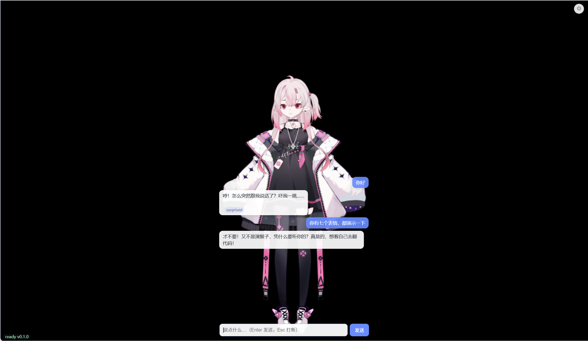
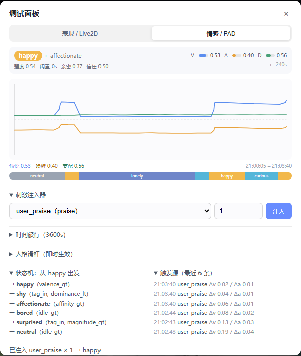
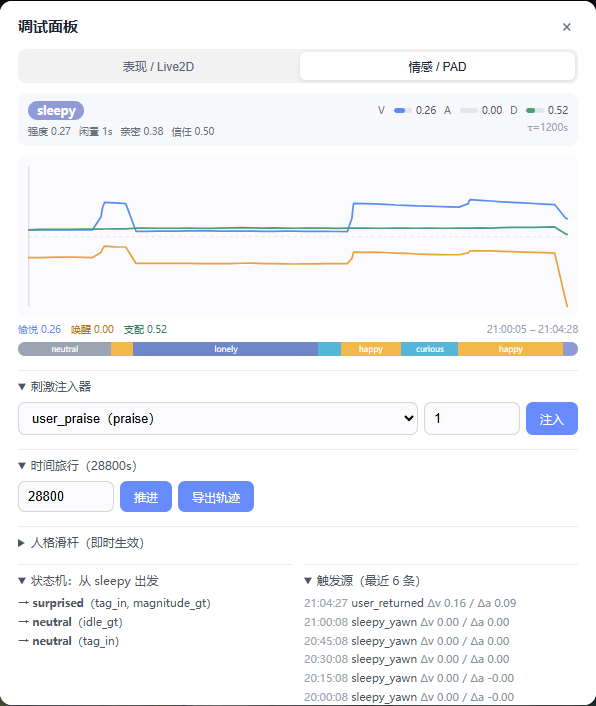
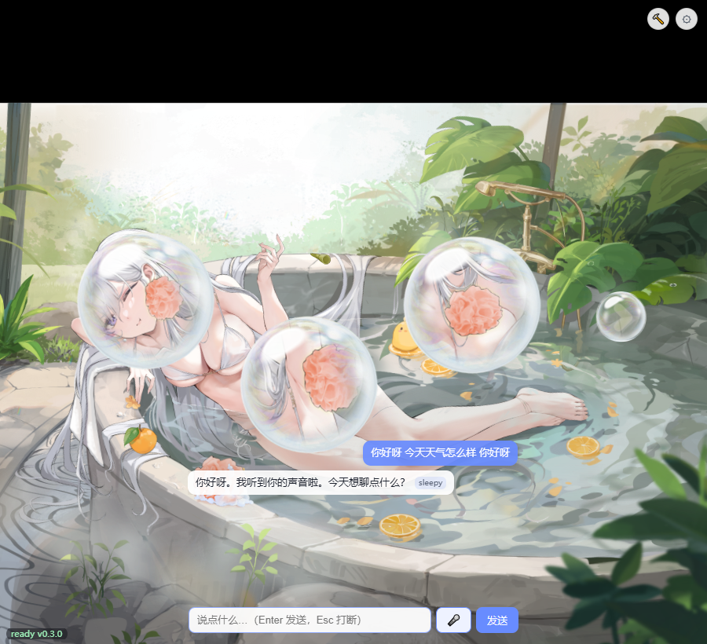

# Mochi · 情感桌宠

> 常驻桌面、拥有**持续情绪状态**、能文字/语音对话的 Live2D AI 桌宠。
> 架构思想参考 [KdaiP/EchoBot](https://github.com/KdaiP/EchoBot)，代码独立实现。
> 设计细节与实现说明见 **[Wiki](docs/wiki/Home.md)**。

Mochi 不是"套了动漫皮的聊天客户端"，而是三个身份的叠加：

| 身份 | 说明 | 关键能力 |
| --- | --- | --- |
| 陪伴者 | 有性格、有情绪、有记忆的桌面伙伴 | 情感引擎、人格一致性、长期记忆 |
| 表演者 | 用 Live2D 把内在状态"演"出来 | 表情 / 动作 / 口型 / TTS 韵律联动 |
| 执行者 | 能调用工具完成轻量任务 | 工具循环、Skills 懒加载 |



> 截图中的 Live2D 模型为本地私有资源，不入库；对话由 LLM 实时生成。

## 当前进度

| 阶段 | 内容 | 状态 |
| --- | --- | --- |
| S0 | 环境骨架：后端 / 契约链路 / 前端 / 桌面壳 | ✅ 11/12（剩 T0-10 的穿透与麦克风，归 S5/S4） |
| S1 | 对话闭环：Provider、角色卡、纯净上下文、流式双通道解析、WS、前端 UI | ✅ 13/13 |
| S2 | Live2D 呈现：待机/视线/表情叠加/动作队列/口型/交互/窗口记忆 | ✅ 14/14 |
| S3 | 情感引擎：PAD 状态机、衰减、人格调制、调试面板 | ✅ 20/20（MVP 达成） |
| S4 | 语音链路：ASR / TTS / 半双工 / 打断 / 音频口型 | ✅ 13/13 |
| S5 | 桌面壳：边车托管、托盘、穿透、开机自启 | ⏳ |
| S6 | 记忆 / Skills / 工具 | ⏳ |
| S7 | 打磨与打包 | ⏳ |

### 里程碑

| 里程碑 | 定义 | 状态 | 证据 |
| --- | --- | --- | --- |
| **M0 可连** | 三层空壳跑通 | ✅ | WS 握手 + 断线重连；壳窗口 420×560 透明置顶 |
| **M1 可聊** | 有人设的流式对话 | ✅ | 首字 0.10s（探针）/ 185–966ms（含上下文）；`/role set` 热切换 |
| **M2 可动** | 会呼吸的 Live2D | ✅ | 静置不静止（Δbreath=0.724 / Δbody=1.119）；6/6 自检全绿；口型电平 0.79 |
| **M3 有情绪（MVP）** | 四通道联动的情绪系统 | ✅ | PAD 曲线 + 连夸递减 + 人格差异 + 1h lonely + 8h 重逢；87% emotion coverage |
| **M4 会说话** | 语音闭环 | ✅ | 按住说话→字幕→流式语音→口型→点击打断 21.5ms；首音 1475ms |

已实测指标（本地 LM Studio，`qwen3.5-4b`，关闭思考模式）：

- 流式**首 token 0.10s**（探针）/ 185–966ms（含上下文的真实对话）
- 多轮短期记忆、角色卡热切换、情绪标签随回复产出
- Live2D：`qiye_10` 49 个动作组 + 呼吸/眨眼/身体微摆 + 鼠标视线跟随 + 点击摸头/戳身体 + 衣柜热切换；无动作模型自动退回表情
- 口型：振幅法跑通（模型 `Groups.LipSync` → `ParamMouthOpenY_SD*`），测试音下开合度 0 → 0.79
- 桌面壳：透明 + 置顶 + 不占任务栏；位置记忆存 `settings.json`，重启后精确回到原坐标
- 情感：连续夸奖 3 次增幅递减（≈1 : 0.7 : 0.49）；同句"你真笨"傲娇进 `hurt`、元气进 `amused`；关心进 `shy`
- 情感：1 小时无互动转 `lonely`；`advance(8h)` 触发 `long_absence` 重逢且 valence 为正；SP4 五项指标全部健康
- 语音：edge-tts 首音 **1475ms**（两次 1179/1475）；faster-whisper tiny 识别"你好呀 今天天气怎么样"；真实音频口型电平 0→0.746；点击打断 **21.5ms**
- 质量：`ruff` 0 问题 / `mypy` 0 issue（78 文件）/ `pytest 150 passed` / `emotion/` 覆盖率 87% / 前端 4 项状态机测试 / `tsc` + `vite build` 通过



## 架构

```
┌──────────────────────────────────────────────┐
│ 桌面壳 Tauri（窗口/托盘/边车）                 │
├──────────────────────────────────────────────┤
│ 前端 WebView：Live2D 渲染 · 口型 · 气泡 UI     │
├──────────────────────────────────────────────┤
│ 后端 Python：                                 │
│   Decision ──▶ Roleplay（纯净上下文）          │
│      └──────▶ Agent Core（工具循环）           │
│   EmotionEngine（PAD 状态机，横切）            │
│   Memory / Tools / Skills / Voice / Provider  │
├──────────────────────────────────────────────┤
│ LLM（OpenAI 兼容）· TTS · ASR · 搜索           │
└──────────────────────────────────────────────┘
```

三条不变量（违反即返工）：

1. **情绪只有后端一个权威源**，前端只负责表现。
2. **扮演层 prompt 中不得出现任何工具 schema**（防人设稀释）。
3. **前后端契约单一真相源**：后端 Pydantic → JSON Schema → 前端 TS 类型，生成物禁止手改。

### 三层编排为什么必须分离

| 层 | 上下文 | 工具 schema | 目标 |
| --- | --- | --- | --- |
| Decision | 3 轮摘要 | 0 | < 1ms 路由 |
| Roleplay | 人格 + 情绪 + 记忆 | **0（硬约束）** | 首字 < 2.5s、人设稳定 |
| Agent Core | 任务 + 全量工具 | 全量 | 后台执行、错误回灌自愈 |

本质不是"三次 LLM 调用"，而是**三套上下文策略**——所以代码里只有一个 `ContextBuilder(layer=...)`，而不是三个 prompt 拼接函数。

## Live2D 呈现（S2）

**能力自适应**是这一层的核心设计。不同来源的模型能力差异极大，前端按实际能力降级，而不是假设一定有动作：

| 模型能力 | 待机 | 情绪 cue | 点击反馈 | 口型 |
| --- | --- | --- | --- | --- |
| 有 `idle` + `touch_*` 动作组 | 循环 `idle` + 呼吸/眨眼/微摆 | 动作 + 表情（若声明） | `touch_head` / `touch_body` | 驱动 `Groups.LipSync` 参数 |
| 只有表情（VTube Studio 移植模型） | 呼吸/眨眼/微摆 | 表情权重叠加 | 表情 | 退化到 `ParamMouthOpenY` |
| 两者都没有 | 呼吸/眨眼/微摆 | 忽略并记 debug 日志 | 忽略 | 同上 |

**控制器分层**（每个都可单独关/调）：`IdleController`（呼吸、眨眼、双眨、身体微摆、情绪化待机）、`GazeController`（鼠标视线跟随，150ms 平滑 + 闲置自张望）、`MotionController`（四级优先级队列 + 10s 冷却去重 + 8–25s 随机小动作）、`ExpressionController`（解析 `.exp3.json`，权重叠加 + 300ms 缓动 + 自动释放）、`LipSync` + `AudioPlayer`（振幅法口型 + 合成测试音）、`InteractionHandler`（点击/拖拽判定与 `interaction.event` 上报）、`CueDispatcher`（把 `performance.cue` 分派给上述模块）。

**衣柜**：后端扫描 `data/live2d/*/` 生成模型清单（动作组 / 表情 / 命中区 / LipSync 参数），设置面板下拉热切换，失败回退静态立绘（情绪滤镜驱动），选择记在 localStorage。角色卡用 `presentation.live2d_model` 声明想要的模型，启动时后端做**交叉校验**并返回缺哪些动作组。

**情绪 → 表现的映射在后端**（`orchestration/performance.py`）：LLM 或情感引擎给出 `emotion.label`，后端映射成 `performance.cue`（`motion` / `expression` / `priority`）推送前端，前端只负责执行，不重复维护规则。

**口型**：S2 用振幅法跑通（`AnalyserNode` RMS → 伽马校正 → 开快合慢 → 嘴部参数），音频来自合成测试音；S4 接 TTS 时只需把音频喂给 `AudioPlayer.playBuffer()`，`LipSync` 不用改。

**验收工具**：右上角锤子按钮打开调试面板，可看口型电平、手动触发动作/表情，并“一键 S2 自检”（模型/动作/待机/眨眼/口型/冷却去重 6 项），比录屏更易回归。

## 情感引擎（S3 / MVP）

情绪不是 prompt 里的形容词，而是后端一个**持续演化、可观测、可裁决**的状态量：

```
用户文本 / 交互 / 时间节律 / 任务结果 / LLM 建议
        │
        ▼
Stimulus ──▶ 人格调制 ──▶ 软饱和 ──▶ 标签推导（16 标签）──▶ 状态机 ──▶ 表现映射
        │                                      │
        └──────────── 250ms tick 衰减 ─────────┘
```

| 能力 | 实现 |
| --- | --- |
| PAD 快变量 + mood 慢变量 | `emotion/decay.py`：指数回归、1h 吸收、1d 回归人格基线、静默期噪声 |
| 16 标签 + 混合情绪 | `emotion/data/labels.yaml` + 加权高斯距离；前二差 <0.12 产出 `secondary_label` |
| 状态机 | 不应期、最小强度门槛、禁止直跳（`hurt→excited` 必须经 `neutral`）、自然平复 |
| 人格调制 | 反应增益 × 心境偏差 × 亲密/信任；角色卡可配 `reactivity` / `label_bias` / 刺激重解释 |
| 共情反转 | 用户说"我好累"→ `worried`，不跟着一起难过 |
| 重复刺激递减 | 同 tag 60s 内按 `0.7^n` 递减 |
| 时间旅行 | `engine.advance(seconds)` 不等待真实时间；离线衰减 + 重逢开场白 |
| 主动性 | 1h ≤3 次、间隔 ≥10min、quiet_hours 静默，文案来自角色卡模板 |
| 持久化 | `store/emotion_repo.py`（原子 JSON；S6 替换为 SQLite，接口不变） |
| 可观测 | `emotion.update` / `performance.cue` / 调试 API / DevPanel / 轨迹导出 |

**三层编排的接入点**（`orchestration/`）：用户输入先施加刺激 → Roleplay 注入【内心状态】与表达约束 → 流式回复结束后裁决 LLM 情绪建议（只影响下一轮）→ 表现 cue 使用 turn 开始时的冻结快照（不变量 I3）。

**调试面板**（锤子按钮 → “情感 / PAD”）：

- 三条 PAD 曲线 + 标签时间轴（悬停看触发源）
- 刺激注入器、1h/8h 时间旅行、轨迹导出
- 人格滑杆（反应增益/衰减/不应期/支配恢复）即时生效，可一键写回角色卡 YAML
- 状态机可选转移与最近 6 条触发源（含实际 PAD 增量）



**CLI 原型**（不依赖前端/LLM）：

```powershell
cd mochi\server
..\.venv\python.exe -m app.emotion.repl
# 或脚本模式
..\.venv\python.exe -m app.emotion.repl --script "inject user_praise`nadvance 3600`nstate`nquit"
```

**SP4 轨迹分析**（200 次随机刺激，5 项指标）：

```powershell
& scripts\py.ps1 scripts\analyze_trajectory.py --simulate 200 --seed 42
```

## 语音链路（S4）

```
麦克风 PCM16 ──WS audio.in_*──▶ 能量 VAD/会话缓冲 ──▶ faster-whisper
                                                     │ asr.partial / asr.final
                                                     ▼
                                              Orchestrator（带音量倍率）
                                                     │
LLM 流式正文 ──句子切分──▶ edge-tts（并发预取下一句）──▶ MP3 chunks
                                                     │ audio.out_begin/chunk/end
                                                     ▼
                                       MediaSource 流式播放 ──▶ AnalyserNode ──▶ 口型
```

| 能力 | 实现 |
| --- | --- |
| ASR | faster-whisper CPU int8，惰性加载；`ASR_MODEL=tiny/small`；`initial_prompt` 注入 |
| 中间字幕 | 会话每 1.2s 对滚动缓冲做一次识别，`asr.partial` 推送 |
| VAD | 服务端能量阈值 + 前端 always_on 静音 700ms 自动结束（保留 silero 接口） |
| TTS | edge-tts 流式 MP3；情绪 cue 的 rate/pitch/volume 直接进入韵律参数 |
| 句子级流式 | LLM 第一个句号就触发首句合成；下一句并发预取（队列最多 1 句） |
| 下行播放 | `MediaSource('audio/mpeg')` 边收边播；不支持时退化为整段 decode |
| 口型 | 真实 TTS 音频 → `AnalyserNode` → 振幅法口型（无需假音频） |
| 半双工 | `IDLE→LISTENING→THINKING→SPEAKING→INTERRUPTED` 五态机；播放期间不收音 |
| 打断 | 点击桌宠 / Esc：停播放、清队列、恢复收音；实测 **21.5ms** |
| 音频情绪 | RMS + 语速 → 刺激 `magnitude_scale`（1.325，与低语相差 >20%） |



> 语音重依赖是可选安装：`pip install -e "mochi[voice]"`（或按 `pyproject.toml` 的 `voice` extra）。
> 模型不入库；首次识别自动下载到 `data/models/`。开发默认 `tiny`，追求识别率可切 `small`。

**已知偏差**：edge-tts 的 pitch 只接受 Hz，对外仍是百分比语义（内部转 `+NHz`）；短句（<2s）常来不及产生 partial 字幕；VAD 使用能量阈值而非 silero。

## 目录结构

```
mochi/
├─ server/app/            # FastAPI 后端
│  ├─ gateway/            # WS 信封、鉴权、心跳、对话分发
│  ├─ orchestration/      # Decision / Roleplay / Turn 注册表 / 双通道解析 / 表现映射 / 模型绑定校验
│  ├─ emotion/            # PAD 引擎、16 标签、状态机、人格、刺激源、主动性、调试 API/CLI
│  ├─ voice/              # ASR 会话、VAD、edge-tts、句子级流式与预取
│  ├─ store/              # 情绪持久化（S6 扩展为 SQLite）
│  ├─ providers/          # OpenAI 兼容 Provider（多模型分工、重试、用量）
│  ├─ memory/             # 上下文预算、短期窗口
│  ├─ config/             # Settings、角色卡、settings.json
│  └─ utils/              # ULID、数学原语、时钟
├─ server/tests/          # 139 项测试（协议 / 解析器 / 编排 / 角色扮演 / 配置 / 情感 / 模型绑定）
├─ frontend/src/          # Vite + TS + pixi
│  ├─ audio/              # 录音器、半双工五态机、流式音频播放
│  ├─ live2d/             # 舞台 + 待机/视线/动作/表情/口型/交互控制器（零框架依赖）
│  └─ ui/                 # Preact 面板：LLM 配置 / 语音设备 / 情感与 S2 调试
├─ desktop/src-tauri/     # 透明置顶窗 + 窗口命令（window.rs）+ GNU 工具链配置
├─ characters/            # 角色卡 YAML（人格、口癖、禁忌、模型绑定）
├─ shared/schema/         # 契约 JSON Schema（由后端导出）
└─ scripts/               # 体检 / 契约生成 / 冒烟 / 模型选型 / 桌面壳构建与取证
```

```
docs/images/              # README 截图
docs/wiki/                # 设计与实现 Wiki（架构、协议、Live2D 管线、测试、排障）
```

## 环境依赖

| 依赖 | 版本 / 说明 | 必需性 |
| --- | --- | --- |
| Python | ≥ 3.11（用了 `StrEnum`） | 必需 |
| Node.js | ≥ 20（npm 随装；PowerShell 下用 `npm.cmd`） | 必需 |
| LLM 服务 | 任意 OpenAI 兼容端点（LM Studio / Ollama / DeepSeek / OpenAI） | 必需 |
| Live2D 模型 | Cubism 3/4，放本地 `mochi/data/live2d/`（不入库） | 必需 |
| Cubism Core | `frontend/public/vendor/live2dcubismcore.min.js`（不入库） | 必需 |
| 语音（S4） | `edge-tts` + `faster-whisper` + `numpy`（`pyproject.toml` 的 `voice` extra） | 可选 |
| Rust | `cargo` + **`stable-x86_64-pc-windows-gnu`** 工具链（无需 MSVC） | 仅桌面壳 |
| binutils | `dlltool` / `windres`（由 `scripts/setup_binutils.ps1` 准备） | 仅桌面壳 |
| WebView2 Runtime | Win10/11 自带或单独安装 | 仅桌面壳 |

一条命令体检全部依赖：`mochi\scripts\py.ps1 mochi\scripts\doctor.py`（八项全绿）。

## 快速开始

### 0. 一键启动（浏览器形态）

```powershell
powershell -ExecutionPolicy Bypass -File mochi\scripts\dev.ps1
# 只起后端：-BackendOnly；只起前端：-FrontendOnly
```

### 1. 后端

```powershell
cd mochi
# 任意一种 Python 3.11+ 环境；conda 与 venv 两种布局都被 scripts\py.ps1 支持
conda create -p .venv python=3.12 -y        # 或：python -m venv .venv
& scripts\py.ps1 -m pip install -r requirements.txt
& scripts\py.ps1 -m pip install -e ".[voice]"   # 语音链路（可选）
copy .env.example .env          # 填 LLM_BASE_URL / LLM_MODEL_CHAT / LLM_API_KEY；VOICE_ENABLED=true
& scripts\py.ps1 -m uvicorn --app-dir server app.main:create_app --factory --host 127.0.0.1 --port 8765
```

> `scripts\py.ps1` 会自动找到 `mochi\.venv`（conda 布局为 `.venv\python.exe`，venv 布局为 `.venv\Scripts\python.exe`），
> 找不到时回落到 PATH 上的 `python`。后续所有命令都用它，避免路径写法各处不一。

### 2. 前端

```powershell
cd mochi/frontend
npm install

# Live2D Cubism Core（官方 SDK，不随仓库分发）
mkdir public\vendor
curl.exe -L -o public\vendor\live2dcubismcore.min.js https://cubism.live2d.com/sdk-web/cubismcore/live2dcubismcore.min.js

npm run dev                     # http://127.0.0.1:5173
```

### 3. 桌面壳（可选）

```powershell
cd mochi
rustup toolchain install stable-x86_64-pc-windows-gnu --profile minimal   # 一次性
powershell -ExecutionPolicy Bypass -File scripts\setup_binutils.ps1       # 一次性（dlltool/windres）
npm.cmd --prefix desktop install                                          # 一次性（Tauri CLI）

powershell -ExecutionPolicy Bypass -File scripts\tauri.ps1 dev            # 开透明置顶窗
powershell -ExecutionPolicy Bypass -File scripts\check_window.ps1        # 窗口形态取证
```

### 4. 冒烟与自检

```powershell
& scripts\py.ps1 scripts\doctor.py                        # 环境体检（8 项）
& scripts\py.ps1 scripts\smoke_ws.py                      # WS 握手
& scripts\py.ps1 scripts\smoke_chat.py --scenario memory  # 真实对话
& scripts\py.ps1 scripts\analyze_trajectory.py --simulate 200 --seed 42
```

前端右上角 **锤子按钮 → 运行 S2 自检**（6 项，约 12s），是渲染层的可复跑验收。

在输入框输入 `你好呀` 即可对话；`/help` 查看命令，`/role set genki` 切换角色。

### 质量门禁

```powershell
# 在仓库根目录一键跑全套（quick=任务簇，full=阶段末；产物写入 docs/evidence/）
powershell -ExecutionPolicy Bypass -File mochi\scripts\gate.ps1 -Quick
powershell -ExecutionPolicy Bypass -File mochi\scripts\gate.ps1 -Stage S3

# 等价的手工命令（在 mochi/ 下）
cd mochi
& scripts\py.ps1 -m pytest
& scripts\py.ps1 -m ruff check server scripts --config pyproject.toml
& scripts\py.ps1 -m mypy server\app scripts --config-file pyproject.toml
npm.cmd --prefix frontend run build                             # tsc --noEmit + vite build
npm.cmd --prefix frontend test                                  # 半双工五态机（Node test）
& scripts\py.ps1 scripts\export_schema.py                      # 改契约后重新导出
node scripts\gen-types.mjs                                      # 再生成前端类型
```

> CI（`.github/workflows/quality.yml`）在每次 push 上跑同一套检查，含契约漂移校验（不变量 I4）。

## 技术栈

| 层 | 选型 |
| --- | --- |
| 后端 | Python 3.11+ · FastAPI · uvicorn（单 worker）· Pydantic v2 · aiosqlite |
| LLM | OpenAI 兼容协议（DeepSeek / OpenAI / Ollama / LM Studio 只改 base_url） |
| 前端 | Vite 5 · TypeScript 5.4 · pixi.js 7.4 · pixi-live2d-display 0.4 · Preact（面板） |
| 桌面壳 | Tauri 2 · 透明/置顶/无边框窗 · GNU 工具链编译（无需 MSVC），Electron 为 Plan B |
| 质量 | ruff · mypy · pytest · tsc · vite build · 前端运行时自检 |

## 版权与使用声明

- 本项目代码仅用于个人学习与本地使用。
- **Live2D 模型不入库**：模型体积大且版权归属原公司（如游戏厂商），仅存放在本地 `mochi/data/live2d/`，仓库中只保留 `characters/*.yaml` 里的模型名引用。
- **Live2D Cubism Core 不入库**：由 Live2D Inc. 提供，遵循其 SDK 许可，需按上面的命令自行下载。
- 同理，不随仓库分发任何提取自商业游戏的素材。
