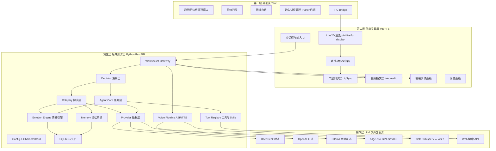
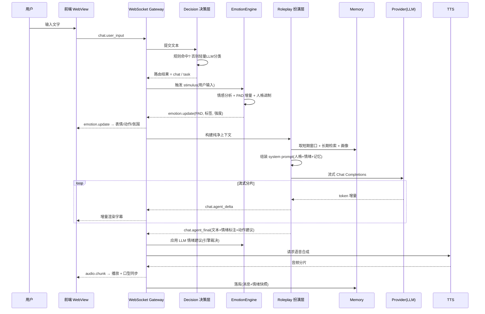
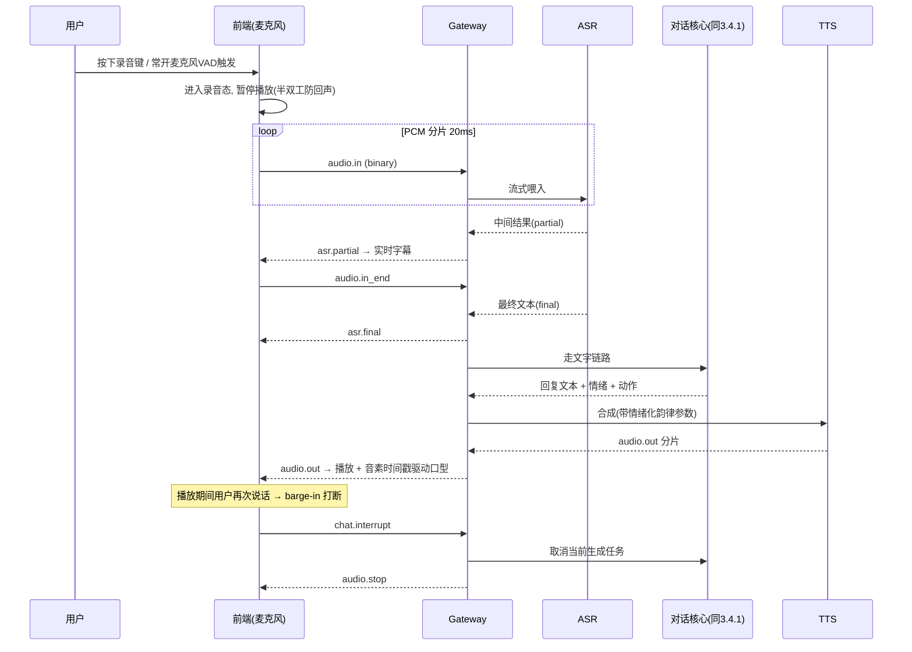
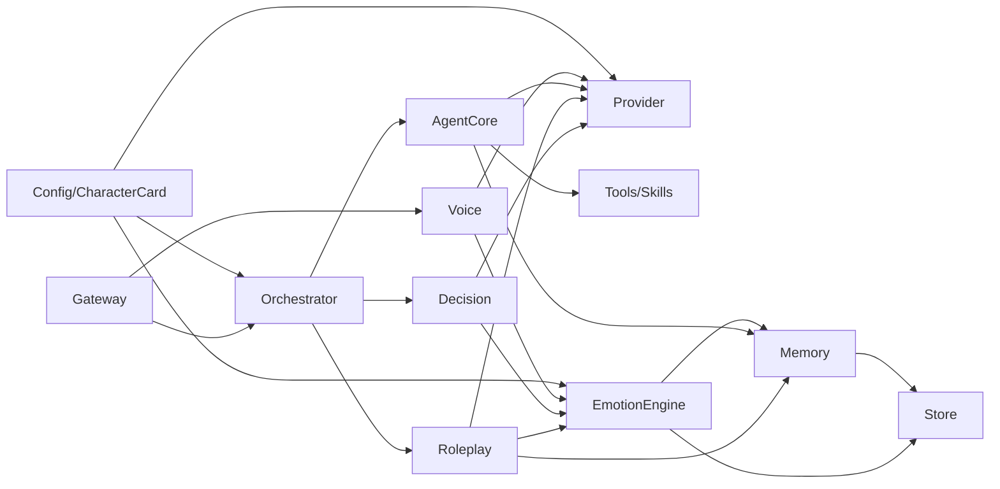
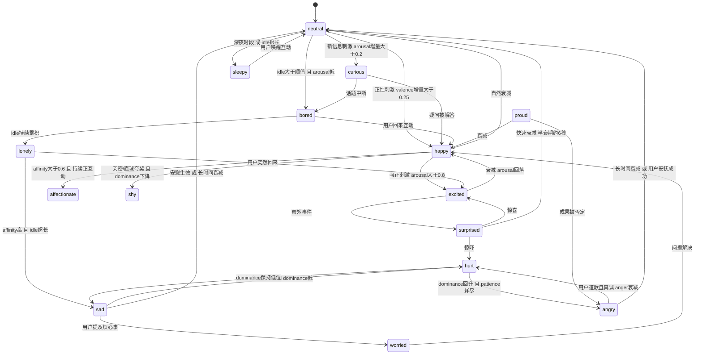
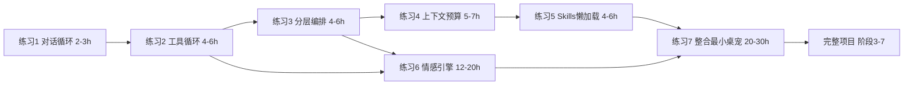

# 情感桌宠 Agent 项目计划书

> 项目代号：**Mochi**（暂定名，寓意"软糯、有温度、会闹小脾气的桌面伙伴"）
> 文档版本：v1.0
> 文档性质：立项计划书 + 架构设计说明书 + Agent 开发学习资料
> 参考项目：[KdaiP/EchoBot](https://github.com/KdaiP/EchoBot)（**只参考、不复用代码**）

---

## 目录

- [1. 项目概述与目标](#1-项目概述与目标)
- [2. EchoBot 参考分析（调研浓缩）](#2-echobot-参考分析调研浓缩)
- [3. 总体架构设计](#3-总体架构设计)
- [4. 技术选型](#4-技术选型)
- [5. 核心模块设计](#5-核心模块设计)
- [6. 数据契约](#6-数据契约)
- [7. 开发路线图](#7-开发路线图)
- [8. Agent 搭建学习指南](#8-agent-搭建学习指南)
- [9. 风险、难点与应对](#9-风险难点与应对)
- [10. 项目目录结构蓝图](#10-项目目录结构蓝图)
- [11. 附录](#11-附录)

---

## 1. 项目概述与目标

### 1.1 项目定位

**一句话定位**：一个常驻桌面、透明悬浮、拥有**持续演化的情绪状态**、可以通过文字与语音进行自然对话的 Live2D AI 桌宠 Agent。

它不是"套了个动漫皮的 ChatGPT 客户端"，而是三个身份的叠加：

| 身份 | 说明 | 关键能力 |
| --- | --- | --- |
| **陪伴者** | 有性格、有情绪、有记忆的桌面伙伴 | 情感引擎、人格一致性、长期记忆 |
| **表演者** | 用 Live2D 形象把内在状态"演"出来 | 表情/动作/口型/语气/TTS 韵律联动 |
| **执行者** | 能调用工具替用户完成轻量任务 | 工具循环、Skills 懒加载、内置工具 |

### 1.2 核心目标

本项目有**两条并行的目标线**，二者同等重要：

#### 目标线 A：产品目标 —— 自建一个情感桌宠

1. **A1 桌面常驻**：透明无边框、始终置顶、可拖拽、可最小化到系统托盘的悬浮窗，关机重启后自动恢复。
2. **A2 情感真实**：桌宠的情绪**不是每次对话临时编出来的**，而是一个有内部状态、会随时间衰减、会被多种事件驱动、受人格基线调制的**持续系统**。用户能明显感觉到"它今天心情不好"和"它刚才被夸了很开心"的区别。
3. **A3 表现联动**：情绪状态必须**同时**驱动四个通道 —— Live2D 表情、Live2D 动作、文本语气（语气词/句式/标点）、TTS 韵律（语速/音调/音量），做到"内外一致"。
4. **A4 对话自然**：文字与语音双通道，首字延迟 ≤ 2.5s（云端 LLM），语音回复可流式播放、可被打断。
5. **A5 人格可换**：通过"角色卡"配置文件切换人格（含情绪基线、反应增益、口头禅、Live2D 模型绑定），不改代码。
6. **A6 有记忆**：记住用户的称呼、偏好、近期事件，跨会话不"失忆"。

#### 目标线 B：学习目标 —— 吃透 Agent 的搭建方式

1. **B1 理解 Agent 五要素**：LLM、上下文工程、工具调用循环、记忆系统、编排层，能各自讲清"解决什么问题、不这么做会怎样"。
2. **B2 掌握分层编排**：亲手实现 EchoBot 式的 Decision / Roleplay / Agent 三层分离，理解"人设稀释"与"Token 膨胀"两大痛点。
3. **B3 掌握工具协议**：实现一套 OpenAI Function Calling 兼容的工具注册、参数校验、执行、结果回灌循环。
4. **B4 掌握懒加载思想**：实现 Skills 的 `activate / list / read` 三工具模式，把"上下文成本"从常量降为按需。
5. **B5 掌握上下文与记忆管理**：实现滑动窗口 + 摘要压缩 + 向量检索三件套。
6. **B6 掌握 Provider 抽象**：用一套代码无缝切换 DeepSeek / OpenAI / Ollama。

### 1.3 与 EchoBot 的关系

| 维度 | 态度 |
| --- | --- |
| 代码 | **不 fork、不复制、不引入其源码或依赖** |
| 架构思想 | **重点学习并借鉴**：三层编排、Skills 懒加载三工具、上下文/记忆分层、OpenAI 兼容 Provider 抽象 |
| 补齐缺口 | EchoBot 是**浏览器端 Live2D**，没有原生桌面壳 → 本项目自建 Tauri 壳<br>EchoBot **没有情绪状态机**，只有静态角色卡 → 本项目自建情感引擎 |
| 差异化 | 本项目的核心竞争力就在两个缺口上：**"真情绪" + "真桌宠"** |

> 学习方式的自我约束：阅读 EchoBot 源码时，先合上代码自己设计一版，再对照它的实现，记录"它比我多想到的点"。这样学到的是**判断力**而不是**代码**。

### 1.4 预期成果（可验收）

| 编号 | 成果 | 验收方式 |
| --- | --- | --- |
| D1 | 可运行的桌面悬浮窗应用（Windows 优先） | 双击启动，桌宠出现在桌面右下角，可拖拽、可托盘 |
| D2 | 文字 + 语音双通道对话闭环 | 说话/打字均有符合人设的回复，Live2D 口型同步 |
| D3 | 情感引擎（含调试面板） | 可视化看到 PAD 三维曲线随交互变化，情绪自然衰减 |
| D4 | ≥ 3 张角色卡 | 切换角色卡后人设、情绪基线、模型、语音全部同步变化 |
| D5 | ≥ 5 个内置工具 + ≥ 3 个 Skill 包 | 能查时间、能记事、能搜网页；Skill 按需加载不占常驻上下文 |
| D6 | 长期记忆 | 关掉程序重开，仍记得昨天聊过的话题与用户偏好 |
| D7 | 完整文档与安装包 | README、架构文档、`msi/nsis` 安装包 |

### 1.5 非目标（明确不做，防止范围蔓延）

- ❌ 不做多用户 / 云端账号体系（单机单用户）
- ❌ 不做 QQ / Telegram 等 IM 平台接入（EchoBot 有，本项目 MVP 不做）
- ❌ 不做复杂的 Agent 生产力任务（写代码、爬取、文件批处理）—— 只保留轻量工具
- ❌ 不自研 LLM、不自研 Live2D 渲染引擎、不自研 Cubism 模型
- ❌ 不做移动端

### 1.6 名词表

| 术语 | 含义 |
| --- | --- |
| **Agent** | 以 LLM 为推理核心，能感知上下文、决策调用工具、并把结果回灌再推理的程序系统 |
| **PAD** | Pleasure–Arousal–Dominance，情感的三维度量空间（本项目取 valence–arousal 二维为主，dominance 为辅） |
| **Valence（效价）** | 情绪的愉悦程度，[-1, 1]，负=不愉快，正=愉快 |
| **Arousal（唤醒度）** | 情绪的激烈/兴奋程度，[0, 1]，低=平静困倦，高=激动亢奋 |
| **Dominance（支配度）** | 对局面的掌控感，[0, 1]，低=委屈顺从，高=自信强势 |
| **Mood（心境）** | 长时间尺度（小时~天）的情绪底色，变化慢 |
| **Emotion（情绪）** | 短时间尺度（秒~分钟）的即时反应，变化快 |
| **人格基线** | 角色卡定义的"性格参数"，决定情绪反应的增益、衰减速率与回归中心 |
| **角色卡** | 一份 YAML/JSON 配置，定义人格、说话风格、情绪参数、绑定的 Live2D 模型与语音 |
| **Skill** | 一个可被懒加载的"能力包"，含说明文档 + 参考资料 + 可选脚本 |
| **口型同步（Lip-sync）** | 由音频信号实时推导出嘴部开合度并驱动 Live2D 参数 |

---

## 2. EchoBot 参考分析（调研浓缩）

### 2.1 项目概览

EchoBot 是一款开源的"二次元 AI 小助手"，核心特性：

- 🎭 **沉浸式 Live2D 交互**：网页端 Live2D 渲染 + 实时语音对话
- 🧠 **决策–扮演–执行 三层架构**：彻底隔离"角色扮演"与"工具调用"
- 🛠️ **硬核生产力**：本地文件读写、定时/周期任务、Skills、长期记忆
- 🌐 **多平台接入**：开箱即用 WebUI + QQ + Telegram
- 技术栈：Python 3.11+ / FastAPI / OpenAI 兼容 LLM / sherpa-onnx ASR / edge-tts & kokoro TTS
- 启动方式：`pip install -r requirements.txt` → 配置 `.env` → `python -m echobot app` → 浏览器访问 `http://127.0.0.1:8000/web`
- 运行期数据落在项目下的 `.echobot/` 目录（`live2d/`、`cron/jobs.json`、`HEARTBEAT.md`、`channels.json` 等）

### 2.2 三层编排架构（最值得学习的部分）

EchoBot 官方文档明确指出了它要解决的痛点：

> 常见的 AI Agent 由于需要载入庞大的工具列表和技能系统，天然耗费 Token 且响应缓慢。如果将角色设定与任务指令混杂，不仅容易导致"人设稀释"，还会严重拖累执行效率。

它的解法是三层分离：

```
用户输入
   │
   ▼
┌──────────────────────────────────────────────┐
│ 1. Decision Layer（决策层）                   │
│    · 混合意图识别：规则 + 轻量 LLM 双引擎      │
│    · 明确指令 → 直接命中规则，跳过大模型       │
│    · 模糊意图 → 交给轻量 LLM 做分类            │
│    · 输出：闲聊 / 后台任务 / 命令              │
└──────────────────────────────────────────────┘
   │                          │
   │ 闲聊                      │ 复杂任务（双线并发）
   ▼                          ▼
┌──────────────────┐   ┌───────────────────────────────┐
│ 2. Roleplay Layer │   │ 3. Agent Core（后台任务层）    │
│  · 纯净上下文      │   │  · 完整 Agent 能力             │
│  · 剥离 Tool-use / │   │  · 工具链 Tools               │
│    Skills 元数据   │   │  · 技能库 Skills（懒加载）     │
│  · 情境感知话术    │   │  · 长短期记忆 Memory           │
│  · 极速、不 OOC    │   │  · 系统级权限（文件/OS）       │
└──────────────────┘   │  · 异步执行，完成后回传         │
                       └───────────────────────────────┘
```

**工作流示例（官方 README）**：

- 情景 A（日常闲聊）："早上好呀！" → Decision 判定为闲聊 → Roleplay 直接回："早安，今天也要元气满满喵~"
- 情景 B（复杂任务）："帮我用 Python 写一个爬虫脚本" → Decision 规则命中 → **双线操作**：Roleplay 立刻秒回"收到！本喵这就帮你写一个爬虫喵~"，Agent Core 后台静默执行（搜索 → 写代码 → 测试 → 回传），完成后由 Roleplay 层用人设语气汇报结果。

**为什么这个设计高明（学习要点）**：

| 设计点 | 解决的问题 | 迁移到本项目的做法 |
| --- | --- | --- |
| 决策层前置 | 闲聊也要付"全量工具 schema"的 Token 成本 | 本项目闲聊占比 90%+，收益更大 |
| 规则 + LLM 双引擎 | 纯 LLM 分类慢且贵 | 明确前缀/正则先命中，兜底才调小模型 |
| Roleplay 上下文纯净 | 工具描述污染人设，导致 OOC | 扮演层的 system prompt 只含人格 + 情绪 + 记忆摘要 |
| 任务与回复解耦（ack 机制） | 长任务让用户干等 | `delegated_ack_enabled` 思路：先回"我去做了"，再回结果 |
| 路由模式可手动覆盖 | 意图识别会误判 | 提供 `auto / chat_only / force_agent` 三档 |

EchoBot 的 `/route`、`/runtime`、`/role`、Session 管理等终端指令体系，也说明它把"运行时可调"当成一等公民 —— 这一点本项目会照做（配置热更新 + 情绪调试面板）。

### 2.3 Skills 懒加载三工具

EchoBot 的 Skills 系统不是把所有技能说明塞进 prompt，而是暴露**三个元工具**给 LLM：

| 工具 | 作用 | 上下文成本 |
| --- | --- | --- |
| `skill_list` | 列出所有可用 Skill 的**名称 + 一句话描述** | 极低（常驻） |
| `skill_activate` | 激活某个 Skill，把它的正文说明注入上下文 | 按需 |
| `skill_read` | 读取 Skill 目录下的参考资料文件 | 按需、可分页 |

**核心洞察**：把"能力目录"和"能力详情"分离 —— 目录常驻（几十 Token），详情按需加载（几百~几千 Token）。10 个 Skill 从"常驻 10×800 Token"变成"常驻 10×20 Token + 命中时 800 Token"。

本项目**完整借鉴**这一模式，并在 5.4 节给出具体的三工具 schema 设计。

### 2.4 上下文与记忆管理

EchoBot 的记忆体系分为：

- **短期**：当前会话的对话窗口（滑动 + 截断）
- **长期**：跨会话的持久记忆（`memory/support.py` 相关支持模块），配合摘要
- **会话管理**：`/new` `/ls` `/switch` `/rename` `/delete` `/current` 多会话隔离
- **周期性心跳**：`Heartbeat` 默认每 30 分钟触发一次（`ECHOBOT_HEARTBEAT_INTERVAL_SECONDS` 可调），配合 `.echobot/HEARTBEAT.md` 定义的周期任务 —— 这是"让 Agent 主动做事"的极简实现

**Heartbeat 的启发（重要）**：桌宠不能只在被戳时才动。一个低频定时器就能实现"它自己会发呆、会主动搭话、会因长时间不理它而失落"。本项目把它升级为**情绪 tick**（见 5.2.5e）+ **主动性触发器**（见 5.2.6e）。

### 2.5 LLM Provider 抽象

- 统一走 **OpenAI 兼容协议**（`providers/openai_compatible.py`），配置只需三项：
  ```env
  LLM_API_KEY=your_api_key_here
  LLM_MODEL=deepseek-chat
  LLM_BASE_URL=https://api.deepseek.com/v1
  ```
- 能力开关式降级：`ECHOBOT_LLM_SUPPORTS_IMAGE_INPUT=false` 可关闭视觉输入，避免模型不支持时误操作
- 语音也走同一套抽象：TTS 支持 OpenAI Speech API 兼容服务，ASR 支持 OpenAI Transcriptions API 兼容服务

**学习要点**：**"协议兼容"是最好的解耦**。不写 `if provider == 'deepseek'`，而是让所有供应商都长得像 OpenAI，切换只改 base_url + model。本项目在 5.1 与 4.3 中沿用并强化（增加多模型分工：决策用小模型、扮演用中模型、摘要用小模型）。

### 2.6 Live2D 呈现与语音链路

- **Live2D**：网页端渲染，资源为完整文件夹（含 `.model3.json`），内置 2 个模型；支持面板上传/切换，上传后复制到 `.echobot/live2d/`；默认开启**眼神鼠标跟随**
- **光影系统**：面板可调背景模糊、色调、饱和度、对比度、光位 X/Y、光晕、暗角、颗粒、空气粒子密度/透明度/尺寸/速度 —— 说明"氛围渲染"对桌宠观感贡献巨大
- **TTS**：内置 `edge-tts`（在线免费无需 Key）与 `kokoro-multi-lang-v1_1`（本地离线，首次自动下载权重）
- **ASR**：内置基于 `sherpa-onnx` 的 **SenseVoice** 模型，本地离线识别
- **半双工语音交互**：播报期间自动暂停收音防回声；支持"按住录音"与"常开麦克风"两种模式

**学习要点**：
1. **半双工 + 播报静音收音**是最低成本的回声消除方案，MVP 必须这么做。
2. **TTS/ASR 双后端（在线免费 + 本地离线）**是极佳的工程折中。
3. Live2D 的"眼神跟随鼠标"在桌宠场景下应升级为"眼神跟随鼠标 + 桌宠在桌面上会转头看你"。

### 2.7 可借鉴点清单（汇总）

| # | 借鉴项 | EchoBot 出处 | 借鉴强度 | 本项目落地位置 |
| --- | --- | --- | --- | --- |
| 1 | Decision–Roleplay–Agent 三层分离 | `orchestration/decision.py`、`orchestration/roleplay.py`、`agent/core.py` | ★★★★★ 完整照搬思想 | 5.1 |
| 2 | Skills 懒加载三工具 | `skill_support/registry.py` | ★★★★★ 完整照搬思想 | 5.4 |
| 3 | OpenAI 兼容 Provider 抽象 | `providers/openai_compatible.py` | ★★★★★ | 4.3 / 5.1 |
| 4 | 上下文构建与系统提示词组装 | `agent/context.py`、`runtime/system_prompt.py` | ★★★★☆ | 5.3 |
| 5 | 工具基类与注册机制 | `tools/base.py` | ★★★★☆ | 5.4 |
| 6 | 运行时引导/装配 | `runtime/bootstrap.py` | ★★★★☆ | 5.8 |
| 7 | 长期记忆支持模块 | `memory/support.py` | ★★★☆☆ 思路借鉴 | 5.3 |
| 8 | 角色卡系统 | `/role` 指令族 | ★★★☆☆ | 5.8 |
| 9 | Heartbeat 周期任务 | `.echobot/HEARTBEAT.md` | ★★★☆☆ 升级为情绪 tick | 5.2.5e / 5.2.6e |
| 10 | 半双工语音 + 双 TTS/ASR 后端 | 语音模块 | ★★★★☆ | 5.5 |
| 11 | `.env` + `.echobot/` 数据目录约定 | `.env.example` | ★★★★☆ | 5.8 / 10 |
| 12 | 光影/氛围渲染面板 | WebUI 控制面板 | ★★☆☆☆ 后期选做 | 5.6 |

### 2.8 两大缺口（本项目的补齐点 = 差异化价值）

#### 缺口一：没有真正的情绪引擎

EchoBot 的"情感"来自**静态角色卡 + LLM 的即兴表演**：prompt 里写"你是一个活泼的猫娘"，然后期待 LLM 每轮自己演出来。这有三个必然缺陷：

1. **无状态**：这一轮生气，下一轮可能凭空开心。情绪不连续、不可累积。
2. **不可控**：无法保证"被冷落 2 小时后会失落"，也无法调参。
3. **无表现映射**：情绪只体现在文字里，Live2D 表情/动作与 TTS 韵律并没有被一个统一的内部状态驱动。

**本项目补齐**：独立的 `EmotionEngine` 模块（5.2），持有 PAD 三维连续状态 + 离散情绪标签 + 状态机 + 衰减模型 + 人格基线调制 + 四通道表现映射，**LLM 只负责"建议"情绪变化，引擎负责"裁决"**。

#### 缺口二：没有原生桌面壳

EchoBot 是**浏览器里的 Live2D**（`http://127.0.0.1:8000/web`），不是桌面上的桌宠。浏览器无法做到：透明背景悬浮在其它窗口之上、无边框、跟随桌面、系统托盘、开机自启、穿透点击。

**本项目补齐**：Tauri 桌面壳（5.7），实现透明无边框 + 始终置顶 + 可拖拽 + 托盘 + 开机自启 + 可切换点击穿透，把后端 Python 服务作为**边车（sidecar）进程**由壳托管启动。

### 2.9 差异化定位对比

| 能力维度 | EchoBot | 本项目 Mochi |
| --- | --- | --- |
| 运行形态 | 浏览器网页 | **原生桌面悬浮窗（Tauri）** |
| 情绪系统 | 静态角色卡（无状态） | **PAD 连续状态机 + 衰减 + 人格调制** |
| 情绪表现 | 仅文字 | **表情 + 动作 + 语气词 + TTS 韵律 四通道** |
| 编排架构 | Decision/Roleplay/Agent 三层 | 三层（借鉴）+ **情感引擎横切层** |
| 生产力任务 | 强（文件读写、爬虫、代码） | 弱（刻意收敛，只留轻量工具） |
| 平台接入 | WebUI + QQ + Telegram | 仅桌面（MVP） |
| 主动性 | Heartbeat 周期任务 | **情绪 tick + 冷落检测 + 主动搭话** |
| 记忆 | 短期 + 长期 + 会话管理 | 短期窗口 + 摘要 + 向量检索 + **用户画像/关系度** |

---

## 3. 总体架构设计

### 3.1 四层架构总览



### 3.2 各层职责边界

| 层 | 进程 | 职责 | 明确不负责 |
| --- | --- | --- | --- |
| **桌面壳层** | Tauri（Rust） | 窗口形态（透明/置顶/无边框/拖拽/穿透）、托盘、自启、拉起并监管 Python 边车、系统级快捷键 | 任何业务逻辑、任何 AI 推理 |
| **前端呈现层** | WebView（Tauri 内） | Live2D 渲染、表情/动作播放、口型同步、音频播放、UI 交互、把用户输入送到后端 | 情绪计算、prompt 构建、LLM 调用（前端只"消费"情绪事件，不"生产"） |
| **后端服务层** | Python 独立进程 | 编排、情感引擎、记忆、工具、语音管线、Provider 调用、持久化 | 渲染、窗口管理 |
| **LLM 与外部服务层** | 远程/本地进程 | 文本生成、意图分类、语音合成与识别、联网搜索 | —— |

**关键约束**：**情绪状态的唯一权威源是后端 EmotionEngine**。前端不允许自己发明情绪，只能接收 `emotion.update` 事件并映射到表现。这样才能保证"情绪可回溯、可调参、可持久化"。

### 3.3 通信方式

| 通道 | 协议 | 用途 | 方向 |
| --- | --- | --- | --- |
| 前端 ↔ 后端 | **WebSocket**（`ws://127.0.0.1:8765/ws`） | 对话、情绪事件、动作指令、音频流、状态同步 | 全双工 |
| 前端 ↔ 后端 | **HTTP REST**（`http://127.0.0.1:8765/api/*`） | 配置读写、历史查询、角色卡管理、Skill 管理、Live2D 资源上传 | 请求-响应 |
| 壳 ↔ 前端 | **Tauri IPC**（`invoke` / `emit`） | 窗口控制（置顶/穿透/位置/尺寸）、托盘菜单、开机自启、边车状态 | 全双工 |
| 壳 ↔ 后端 | **进程管理 + HTTP 健康检查** | 启动/停止/重启 Python 边车，`GET /health` 探活 | 单向管理 |
| 后端 ↔ LLM | **HTTPS，OpenAI 兼容** | Chat Completions（含 Function Calling）、Embeddings | 请求-响应/流式 |

> **为什么主通道用 WebSocket 而不是 REST 轮询**：情绪事件、流式文本、音频分片、口型驱动都是**服务端主动推送**的场景，且要求低延迟；REST 无法满足。REST 只用于"低频、幂等、请求-响应"的管理类操作。

> **为什么后端不直接嵌进 Tauri（Rust）**：Python 生态在 LLM/语音/向量检索上无可替代；Rust 侧只做窗口与进程管理，职责清晰、风险隔离（Python 崩溃不会带走窗口，可自动重启）。

### 3.4 端到端数据流

#### 3.4.1 文字对话链路



#### 3.4.2 语音对话链路



#### 3.4.3 后台任务链路（借鉴 EchoBot 双线机制）

```
用户："帮我记一下明天下午三点开会"
  ├─ Decision 层：规则/LLM 判定为 task
  ├─ Roleplay 层（立即秒回 ack）："好嘞，我这就记下来喵~"
  └─ Agent Core（后台异步）：
        activate skill(reminder) → 调用 create_reminder 工具
        → 写入 SQLite → 回传结果
        → Roleplay 层用当前情绪语气汇报："记好啦！明天下午三点，我不会让你忘的~"
```

### 3.5 进程与部署形态

```
┌─────────────────────────────────────────────┐
│  Mochi.exe (Tauri 主进程, Rust)              │
│   ├─ WebView 窗口 (透明/置顶/无边框)         │
│   │    └─ 前端 SPA (Vite 构建产物)           │
│   ├─ 系统托盘                                │
│   └─ Sidecar: mochi-server.exe / python      │
│        └─ FastAPI + uvicorn                  │
│             ├─ :8765  (仅绑定 127.0.0.1)     │
│             └─ 数据目录 %APPDATA%/Mochi/     │
└─────────────────────────────────────────────┘
```

- **开发期**：`pnpm tauri dev` + `uvicorn app.main:app --reload` 分开跑，前端走 Vite devServer
- **发布期**：前端构建产物打进 Tauri 资源；Python 用 PyInstaller 打成单文件 sidecar，由 Tauri 的 `shell` sidecar 机制拉起
- **安全**：后端**只监听 127.0.0.1**，并校验一个启动时随机生成、通过 IPC 传给前端的 `X-Mochi-Token`，防止本机其它程序连接

### 3.6 关键设计原则

1. **单一情绪权威源**：情绪只在后端计算，前端只表现。
2. **表现与状态解耦**：情绪状态 → 表现映射表是**数据驱动**的（配置化），换 Live2D 模型只改映射表。
3. **协议兼容优先**：LLM / TTS / ASR 全部走 OpenAI 兼容协议，供应商可插拔。
4. **上下文成本敏感**：一切能懒加载的都懒加载（Skills、记忆、工具 schema）。
5. **可观测优先**：每个模块都有对应的调试面板/日志，情绪曲线可视化是硬需求（否则无法调参）。
6. **降级可用**：无麦克风 → 纯文字；无网络 → 本地 Ollama + 本地 TTS；Live2D 加载失败 → 静态立绘兜底。
7. **失败不崩窗**：Python 边车异常退出时，Tauri 自动重启并让桌宠播放"困惑/重启"表情。

---

## 4. 技术选型

### 4.1 选型总表

| 层次 | 选型 | 版本基线 | 角色 |
| --- | --- | --- | --- |
| 后端语言 | Python | 3.11+ | 主服务语言（`asyncio` 性能改进、`TaskGroup`、更好的错误提示） |
| Web 框架 | FastAPI | ≥0.110 | HTTP REST + WebSocket 一体，Pydantic 校验，自动 OpenAPI 文档 |
| ASGI 服务器 | uvicorn | ≥0.29 | 单进程异步服务，`--reload` 开发 |
| 数据校验 | Pydantic | v2 | 消息 schema、配置模型、角色卡模型 |
| 配置 | python-dotenv + `.env` | —— | API Key、模型、人格参数、开关 |
| LLM 协议 | OpenAI 兼容 Chat Completions | v1 | 统一接入，含 Function Calling / stream |
| LLM 默认供应商 | DeepSeek（`deepseek-chat`） | —— | 中文能力强、便宜、OpenAI 协议原生兼容 |
| LLM 备选 | OpenAI / Ollama（本地） | —— | 只改 `base_url` + `model` |
| 前端构建 | Vite | ≥5 | 秒级 HMR，TS 原生 |
| 前端语言 | TypeScript | ≥5.4 | 消息契约类型化，与第 6 章 schema 一一对应 |
| UI 框架（非 Live2D 层） | **Preact** | ≥10.19 | 对话框/设置面板/调试面板等 DOM UI；3KB 体积、hooks 兼容 React 生态，与 pixi canvas 层解耦（选型理由见 4.4，目录位置见第 10 章 `frontend/src/ui/`） |
| Live2D 渲染 | pixi.js + pixi-live2d-display | pixi 7.x | Cubism 2/4 模型渲染，社区事实标准 |
| Live2D SDK | Cubism Core（`.model3.json`） | 4.x | 官方运行时 |
| 桌面壳（首选） | **Tauri** | 2.x | 透明置顶悬浮窗、体积小、Rust 侧稳定 |
| 桌面壳（备选） | Electron | 30+ | 生态成熟、透明窗支持好，但体积大 |
| ASR（本地） | faster-whisper | ≥1.0 | CTranslate2 加速，`small`/`base` 模型，CPU 可跑 |
| ASR（云备选） | OpenAI 兼容 Transcriptions API | —— | 与 EchoBot 一致的抽象 |
| TTS（MVP） | edge-tts | ≥6.1 | 免费、无需 Key、中文自然、支持语速/音调/音量参数 |
| TTS（情感升级） | GPT-SoVITS | 2.x | 少样本克隆 + **情感/语气可控**，本地部署 |
| 存储（主） | SQLite（`aiosqlite`） | —— | 会话、消息、情绪快照、画像、提醒 |
| 存储（向量，可选） | chromadb | ≥0.5 | 长期记忆语义检索；MVP 可先用 SQLite + 关键词兜底 |
| 定时 | APScheduler / `asyncio` 循环 | —— | 情绪 tick、主动性触发、提醒 |
| 打包 | PyInstaller（后端） + tauri-bundler（壳） | —— | 产出 `.msi` / `.exe` 安装包 |
| 代码质量 | ruff + mypy + pytest | —— | lint / 类型 / 单测 |

### 4.2 后端：为什么是 Python 3.11 + FastAPI + asyncio

**理由**：

1. **生态垄断性优势**：LLM SDK（openai）、语音（faster-whisper、edge-tts、GPT-SoVITS）、向量库（chromadb）几乎全部 Python 优先，换语言等于放弃生态。
2. **asyncio 天生契合场景**：桌宠后端是**极端 I/O 密集**（等 LLM、等 TTS、等 ASR），几乎无 CPU 计算。异步单进程即可支撑，且 `asyncio.Task` 取消机制正好实现"打断生成"。
3. **FastAPI 一框架搞定两件事**：REST（配置/历史）+ WebSocket（实时对话），且 Pydantic 模型可直接作为第 6 章数据契约的**唯一真相源**（前端 TS 类型可由 `datamodel-code-generator` 从 OpenAPI 反向生成）。
4. **3.11+ 的必要性**：性能提升 10–60%；`asyncio.timeout()`、`TaskGroup` 简化并发编排（Decision 层"规则 + LLM 双引擎"需要竞速）。

**取舍**：

- ❌ 放弃 Node.js 后端：语音与向量生态弱，且会导致前后端两套语言心智负担。
- ❌ 放弃 Rust 后端：性能过剩，开发效率过低，学习成本高，与"学习 Agent 搭建"目标冲突。
- ⚠️ Python 打包体积大（PyInstaller + faster-whisper 模型约 300–800MB）→ 应对：ASR 模型按需下载、TTS 优先云端、发布版可选"精简模式"（不含本地 ASR）。

**并发模型约定**（重要实现要点）：

```
uvicorn 单 worker（不要多 worker！）
  └─ 事件循环
       ├─ WS 连接任务（每连接一个）
       ├─ EmotionEngine tick 任务（全局单例，250ms 一次）
       ├─ 每次对话一个 asyncio.Task（可取消 → 支持打断）
       ├─ TTS/ASR 的 CPU 密集调用 → asyncio.to_thread / ProcessPoolExecutor
       └─ SQLite 写入 → 单写者队列（避免并发写锁）
```

> **单 worker 的原因**：情绪状态、记忆缓存都是**进程内单例**，多 worker 会导致状态分裂。桌宠是单用户应用，无需横向扩展。

### 4.3 LLM：OpenAI 兼容协议 + 多模型分工

**统一协议**（借鉴 EchoBot `providers/openai_compatible.py`）：

```env
# .env
LLM_API_KEY=sk-xxxxxxxx
LLM_BASE_URL=https://api.deepseek.com/v1
LLM_MODEL_CHAT=deepseek-chat          # 扮演层：中档模型，质量优先
LLM_MODEL_DECISION=deepseek-chat      # 决策层：可换成更小更便宜的模型
LLM_MODEL_SUMMARY=deepseek-chat       # 记忆摘要：可离线时用 Ollama
EMBEDDING_MODEL=bge-m3                # 可选：向量检索
```

**多模型分工策略**（比 EchoBot 更进一步的成本优化）：

| 用途 | 频率 | 模型档位 | 理由 |
| --- | --- | --- | --- |
| Decision 意图分类 | 每条消息 | 小/快模型，`max_tokens≈64`，`temperature=0` | 只输出一个 JSON，不需要文笔 |
| Roleplay 回复生成 | 每条消息 | 中/大模型，流式，`temperature=0.85` | 决定体验上限 |
| Agent Core 工具循环 | 低频 | 大模型，支持 Function Calling | 需要推理能力 |
| 输入情感分析 | 每条消息 | **规则/词典优先**，兜底小模型 | 见 5.2.6(a)，能不调 LLM 就不调 |
| 记忆摘要 | 每 N 轮 | 小模型 | 后台异步，不影响延迟 |

**供应商切换矩阵**：

| 供应商 | base_url | 典型 model | 优势 | 劣势 |
| --- | --- | --- | --- | --- |
| **DeepSeek（默认）** | `https://api.deepseek.com/v1` | `deepseek-chat` | 中文自然、价格极低、协议原生兼容 | 需联网 |
| OpenAI | `https://api.openai.com/v1` | `gpt-4o-mini` | Function Calling 稳定、生态好 | 贵、中文语气略"翻译腔" |
| Ollama（本地） | `http://127.0.0.1:11434/v1` | `qwen2.5:7b-instruct` | 免费、离线、隐私 | 需显卡、质量波动、工具调用能力弱 |
| 兼容网关（One-API/LiteLLM） | 自建 | 任意 | 一处配置多处可用 | 多一层运维 |

**取舍与兜底**：
- Function Calling 在部分本地模型上不稳定 → Agent Core 提供**两种工具调用模式**：`native`（走 API 的 tools 字段）与 `prompted`（在 prompt 里给 XML/JSON 模板，正则解析），由配置切换。
- LLM 输出情绪标注可能不合法 → 情感引擎做**严格校验 + 兜底**（见 5.2.11）。

### 4.4 前端：Vite + TypeScript + pixi-live2d-display

**理由**：

1. **pixi-live2d-display 是 Web 端 Live2D 的事实标准**，同时支持 Cubism 2（`.model.json`）与 Cubism 4（`.model3.json`），API 简洁：`Live2DModel.from(url)` → `model.expression('smile')` → `model.motion('tap_body')`。
2. **直接暴露底层参数**：可通过 `model.coreModel.setParameterValueById('ParamMouthOpenY', v)` 逐帧驱动口型，这是实现音素级/振幅级口型同步的前提。
3. **TypeScript 的必要性**：第 6 章有 20+ 种 WS 消息类型，用 `discriminated union` 建模后，编译期即可保证前后端契约一致。
4. **Vite**：Live2D 资源较大，Vite 的按需加载与静态资源处理比 Webpack 省心。

**取舍**：
- ❌ 不用 React/Vue 全家桶承载 Live2D：pixi canvas 与虚拟 DOM 混用容易互相干扰。**方案**：Live2D 层是纯 TS 类（无框架），UI 层（对话框/设置面板）用轻量 **Preact + hooks**，二者通过一个 `EventBus` 通信。
- ⚠️ `pixi-live2d-display` 对 pixi 版本敏感（v7 与 v8 API 有差异）→ **锁定 pixi.js 7.4.x + pixi-live2d-display 0.4.x**，写入 lockfile，禁止随手升级。

### 4.5 桌面壳：Tauri（首选） vs Electron（备选）

| 对比项 | **Tauri 2.x** | Electron 30+ |
| --- | --- | --- |
| 安装包体积 | **~3–10 MB**（复用系统 WebView2） | ~80–150 MB（自带 Chromium） |
| 内存占用 | **低（~80–150 MB）** | 高（~250–500 MB） |
| 透明无边框窗口 | ✅ `transparent: true` + `decorations: false` | ✅ 支持，成熟 |
| 始终置顶 | ✅ `alwaysOnTop` | ✅ `setAlwaysOnTop` |
| 点击穿透 | ✅ `setIgnoreCursorEvents` | ✅ `setIgnoreCursorEvents(true, {forward:true})` |
| 拖拽移动 | ✅ `data-tauri-drag-region` / `startDragging` | ✅ `-webkit-app-region: drag` |
| 系统托盘 | ✅ 内置 Tray API（2.x 一等公民） | ✅ Tray |
| 开机自启 | ✅ `tauri-plugin-autostart` | ✅ `app.setLoginItemSettings` |
| 边车进程管理 | ✅ `tauri-plugin-shell` sidecar，自动随窗口生命周期 | ⚠️ 需手写 `child_process` + 退出清理 |
| WebView 一致性 | ⚠️ **依赖系统 WebView2**（Win10/11 自带；跨平台有渲染差异） | ✅ 完全一致（自带 Chromium） |
| WebGL / Live2D 性能 | ✅ WebView2 = Chromium 内核，WebGL2 完整支持 | ✅ 同样完整 |
| 音频 API 延迟 | ✅ 同 Chromium | ✅ 同 Chromium |
| 学习成本 | ⚠️ 需少量 Rust（本项目只需 ~200 行） | ✅ 纯 JS |
| 生态成熟度 | 中（快速上升） | **高** |
| 麦克风权限 | ⚠️ WebView2 下需正确配置 `capabilities` 与权限请求处理 | ✅ 更顺手 |

**推荐结论：Tauri 2.x 作为首选**，理由按权重排序：

1. **桌宠是常驻应用**，内存与体积是长期体验的核心指标 —— Tauri 在这两项上是数量级优势。用户不会希望一个"桌面小宠物"吃掉 500MB 内存。
2. **sidecar 机制天然契合"Rust 壳 + Python 后端"架构**，进程生命周期管理开箱即用。
3. Windows 10/11 **自带 WebView2**（Edge 内核），目标平台无额外依赖；WebGL2 与 Web Audio 完整可用，Live2D 无性能损失。

**Electron 作为备选（Plan B）触发条件**（满足任一即切换）：

- WebView2 在目标机器上缺失且无法静默安装（企业受限环境）
- 麦克风权限 / 音频设备枚举在 WebView2 下出现无法绕过的问题
- 需要跨 macOS/Linux 且要求渲染完全一致
- Tauri 的透明窗 + 置顶 + 穿透组合在特定 Windows 版本出现合成器 bug

> **风险对冲设计**：前端代码**零 Tauri 依赖**。所有窗口操作通过一层 `ShellAdapter` 接口抽象（`setAlwaysOnTop()` / `setClickThrough()` / `moveBy()` / `quit()`），提供 `TauriAdapter` 与 `ElectronAdapter` 两个实现，浏览器环境下用 `WebAdapter` 空实现兜底。这样切换壳的成本被压缩到一个文件。

### 4.6 语音：ASR 与 TTS 的两阶段路线

#### ASR（语音识别）

| 方案 | 阶段 | 说明 |
| --- | --- | --- |
| **faster-whisper**（本地） | MVP 主选 | CTranslate2 推理，`base`/`small` 模型 CPU 可实时；支持流式分片喂入（自实现 VAD + 增量解码） |
| silero-vad | MVP 配套 | 轻量 VAD，决定"用户说完了没"，避免长时间静音等待 |
| OpenAI 兼容 Transcriptions API | 备选 | 与 EchoBot 一致的抽象，云端质量更好，配置 `ASR_BASE_URL`/`ASR_MODEL` 即用 |

> 注：EchoBot 用的是 `sherpa-onnx + SenseVoice`，中文效果优秀且离线。本项目 MVP 选 faster-whisper（社区更广、Python API 更简单），但**在 Provider 层保留同构接口**，后续可无缝替换为 SenseVoice。

#### TTS（语音合成）

| 方案 | 阶段 | 说明 |
| --- | --- | --- |
| **edge-tts** | MVP | 免费、无需 Key、中文自然；**支持 `rate`/`pitch`/`volume` 参数** → 可直接被情绪引擎驱动（开心=语速+10%、音调+8%；失落=语速−15%、音调−10%） |
| **GPT-SoVITS** | 情感升级版 | 本地部署，少样本音色克隆；支持**参考音频控制情感**（用不同情绪的参考音频实现真正的"带情绪说话"）；OpenAI Speech API 兼容网关可接入 |
| kokoro（本地离线） | 备选 | 与 EchoBot 一致，离线兜底，但情感可控性弱 |

**TTS 抽象接口**（三个后端同一签名，配置切换）：

```python
class TTSProvider(Protocol):
    async def synthesize(
        self, text: str, *, voice: str,
        rate: float = 1.0,       # 倍率语义：1.0 = 原速，1.18 = 加速 18%
        pitch: float = 0.0,      # 百分比偏移语义：单位为 %，+6.5 即 edge-tts 的 "+6.5%"
        volume: float = 1.0,     # 倍率语义：1.0 = 原音量
        emotion_ref: str | None = None,   # GPT-SoVITS 用：情绪参考音频名
    ) -> AsyncIterator[AudioChunk]: ...   # 流式产出，含时间戳/音素信息(若可用)
```

> **⚠️ 参数语义约定（全文统一，务必注意 `rate`/`volume` 与 `pitch` 语义不同）**：
> - `rate` / `volume` 是**倍率**，中性值 `1.0`（如 `0.92` 表示减速 8%）
> - `pitch` 是**百分比偏移量**，中性值 `0.0`（如 `6.5` 表示音调升高 6.5%，`-10.0` 表示降低 10%）
> - 这样设计的原因：edge-tts 原生 API 就是 `rate="+8%"` / `pitch="+6Hz"` 的偏移写法，`pitch` 用偏移语义可无损直传；而 `rate` 用倍率便于人格/情绪做乘法叠加。
> - 角色卡 YAML 中 `pitch` 允许写成字符串（`"+7%"`），WS 协议中统一为 float（`7.0`），**由 Provider 层负责格式转换**（详见 5.5.3 与 6.4.4 的说明）。

**半双工策略（照搬 EchoBot 的成熟做法）**：TTS 播放期间前端**关闭麦克风/忽略 VAD 触发**，播放结束或用户主动打断（快捷键/点击桌宠）后恢复。这是成本最低、效果最稳的回声消除方案。

### 4.7 存储：SQLite 为主 + chromadb 可选

**表结构概览**（详细字段见 5.3）：

| 表 | 用途 |
| --- | --- |
| `sessions` | 会话（标题、创建时间、当前角色卡） |
| `messages` | 消息（role、content、情绪快照 JSON、时间戳、token 数） |
| `emotion_snapshots` | 情绪历史（PAD 三维 + 标签 + 强度 + 触发源），供调试面板绘制曲线 |
| `memory_long` | 长期记忆条目（文本、类型、重要性、摘要来源、时间） |
| `user_profile` | 用户画像键值（称呼、偏好、关系度、生日等） |
| `reminders` | 提醒/定时任务 |
| `skill_state` | Skill 激活状态与使用统计 |

**为什么 SQLite 而不是 PostgreSQL/文件**：单用户桌面应用，零运维、单文件、事务足够；`aiosqlite` 提供异步接口。

**chromadb 的定位**：**可选增强，不是 MVP 阻塞项**。长期记忆检索的三档降级：

1. **档位 1（MVP）**：SQLite `LIKE` + 关键词/标签匹配 + 时间衰减排序
2. **档位 2**：`Embeddings API` + SQLite 存向量 + numpy 余弦相似度（无需额外服务）
3. **档位 3**：chromadb 本地持久化集合（支持元数据过滤、增量索引）

> 采用**接口抽象 `MemoryRetriever`**，三档实现同一接口，配置切换，代码零改动。

### 4.8 配置：`.env` + 数据目录 + 角色卡三级

| 层级 | 位置 | 内容 | 是否入版本库 |
| --- | --- | --- | --- |
| **机密与环境** | `.env`（开发）/ 系统环境变量（发布） | API Key、base_url、模型名、端口 | ❌ 必须 `.gitignore` |
| **运行时数据** | `%APPDATA%/Mochi/`（Win） | `mochi.db`、`live2d/`、`voices/`、`skills/`、`logs/` | ❌ |
| **人格配置** | 角色卡 YAML（项目 `characters/` + 用户自定义目录） | 人格、语气、情绪参数、模型绑定 | ✅ 内置卡入库 |

**配置优先级**：命令行参数 > `.env` > 角色卡默认值 > 代码内默认值。所有配置由一个 Pydantic `Settings` 单例加载，**支持热重载**（借鉴 EchoBot `/runtime set` 思想：改配置不用重启）。

---

## 5. 核心模块设计

> 本章逐个模块拆解**职责 / 对外接口 / 实现要点 / 与其它模块的关系**。所有接口签名即为后续编码的契约。

### 5.0 模块清单与依赖关系

| 模块 | 目录 | 依赖 | 被依赖 |
| --- | --- | --- | --- |
| Gateway（WS/REST 入口） | `app/gateway/` | 全部 | —— |
| Orchestrator（编排） | `app/orchestration/` | EmotionEngine、Memory、Tools、Provider | Gateway |
| EmotionEngine（情感） | `app/emotion/` | Memory（画像）、Config（角色卡） | Orchestrator、Gateway |
| Memory（记忆） | `app/memory/` | Store | Orchestrator、EmotionEngine |
| Tools & Skills | `app/tools/`、`app/skills/` | Provider | Agent Core |
| Voice（语音管线） | `app/voice/` | Provider、EmotionEngine | Gateway |
| Provider（LLM 抽象） | `app/providers/` | Config | Orchestrator、Memory、Voice |
| Config & CharacterCard | `app/config/` | —— | 全部 |
| Store（持久化） | `app/store/` | —— | Memory、EmotionEngine |
| 前端呈现 | `frontend/src/` | —— | —— |
| 桌面壳 | `desktop/src-tauri/` | —— | —— |



### 5.1 Agent 编排层（借鉴 EchoBot 三层）

#### 5.1.1 职责

接收一条用户输入，决定"怎么处理"，并把处理结果与情绪变化组织成统一的事件流返回给 Gateway。**编排层不做具体生成，只做调度。**

#### 5.1.2 三个子层

##### (a) Decision 决策层

**职责**：快速、低成本地判定意图与路由。

```python
class Route(str, Enum):
    CHAT = "chat"            # 日常闲聊 → Roleplay
    TASK = "task"            # 需要工具 → Agent Core（+ Roleplay ack）
    COMMAND = "command"      # 斜杠命令 /配置操作 → 直接处理，不走 LLM
    EMOTIONAL = "emotional"  # 强情绪输入（哭诉/发怒/告白）→ Roleplay + 高权重情绪刺激

@dataclass
class DecisionResult:
    route: Route
    confidence: float           # 0~1
    matched_rule: str | None    # 命中的规则名，None 表示走 LLM
    emotion_hint: EmotionDelta | None   # 决策层顺带产出的粗粒度情绪信号
    latency_ms: int
```

**实现要点（双引擎，借鉴 EchoBot）**：

1. **规则引擎优先**（0 Token、<1ms）：
   - 斜杠命令前缀：`/new` `/role` `/route` `/emotion` `/config`
   - 明确任务正则：`^(帮我|请).*(写|生成|搜索|查|计算|记录|提醒)`
   - 强情绪词典：`我好难过|我生气了|谢谢你|你最棒了|滚` → 直接标 `EMOTIONAL` 并给出 `emotion_hint`
2. **轻量 LLM 兜底**（规则未命中时）：
   - `temperature=0`、`max_tokens=64`、**强制 JSON 输出**
   - prompt 只含：系统角色说明 + 用户输入 + 最近 3 轮对话摘要 + 可选工具的一句话清单
   - 输出：`{"route":"chat|task|emotional","confidence":0.0-1.0,"reason":"..."}`
3. **路由模式覆盖**（借鉴 `/route`）：`auto`（默认）/ `chat_only`（禁用工具，防误唤醒）/ `force_agent`（全部走 Agent Core）
4. **置信度阈值**：`confidence < 0.6` 时降级为 `CHAT`（宁可少做事，不可乱做事）

##### (b) Roleplay 扮演层

**职责**：生成符合人设、符合当前情绪、有沉浸感的回复。**这一层是桌宠体验的 90%。**

**核心原则：纯净上下文（借鉴 EchoBot）** —— 扮演层的 prompt **绝不包含**工具 schema、Skill 详情、系统日志等元数据。它的 system prompt 只有四块：

```
[1] 人格内核（来自角色卡）：姓名、身份、性格、说话风格、口头禅、禁忌
[2] 当前情绪状态（来自 EmotionEngine）：
    "你现在的心情：开心（强度 0.72）。愉悦度偏高、精神比较亢奋。
     因为你刚被用户夸奖了。请在语气中自然体现，但不要直白地说'我很开心'。"
[3] 关系与记忆（来自 Memory）：用户称呼、关系度、近期关键事件摘要（≤300 字）
[4] 表达约束：字数上限、必须输出情绪标注 JSON、允许的动作建议白名单
```

**输出格式（关键设计）**：扮演层要求 LLM 返回**结构化双通道**结果：

```json
{
  "text": "诶嘿嘿…突然这么说，人家会不好意思的啦！",
  "emotion": {"label": "shy", "delta_valence": 0.18, "delta_arousal": 0.12, "confidence": 0.8},
  "action": {"expression": "smile_soft", "motion": "touch_head_shy", "priority": "normal"}
}
```

- `text` 用于字幕与 TTS
- `emotion` 是**建议**，交给 EmotionEngine 裁决（引擎可打折、可拒绝）
- `action` 是**建议**，交给表现映射器校验（必须在角色卡声明的白名单内）

**实现要点**：
- **流式输出**：`text` 字段用流式解析（边收边发 `chat.agent_delta`），`emotion`/`action` 在流末尾解析。为此约定 LLM 先输出 `text`，再输出 JSON 块，用一个不会出现在正文里的分隔符（如 `\n<<<MOOD>>>\n`）切分。
- **字数控制**：桌宠对话框小，默认 `max 60 字`；长回复自动折叠"展开阅读"。
- **防 OOC 三重保险**：① 纯净上下文；② 角色卡禁忌词后置过滤；③ 情绪标签与文本情感的**一致性校验**（若 `label=angry` 但文本全是撒娇 → 记录告警并以文本为准重新推导）。

##### (c) Agent Core 任务层

**职责**：后台异步执行需要工具的任务，完成后把结果交回 Roleplay 层"用人设汇报"。

**工具调用循环（Agent 的心脏）**：

```python
async def run_task(self, user_input: str, ctx: AgentContext) -> TaskResult:
    messages = self._build_messages(ctx)          # 含完整工具 schema
    for step in range(self.max_steps):            # 默认 8，防死循环
        resp = await self.provider.chat(
            messages, tools=self.registry.schemas(), stream=False
        )
        if not resp.tool_calls:                    # 模型给出最终答案
            return TaskResult(ok=True, output=resp.content, steps=step + 1)

        messages.append(resp.assistant_message)
        for call in resp.tool_calls:
            tool = self.registry.get(call.name)
            if tool is None:
                result = ToolResult.error(f"unknown tool: {call.name}")
            else:
                try:
                    args = tool.validate(call.arguments)      # Pydantic 校验
                    if tool.requires_confirm(args):           # 危险操作需确认
                        await self.emit_confirm_request(call)
                        if not await self.wait_confirm(timeout=60):
                            result = ToolResult.error("user rejected or timeout")
                            continue
                    result = await asyncio.wait_for(
                        tool.execute(args, ctx), timeout=tool.timeout
                    )
                except Exception as e:
                    result = ToolResult.error(f"{type(e).__name__}: {e}")
            messages.append(result.to_tool_message(call.id))  # 结果回灌
            await self.emit_tool_event(call.name, result)     # 前端可显示"正在做…"
    return TaskResult(ok=False, output="任务超出最大步数，已中止")
```

**实现要点**：
1. **ack 机制（借鉴 EchoBot `delegated_ack_enabled`）**：任务开始时立刻由 Roleplay 层回一句"收到，我去做啦~"，避免用户干等；配置可关。
2. **步数上限 + 超时 + 取消**：`max_steps=8`，单工具超时 30s，整体可被 `chat.interrupt` 取消（`asyncio.Task.cancel()`）。
3. **错误必须回灌**：工具异常不能抛出中断循环，而要作为 `tool` 消息回给 LLM，让它自我修正（这是 Agent 有"韧性"的关键）。
4. **权限分级**：工具标 `risk: low|medium|high`；`high`（删除文件、执行命令）默认关闭，需在设置面板显式开启，且每次执行前弹确认。
5. **异步汇报**：任务完成后通过 Gateway 主动推送，Roleplay 层结合**当前情绪**（可能已经过了几分钟，情绪已衰减）来汇报。

#### 5.1.3 编排层统一入口

```python
class Orchestrator:
    async def handle(self, msg: UserInput, conn: Connection) -> None:
        # 1. 决策
        decision = await self.decision.classify(msg, self.memory.recent(3))
        # 2. 情绪刺激（无论走哪条路都要触发）
        await self.emotion.apply_stimulus(Stimulus.from_user_input(msg, decision))
        # 3. 分发
        match decision.route:
            case Route.COMMAND:  await self.commands.dispatch(msg, conn)
            case Route.CHAT | Route.EMOTIONAL:
                await self.roleplay.reply(msg, decision, conn)
            case Route.TASK:
                if self.config.delegated_ack:
                    await self.roleplay.ack(msg, conn)
                asyncio.create_task(self._run_and_report(msg, decision, conn))
```

#### 5.1.4 与其它模块的关系

| 交互对象 | 方向 | 内容 |
| --- | --- | --- |
| Gateway | ← | `UserInput` / 打断信号 |
| EmotionEngine | → | `Stimulus`（刺激）；← `EmotionState`（用于构建 prompt） |
| Memory | → | 读写短期窗口、检索长期记忆、更新画像 |
| Provider | → | Chat Completions 调用 |
| Tools | → | schema 获取与执行 |
| Config | ← | 角色卡、路由模式、模型分工 |

---

### 5.2 情感引擎（Emotion Engine）—— 本项目核心与创新点

> **这是整份计划书中篇幅最大、设计最重的一节。** 它是 Mochi 区别于"套皮聊天机器人"的根本：情绪不是 LLM 每轮临时编出来的台词，而是一个**有内部状态、可累积、可衰减、可调参、可观测、可驱动多通道表现**的独立系统。

#### 5.2.1 设计目标与原则

| 目标 | 说明 | 反例（必须避免） |
| --- | --- | --- |
| **G1 连续性** | 情绪是连续演化的状态量，不会凭空跳变 | 上一句生气，下一句无缘无故开心 |
| **G2 可累积** | 多次小刺激能叠加成明显情绪；"被夸三次"应比"被夸一次"更开心 | 每次刺激独立、互不影响 |
| **G3 会消退** | 情绪随时间自然衰减，回归人格基线；不同情绪衰减速度不同 | 生气一小时后还是满强度 |
| **G4 有个性** | 同一刺激，不同人格反应强度/持续时间不同（傲娇 vs 温柔） | 所有角色卡情绪表现一致 |
| **G5 可表现** | 情绪必须映射到 Live2D 表情/动作 + 文本语气 + TTS 韵律 | 情绪只写在 prompt 里，外观无变化 |
| **G6 可调参** | 所有魔法数字都在配置里，能通过调试面板实时改并立即生效 | 硬编码在代码里 |
| **G7 可观测** | 情绪历史全程落库，面板可绘制 PAD 曲线与触发源时间轴 | 无法回答"它为什么突然这样" |
| **G8 不喧宾夺主** | 情绪影响表达，但不能让回复变得不可用/答非所问 | 生气到拒绝回答用户的正常问题 |

**七条设计原则**：

1. **引擎裁决，LLM 建议**：LLM 输出的情绪标注只是"输入之一"，最终状态由引擎按规则计算。这样情绪才是**确定性可复现**的。
2. **双时间尺度**：`emotion`（秒~分钟，快变）与 `mood`（小时~天，慢变）分离。mood 是 emotion 的滑动平均，也是 emotion 衰减的回归中心。
3. **维度 + 离散双表示**：PAD 连续量用于计算与插值，离散标签用于表现映射与人类可读。二者双向绑定。
4. **刺激驱动，而非轮询判断**：一切情绪变化都由 `Stimulus`（刺激事件）触发，无刺激时只有衰减与随机扰动。
5. **有界与饱和**：所有维度都在闭区间内，采用软饱和（`tanh` 式）而非硬裁剪，避免"顶到边界后无响应"。
6. **防抖动**：引入不应期（refractory period）与最小变化阈值，避免情绪在两个标签间高频震荡（"情绪癫痫"）。
7. **表现层数据驱动**：情绪→表情/动作/韵律的映射表放在角色卡里，换模型不改代码。

#### 5.2.2 混合情绪模型：PAD 维度 + 离散标签

##### (a) 为什么用"维度 + 离散"混合，而不是二选一

| 方案 | 优点 | 缺点 |
| --- | --- | --- |
| 纯离散（Ekman 六情绪） | 直观、易映射表情 | 无法表达"有点开心又有点紧张"；无法平滑过渡；粒度粗 |
| 纯维度（PAD/Russell 环状） | 连续、可计算、可插值、能表达混合情绪 | 不可读；难以直接映射到"某个具体表情" |
| **混合（本项目）** | 维度负责**计算与演化**，离散负责**表现与表达** | 需维护二者的映射一致性（通过"情绪中心点距离"自动解决） |

##### (b) 三维定义与取值

| 维度 | 变量名 | 区间 | 语义 | 桌宠场景解读 |
| --- | --- | --- | --- | --- |
| 愉悦度（Pleasure/Valence） | `valence` | **[-1.0, 1.0]** | 不愉快 ↔ 愉快 | 负=委屈/生气/难过；正=开心/满足/兴奋 |
| 唤醒度（Arousal） | `arousal` | **[0.0, 1.0]** | 平静困倦 ↔ 激动亢奋 | 低=慵懒/失落/ sleepy；高=激动/紧张/兴奋 |
| 支配度（Dominance） | `dominance` | **[0.0, 1.0]** | 顺从委屈 ↔ 自信强势 | 低=撒娇认错/害羞；高=傲娇/得意/管教用户 |

> **为什么保留 dominance**：二次元人设中"傲娇（高 dominance + 正 valence + 高 arousal）"与"害羞（低 dominance + 正 valence + 中 arousal）"在 valence-arousal 平面上几乎重叠，只有 dominance 能区分。这是本项目比常见"二维情绪轮"更进一步的地方。
> **注意区间不对称**：`valence` 是有正负的对称区间，`arousal`/`dominance` 是 [0,1] 的单极区间。所有计算函数必须遵守这一点。

##### (c) 离散情绪标签体系（16 类，全项目统一枚举）

每个标签定义为 PAD 空间中的一个"中心点 + 半径"。运行时通过计算当前 PAD 到各中心的**加权距离**，反推出最匹配的标签（也可由刺激直接指定标签，此时反过来用标签中心修正 PAD）。

| 标签（枚举值） | 中文 | valence | arousal | dominance | 典型触发 | Live2D 表情 | TTS 韵律 |
| --- | --- | --- | --- | --- | --- | --- | --- |
| `neutral` | 平静 | 0.05 | 0.30 | 0.55 | 默认/衰减回归 | `relaxed` | rate 1.00 / pitch +0% |
| `happy` | 开心 | 0.62 | 0.58 | 0.60 | 被夸、聊到兴趣话题 | `smile` | rate 1.08 / pitch +6% |
| `excited` | 兴奋 | 0.72 | 0.86 | 0.65 | 惊喜、期待的事发生 | `excited` | rate 1.18 / pitch +12% |
| `amused` | 觉得好笑 | 0.58 | 0.62 | 0.62 | 用户讲了笑话 | `laugh` | rate 1.12 / pitch +9% |
| `affectionate` | 喜爱/黏人 | 0.70 | 0.45 | 0.42 | 长时间温馨互动、告白 | `love` | rate 0.96 / pitch +4% |
| `shy` | 害羞 | 0.35 | 0.55 | **0.22** | 被直球夸奖/亲密话 | `shy` | rate 0.92 / pitch +7%（尾音上扬） |
| `proud` | 得意/傲娇 | 0.55 | 0.52 | **0.82** | 完成任务、被依赖 | `smirk` | rate 1.05 / pitch +3% |
| `curious` | 好奇 | 0.28 | 0.60 | 0.52 | 新话题、未知事物 | `curious` | rate 1.05 / pitch +5% |
| `sleepy` | 困倦 | 0.05 | **0.10** | 0.40 | 深夜、长时间无互动 | `sleepy` | rate 0.85 / pitch −6% |
| `bored` | 无聊 | −0.15 | 0.18 | 0.48 | 被冷落、话题枯燥 | `bored` | rate 0.95 / pitch −3% |
| `lonely` | 寂寞 | −0.42 | 0.22 | **0.28** | >N 小时无互动 | `lonely` | rate 0.88 / pitch −8% |
| `sad` | 难过 | −0.62 | 0.25 | 0.30 | 被否定、用户情绪低落传染 | `sad` | rate 0.86 / pitch −10% |
| `worried` | 担心 | −0.35 | 0.58 | 0.35 | 用户提到烦心事 | `worried` | rate 0.94 / pitch −2% |
| `angry` | 生气 | −0.68 | **0.80** | **0.72** | 被骂、被反复戏弄 | `angry` | rate 1.14 / pitch +4%（重音强） |
| `hurt` | 委屈 | −0.72 | 0.55 | **0.18** | 被伤害性话语攻击 | `cry` | rate 0.84 / pitch −12%（带哽咽） |
| `surprised` | 惊讶 | 0.10 | **0.92** | 0.45 | 意外信息（瞬时，衰减极快） | `surprise` | rate 1.20 / pitch +14% |

**标签推导算法**：

```python
def infer_label(pad: PAD, catalog: list[EmotionLabel]) -> tuple[str, float]:
    """返回 (标签名, 匹配度0~1)。匹配度低于阈值时回落到 neutral。"""
    best, best_score = "neutral", 0.0
    for e in catalog:
        # dominance 权重较低，因为它是"辅助区分维度"
        d = math.sqrt(
            1.00 * (pad.valence  - e.v) ** 2 +
            0.85 * (pad.arousal  - e.a) ** 2 +
            0.55 * (pad.dominance - e.d) ** 2
        )
        score = math.exp(-(d ** 2) / (2 * e.radius ** 2))   # 高斯核，radius 默认 0.22
        if score > best_score:
            best, best_score = e.name, score
    return (best, best_score) if best_score >= 0.35 else ("neutral", best_score)
```

> **混合情绪的表达**：当第二名的 score 与第一名差距 < 0.12 时，认为存在"混合情绪"，输出 `secondary_label`。表现层的处理：Live2D 表情做**权重叠加**（`setExpression('shy', 0.7)` + `setExpression('happy', 0.3)`），文本语气词取主标签，TTS 韵律取两者加权平均。这是"害羞又开心"能被演出来的关键。

#### 5.2.3 情绪状态数据结构

```python
# app/emotion/models.py
from dataclasses import dataclass, field
from enum import Enum
from typing import Literal
import time

@dataclass
class PAD:
    valence: float = 0.05      # [-1, 1]
    arousal: float = 0.30      # [0, 1]
    dominance: float = 0.55    # [0, 1]

    def clamped(self) -> "PAD":
        return PAD(
            valence=soft_clamp(self.valence, -1.0, 1.0),
            arousal=soft_clamp(self.arousal, 0.0, 1.0),
            dominance=soft_clamp(self.dominance, 0.0, 1.0),
        )

@dataclass
class EmotionState:
    # ---- 快变量：即时情绪（秒~分钟） ----
    pad: PAD = field(default_factory=PAD)
    label: str = "neutral"                 # 主标签，取值见 5.2.2 枚举
    secondary_label: str | None = None     # 混合情绪的次标签
    intensity: float = 0.30                # [0,1] 情绪强度，决定表现幅度
    label_confidence: float = 1.0          # 标签匹配度

    # ---- 慢变量：心境（小时~天） ----
    mood: PAD = field(default_factory=lambda: PAD(0.10, 0.35, 0.55))
    mood_label: str = "content"            # 心境标签：content/serene/tense/low/upbeat（与 6.5.1 MoodLabel 一致）

    # ---- 关系与积累量 ----
    affinity: float = 0.30                 # [0,1] 对用户的亲密度，缓慢增长
    trust: float = 0.50                    # [0,1] 信任度，被欺骗/戏弄会下降
    patience: float = 1.00                 # [0,1] 耐心，被反复打断/戏弄会降低

    # ---- 时间戳与溯源 ----
    updated_at: float = field(default_factory=time.time)
    last_stimulus_at: float = field(default_factory=time.time)
    last_interaction_at: float = field(default_factory=time.time)
    last_label_change_at: float = 0.0      # 用于不应期判定
    idle_seconds: float = 0.0              # 距上次互动的秒数（tick 累加）

    # ---- 待处理的主动行为（由 5.2.5d 离线衰减写入，启动后由编排层消费一次） ----
    pending_greeting: str | None = None    # 场景键名，如 "long_absence" / "very_long_absence"

    # ---- 溯源链（可观测性核心） ----
    recent_causes: list["EmotionCause"] = field(default_factory=list)  # 最近 10 条
    active_effects: list[str] = field(default_factory=list)  # 生效中的持续效果 id

@dataclass
class EmotionCause:
    ts: float
    source: StimulusSource   # 见下方定义，共 10 值，与 6.5.5 严格一致
    stimulus: str            # 人类可读描述，如 "user_praise"
    delta: PAD               # 本次刺激造成的增量
    resulting_label: str
    note: str = ""

# ── 全项目单一真相源：5.2.6 Stimulus、6.4.3 emotion.update、6.5.5 枚举均引用此别名 ──
StimulusSource = Literal[
    "user_text", "user_voice", "interaction", "time_rhythm", "random",
    "task_result", "system", "llm_hint", "reunion", "proactive",
]
```

> **`source` 与 `tag` 的区别**：`source` 是"刺激从哪个通道来"（10 值封闭枚举，见 6.5.5）；`stimulus`/`tag` 是"具体是什么刺激"（开放集合，见 5.2.6 与 6.5.6）。例如同为 `source="interaction"`，`tag` 可以是 `pat_head` 或 `teased`。

**`EmotionSnapshot`（引擎对外的状态视图）**：

> ⚠️ 下面这份 JSON 是**引擎内部的合并视图**（便于理解"状态 + 表现"的完整因果），**不是任何一条 WS 消息的实际载荷**。真正下发时由 Gateway 拆成**两条独立消息**：
> - **状态部分**（`pad` ~ `causes`）→ `emotion.update`（schema 见 6.4.3）
> - **表现部分**（`expression` / `motion` / `tts` / `style_hints`）→ `performance.cue`（schema 见 6.4.4）
>
> 拆分的原因：状态的推送频率（tick 节流，≥500ms）与表现指令的推送频率（仅在需要表演时）不同，且消费方也不同（调试面板 vs Live2D 表现层）。

```jsonc
{
  // ═══ 状态部分 → 对应 WS 消息 emotion.update（6.4.3）═══
  "pad": {"valence": 0.58, "arousal": 0.63, "dominance": 0.30},
  "label": "shy",
  "secondary_label": "happy",
  "intensity": 0.74,
  "label_confidence": 0.81,
  "mood": {"valence": 0.22, "arousal": 0.40, "dominance": 0.52},
  "mood_label": "content",
  "affinity": 0.46,
  "trust": 0.61,
  "patience": 0.92,
  "idle_seconds": 42.0,
  "causes": [
    {"ts": 1792000000.12, "source": "user_text", "stimulus": "user_praise",
     "delta": {"valence": 0.22, "arousal": 0.10, "dominance": -0.18},
     "resulting_label": "shy"}
  ],

  // ═══ 表现部分 → 对应 WS 消息 performance.cue（6.4.4），由 5.2.9 映射器产出 ═══
  "expression": {"name": "shy", "weight": 0.7, "secondary": {"name": "smile", "weight": 0.3}},
  "motion": {"name": "touch_head_shy", "priority": "normal"},
  "tts": {"rate": 0.94, "pitch": 6.0, "volume": 0.95},   // pitch 为百分比偏移（+6.0%）
  "style_hints": ["语气软", "可用省略号", "避免长句", "可加「唔…」「那个…」"]
}
```

> `style_hints` 仅用于调试面板展示与前端字幕样式提示；对 LLM 的实际约束由 `prompt_block()` / `style_constraints()`（5.2.13）在后端注入 prompt，不依赖前端。

#### 5.2.4 情绪状态机

离散标签不是自由跳变的，而是受**状态机约束**：某些转移需要满足条件，某些转移被禁止（避免"大哭下一秒大笑"）。



**转移规则的实现形式**（数据驱动，写在角色卡/引擎配置里，不硬编码）：

```python
@dataclass
class Transition:
    from_label: str | set[str]     # 支持 "*" 通配
    to_label: str
    condition: str                 # 表达式，可用变量：pad, stimulus, idle, affinity, patience, hour
    priority: int = 0
    cooldown: float = 0.0          # 该转移的最小间隔（秒），防抖

TRANSITIONS: list[Transition] = [
    Transition("happy", "shy", "stimulus.tag == 'intimate_praise' and pad.dominance < 0.35"),
    Transition("hurt", "angry", "pad.dominance > 0.6 and patience < 0.3", cooldown=120),
    Transition("*", "surprised", "stimulus.tag == 'unexpected' and stimulus.magnitude > 0.7", cooldown=20),
    Transition({"angry", "hurt"}, "neutral", "idle > 600 or stimulus.tag == 'sincere_apology'"),
    # ... 完整表见配置文件 emotion/transitions.yaml
]
```

**状态机的三个约束**：

1. **不应期（Refractory）**：同一标签两次进入之间至少间隔 `refractory_seconds`（默认 8s），期间即使条件满足也只做 PAD 累积不改标签。
2. **最小强度门槛**：`intensity < 0.25` 时不允许进入 `excited` / `angry` / `hurt` 等高强度标签，直接落到 `neutral`。
3. **禁止直跳**：`hurt → excited`、`angry → affectionate` 这类跨越极大的转移必须经过 `neutral` 中转（引擎内部插值过渡，视觉上是"情绪平复了一下"）。

#### 5.2.5 强度与衰减模型

##### (a) 衰减：指数回归到心境

情绪不会永远保持，`pad` 随时间向 `mood` 指数回归：

```
pad(t + Δt) = mood + (pad(t) − mood) · exp(−Δt / τ)
```

其中 `τ`（时间常数，秒）由**标签**与**人格**共同决定：

| 标签 | 基础 τ（秒） | 半衰期 | 直觉 |
| --- | --- | --- | --- |
| `surprised` | 8 | ~5.5s | 惊讶转瞬即逝 |
| `excited` | 90 | ~62s | 兴奋退得快 |
| `happy` / `amused` | 240 | ~2.8min | 开心能持续一会 |
| `shy` | 120 | ~1.4min | 害羞很快过去 |
| `curious` | 300 | ~3.5min | 好奇会挂着 |
| `angry` | 600 | ~7min | 生气持久 |
| `sad` / `hurt` | 900 | ~10min | 难过最难消 |
| `lonely` | 1800 | ~21min | 寂寞是慢变量 |
| `sleepy` | 1200 | ~14min | 困意缓慢 |

**人格调制**：`τ_effective = τ_base × persona.decay_multiplier`（如"易怒但记不住"的角色 `decay_multiplier = 0.6`，"心思细腻"的角色 `= 1.5`）。

##### (b) 心境（mood）的慢更新

```
mood(t + Δt) = mood(t) + (pad(t) − mood(t)) · (Δt / T_mood)      # T_mood = 3600s
mood 自身也向 persona.baseline_mood 缓慢回归：
mood ← mood + (baseline_mood − mood) · (Δt / 86400)               # 一天尺度
```

意义：**"今天心情一直不好"**是 mood 造成的，即使当下 emotion 已回到 neutral，mood 的负 valence 仍会让下一轮 prompt 里带上"今天有点提不起劲"，并让新刺激的响应打折。

##### (c) 强度 intensity

```
intensity = clamp01( w1·|pad − mood| + w2·arousal + w3·recency )
             w1 = 0.45, w2 = 0.35, w3 = 0.20
recency = exp(−(now − last_stimulus_at) / 60)
```

`intensity` 决定**表现幅度**：低强度时只做轻微表情（权重 0.3）、不加语气词；高强度时表情权重 1.0 + 动作 + 语气词 + TTS 韵律全开。

##### (d) 离线时间的处理（重要体验细节）

程序关闭期间情绪不应"冻结"也不应"清零"：

```python
def apply_offline_decay(state: EmotionState, now: float) -> EmotionState:
    gap = now - state.updated_at
    if gap < 300:                        # <5 分钟：正常衰减，视为一直在一起
        return decay(state, gap)
    # 长时间离线：情绪完全回归心境，并根据 affinity 生成"重逢情绪"
    state.pad = state.mood.copy()
    state.intensity = 0.2
    if gap > 6 * 3600 and state.affinity > 0.5:
        apply_stimulus(Stimulus("reunion", tag="long_absence",
                                dval=0.35, darousal=0.30, ddom=-0.05))  # 重逢的开心
        state.pending_greeting = "long_absence"     # 触发专属开场白
    elif gap > 24 * 3600:
        apply_stimulus(Stimulus("reunion", tag="very_long_absence",
                                dval=-0.20, darousal=0.10, ddom=-0.25))  # 有点委屈
        state.pending_greeting = "very_long_absence"
    return state
```

##### (e) tick 循环

情感引擎有一个 **250ms 的独立 tick**（借鉴 EchoBot Heartbeat 思想，但频率高得多）：

```python
async def tick_loop(self):
    async with asyncio.timeout(None):
        while True:
            await asyncio.sleep(0.25)
            dt = time.time() - self._last_tick
            self._last_tick = time.time()
            self.state.pad = decay_toward(self.state.pad, self.state.mood, dt, self.tau())
            self.state.mood = update_mood(self.state.mood, self.state.pad, dt, self.persona)
            self.state.idle_seconds += dt
            self.apply_time_rhythm(dt)         # 昼夜节律，见 5.2.6(c)
            self.apply_random_perturbation(dt) # 随机扰动，见 5.2.6(d)
            self.evaluate_proactive(dt)        # 主动性触发，见 5.2.6(e)
            self.reinfer_label()               # 重新推导标签（含状态机与不应期）
            if self.should_broadcast():        # 变化超阈值且距上次广播 > 500ms
                await self.emit_snapshot()
            if self.should_persist():          # 每 5s 或有重大事件时落库
                await self.store.save_snapshot(self.state)
```

> **性能考量**：tick 只做浮点运算，无 I/O；落库与广播都做了节流（throttle），250ms 一次不会造成 CPU 或 WebSocket 压力。

#### 5.2.6 情绪触发源（Stimulus 体系）

**统一刺激接口**：

```python
from app.emotion.models import StimulusSource   # 定义见 5.2.3，与 6.5.5 同源（10 值）

@dataclass
class Stimulus:
    source: StimulusSource   # 10 值封闭枚举，见 6.5.5
    tag: str             # 语义标签（StimulusTag），见下表与 6.5.6
    magnitude: float = 1.0    # 0~1，刺激强度（由分析器给出）
    dval: float = 0.0         # 建议的 valence 增量（可被引擎重算）
    darousal: float = 0.0
    ddominance: float = 0.0
    confidence: float = 1.0
    note: str = ""
```

##### (a) 触发源一：用户输入的情感分析

**三级流水线（成本从低到高，能早停就早停）**：

```
Level 1  词典 + 规则（0 成本，<1ms，覆盖 ~60% 明确情况）
   ├─ 正性词典：谢谢 / 好棒 / 喜欢你 / 辛苦了 / 你真聪明 → tag=user_praise, dval=+0.25
   ├─ 负性词典：笨 / 滚 / 闭嘴 / 烦死了 / 没用 → tag=user_insult, dval=−0.45, ddom=−0.1
   ├─ 悲伤线索：我好累 / 我难过 / 我失败了 / 分手了 → tag=user_sad, dval=−0.3（注意：这是用户的情绪，
   │            桌宠的反应应是 worried/共情，而不是跟着 sad 到无法安慰 → 见"共情反转"规则）
   ├─ 亲密线索：抱抱 / 摸摸头 / 晚安 / 么么 → tag=intimate, dval=+0.3, ddom=−0.15
   ├─ 惊讶线索：?! / 真的假的 / 不会吧 / 卧槽 → tag=unexpected, darousal=+0.5
   └─ 否定词检测：不 / 别 / 没 + 情感词 → 极性反转
   
Level 2  轻量 LLM 情感标注（仅在 Level 1 未命中且文本 > 8 字时触发）
   输入：用户文本 + 最近 2 轮上下文
   输出（强制 JSON，temperature=0，max_tokens=48）：
   {"polarity": -1|0|1, "intensity": 0.0-1.0, "user_emotion": "sad|angry|happy|neutral|...",
    "target": "self|bot|third_party", "tag": "user_praise|user_insult|user_vent|...", "confidence": 0.0-1.0}
   
Level 3  与 Roleplay 层合并（零额外调用）
   Roleplay 生成回复时本来就要输出 emotion 字段（见 5.1.2b），
   这份 llm_hint 作为对 Level 1/2 结果的校正，权重 0.4
```

**"共情反转"规则（情感自然度的关键细节）**：
用户表达负面情绪时，桌宠**不应该**跟着变得同样负面（那会让用户更难受），而应该：
- `valence` 小幅下降（−0.10，表示"我也被影响了"）
- `arousal` 上升（+0.20，表示"我在认真听"）
- `dominance` 保持或略升（+0.05，表示"我来支撑你"）
- 标签映射到 `worried` 而非 `sad`
这条规则写在配置里：`empathy_inversion: {user_sad: {label_override: "worried", valence_scale: 0.35}}`。

**语音额外维度**：ASR 之外，从音频提取 `volume_rms`（音量）、`speech_rate`（语速）、`pitch_std`（音调波动）→ 推断"用户在吼"或"用户声音很低落"，作为 `magnitude` 的修正因子（±30%）。

##### (b) 触发源二：交互行为事件

交互刺激分三类，**必须区分清楚**（否则会误以为前后端枚举不一致）：

- **A 类｜前端上报 → 直接触发情绪**：由 `interaction.event`（6.4.5）从前端发来，引擎按 PAD 增量表处理
- **B 类｜后端内部推导 → 触发情绪**：前端**不发送**，由引擎/编排层根据 A 类事件序列或系统状态自行推导
- **C 类｜前端上报 → 仅 UI/状态跟踪，不触发情绪**：用于窗口状态机、拖拽判定等，进入引擎后**只更新时间戳与计数器，不产生 PAD 增量**

**A 类：前端上报并触发情绪**（与 6.4.5 `interaction.event.type` 枚举、6.5.6 `StimulusTag` 一一对应）

| 事件 | tag | Δvalence | Δarousal | Δdominance | 说明 |
| --- | --- | --- | --- | --- | --- |
| 点击头部（抚摸） | `pat_head` | +0.18 | +0.05 | −0.10 | 高频触发有递减（见下 habituation） |
| 点击/轻捏脸部 | `touch_face` | **+0.26** | **+0.18** | **−0.20** | 比摸头更亲密，`shy` 强度更高、`dominance` 掉得更多（对应 5.6.6 的点击区域反馈表）；`affinity < 0.35` 时改为 `angry` 低强度（"还不熟别乱捏"） |
| 点击身体 | `poke_body` | +0.05 | +0.15 | −0.02 | 中性偏正，主要是"被注意到" |
| 拖拽移动（已完成一次拖拽） | `dragged` | −0.05 | +0.20 | −0.05 | 被拎起来，略不满；播放 `struggle` 动作 |
| 长时间戳弄（>10 次/10s） | `teased` | −0.25 | +0.35 | +0.10 | 被戏弄 → 生气；`patience −0.15` |
| 用户打断说话 | `interrupted` | −0.12 | +0.10 | −0.05 | `patience −0.05`；由语音链路（5.5.2 barge-in）上报 |
| 窗口被最小化到托盘 | `window_minimized` | −0.15 | −0.10 | −0.10 | 被"收起来"了；tag 全项目统一记作 `window_minimized`（不使用 `minimized` 简写） |

**B 类：后端内部推导，不由前端发送**

| tag | 触发机制 | Δvalence | Δarousal | Δdominance | 说明 |
| --- | --- | --- | --- | --- | --- |
| `content_after_pat` | 引擎侧定时器：收到 `pat_head`/`touch_face` 后启动 3s 计时，若期间**无新的交互事件且用户无新输入**，则判定为"抚摸后安静下来"，由 `tick` 触发一次 | +0.10 | −0.10 | 0.00 | "舒服的余韵"。前端无法判断"静止"，故必须由后端推导；因此它**不出现在** 6.4.5 的 `interaction.event.type` 枚举中，但**出现在** 6.5.6 `StimulusTag` 中 |
| `task_success` | Agent Core（5.1.2c）任务完成回传时 | +0.22 | +0.15 | +0.12 | 得意/有成就感 |
| `task_fail` | Agent Core 任务失败或超步数中止时 | −0.20 | +0.10 | −0.15 | 沮丧、不好意思 |
| `gift` | 用户切换角色卡/上传新 Live2D 模型/换语音时 | +0.35 | +0.30 | −0.05 | "收到礼物" |
| `user_returned` | 窗口从托盘恢复、或客户端 `focused` 由 false→true 且距上次互动 > 30min | +0.20 | +0.15 | −0.05 | 重逢的小开心；与 5.2.5d 的离线重逢区分（后者是**程序重启**，走 `reunion` source） |

**C 类：仅 UI / 状态跟踪，不触发情绪变化**

| `interaction.event.type` | 用途 | 引擎侧行为 |
| --- | --- | --- |
| `drag_start` | 前端开始拖拽，用于切换"拖拽中"光标与暂停 idle | 仅置 `is_dragging=True`，**无 PAD 增量** |
| `drag_end` | 拖拽结束；由后端根据 `meta.drag_distance_px` 判定是否升级为 A 类 `dragged` | 距离 > 6px → 生成 `dragged` 刺激；否则视为一次点击 |
| `double_click` | 唤起/收起对话框、打开设置面板等 UI 行为 | 仅更新时间戳，**无 PAD 增量**（若产品后续需要"被双击会不满"，再移入 A 类） |
| `window_restored` | 从托盘恢复窗口；是 B 类 `user_returned` 的**前置信号** | 仅更新 `last_interaction_at`，情绪由 `user_returned` 逻辑决定是否触发 |

> **为什么要显式区分 C 类**：如果不声明"这些事件不产生情绪"，实现时容易顺手给每个事件都加一点 PAD 增量，结果用户拖个窗口、双击开个面板，桌宠情绪就乱跳。**"不是所有交互都该有情绪反应"是情感自然度的一部分。**

**重复刺激递减（habituation）**：同一 tag 在 60s 内重复触发，效果按 `0.7^n` 递减。否则用户狂点头部会把 valence 刷满，情绪系统失去意义。

```python
def apply_habituation(self, tag: str, delta: PAD) -> PAD:
    n = self._recent_tag_count(tag, window=60.0)   # 不含本次
    factor = 0.7 ** n
    return PAD(delta.valence * factor, delta.arousal * factor, delta.dominance * factor)
```

> habituation **只对 A 类生效**；B 类（如 `task_success`）本身就是低频事件，不做递减；C 类不产生增量，无需递减。

##### (c) 触发源三：时间节律（Chronobiology）

桌宠应该"活在真实时间里"，这是"它是活的"这一错觉的重要来源。

| 时段/条件 | 效果 | 说明 |
| --- | --- | --- |
| 05:00–07:00 | `arousal −0.10`，倾向 `sleepy` | 刚醒，迷糊 |
| 07:00–09:00 | `valence +0.05` | 早晨元气 |
| 12:00–13:30 | 倾向 `sleepy`（饭后困） | |
| 22:00–24:00 | `arousal −0.15`，`valence +0.03` | 夜晚放松 |
| 00:00–05:00 | `arousal −0.30`，强倾向 `sleepy`；若用户仍在互动 → `worried`（"这么晚还不睡？"） | **主动关心触发点** |
| 用户生日（画像中） | `excited` + 专属开场白 | |
| 纪念日/首次相遇满 N 天 | `affectionate` + 专属台词 | |
| 连续 N 天未启动 | 重逢情绪（见 5.2.5d） | |
| 周末 vs 工作日 | `valence +0.03 / −0.02` | 细微差别，增加真实感 |

实现：`apply_time_rhythm(dt)` 在 tick 中按分钟粒度施加**极小的持续增量**（而非跳变），并维护一个 `circadian_target: PAD`，让 mood 缓慢向它靠拢。

##### (d) 触发源四：随机扰动（生命感）

**没有随机性的情绪系统是机械的**。但纯随机会显得"神经质"，因此设计为：

1. **微噪声（每 tick）**：`pad += N(0, 0.0015)`，肉眼不可见，但让曲线不是死板直线。
2. **自发念头（低频）**：泊松过程，平均间隔 `persona.spontaneous_interval`（默认 900s = 15min）。触发时从"自发事件池"抽一条：
   ```yaml
   spontaneous_events:
     - {tag: daydream,  dval: +0.06, darousal: -0.05, weight: 30, say: "唔…刚刚走神了…"}
     - {tag: hungry,    dval: -0.04, darousal: +0.05, weight: 15, say: "有点想吃甜的了…"}
     - {tag: curious_thought, dval: +0.08, darousal: +0.10, weight: 20, say: "诶，你说…"}
     - {tag: sleepy_yawn, dval: 0.0, darousal: -0.12, weight: 20, motion: "yawn"}
     - {tag: sudden_happy, dval: +0.15, darousal: +0.10, weight: 15}
   ```
   其中 `say` / `motion` 会走**主动性通道**（见下），可能触发桌宠自己开口。
3. **情绪惯性抖动**：在高 `arousal` 状态下，噪声幅度放大 3 倍（激动时情绪更不稳定）——`σ = 0.0015 × (1 + 2·arousal)`。

##### (e) 主动性触发（Proactivity）—— 让桌宠"自己会动"

情感引擎不只是被动响应，还要能**主动发起行为**。触发器：

| 触发器 | 条件 | 行为 |
| --- | --- | --- |
| **冷落检测** | `idle_seconds > persona.lonely_threshold`（默认 3600s）且 `affinity > 0.4` | 情绪转 `lonely`；有 30% 概率主动搭话："…你在忙吗？" |
| **深夜关怀** | 时间在 00:00–03:00 且用户 5min 内有互动 | `worried` + 主动台词："已经很晚了哦…要不要休息一下？" |
| **情绪溢出** | `intensity > 0.85` 持续 > 10s | 触发一个大幅度动作（按当前标签取 `stomp`（负性）/ `jump_happy`（正性），名称见 6.5.3 `MotionName` 枚举）+ 可能自主发言 |
| **提醒到期** | `reminders` 表命中 | 主动播报 + `proud` |
| **自发念头** | 泊松抽样命中且带 `say` | 主动说一句（受"打扰预算"限制） |
| **重逢** | 程序启动且离线 > 6h | 专属开场白 + 重逢情绪 |

**打扰预算（Anti-Annoyance，必须有）**：
```python
class ProactivityBudget:
    max_per_hour: int = 3          # 每小时最多主动 3 次
    min_interval_seconds: int = 600  # 两次主动至少间隔 10 分钟
    quiet_hours: tuple = (23, 7)     # 深夜不主动（除非深夜关怀触发）
    focus_mode_respect: bool = True  # 检测到用户全屏应用/游戏时静默
```
> 主动性是双刃剑：做好了是"它有生命"，做过了是"这玩意儿好吵"。**默认值必须保守**，并在设置面板提供"主动性"滑杆（0=从不主动，100=默认值×2）。

#### 5.2.7 人格基线对反应的调制

同一句"你真笨"，温柔角色会 `hurt`，傲娇角色会 `angry`，元气角色会 `amused`。这靠**人格参数**实现：

```yaml
# characters/tsundere.yaml（节选）
persona:
  name: "星璃"
  baseline_mood: {valence: 0.15, arousal: 0.45, dominance: 0.70}   # 心境回归中心：偏自信
  initial_pad:   {valence: 0.10, arousal: 0.40, dominance: 0.72}

  reactivity:                      # 反应增益：对不同类型刺激的放大/缩小
    praise:      0.6               # 傲娇：被夸反应"克制"（但内心其实很开心 → 走 shy 分支）
    insult:      1.6               # 被损反应强烈
    intimate:    1.8               # 亲密接触反应极大（→ shy，dominance 骤降）
    task_fail:   1.3
    unexpected:  1.2

  decay_multiplier: 1.3            # 情绪持续更久（记仇/念旧）
  refractory_seconds: 10
  dominance_recovery: 0.02         # dominance 每 tick 向基线回复的速度（傲娇总会"找回气势"）

  label_bias:                      # 标签推导时的偏置，让同一 PAD 更可能落到某些标签
    shy:   +0.15
    proud: +0.20
    angry: +0.10
    hurt:  -0.10                   # 傲娇不轻易示弱

  forbidden_labels: ["affectionate"]   # 前期不允许直白撒娇，需 affinity > 0.75 解锁
  unlock_rules:
    - {label: "affectionate", condition: "affinity > 0.75"}

  proactive:
    lonely_threshold_seconds: 2400
    spontaneous_interval_seconds: 1200
    max_per_hour: 2
```

**调制公式（刺激 → 实际增量）**：

```python
def modulate(self, s: Stimulus) -> PAD:
    g = self.persona.reactivity.get(s.tag_category, 1.0)   # 类别增益
    # mood 调制：心情差时，正性刺激效果打折、负性刺激效果放大（情绪一致性偏差）
    mood_bias = self.state.mood.valence                     # [-1,1]
    if s.dval > 0:
        g *= (1 - 0.35 * max(0.0, -mood_bias))              # 心情差 → 好话听不进去
    else:
        g *= (1 + 0.45 * max(0.0, -mood_bias))              # 心情差 → 更容易被刺痛
    # affinity/trust 调制：关系越深，正性刺激越强，负性刺激"更痛但更易原谅"
    g *= (0.7 + 0.6 * self.state.affinity) if s.dval > 0 else (1.0 + 0.3 * self.state.trust)
    # 强度与置信度
    g *= s.magnitude * (0.5 + 0.5 * s.confidence)
    # 软饱和：越接近边界，同样刺激造成的变化越小（防止顶格后无响应）
    return PAD(
        valence   = soft_step(self.state.pad.valence,   s.dval * g, lo=-1.0, hi=1.0),
        arousal   = soft_step(self.state.pad.arousal,   s.darousal * g, lo=0.0, hi=1.0),
        dominance = soft_step(self.state.pad.dominance, s.ddominance * g, lo=0.0, hi=1.0),
    )

def soft_step(current: float, delta: float, lo: float, hi: float) -> float:
    """在边界附近自动压缩步长，实现平滑饱和而非硬裁剪。"""
    span = hi - lo
    room = (hi - current) if delta > 0 else (current - lo)
    if room <= 0:
        return current
    return current + delta * min(1.0, room / (0.35 * span))
```

> **`soft_step` 的意义**：如果只做 `clamp`，当 valence 已经 0.95 时再被夸一次，用户看到的是"毫无反应"，会认为系统坏了。`soft_step` 让接近边界时增量自动衰减，曲线呈现自然的"S 形饱和"。

#### 5.2.8 一次情绪更新的完整伪流程

以"用户发来『今天辛苦啦，摸摸头~』"为例，端到端走一遍：

```
━━ 阶段 1：刺激采集 ━━━━━━━━━━━━━━━━━━━━━━━━━━━━━━━━━━━━━━
[1.1] Gateway 收到 chat.user_input(text="今天辛苦啦，摸摸头~", modality="text")
[1.2] 同时前端上报 interaction.event(type="pat_head")  ← 若用户真的点了头
      → 生成两个 Stimulus 排队

━━ 阶段 2：情感分析 ━━━━━━━━━━━━━━━━━━━━━━━━━━━━━━━━━━━━━━
[2.1] Level 1 词典扫描：命中 "辛苦"(care) + "摸摸头"(intimate)
      → tag = "intimate_care", polarity = +1
[2.2] magnitude 计算：
      base=0.8（词典强度）
      × length_factor=1.0
      × voice_factor=1.0（文本通道）
      = 0.80
[2.3] 生成建议增量：dval=+0.28, darousal=+0.05, ddominance=-0.15
[2.4] Level 2 是否需要？→ 词典已高置信命中(0.9) → 跳过，省一次 LLM 调用 ✅

━━ 阶段 3：引擎裁决 ━━━━━━━━━━━━━━━━━━━━━━━━━━━━━━━━━━━━━━
[3.1] 读取当前状态：pad=(0.10, 0.35, 0.60), mood=(0.15,0.40,0.62),
      label=neutral, intensity=0.28, affinity=0.52, patience=1.0
[3.2] 读取人格（星璃/傲娇）：reactivity.intimate = 1.8
[3.3] habituation 检查：过去 60s 内 "intimate_care" 出现 0 次 → factor = 1.0
[3.4] modulate()：
      g = 1.8（人格增益）
        × (0.7 + 0.6×0.52) = 1.012（affinity 调制）
        × 0.80（magnitude）× (0.5+0.5×0.9)=0.95（confidence）
        = 1.388
      soft_step(valence=0.10, Δ=+0.28×1.388=+0.389) → 0.10+0.389×min(1, 0.9/0.7)=0.489
      soft_step(arousal=0.35, Δ=+0.069)             → 0.419
      soft_step(dominance=0.60, Δ=-0.208)           → 0.392
[3.5] 应用共情反转？→ 不适用（用户是正性情绪）
[3.6] 记录 EmotionCause 到 recent_causes（保留最近 10 条）
[3.7] affinity += 0.008（亲密互动缓慢加亲密度，上限 1.0）

━━ 阶段 4：标签推导与状态机 ━━━━━━━━━━━━━━━━━━━━━━━━━━━━━
[4.1] infer_label((0.489, 0.419, 0.392))：
      → shy: score=0.81（dominance 低是决定性因素）
      → happy: score=0.72
      → 差距 0.09 < 0.12 ⇒ 混合情绪！main=shy, secondary=happy
[4.2] 状态机校验：neutral → shy 存在合法转移（"亲密/直球夸奖 且 dominance 下降"）✅
[4.3] 不应期检查：last_label_change_at = 45s 前 > refractory(10s) ✅
[4.4] 强度门槛：intensity 重算 = 0.45×|pad−mood| + 0.35×0.419 + 0.20×recency(1.0)
      = 0.45×0.34 + 0.147 + 0.20 = 0.500 → 高于 0.25 门槛 ✅
[4.5] 禁止直跳检查：neutral→shy 非禁止转移 ✅
[4.6] 人格 forbidden_labels 检查：shy 未被禁止 ✅
[4.7] 提交：label=shy, secondary=happy, intensity=0.50, confidence=0.81

━━ 阶段 5：表现映射（四通道）━━━━━━━━━━━━━━━━━━━━━━━━━━━━
[5.1] Live2D 表情：expression("shy", weight=0.7) + expression("smile", weight=0.3)
      （weight = f(intensity)：0.5 → 0.7/0.3）
[5.2] Live2D 动作：motion("touch_head_shy")，priority="normal"
      附加参数：ParamBodyAngleX 轻微低头 −8°，持续 1.2s
[5.3] 文本风格提示（注入 Roleplay 的 system prompt）：
      "你现在害羞又开心（强度中等）。说话可以软一点、短一点，
       允许用「唔…」「那个…」「才、才没有…」，允许省略号，避免长篇大论。
       注意：你是傲娇，嘴上要否认，但不要真的生气。"
[5.4] 语气词库选取：从 character.card.interjections["shy"] 抽 1 个，
      以 probability=0.6 插入句首/句尾
[5.5] TTS 韵律：rate=0.94, pitch=+6.5%（shy 0.92/+7% 与 happy 1.08/+6% 按 0.7/0.3 加权）
      GPT-SoVITS 模式下额外传 emotion_ref="shy_soft.wav"

━━ 阶段 6：广播与持久化 ━━━━━━━━━━━━━━━━━━━━━━━━━━━━━━━━━
[6.1] WS 推送 emotion.update（**状态子集** + reason/stimulus/label_changed，schema 见 6.4.3）
[6.2] WS 推送 performance.cue（表情+动作+TTS 参数的合并指令，schema 见 6.4.4）
      ↑ 两条消息共享同一 turn_id；5.2.3 的合并视图仅为讲解用，实际不会整包下发
[6.3] 落库 emotion_snapshots 表（异步、节流：变化 > 0.05 或距上次 > 5s）
[6.4] 若 intensity > 0.85 且持续 > 10s → 登记到主动性触发器观察队列

━━ 阶段 7：后续衰减 ━━━━━━━━━━━━━━━━━━━━━━━━━━━━━━━━━━━━━
[7.1] tick 每 250ms：pad 向 mood 回归，τ(shy)=120s × decay_multiplier(1.3) = 156s
[7.2] ~1.8 分钟后 intensity 降到 0.3 以下 → 表情权重自动降到 0.3 → 平滑回到 relaxed
[7.3] mood 缓慢吸收这次正向体验：mood.valence += (0.489-0.15)×(Δt/3600)
      → 这一整天它会稍微更好哄一点
```

#### 5.2.9 情绪 → 表现的映射规则（数据驱动）

映射表放在角色卡里（因为不同 Live2D 模型的 expression/motion 名称不同）：

```yaml
# characters/tsundere.yaml（表现映射节选）
presentation:
  live2d_model: "hoshiri"
  expression_map:              # 情绪标签 → 模型表情名 + 权重曲线
    shy:        {expr: "shy",    weight: "intensity", fallback: "smile_soft"}
    happy:      {expr: "smile",  weight: "intensity"}
    angry:      {expr: "angry",  weight: "max(0.6, intensity)"}
    hurt:       {expr: "cry",    weight: "intensity"}
    sleepy:     {expr: "sleepy", weight: "0.5 + 0.5*intensity"}
    surprised:  {expr: "surprise", weight: 1.0, auto_release_seconds: 2.5}
    neutral:    {expr: "relaxed", weight: 0.4}
  motion_map:                  # 情绪 + 触发场景 → 动作组
    on_label_enter:
      excited:  "jump_happy"
      angry:    "stomp"
      shy:      "touch_head_shy"
    on_interaction:
      pat_head: ["shake_happy", "touch_head_shy"]   # 随机抽一个
      dragged:  "struggle"
    idle_set:   ["idle_blink", "idle_look_around", "idle_yawn", "idle_tail"]
  tts_map:                     # 情绪 → TTS 韵律（edge-tts 参数）
    # 注：pitch 在 YAML 中写字符串（edge-tts 原生形态），加载时由 Provider 统一转 float 百分比值；
    #     rate/volume 为倍率。语义约定见 4.6、转换责任见 5.5.3、协议形态见 6.4.4。
    shy:    {rate: 0.92, pitch: "+7%",  volume: 0.92}
    angry:  {rate: 1.14, pitch: "+4%",  volume: 1.10}
    sad:    {rate: 0.86, pitch: "-10%", volume: 0.85}
    excited:{rate: 1.18, pitch: "+12%", volume: 1.05}
  interjections:               # 语气词库（按标签）
    shy:    ["唔…", "那个…", "才、才没有…", "别、别这样啦…"]
    happy:  ["诶嘿嘿~", "哼哼~", "喵~"]
    angry:  ["哼！", "喂！", "真是的…"]
    sleepy: ["唔…", "呼啊…", "zzz"]
  text_style_rules:            # 文本风格约束（注入 prompt）
    high_arousal:  {max_len: 40, allow_exclamation: true,  allow_ellipsis: false}
    low_arousal:   {max_len: 30, allow_exclamation: false, allow_ellipsis: true}
    low_dominance: {allow_hesitation: true,  forbidden: ["命令句式"]}
    high_dominance:{allow_teasing: true, forbidden: ["示弱词"]}
```

**映射器的三条硬规则**：
1. **白名单校验**：LLM 建议的 `action.expression` 必须存在于当前模型的 expression_map 中，否则回落到情绪标签的默认表情。
2. **表情互斥与优先级**：同时只能有一个"主表情"；`auto_release_seconds` 用于 `surprised` 这类瞬时表情自动释放。
3. **平滑过渡**：表情权重变化用 300ms 缓动（前端 lerp），不做硬切换 —— 这是"情绪自然度"在视觉层的最后一道保障。

#### 5.2.10 情绪与 LLM 的协作边界

| 事项 | 谁负责 | 理由 |
| --- | --- | --- |
| 判定用户情绪 | **引擎**（词典优先，LLM 辅助） | 需要确定性、低成本、可复现 |
| 计算桌宠情绪状态 | **引擎独占** | LLM 无状态、不可靠、无法衰减 |
| 决定说什么 | **LLM** | 语言生成是 LLM 的强项 |
| 决定怎么说（语气词/句式） | **引擎给约束，LLM 执行** | 约束保证一致性，LLM 保证自然度 |
| 建议表情/动作 | **LLM 提议，引擎校验** | LLM 更懂语境，但可能编出不存在的动作名 |
| 决定是否主动搭话 | **引擎** | 需要节流与打扰预算 |

**Prompt 注入模板（Roleplay 层实际使用）**：

```
【你此刻的内心状态】
情绪：害羞（主）+ 开心（次），强度 0.50/1.00
  · 愉悦度 0.49（偏正面）  · 精神唤醒 0.42（中等）  · 气势 0.39（比平时弱）
起因：用户刚才说了"今天辛苦啦，摸摸头~"，还摸了你的头
今日心境：还算不错（valence 0.18）
与用户的关系：亲密度 0.52（比较熟了但还没到无话不谈），信任 0.61

【表达要求】
- 说话软一点、短一点，不超过 40 字
- 可以使用：「唔…」「那个…」「才、才没有…」；可以使用省略号
- 禁止：命令句式、长篇说教、直白地说"我很开心/我很害羞"
- 你是傲娇：嘴上要否认这份害羞，但绝不能真的生气或伤人
- 记得回应"辛苦"这个点，不要只顾着害羞

【输出格式】
先输出回复正文，然后换行输出 <<<MOOD>>> 再输出一个 JSON：
{"emotion":{"label":"...","delta_valence":0.0,"delta_arousal":0.0,"confidence":0.0},
 "action":{"expression":"...","motion":"...","priority":"normal"}}
label 必须从这个列表里选：neutral,happy,excited,amused,affectionate,shy,proud,
curious,sleepy,bored,lonely,sad,worried,angry,hurt,surprised
expression 必须从这个列表里选：relaxed,smile,smile_soft,excited,laugh,love,shy,
smirk,curious,sleepy,bored,lonely,sad,worried,angry,cry,surprise
```

#### 5.2.11 健壮性：校验、兜底与防抖

| 风险 | 应对措施 |
| --- | --- |
| LLM 输出的 `label` 不在枚举内 | 白名单校验失败 → 忽略该字段，仅用引擎自身推导结果，记 WARN 日志 |
| LLM 输出的 JSON 格式坏 | 容错解析（正则提取 `{...}`）→ 失败则忽略，不影响正文回复 |
| `delta_*` 数值越界（如 5.0） | 裁剪到 [-0.5, 0.5]，单次刺激增量硬上限 |
| LLM 建议与词典分析矛盾 | 按权重融合：引擎分析 0.6 + LLM 建议 0.4；矛盾度 > 0.5 时记日志供调参 |
| 情绪高频震荡 | 不应期（8–10s）+ 最小变化阈值（PAD 变化 < 0.03 不广播）+ 转移 cooldown |
| 一直卡在负面情绪 | **兜底自愈**：若 `valence < -0.5` 持续 > 30min，强制 mood 向 baseline 回归速度 ×3，并触发"自我调节"事件（桌宠自己找乐子） |
| 用户长期虐待导致完全负面 | `patience` 归零后进入"闹别扭"模式（冷淡但不恶毒），且**永不产生攻击性/自伤性内容**（角色卡 hard constraint） |
| 引擎异常 | 情绪计算包裹 try/except，异常时返回上一次有效状态 + `neutral` 标签，**绝不让情绪异常中断对话** |
| 数值漂移（NaN） | 每次 tick 后做 `assert isfinite`，检测到 NaN 立即重置到 baseline 并告警 |

#### 5.2.12 可观测性与调参面板

**这是情感引擎能否做好的决定性因素** —— 无法观测就无法调参。

调试面板（前端 DevPanel，快捷键 `Ctrl+Shift+E` 唤出）提供：

1. **PAD 三维实时曲线**（最近 30 分钟，250ms 采样降频到 1s 绘制）
2. **标签时间轴**：彩色条带显示标签变迁，鼠标悬停显示 `EmotionCause`（"14:23:05 因 user_praise 从 neutral → shy，Δv=+0.389"）
3. **刺激注入器**：手动发送任意 Stimulus（选 tag + magnitude），立刻看效果 —— 调参效率提升 10 倍
4. **人格参数滑杆**：实时修改 `reactivity.*` / `decay_multiplier` / `baseline_mood`，立即生效并可一键写回角色卡
5. **状态机可视化**：高亮当前标签节点与可达转移
6. **表现预览**：点击任一表情/动作名直接播放，无需通过对话触发
7. **导出/导入情绪轨迹**：JSON 格式，便于对比调参前后效果

#### 5.2.13 情感引擎接口清单

```python
class EmotionEngine:
    # ---- 状态读写 ----
    @property
    def state(self) -> EmotionState: ...
    def snapshot(self) -> EmotionSnapshot: ...          # 用于 WS 广播与 prompt 构建
    def prompt_block(self) -> str: ...                  # 生成 5.2.10 的【内心状态】文本块
    def style_constraints(self) -> StyleConstraints: ... # 字数/句式/语气词约束

    # ---- 刺激输入 ----
    async def apply_stimulus(self, s: Stimulus) -> EmotionSnapshot: ...
    async def apply_llm_hint(self, hint: LLMEmotionHint) -> EmotionSnapshot: ...
    async def apply_interaction(self, ev: InteractionEvent) -> EmotionSnapshot: ...

    # ---- 生命周期 ----
    async def start(self) -> None: ...                  # 启动 tick 循环
    async def stop(self) -> None: ...
    async def load(self) -> None: ...                   # 从 DB 恢复 + 离线衰减
    async def persist(self) -> None: ...

    # ---- 表现映射 ----
    def map_to_presentation(self) -> PresentationCue: ...  # 表情+动作+TTS+风格

    # ---- 主动性 ----
    def poll_proactive(self) -> ProactiveIntent | None: ...

    # ---- 调参（面板用）----
    def update_persona(self, patch: dict) -> None: ...
    def inject_debug_stimulus(self, tag: str, magnitude: float) -> EmotionSnapshot: ...

    # ---- 订阅 ----
    def subscribe(self, cb: Callable[[EmotionSnapshot], Awaitable[None]]) -> Unsubscribe: ...
```

---

### 5.3 记忆与上下文（Memory）

#### 5.3.1 职责

在**有限的 Token 预算**内，为每一次 LLM 调用装配"最相关"的上下文。记忆系统不是数据库，而是**上下文的策展人（curator）**。

#### 5.3.2 四层记忆模型

| 层 | 名称 | 生命周期 | 存储 | 容量 | 用途 |
| --- | --- | --- | --- | --- | --- |
| L0 | **工作记忆**（Working） | 单次调用 | 内存 | ~2K token | 本轮实际送入 LLM 的 messages 数组 |
| L1 | **短期记忆**（Short-term） | 当前会话 | 内存 + SQLite | 最近 20 轮 | 对话连贯性 |
| L2 | **长期记忆**（Long-term） | 永久 | SQLite (+向量) | 无上限，检索 Top-K | "上次你说要考试…" |
| L3 | **画像记忆**（Profile） | 永久，缓慢更新 | SQLite KV | ~30 条 | 称呼、偏好、关系度、生日 |

#### 5.3.3 工作记忆的装配算法（Token 预算分配）

```python
class ContextBuilder:
    BUDGET = {                      # 总预算 8K，可配置
        "system_persona":   900,     # 角色卡人格内核（固定）
        "emotion_state":    350,     # 情感引擎的 prompt_block()（每轮变化）
        "user_profile":     300,     # 画像 KV（固定）
        "long_term_recall": 700,     # 检索到的长期记忆 Top-K（每轮变化）
        "session_summary":  500,     # 早期对话的滚动摘要（每 N 轮更新）
        "recent_dialog":   2500,     # 最近 K 轮原文（滑动窗口）
        "tools_schema":    1500,     # 仅 Agent Core 层有；Roleplay 层为 0 ← 关键差异
        "output_format":    350,     # 输出格式约束
        "reserve":          900,     # 留给回复
    }
```

**装配流程**：

```
1. system 消息 = 人格内核 + 情绪状态块 + 画像 + 长期记忆检索结果 + 会话摘要 + 输出格式
2. 从最近对话倒序填充，直到 recent_dialog 预算耗尽（按"完整轮次"为单位，绝不切断一问一答）
3. 若仍有空间，向前追加更早的轮次
4. 若超预算：触发 5.3.4 的摘要压缩，而不是简单丢弃
5. Roleplay 层：tools_schema 预算置 0（纯净上下文，借鉴 EchoBot）
   Agent Core 层：recent_dialog 预算减半，tools_schema 拿满
```

**关键设计：按"轮次"而非"消息"截断**。切断一对 user/assistant 会让 LLM 困惑（看到孤立的回复或孤立的问题）。

#### 5.3.4 短期记忆与摘要压缩

```
触发条件：会话消息数 > 20 轮 或 recent_dialog token 超预算 120%
压缩流程（后台异步，不阻塞回复）：
  1. 取最旧的 10 轮（保留最近 10 轮原文不动）
  2. 用小模型生成结构化摘要：
     prompt: "把以下对话压缩成要点，保留：① 用户提到的事实/偏好 ② 未完成的约定
              ③ 情绪事件 ④ 具体名词（人名/地名/时间）。丢弃寒暄与重复。150 字以内。"
  3. 摘要追加到 session_summary（滚动合并：新摘要 + 旧摘要 → 再压缩，防止无限增长）
  4. 原始消息不删除，只是不再进 prompt（可被长期记忆检索召回）
```

**滚动合并的必要性**：如果不合并，聊 100 轮后 `session_summary` 自己就会爆预算。合并时要求模型"保留最新与最重要的，丢弃已过时的"。

#### 5.3.5 长期记忆

##### 写入：什么值得记住

由**记忆抽取器**在每轮对话结束后异步运行（小模型 + 规则）：

```python
MEMORY_WORTHY_RULES = [
    "用户自述的事实：姓名/昵称、职业、学校、城市、生日、宠物、爱好",
    "用户的偏好与厌恶：喜欢的食物/颜色/话题，讨厌的东西",
    "重要事件：考试、面试、生日、分手、生病、项目截止",
    "未完成的约定：'明天提醒你'、'下次继续聊'",
    "情绪强度高的对话片段（intensity > 0.7）",
    "用户对桌宠的评价与期待（用于人格微调参考）",
]
# 抽取输出：
{"type": "fact|preference|event|promise|emotion",
 "content": "用户在准备 12 月的考研",
 "importance": 0.0-1.0,
 "keywords": ["考研","12月"],
 "expire_at": null | "2026-12-31"}   # 时效性记忆会自动过期
```

##### 读取：三档降级检索（见 4.7）

```python
class MemoryRetriever(Protocol):
    async def recall(self, query: str, k: int = 4,
                     filters: dict | None = None) -> list[MemoryItem]: ...

# 实现 1：KeywordRetriever（MVP）
#   SQLite FTS5 全文索引 + 关键词匹配 + importance×recency 加权排序
#   score = 0.5*bm25_norm + 0.3*importance + 0.2*exp(-age_days/30)
#
# 实现 2：EmbeddingRetriever
#   Embeddings API 生成向量存 SQLite BLOB，numpy 余弦相似度
#   score = 0.6*cosine + 0.25*importance + 0.15*recency
#
# 实现 3：ChromaRetriever
#   chromadb PersistentClient，支持 metadata 过滤（type、时间范围）
```

**召回时机（不是每轮都召回，省 Token）**：
1. 会话开始时召回一次（"上次聊到哪"）
2. Decision 层判定输入含**实体名词**或**时间指代**（"上次"、"那个"、"我说的"）时召回
3. 用户提到画像中已有的关键词时召回
4. 每 10 轮做一次"主动关联召回"

#### 5.3.6 用户画像（Profile）

结构化 KV，与自由文本记忆分开管理（因为要**精确**且**可被工具读写**）：

```json
{
  "nickname": "阿哲",
  "preferred_address": "阿哲",
  "birthday": "1998-06-12",
  "occupation": "后端工程师",
  "city": "杭州",
  "likes": ["猫", "咖啡", "科幻电影"],
  "dislikes": ["被打扰睡觉"],
  "important_dates": [{"date": "2026-12-20", "note": "考研初试"}],
  "relationship": {"affinity": 0.52, "trust": 0.61, "days_known": 14, "first_met": "2026-10-07"},
  "interaction_style": {"prefers_short": true, "active_hours": [22, 23, 0, 1]}
}
```

- 由 `update_profile` 工具写入（Agent Core 可调用），也由记忆抽取器自动更新
- **变化需通知用户**："我记住啦，你叫阿哲~" —— 让记忆"可感知"，这是体验的关键
- 画像参与情绪计算：`affinity` / `trust` 直接是 `EmotionState` 的字段（见 5.2.3）

#### 5.3.7 会话管理（借鉴 EchoBot `/new` `/switch` 等）

| 命令 | 行为 |
| --- | --- |
| `/new [标题]` | 新建会话；旧会话记忆保留在长期层 |
| `/ls` `/switch <n>` | 列出 / 切换会话 |
| `/rename` `/delete` `/current` | 重命名 / 删除 / 查看 |
| `/memory` | 查看当前长期记忆条目（可 `/memory del <id>` 遗忘） |
| `/forget` | 一键清空画像与长期记忆（隐私需求，必须提供） |

> **情绪状态跨会话保留**：会话切换不重置情绪（情绪属于"这只桌宠"，不属于"这段对话"）。

#### 5.3.8 接口清单

```python
class MemoryService:
    async def append_turn(self, session_id: str, user: str, assistant: str,
                          emotion: EmotionSnapshot) -> None: ...
    def recent(self, k: int = 10) -> list[Message]: ...
    async def build_context(self, session_id: str, query: str,
                            layer: Literal["roleplay", "agent"],
                            budget: dict | None = None) -> list[dict]: ...
    async def recall(self, query: str, k: int = 4) -> list[MemoryItem]: ...
    async def extract_and_store(self, turn: Turn) -> list[MemoryItem]: ...
    async def summarize_session(self, session_id: str) -> str: ...
    async def get_profile(self) -> UserProfile: ...
    async def update_profile(self, patch: dict) -> UserProfile: ...
    async def forget(self, scope: Literal["item", "session", "all"], id: str = "") -> None: ...
```

---

### 5.4 工具与 Skills

#### 5.4.1 职责划分

| 概念 | 定义 | 上下文成本 | 例子 |
| --- | --- | --- | --- |
| **Tool（工具）** | 一个可被 LLM 调用的函数，有 JSON Schema | schema 常驻 Agent Core 上下文 | `get_current_time` |
| **Skill（技能）** | 一组"知识 + 流程 + 可选脚本"的能力包 | **懒加载**，仅目录常驻 | `reminder`、`weather-report` |
| **元工具（Meta-tool）** | 操作 Skill 的工具 | 3 个 schema 常驻 | `skill_list/activate/read` |

#### 5.4.2 工具基类（借鉴 EchoBot `tools/base.py`）

```python
# app/tools/base.py
class Tool(ABC):
    name: ClassVar[str]
    description: ClassVar[str]          # 会进 schema，务必精炼（<80 字）
    args_schema: ClassVar[type[BaseModel]]   # Pydantic 模型，自动生成 JSON Schema
    risk: ClassVar[Literal["low", "medium", "high"]] = "low"
    timeout: ClassVar[float] = 30.0
    enabled_by_default: ClassVar[bool] = True
    layer: ClassVar[Literal["agent", "roleplay", "system"]] = "agent"

    @abstractmethod
    async def execute(self, args: BaseModel, ctx: ToolContext) -> ToolResult: ...

    def requires_confirm(self, args: BaseModel) -> bool:
        return self.risk == "high"

class ToolResult:
    ok: bool
    data: Any                 # 成功时的结构化数据
    error: str | None
    display: str | None       # 给前端展示的友好文本（可选）
    side_effects: list[str]   # 如 ["emotion:happy", "tts:speak"]，用于跨模块联动

    def to_tool_message(self, call_id: str) -> dict:
        """回灌给 LLM 的 tool 消息。注意：错误也要回灌，让模型自我修正。"""
        payload = {"ok": self.ok} | ({"data": self.data} if self.ok else {"error": self.error})
        return {"role": "tool", "tool_call_id": call_id,
                "content": json.dumps(payload, ensure_ascii=False)[:4000]}
```

**设计要点**：
- `args_schema` 用 Pydantic → 自动导出 OpenAI Function Calling 需要的 JSON Schema，且**执行前强校验**（LLM 常犯参数类型错误）
- `description` 直接影响 LLM 是否用对工具 —— 写"何时该用/不该用"比写"这是什么"更有效
- `risk` 分级 + `requires_confirm` → 危险操作必须用户确认（借鉴但不照搬 EchoBot 的系统级权限：本项目**默认不开文件写/命令执行**）

#### 5.4.3 内置工具清单

| 工具名 | 参数 | risk | 说明 |
| --- | --- | --- | --- |
| `get_current_time` | `timezone?: str` | low | 当前日期时间、星期、是否深夜 |
| `set_reminder` | `content, when(ISO或自然语言), repeat?` | low | 写入 `reminders` 表，APScheduler 调度 |
| `list_reminders` / `cancel_reminder` | `id?` | low | 管理提醒 |
| `remember` | `content, type, importance?` | low | **主动写入长期记忆**（让桌宠"记 things"） |
| `recall_memory` | `query, k?` | low | 检索长期记忆 |
| `update_user_profile` | `patch: dict` | medium | 更新画像（会向用户播报确认） |
| `web_search` | `query, top_k?` | low | 联网搜索（需配置 API Key，未配置则该工具不注册） |
| `get_weather` | `city?` | low | 天气（可选，需 Key） |
| `change_emotion` | `label, intensity?, reason` | low | **让 LLM 主动建议情绪变化**（走引擎裁决，见 5.2.10） |
| `play_motion` | `motion_name, expression?` | low | 主动播放动作/表情（白名单校验） |
| `desktop_control` | `action: minimize_tray\|set_always_on_top\|toggle_click_through\|open_settings` | medium | 通过 Tauri IPC 控制窗口 |
| `speak` | `text, emotion?` | low | 插一句语音（用于主动搭话） |

> **注意 `change_emotion` 工具的定位**：它不是"LLM 直接改情绪"，而是"LLM 提交一份**情绪变更申请**"，由 EmotionEngine 按人格增益、饱和、状态机规则裁决（可能被削弱、可能被拒绝）。这与 5.2.10 的边界表一致。

#### 5.4.4 Skills 懒加载三工具（借鉴 EchoBot `skill_support/registry.py`）

##### 目录结构

```
skills/
├─ reminder/
│  ├─ SKILL.md              # 主说明：什么时候用、步骤、注意事项（300~800字）
│  ├─ references/
│  │  ├─ natural-language-time.md   # 自然语言时间解析规则详解
│  │  └─ examples.md                # 20 个示例对话
│  └─ scripts/parse_time.py         # 可选：可执行辅助脚本
├─ emotional-support/
│  ├─ SKILL.md              # 用户情绪低落时的应对流程（共情四步法）
│  └─ references/phrases.md
└─ morning-greeting/
   └─ SKILL.md              # 早晨问候的流程与话题库
```

##### 三工具 Schema

```json
[
  {
    "name": "skill_list",
    "description": "列出所有可用技能包的名称与一句话说明。当你不确定如何处理某类请求时先调用它。",
    "parameters": {"type": "object", "properties": {}, "required": []}
  },
  {
    "name": "skill_activate",
    "description": "激活一个技能包，把它的完整操作说明载入当前对话上下文。激活后才能使用其中的流程。",
    "parameters": {
      "type": "object",
      "properties": {"name": {"type": "string", "description": "技能名，必须来自 skill_list"}},
      "required": ["name"]
    }
  },
  {
    "name": "skill_read",
    "description": "读取已激活技能包内的参考资料文件。用于需要详细规则或示例时。",
    "parameters": {
      "type": "object",
      "properties": {
        "name": {"type": "string"},
        "path": {"type": "string", "description": "相对技能目录的文件路径，如 references/examples.md"},
        "offset": {"type": "integer", "default": 0},
        "limit": {"type": "integer", "default": 200, "description": "最多读取行数，防止上下文爆炸"}
      },
      "required": ["name", "path"]
    }
  }
]
```

##### 上下文成本对比（这一模式的收益）

| 场景 | 全量注入 | 懒加载三工具 |
| --- | --- | --- |
| 常驻成本（8 个 Skill，每个正文 ~600 token） | 4800 token | **~180 token**（8×名称+一句话描述 + 3 个工具 schema） |
| 命中 1 个 Skill 时 | 4800 token | ~780 token |
| 闲聊（90% 的情况） | 4800 token | **0 token**（Roleplay 层不加载任何工具） |

##### 实现要点

```python
class SkillRegistry:
    def scan(self) -> None:
        """启动时扫描 skills/ 目录，只解析 SKILL.md 的 frontmatter（name + description）"""
    def catalog_block(self) -> str:
        """生成常驻上下文里的技能目录文本（供 LLM 或 prompt 使用）"""
    def activate(self, name: str, session_id: str) -> str:
        """读取 SKILL.md 正文，登记到会话的 active_skills，返回正文"""
    def read(self, name: str, path: str, offset: int, limit: int) -> str:
        """路径安全校验（防目录穿越）+ 分页读取"""
    def deactivate_expired(self, session_id: str, max_age_minutes: int = 30) -> None:
        """长时间未用的已激活技能自动卸载，释放上下文"""
```

**安全要点**：`read` 必须做路径规范化 + 前缀校验，禁止 `../../` 逃逸出技能目录。

#### 5.4.5 工具注册与 schema 生成

```python
class ToolRegistry:
    def register(self, tool: type[Tool]) -> None: ...
    def schemas(self, layer: str = "agent") -> list[dict]:
        """按层过滤 → Pydantic model_json_schema() → OpenAI tools 格式"""
    def get(self, name: str) -> Tool | None: ...
    def set_enabled(self, name: str, enabled: bool) -> None:   # 运行时开关（热更新）
```

**层过滤的意义**：Roleplay 层拿到的工具集为空（纯净上下文）；Agent Core 拿到全量；`layer="system"` 的工具（如 `desktop_control`）只在特定命令下暴露。

---

### 5.5 语音链路（Voice Pipeline）

#### 5.5.1 职责

把"音频输入 → 文本 → 回复文本 → 音频输出"这条链路做成**低延迟、可流式、可打断**的管道，并把情绪注入 TTS 韵律。

#### 5.5.2 ASR 子链路

```
麦克风（前端 getUserMedia, 16kHz mono PCM）
  → VAD 切片（silero-vad，前端 WASM 或后端）
  → WS 二进制帧 audio.in（每 20~40ms 一帧）
  → 后端流式缓冲
  → faster-whisper 增量解码（分块 + 前缀稳定化）
  → asr.partial 推送（前端实时显示灰色字幕）
  → VAD 判定语音结束（静音 > 700ms）
  → 最终解码 → asr.final → 进入对话链路
```

**实现要点**：
1. **半双工**：TTS 播放期间前端**停止发送音频**（借鉴 EchoBot"播报期间自动暂停收音防回声"）。这是最低成本的方案，MVP 必做。
2. **两种录音模式**：`push_to_talk`（按住说话，最稳）与 `always_on`（VAD 自动切分，体验好但易误触发）。设置面板可切换。
3. **打断（barge-in）**：`always_on` 模式下，若播放中检测到用户语音（需 AEC 或"用户点了桌宠"作为显式信号）→ 发 `chat.interrupt` → 后端取消 LLM Task、停止 TTS 流、前端清空音频队列。MVP 用**显式打断**（点击桌宠 / 快捷键 / 再次按住录音键），全双工 AEC 列为阶段 7 可选。
4. **faster-whisper 参数**：`model_size="small"`（中文用 `small` 明显优于 `base`）、`compute_type="int8"`（CPU 提速 2~3 倍）、`vad_filter=True`、`initial_prompt="<角色名>，<用户昵称>"`（用 prompt 提升专有名词识别率）。
5. **Provider 可切换**：`ASR_BACKEND=faster_whisper|openai_compatible|disabled`。

#### 5.5.3 TTS 子链路

```
Roleplay 输出文本
  → 文本预处理：
      · 剥离 Markdown / 表情符号 / <<<MOOD>>> JSON 块
      · 长句切分（按 。！？；\n，每段 ≤ 40 字）→ 支持流式首包快出
      · 数字/英文规范化（"3.14" → "三点一四"，可选）
  → 情绪参数注入（来自 PresentationCue.tts：rate/pitch/volume/emotion_ref）
  → TTSProvider.synthesize() 流式产出 AudioChunk
  → WS 推送 audio.out（二进制 + 元信息：seq, sample_rate, phoneme_timestamps?）
  → 前端 WebAudio 队列播放
  → 口型同步（见 5.6.4）
```

**首包延迟优化**：
- 句子级切分 + 流式合成 → 首包可在 LLM 出完第一句时就开始，实测可把"感知延迟"从 3s 降到 1.2s
- edge-tts 是网络服务，需并发预取下一句（`asyncio.create_task` 提前合成第 2 句）
- 播放队列水位控制：队列 < 1s 时才请求下一段，避免过度预取浪费

**edge-tts 情绪参数映射**（`rate`/`pitch`/`volume` 均为百分比字符串，如 `"+8%"`）：

| 情绪 | rate | pitch | volume | 听感 |
| --- | --- | --- | --- | --- |
| `excited` | +18% | +12% | +5% | 明快上扬 |
| `happy` | +8% | +6% | 0 | 轻快 |
| `shy` | −8% | +7% | −8% | 小声、尾音上扬 |
| `sad` / `hurt` | −14% | −10% | −15% | 缓慢低哑 |
| `angry` | +14% | +4% | +10% | 急促有力 |
| `sleepy` | −15% | −6% | −10% | 拖长、含糊 |
| `surprised` | +20% | +14% | +5% | 突然拔高 |

> **⚠️ `pitch` 的三种书写形态与转换责任（务必统一，详见 4.6 参数语义约定）**：
>
> | 位置 | 类型 | 示例 | 语义 |
> | --- | --- | --- | --- |
> | 角色卡 YAML（5.8 / 5.5.3 上表） | string | `"+7%"`、`"-10%"` | edge-tts 原生写法，便于人工调参 |
> | WS 协议 / `PresentationCue.tts`（6.4.4） | float | `7.0`、`-10.0` | **百分比偏移量**，中性值 `0.0` |
> | `TTSProvider.synthesize(pitch=...)`（4.6 / 5.5.5） | float | `7.0` | 同上，Provider 内部再拼成 `"+7.0%"` 交给 edge-tts |
>
> **转换由 Provider 层单点负责**，其余各层一律用 float：
> ```python
> # providers/edge_tts.py
> def _fmt_percent(v: float) -> str:          # 7.0 -> "+7.0%" ；-10.0 -> "-10.0%"
>     return f"{v:+.1f}%"
> def _coerce_pitch(v: float | str) -> float:  # 角色卡里的 "+7%" -> 7.0
>     return float(str(v).strip().rstrip("%")) if isinstance(v, str) else float(v)
> ```
> 注意 `rate` / `volume` 在协议层是**倍率**（中性 `1.0`），只有 Provider 内部才换算成 `"+8%"` 这类字符串；**只有 `pitch` 在协议层就是百分比偏移**，两者语义不同，不要混用。

**GPT-SoVITS 升级路径**：把 `emotion_ref` 映射到预录的"情绪参考音频"（同一音色的 happy/sad/angry/shy 各一段 5s 样本），真正实现"带情感说话"。接口不变，只换 Provider 实现。

#### 5.5.4 音频传输格式

| 方向 | 格式 | 帧大小 | 说明 |
| --- | --- | --- | --- |
| 上行 `audio.in` | PCM16LE, 16kHz, mono | 20–40ms（640–1280 字节） | 二进制帧 + 一个 JSON 头帧声明格式 |
| 下行 `audio.out` | MP3（edge-tts 原生）或 PCM16 | 每句一个流 | MVP 用 MP3（体积小），前端 `MediaSource`/`decodeAudioData` 播放 |
| 下行 `audio.out`（口型模式） | PCM16 + `phoneme_timestamps` | —— | GPT-SoVITS 可提供音素时间戳，用于精确口型 |

#### 5.5.5 接口清单

```python
class ASRProvider(Protocol):
    async def open(self, fmt: AudioFormat) -> ASRStream: ...
class ASRStream:
    async def feed(self, pcm: bytes) -> None: ...
    async def partial(self) -> str | None: ...
    async def finalize(self) -> str: ...
    async def close(self) -> None: ...

class TTSProvider(Protocol):
    async def synthesize(self, text: str, *, voice: str,
                         rate: float = 1.0,     # 倍率，中性值 1.0
                         pitch: float = 0.0,    # 百分比偏移，中性值 0.0（+6.5 == edge-tts "+6.5%"）
                         volume: float = 1.0,   # 倍率，中性值 1.0
                         emotion_ref: str | None = None) -> AsyncIterator[AudioChunk]: ...

class VoicePipeline:
    async def handle_audio_in(self, conn: Connection, frame: bytes) -> None: ...
    async def end_of_speech(self, conn: Connection) -> str: ...
    async def speak(self, conn: Connection, text: str, cue: PresentationCue) -> None: ...
    async def stop_speaking(self, conn: Connection) -> None: ...   # 打断
```

---

### 5.6 Live2D 呈现层

#### 5.6.1 职责

把后端推送的**情绪快照 + 表现指令**转化为可见的、流畅的、有生命感的 Live2D 表演；同时把用户的**点击/拖拽**转化为交互事件上报。

#### 5.6.2 模块划分（前端）

```
frontend/src/live2d/
├─ Live2DStage.ts        # pixi Application 初始化、canvas、resize、透明背景
├─ ModelLoader.ts        # 加载 .model3.json，失败降级到静态立绘
├─ ExpressionController.ts # 表情切换（权重叠加 + 缓动过渡）
├─ MotionController.ts   # 动作播放（优先级队列 + 打断规则）
├─ LipSync.ts            # 口型同步（振幅法 / 音素法）
├─ IdleController.ts     # 待机行为（眨眼、呼吸、视线、小动作）
├─ GazeController.ts     # 眼神跟随（鼠标 / 焦点）
├─ InteractionHandler.ts # 点击命中检测、拖拽、命中区域上报
└─ CueDispatcher.ts      # 接收 WS 的 performance.cue，分派给上述控制器
```

#### 5.6.3 表情与动作触发

**表情（Expression）**：
```ts
// 权重叠加 + 300ms 缓动，避免硬切换（情绪自然度的视觉保障）
stage.setExpression('shy', 0.7, {fadeMs: 300});
stage.setExpression('smile', 0.3, {fadeMs: 300});
// 瞬时表情（surprised）带自动释放
stage.setExpression('surprise', 1.0, {autoReleaseMs: 2500});
```

**动作（Motion）优先级队列**：

| 优先级 | 名称 | 规则 |
| --- | --- | --- |
| 3 | `force` | 立即打断当前动作（惊讶、被拖拽） |
| 2 | `high` | 当前动作播完后立刻执行（情绪爆发） |
| 1 | `normal` | 排队，队列长度上限 2，超出丢弃最旧 |
| 0 | `idle` | 仅当无其它动作时随机播放 |

**去重与冷却**：同一动作 10s 内不重复播放（避免机械感）；`idle` 动作间隔 8–25s 随机。

#### 5.6.4 口型同步（Lip-sync）

**两种模式**：

| 模式 | 原理 | 精度 | 成本 | 适用 |
| --- | --- | --- | --- | --- |
| **A. 振幅法（MVP）** | `AnalyserNode.getByteTimeDomainData()` → 计算 RMS → 映射到 `ParamMouthOpenY` | 中 | 极低，纯前端 | edge-tts（无音素信息） |
| **B. 音素法（升级）** | 后端返回 `phoneme_timestamps`（音素 + 起止时间）→ 前端按当前播放时间查表 → 音素映射到口型 | 高 | 需 TTS 支持 | GPT-SoVITS / Azure TTS |

**振幅法实现要点**：
```ts
// 每帧（requestAnimationFrame）
const rms = analyser.getRMS();                       // 0~1
const target = Math.min(1, Math.pow(rms * 3.2, 0.7)); // 伽马校正，让小声也有开合
// 平滑：开快合慢（符合真实口型物理特性）
current += (target - current) * (target > current ? 0.55 : 0.22);
model.coreModel.setParameterValueById('ParamMouthOpenY', current);
```

**音素 → 口型映射表**（模式 B）：

| 口型（Cubism 参数值） | 音素类别 | 例 |
| --- | --- | --- |
| 0.0（闭） | 静音、双唇音 | `p` `b` `m` |
| 0.3（微开） | 唇齿音、闭元音 | `f` `v` `i` `u` |
| 0.6（半开） | 中元音、齿音 | `e` `o` `s` `t` `n` |
| 1.0（全开） | 开元音 | `a` `ɑ` `æ` |

> Cubism 模型通常只有 `ParamMouthOpenY`（开合）与 `ParamMouthForm`（嘴型）两个参数，无法做出精确的唇形。因此**模式 A 在观感上已足够**，模式 B 的增益主要在"元音清晰度"。MVP 一律用模式 A，把它做好（平滑、伽马校正、开快合慢）比追求音素精度性价比高得多。

#### 5.6.5 待机行为（Idle）—— "活着"的关键

| 行为 | 实现 | 频率 |
| --- | --- | --- |
| **呼吸** | `ParamBreath` 正弦波动（周期 3.5–4.5s 随机） | 常驻 |
| **眨眼** | `ParamEyeLOpen`/`ParamEyeROpen` 脉冲，间隔 2–6s 随机；偶尔"双眨" | 常驻 |
| **身体微摆** | `ParamBodyAngleX/Y/Z` 低频噪声（Perlin） | 常驻 |
| **视线跟随** | `ParamEyeBallX/Y` 跟随鼠标，带 150ms 延迟与最大偏转限制 | 常驻，可关（借鉴 EchoBot 默认开启眼神鼠标跟随） |
| **随机小动作** | 从 `idle_set` 抽取（挠头、摇尾、看四周、打哈欠） | 8–25s |
| **情绪化待机** | 情绪影响 idle 选择：`sleepy` → 打哈欠频率×3；`angry` → 身体微摆幅度×1.8；`happy` → 偶尔轻快跳动 | 常驻 |

> **情绪化待机是本项目相对 EchoBot 的差异化细节**：即使不说话，桌宠的身体语言也在表达情绪。

#### 5.6.6 点击与拖拽交互

```ts
// 命中检测：使用 Cubism 的 hitTest（模型 model3.json 中定义的 HitAreas）
const areas = model.hitTest(x, y);   // 返回 ["HitAreaHead", "HitAreaBody", ...]
// 映射到交互事件并上报后端（触发情绪刺激，见 5.2.6b）
if (areas.includes('HitAreaHead')) emit('interaction', {type: 'pat_head'});

// 拖拽：区分"拖模型"与"拖窗口"
//  - 按住模型 5s 内移动 > 6px → 拖拽窗口（Tauri startDragging），同时播放 struggle 动作
//  - 未达阈值就松手 → 视为点击
//  - 拖拽时上报 interaction.dragged（触发轻微不满情绪）
```

**点击区域的反馈设计**：不同区域触发不同情绪与台词，这是"养成感"的核心：

| 区域 | 上报 `interaction.event.type`（= `StimulusTag`） | 情绪反应（PAD 增量见 5.2.6(b)） | 台词风格 |
| --- | --- | --- | --- |
| 头（`HitAreaHead`） | `pat_head` | `shy` / `happy`（+0.18 / +0.05 / −0.10，+affinity） | "唔…好舒服…" |
| 脸（`HitAreaFace`） | `touch_face` | `shy`（**强度更高**：+0.26 / +0.18 / −0.20）；`affinity < 0.35` 时转 `angry` 低强度 | "别、别捏啦！" |
| 身体（`HitAreaBody`） | `poke_body` | `amused`（+0.05 / +0.15 / −0.02）；亲密度低时 `angry` 低强度 | "喂！手放好！" |
| 反复戳同一处（>10 次/10s） | `teased` | `angry`（−0.25 / +0.35 / +0.10，−patience 0.15） | "你是不是闲得慌…" |
| 抚摸后 3s 内安静下来 | ——（后端推导 `content_after_pat`，前端不上报） | `affectionate` 余韵（+0.10 / −0.10 / 0.00） | "…再摸一下也不是不行…" |

> 表中 `type` 取值必须落在 6.4.5 枚举内，PAD 增量以 5.2.6(b) 的 A/B 类表格为准（本表为便于对照的冗余展示，若两处冲突以 5.2.6(b) 为唯一真相源）。

#### 5.6.7 模型资源管理

- 资源目录：`%APPDATA%/Mochi/live2d/<model_name>/`（含 `.model3.json` 及贴图/动作/表情）
- 后端提供 REST：`GET /api/v1/live2d/models`（列表）、`POST /api/v1/live2d/upload`（zip 上传解压）、`DELETE /api/v1/live2d/models/{name}`（完整清单见 6.6）
- 角色卡通过 `presentation.live2d_model` 绑定模型名；切换角色卡 → 后端推送 `model.switch` → 前端卸载旧模型加载新模型（带淡入淡出）
- **兜底**：模型加载失败 → 显示一张静态 PNG 立绘 + 情绪驱动的 CSS 滤镜（不至于整个应用白屏）

#### 5.6.8 氛围渲染（选做，借鉴 EchoBot 光影面板）

桌宠悬浮在桌面上，"氛围"极大影响观感。可选实现（阶段 7）：
- 情绪驱动的**光晕颜色**：`happy` 暖黄、`sad` 冷蓝、`angry` 暗红（CSS `filter` + 径向渐变叠加层）
- 粒子效果：`excited` 时冒小星星、`sleepy` 时冒 zzz
- 阴影：让桌宠看起来"站在桌面上"而不是"贴在屏幕上"

---

### 5.7 桌面壳（Tauri）

#### 5.7.1 职责

只负责**窗口形态与系统集成**，不含任何业务逻辑。

#### 5.7.2 窗口配置

```jsonc
// src-tauri/tauri.conf.json（关键片段）
{
  "app": {
    "windows": [{
      "label": "pet",
      "title": "Mochi",
      "width": 420, "height": 560,
      "resizable": true,
      "decorations": false,          // 无边框
      "transparent": true,           // 透明背景（Live2D 悬浮在桌面上）
      "alwaysOnTop": true,           // 置顶
      "skipTaskbar": true,           // 不占任务栏（走托盘）
      "shadow": false,               // 关闭系统阴影（透明窗必须关，否则有黑边）
      "maximizable": false,
      "fullscreen": false,
      "visible": false,              // 启动后由前端就绪事件再 show，避免白闪
      "webviewInstallMode": { "type": "embedBootstrapper", "silent": true }
    }],
    "security": { "csp": "default-src 'self'; connect-src 'self' ws://127.0.0.1:8765 http://127.0.0.1:8765; media-src blob:; img-src 'self' asset: blob:" }
  }
}
```

**透明窗的三个必踩坑（提前写明）**：
1. `shadow: false` 必须设置，否则 Windows 会给透明窗加一圈不透明阴影
2. HTML/CSS 全链路必须透明：`html, body, #app { background: transparent !important; }`，且 pixi `Application` 用 `backgroundAlpha: 0`
3. Windows 上 `transparent + alwaysOnTop` 组合在某些版本会导致点击穿透异常 → 备用方案：改用 `setIgnoreCursorEvents` 精细控制

#### 5.7.3 功能清单

| 功能 | Tauri API | 说明 |
| --- | --- | --- |
| 拖拽移动 | `getCurrentWindow().startDragging()` | 按住模型拖拽时调用 |
| 位置记忆 | `outerPosition()` 读写 + 存 `settings.json` | 重启后回到原位 |
| 屏幕边缘吸附 | 自行计算 + `setPosition()` | 拖到边缘自动吸附，可选 |
| 系统托盘 | `TrayIconBuilder` + 菜单 | 显示/隐藏、置顶开关、穿透开关、设置、退出 |
| 开机自启 | `tauri-plugin-autostart` | 设置面板开关 |
| 点击穿透 | `setIgnoreCursorEvents(bool)` | 让桌宠"不挡操作"；开启时保留一个热区（如右下角 60×60）用于唤回 |
| 全局快捷键 | `tauri-plugin-global-shortcut` | `Ctrl+Alt+M` 显隐、`Ctrl+Alt+T` 穿透、`Ctrl+Alt+V` 语音 |
| 边车管理 | `tauri-plugin-shell` sidecar | 启动/健康检查/崩溃重启 Python 后端 |
| 单实例 | `tauri-plugin-single-instance` | 二次启动时聚焦已有窗口 |
| 窗口显隐动画 | CSS + `show()/hide()` | 淡入淡出而非突变 |

#### 5.7.4 边车（Python 后端）生命周期

```
Tauri setup 钩子
  ├─ 1. 选择空闲端口（默认 8765，被占用则 +1 递增）
  ├─ 2. 生成随机 X-Mochi-Token
  ├─ 3. spawn sidecar: mochi-server --port <p> --token <t> --data-dir <APPDATA>/Mochi
  ├─ 4. 轮询 GET http://127.0.0.1:<p>/health 直到 200（超时 30s）
  ├─ 5. emit('backend-ready', {port, token}) → 前端建立 WS 连接
  └─ 6. 监听 sidecar exit 事件 → 非正常退出则重启（最多 3 次），并让桌宠播放"困惑"表情
窗口关闭 / 应用退出
  └─ kill sidecar（先 SIGTERM/优雅关闭 HTTP，2s 后强杀）
```

**为什么后端不随窗口关闭而退出**：托盘模式下窗口隐藏但后端应继续运行（情绪 tick、提醒调度不中断）。只有"退出"菜单项才真正关闭后端。

#### 5.7.5 ShellAdapter 抽象（Electron 备选的对冲）

```ts
// frontend/src/shell/ShellAdapter.ts
export interface ShellAdapter {
  setAlwaysOnTop(v: boolean): Promise<void>;
  setClickThrough(v: boolean): Promise<void>;
  startDragging(): Promise<void>;
  setPosition(x: number, y: number): Promise<void>;
  getPosition(): Promise<{x: number; y: number}>;
  minimizeToTray(): Promise<void>;
  show(): Promise<void>;
  hide(): Promise<void>;
  setAutostart(v: boolean): Promise<void>;
  quit(): Promise<void>;
  onTrayCommand(cb: (cmd: string) => void): () => void;
}
// 实现：TauriAdapter（默认） / ElectronAdapter（备选） / WebAdapter（浏览器开发用，全部 no-op）
export const shell: ShellAdapter = detectAdapter();
```

---

### 5.8 配置与角色卡系统

#### 5.8.1 配置分层（详见 4.8）

```
优先级：CLI 参数 > .env / 环境变量 > settings.json（用户可改）> 角色卡默认 > 代码默认
```

| 文件 | 位置 | 内容 | 可热重载 |
| --- | --- | --- | --- |
| `.env` | 项目根（开发）/ 安装目录 | API Key、base_url、模型名、端口 | ⚠️ 需重启 |
| `settings.json` | `%APPDATA%/Mochi/` | 窗口位置、置顶、穿透、自启、语音后端、主动性等级、TTS 音色 | ✅ |
| `characters/*.yaml` | 内置 + 用户目录 | 角色卡（人格 + 情绪 + 表现映射） | ✅ 切换即生效 |
| `emotion/params.yaml` | 内置 | 情绪标签中心点、衰减 τ、转移规则 | ✅（调试面板可改） |
| `skills/*/SKILL.md` | 内置 + 用户目录 | 技能包 | ✅ 扫描刷新 |

#### 5.8.2 角色卡完整 Schema

```yaml
# characters/tsundere.yaml
meta:
  id: "hoshiri_tsundere"
  name: "星璃"
  version: "1.0"
  author: "you"
  description: "傲娇型的桌面伙伴，嘴硬心软"
  tags: ["tsundere", "cat-ears", "female"]

identity:                        # → 进入 system prompt 的人格内核
  full_name: "星璃（Hoshiri）"
  species: "猫耳少女"
  age_setting: "17 岁的样子"
  role: "住在用户桌面里的伙伴"
  personality: |
    表面傲娇、爱抬杠、嘴上不饶人；实际上非常在意用户，会默默记住用户说过的每件事。
    被夸奖时会立刻否认并转移话题，但耳朵会出卖她。
    讨厌被当成小孩子，喜欢被认真请教问题。
  speech_style:
    tone: "轻快、带刺、句尾常上扬"
    sentence_length: "偏短，10~35 字"
    catchphrases: ["哼！", "才、才不是为了你…", "真是的…", "笨蛋"]
    forbidden: ["作为AI", "我是一个语言模型", "我无法", "亲", "您"]
    emoji_policy: "偶尔用 (￣^￣) 之类的颜文字，不用 emoji"
  boundaries:                    # 硬约束，任何情绪下都不得突破
    - "永不使用攻击性、侮辱性、歧视性语言"
    - "永不生成自伤、自杀相关内容；用户提及时无条件切换到关怀模式并给出求助信息"
    - "永不假装拥有真实身体/真实情感体验之外的能力（不谎称能操作未授权的系统）"
    - "涉及医疗、法律、投资建议时明确说明这只是参考"

persona:                         # → 情感引擎参数（见 5.2.7）
  baseline_mood: {valence: 0.15, arousal: 0.45, dominance: 0.70}
  initial_pad:   {valence: 0.10, arousal: 0.40, dominance: 0.72}
  reactivity: {praise: 0.6, insult: 1.6, intimate: 1.8, task_fail: 1.3, unexpected: 1.2}
  decay_multiplier: 1.3
  refractory_seconds: 10
  dominance_recovery: 0.02
  label_bias: {shy: 0.15, proud: 0.20, angry: 0.10, hurt: -0.10}
  forbidden_labels: ["affectionate"]
  unlock_rules: [{label: "affectionate", condition: "affinity > 0.75"}]
  proactive:
    lonely_threshold_seconds: 2400
    spontaneous_interval_seconds: 1200
    max_per_hour: 2
    quiet_hours: [23, 7]

presentation:                    # → Live2D 与 TTS 映射（见 5.2.9）
  live2d_model: "hoshiri"
  voice: {backend: "edge-tts", name: "zh-CN-XiaoyiNeural"}
  expression_map: { ... }
  motion_map: { ... }
  tts_map: { ... }
  interjections: { ... }
  text_style_rules: { ... }

memory:                          # → 记忆系统的角色相关配置
  long_term_recall_k: 4
  summary_style: "简洁、保留事实与约定"
  initial_profile_hints: "用户偏好未知，需在对话中逐步了解"

greetings:                       # 场景化开场白（配合情绪状态选择）
  on_start: ["哼，你终于来了。", "…还知道打开我啊。"]
  long_absence: ["…你消失了好久。我才没有在等你。"]
  very_long_absence: ["哼，我还以为你把我忘了呢。"]
  morning: ["早。…别指望我说什么元气满满的话。"]
  late_night: ["这么晚了还不睡？…我才不是担心你。"]
  reunion_happy: ["你回来啦！…咳，我是说，嗯。"]
```

#### 5.8.3 角色卡校验与加载

```python
class CharacterCard(BaseModel):
    """Pydantic 模型，加载即校验；字段缺失给出明确错误而非运行时崩溃"""
    meta: Meta; identity: Identity; persona: Persona
    presentation: Presentation; memory: MemoryConfig; greetings: dict[str, list[str]]

class CardLoader:
    def load(self, card_id: str) -> CharacterCard: ...
    def list_cards(self) -> list[CardSummary]: ...
    def validate(self, raw: dict) -> tuple[CharacterCard | None, list[str]]:
        """返回 (卡, 警告列表)。警告如：expression_map 引用了模型不存在的表情名"""
    def cross_check_with_model(self, card, model_manifest) -> list[str]:
        """关键：校验卡里声明的表情/动作名在 Live2D 模型中真实存在，避免运行时静默失败"""
```

> **`cross_check_with_model` 是易被忽略但极重要的一步**：角色卡写了 `expression: "smirk"` 但模型只有 `smile`，运行时不会报错、只会没反应，极难排查。加载时就交叉校验并给出警告列表。

#### 5.8.4 运行时指令（借鉴 EchoBot `/role` `/route` `/runtime`）

| 命令 | 作用 |
| --- | --- |
| `/role list` `/role set <id>` `/role current` | 角色卡管理 |
| `/route auto\|chat_only\|force_agent` | 路由模式（借鉴 EchoBot） |
| `/emotion` | 查看当前情绪状态（PAD + 标签 + 起因） |
| `/emotion set <label> [intensity]` | 手动设定情绪（调试用） |
| `/emotion reset` | 重置到人格基线 |
| `/runtime list` `/runtime set <k> <v>` | 运行时参数热改（借鉴 EchoBot） |
| `/memory` `/forget` | 记忆管理 |
| `/new` `/ls` `/switch` `/rename` `/delete` | 会话管理 |
| `/help` | 帮助 |

#### 5.8.5 装配引导（借鉴 EchoBot `runtime/bootstrap.py`）

```python
async def bootstrap() -> AppContext:
    settings   = Settings.load()                       # .env + settings.json
    card       = CardLoader(settings.character).load()
    store      = await Store.open(settings.data_dir / "mochi.db")
    provider   = ProviderFactory.create(settings.llm)  # OpenAI 兼容
    memory     = MemoryService(store, provider, settings.memory)
    emotion    = EmotionEngine(card.persona, memory, store, EmotionParams.load())
    await emotion.load()                               # 恢复状态 + 离线衰减
    tools      = ToolRegistry.auto_discover().filtered_by_settings(settings)
    skills     = SkillRegistry(settings.skills_dirs); skills.scan()
    voice      = VoicePipeline(ASRFactory.create(settings), TTSFactory.create(settings))
    orch       = Orchestrator(decision, roleplay, agent_core, emotion, memory, tools)
    await emotion.start()                              # 启动 tick
    return AppContext(...)
```

**要点**：所有依赖在一个函数里显式装配（构造器注入，不用全局单例），便于单测替换 mock。

---

## 6. 数据契约

> 本章是**前后端协作的唯一真相源**。所有字段与第 3 章数据流、第 5 章模块设计严格对应。
> 后端用 Pydantic v2 建模，前端用 TypeScript `discriminated union` 建模，二者可由 OpenAPI 自动生成以保证不漂移。

### 6.1 传输约定

| 项 | 约定 |
| --- | --- |
| WS 端点 | `ws://127.0.0.1:8765/ws?token=<X-Mochi-Token>` |
| REST 前缀 | `http://127.0.0.1:8765/api/v1` |
| 文本帧编码 | UTF-8 JSON，**紧凑格式**（无缩进） |
| 二进制帧 | 仅用于音频（上行 PCM16、下行 MP3/PCM16） |
| 时间戳 | `ts` 字段一律为 **Unix 秒（float，毫秒精度）**；前端展示时本地化 |
| ID | `msg_id` / `turn_id` 为 ULID 字符串（时间有序、可排序） |
| 心跳 | 客户端每 20s 发 `sys.ping`，服务端回 `sys.pong`；60s 无心跳判定断线 |
| 重连 | 前端指数退避（1s→2s→4s→…→30s），重连后发 `sys.hello` 拉取全量状态 |
| 鉴权 | 所有请求（WS 与 REST）必须带 token；token 由 Tauri 启动边车时生成并经 IPC 传给前端 |

### 6.2 消息信封（Envelope）

所有 WS 文本消息统一信封：

```json
{
  "v": 1,
  "type": "chat.agent_delta",
  "id": "01J9ZK3M8QWERTYUIOP23456",
  "ts": 1792000000.123,
  "turn_id": "01J9ZK3M0TURN00000000000",
  "payload": { }
}
```

| 字段 | 类型 | 必填 | 说明 |
| --- | --- | --- | --- |
| `v` | int | ✅ | 协议版本，当前 `1`；不匹配时服务端回 `sys.error{code:"PROTOCOL_MISMATCH"}` |
| `type` | string | ✅ | 消息类型，见 6.3；采用 `域.动作` 命名 |
| `id` | string | ✅ | 消息唯一 ID（ULID），用于去重 |
| `ts` | number | ✅ | 发送方时间戳（Unix 秒） |
| `turn_id` | string | ⬜ | 对话轮次 ID，把一轮对话的所有事件串起来（流式文本、情绪、动作、音频共享） |
| `payload` | object | ✅ | 具体载荷，按 `type` 区分 |

### 6.3 消息类型总表

#### 6.3.1 客户端 → 服务端

| type | 用途 | 触发源模块 |
| --- | --- | --- |
| `sys.hello` | 连接建立后的握手，拉取全量状态 | Gateway |
| `sys.ping` | 心跳 | Gateway |
| `chat.user_input` | 用户文本输入 | 前端输入框 → Orchestrator |
| `chat.interrupt` | 打断当前生成/播放 | 前端 → Orchestrator |
| `interaction.event` | Live2D 点击/拖拽等交互 | 5.6.6 → 5.2.6(b) |
| `audio.in_begin` | 开始上行音频（声明格式） | 5.5.2 |
| `audio.in` | **二进制帧**，PCM 音频分片 | 5.5.2 |
| `audio.in_end` | 结束上行音频，请求最终识别 | 5.5.2 |
| `ui.state_change` | 前端状态变更（面板开关、静音等） | Gateway |
| `debug.inject_stimulus` | 调试面板注入刺激 | 5.2.12 |
| `debug.set_persona` | 调试面板热改人格参数 | 5.2.12 |

#### 6.3.2 服务端 → 客户端

| type | 用途 | 消费方 |
| --- | --- | --- |
| `sys.hello_ack` | 握手响应，含全量状态快照 | 前端初始化 |
| `sys.pong` | 心跳响应 | —— |
| `sys.error` | 错误 | 前端提示 |
| `sys.status` | 后端状态变化（LLM 连通性、边车重启等） | 前端状态灯 |
| `chat.route_decision` | 决策结果（可选推送，调试用） | 调试面板 |
| `chat.agent_delta` | 流式回复增量 | 字幕渲染 |
| `chat.agent_final` | 回复完成（含完整文本与元信息） | 字幕定稿、落库 |
| `chat.ack` | 后台任务已开始的用户可见提示 | 字幕 |
| `chat.task_progress` | 后台任务进度/工具调用事件 | 状态气泡 |
| `emotion.update` | **情绪状态快照**（核心） | 5.6 表现层 |
| `performance.cue` | **表现指令**（表情+动作+TTS 合并） | 5.6.3 |
| `model.switch` | 切换 Live2D 模型 | 5.6.7 |
| `asr.partial` | 语音识别中间结果 | 实时字幕 |
| `asr.final` | 语音识别最终文本 | 字幕、进入对话 |
| `asr.error` | 识别失败 | 提示 |
| `audio.out_begin` | 下行音频开始（声明格式与口型模式） | 5.6.4 |
| `audio.out` | **二进制帧**，音频分片 | 播放队列 |
| `audio.out_end` | 下行音频结束（含总时长） | 口型收尾 |
| `audio.stop` | 立即停止播放（打断） | 播放队列 |
| `proactive.speak` | 桌宠主动发起的发言 | 字幕 + TTS |
| `memory.profile_updated` | 画像被更新（需向用户播报） | 提示气泡 |
| `tool.confirm_request` | 危险操作确认请求 | 确认弹窗 |

### 6.4 关键消息 Payload 定义（含 JSON 示例）

#### 6.4.1 `chat.user_input`（用户输入）

```json
{
  "v": 1, "type": "chat.user_input",
  "id": "01J9ZK3M8Q00000000000000A1",
  "ts": 1792000000.000,
  "turn_id": "01J9ZK3M0TURN00000000000",
  "payload": {
    "text": "今天辛苦啦，摸摸头~",
    "modality": "text",
    "session_id": "sess_default",
    "client_context": {
      "local_time": "2026-10-21T22:14:03+08:00",
      "focused": true,
      "audio_playing": false
    },
    "attachments": []
  }
}
```

| 字段 | 类型 | 说明 |
| --- | --- | --- |
| `text` | string | 用户输入文本（语音通道由后端 ASR 结果填充，前端不发此消息） |
| `modality` | `"text" \| "voice" \| "command"` | 输入通道 |
| `session_id` | string | 会话 ID |
| `client_context.local_time` | ISO8601 | 客户端本地时间（用于时间节律，见 5.2.6c） |
| `client_context.focused` | boolean | 窗口是否聚焦（影响主动性判断） |
| `client_context.audio_playing` | boolean | 是否正在播放 TTS（半双工判定） |
| `attachments` | array | 预留：`{kind:"image"\|"file", name, size, ref}` |

#### 6.4.2 `chat.agent_delta` / `chat.agent_final`（回复）

```json
{
  "v": 1, "type": "chat.agent_delta",
  "id": "01J9ZK3M8Q00000000000000B1",
  "ts": 1792000000.420,
  "turn_id": "01J9ZK3M0TURN00000000000",
  "payload": { "delta": "才、才没有", "index": 0, "done": false }
}
```

```json
{
  "v": 1, "type": "chat.agent_final",
  "id": "01J9ZK3M8Q00000000000000B2",
  "ts": 1792000001.180,
  "turn_id": "01J9ZK3M0TURN00000000000",
  "payload": {
    "text": "才、才没有觉得开心呢…哼，不过你今天也算努力了。",
    "message_id": "01J9MSG0000000000000000C1",
    "route": "chat",
    "layer": "roleplay",
    "usage": {"prompt_tokens": 1284, "completion_tokens": 46, "total_tokens": 1330},
    "latency_ms": {"first_token": 420, "total": 1180},
    "tts": {"enabled": true, "voice": "zh-CN-XiaoyiNeural", "rate": 0.92, "pitch": 7.0, "volume": 0.92},
    "truncated": false
  }
}
```

#### 6.4.3 `emotion.update`（情绪事件）—— 核心契约

**与 5.2.3 的关系**：本消息的 payload 是 5.2.3 `EmotionState` 的**状态子集** + **推送元数据**（`reason` / `stimulus` / `label_changed`）。表现相关字段（`expression` / `motion` / `tts` / `style_hints`）**不在本消息中**，已拆分到 `performance.cue`（6.4.4）。两者由同一次情绪更新产生、共享同一个 `turn_id`，前端按 5.2.3 的说明分别消费。

```json
{
  "v": 1, "type": "emotion.update",
  "id": "01J9ZK3M8Q00000000000000D1",
  "ts": 1792000000.135,
  "turn_id": "01J9ZK3M0TURN00000000000",
  "payload": {
    "reason": "stimulus",
    "stimulus": {"source": "user_text", "tag": "intimate_care", "magnitude": 0.80},
    "pad": {"valence": 0.489, "arousal": 0.419, "dominance": 0.392},
    "label": "shy",
    "secondary_label": "happy",
    "intensity": 0.50,
    "label_confidence": 0.81,
    "label_changed": true,
    "mood": {"valence": 0.182, "arousal": 0.402, "dominance": 0.615},
    "mood_label": "content",
    "affinity": 0.528,
    "trust": 0.610,
    "patience": 1.00,
    "idle_seconds": 0.0,
    "causes": [
      {"ts": 1792000000.130, "source": "user_text", "stimulus": "intimate_care",
       "delta": {"valence": 0.389, "arousal": 0.069, "dominance": -0.208},
       "resulting_label": "shy", "note": "reactivity.intimate=1.8, affinity=0.52"}
    ]
  }
}
```

| 字段 | 类型 | 说明 |
| --- | --- | --- |
| `reason` | `"stimulus" \| "decay" \| "tick" \| "manual" \| "reunion" \| "proactive"` | 变化原因；`decay`/`tick` 为节流推送（≥500ms 间隔） |
| `stimulus` | object \| null | 触发本次变化的刺激（`reason=stimulus` 时非空） |
| `pad` | `{valence, arousal, dominance}` | valence ∈ [-1,1]，其余 ∈ [0,1] |
| `label` / `secondary_label` | string \| null | 见 6.5.1 枚举；`secondary_label` 为混合情绪的次标签 |
| `intensity` | number [0,1] | 决定表现幅度（表情权重、语气词概率） |
| `label_changed` | boolean | 是否发生标签切换（前端可据此触发进入动画） |
| `causes` | array（最近 10 条） | 溯源链，调试面板时间轴用 |

> **推送节流规则**：`reason=stimulus` 或 `label_changed=true` 时**立即推送**；纯衰减变化仅当 `Δpad > 0.03` 或距上次推送 > 2s 时推送。避免 250ms tick 把 WebSocket 打满。

#### 6.4.4 `performance.cue`（表现指令）

由 5.2.9 的映射器产出，是前端表现层的**唯一驱动源**：

```json
{
  "v": 1, "type": "performance.cue",
  "id": "01J9ZK3M8Q00000000000000E1",
  "ts": 1792000000.140,
  "turn_id": "01J9ZK3M0TURN00000000000",
  "payload": {
    "expression": {
      "primary":   {"name": "shy",   "weight": 0.7, "fade_ms": 300},
      "secondary": {"name": "smile", "weight": 0.3, "fade_ms": 300},
      "auto_release_ms": null
    },
    "motion": {"name": "touch_head_shy", "priority": "normal", "loop": false},
    "params": [
      {"id": "ParamBodyAngleX", "value": -8.0, "duration_ms": 1200, "ease": "easeInOutSine"}
    ],
    "tts": {"rate": 0.94, "pitch": 6.5, "volume": 0.95, "emotion_ref": "shy_soft"},
    "atmosphere": {"glow_color": "#ffd9e8", "particles": "heart_sparse", "intensity": 0.5},
    "style_hints": ["语气软", "允许省略号", "禁止命令句式", "max_len=40"]
  }
}
```

| 字段 | 说明 | 对应模块 |
| --- | --- | --- |
| `expression.primary/secondary` | 主/次表情与权重，`fade_ms` 缓动时长 | 5.6.3 |
| `expression.auto_release_ms` | 瞬时表情自动释放（如 `surprise`） | 5.6.3 |
| `motion.priority` | `force \| high \| normal \| idle`，见 5.6.3 优先级队列 | 5.6.3 |
| `params` | 直接驱动 Cubism 参数（身体角度、眼睛等） | 5.6.4 |
| `tts` | 韵律参数，edge-tts 的 rate/pitch 由此换算（见下方语义约定） | 5.5.3 |
| `atmosphere` | 氛围渲染（选做，阶段 7） | 5.6.8 |
| `style_hints` | 仅供调试面板展示（实际约束已在后端注入 prompt） | 5.2.9 |

> **`tts` 字段单位约定（与 4.6 / 5.5.3 / 5.5.5 完全一致）**：
> - `rate`、`volume`：**倍率**，中性值 `1.0`（`0.94` = 减速 6%）
> - `pitch`：**百分比偏移量**，中性值 `0.0`（`6.5` = 音调升高 6.5%，对应 edge-tts 的 `"+6.5%"`；`-10.0` = 降低 10%）
> - 角色卡 YAML 中允许把 `pitch` 写成字符串 `"+7%"`（人类可读），**加载时由角色卡解析器 / Provider 统一转成 float `7.0`**；WS 协议上**永远只出现 float**，前端不得自行解析百分号字符串。

#### 6.4.5 `interaction.event`（交互事件）

```json
{
  "v": 1, "type": "interaction.event",
  "id": "01J9ZK3M8Q00000000000000F1",
  "ts": 1792000005.000,
  "payload": {
    "type": "pat_head",
    "hit_area": "HitAreaHead",
    "position": {"x": 210, "y": 132},
    "count_in_window": 3,
    "meta": {"drag_distance_px": 0, "press_duration_ms": 120}
  }
}
```

`type` 枚举（与 5.2.6(b) 表格严格对应）：
`pat_head` | `poke_body` | `touch_face` | `dragged` | `teased` | `drag_start` | `drag_end` | `double_click` | `window_minimized` | `window_restored` | `user_returned`

> **本枚举 ≠ `StimulusTag`（6.5.6）**，三点差异必须记住：
> 1. `content_after_pat` **不在本枚举中** —— 它是 B 类"后端内部推导"刺激（引擎侧 3s 静止定时器，见 5.2.6(b)），前端无法判断"用户是否安静下来"，因此**不由前端发送**；它只会出现在 `emotion.update.payload.stimulus.tag` 与 6.5.6 `StimulusTag` 中。
> 2. `drag_start` / `drag_end` / `double_click` / `window_restored` **在本枚举中但不在 `StimulusTag` 中** —— 它们是 C 类 UI 状态事件，只更新时间戳/计数器，不产生 PAD 增量。
> 3. `interrupted` 是 A 类刺激，但它由**语音链路**通过 `audio.in_begin`（barge-in，见 5.5.2）隐式上报，**不走** `interaction.event`，故也不在本枚举中。

#### 6.4.6 音频流消息

```json
{ "v":1, "type":"audio.in_begin", "ts":1792000010.0,
  "payload": {"format":"pcm_s16le","sample_rate":16000,"channels":1,
              "frame_ms":40,"mode":"push_to_talk","stream_id":"st_01J9..."} }
```
```json
{ "v":1, "type":"audio.out_begin", "ts":1792000012.0, "turn_id":"01J9ZK3M0TURN...",
  "payload": {"format":"mp3","sample_rate":24000,"channels":1,
              "lipsync_mode":"amplitude","stream_id":"st_01J9...",
              "segments":[{"index":0,"text":"才、才没有觉得开心呢…"},{"index":1,"text":"哼，不过你今天也算努力了。"}]} }
```
```json
{ "v":1, "type":"audio.out_end", "ts":1792000014.5, "turn_id":"01J9ZK3M0TURN...",
  "payload": {"stream_id":"st_01J9...","duration_ms":2480,
              "phoneme_timestamps": null } }
```

- `audio.in` / `audio.out` 为**二进制帧**：前 4 字节大端 uint32 = `stream_id` 的哈希，其后为裸音频数据（避免每帧带 JSON 头）
- `lipsync_mode`：`"amplitude"`（模式 A）或 `"phoneme"`（模式 B，此时 `audio.out_end` 带 `phoneme_timestamps`）
- `phoneme_timestamps` 结构：`[{"ph":"a","start_ms":120,"end_ms":260,"mouth":1.0}, ...]`

#### 6.4.7 `asr.partial` / `asr.final`

```json
{ "v":1, "type":"asr.final", "ts":1792000011.2,
  "payload": {"text":"今天辛苦啦，摸摸头~","confidence":0.94,"language":"zh",
              "duration_ms":2100,"volume_rms":0.18,"speech_rate_syl_per_s":4.2,
              "emotion_hint":{"polarity":1,"intensity":0.7}} }
```

> `volume_rms` / `speech_rate_syl_per_s` 用于 5.2.6(a) 的"语音额外维度"修正 `magnitude`。

#### 6.4.8 `proactive.speak`（主动发言）

```json
{ "v":1, "type":"proactive.speak", "ts":1792003600.0,
  "payload": {"trigger":"lonely","text":"…你在忙吗？已经一个小时没理我了。",
              "emotion":{"label":"lonely","intensity":0.62},
              "allow_tts":true,"budget_remaining":2,"can_dismiss":true} }
```

#### 6.4.9 `sys.error`

```json
{ "v":1, "type":"sys.error", "ts":1792000013.0, "turn_id":"01J9ZK3M0TURN...",
  "payload": {"code":"LLM_TIMEOUT","message":"语言模型响应超时，已重试 1 次",
              "retryable":true,"user_visible":true,"detail":{"provider":"deepseek","timeout_ms":20000}} }
```

### 6.5 枚举定义

#### 6.5.1 情绪标签枚举（`EmotionLabel`）

**与 5.2.2 表格完全一致，全项目唯一来源**：

```
neutral | happy | excited | amused | affectionate | shy | proud | curious
sleepy  | bored | lonely  | sad    | worried      | angry | hurt | surprised
```

心境标签（`MoodLabel`）：`content | serene | tense | low | upbeat`

TypeScript 定义：

```ts
export const EMOTION_LABELS = [
  'neutral','happy','excited','amused','affectionate','shy','proud','curious',
  'sleepy','bored','lonely','sad','worried','angry','hurt','surprised',
] as const;
export type EmotionLabel = typeof EMOTION_LABELS[number];
```

#### 6.5.2 表情指令枚举（`ExpressionName`）

> **约定**：这是**逻辑表情名**（角色卡无关），由各角色卡的 `presentation.expression_map` 映射到具体 Live2D 模型的 expression 名。逻辑名全集固定，模型名可变。

```
relaxed | smile | smile_soft | laugh | excited | love | shy | smirk | curious
sleepy | bored | lonely | sad | worried | angry | cry | surprise | blank
```

> **`blank` 的语义**：**无表情的默认/兜底态** —— 清除当前所有 expression 权重，让模型回到 `.model3.json` 的原始参数状态。用于三种场景：① Live2D 模型尚未加载完成或加载失败降级为静态立绘时；② 切换角色卡/模型的过渡帧（避免旧表情残留）；③ 调试面板的"重置表情"按钮。`blank` **不会**由情绪引擎产出（`neutral` 情绪对应的是 `relaxed`，不是 `blank`），因此它不出现在任何角色卡的 `expression_map` 中。

#### 6.5.3 动作指令枚举（`MotionName`）

| 分类 | 逻辑动作名 |
| --- | --- |
| 待机 | `idle_blink` `idle_breath` `idle_sway` `idle_look_around` `idle_yawn` `idle_tail` |
| 正性 | `jump_happy` `shake_happy` `clap` `spin` `nod` `wave` |
| 负性 | `stomp` `shake_head` `turn_away` `slump` `cry_shoulder_shake` |
| 亲密 | `touch_head_shy` `hug_air` `blush_cover_face` |
| 交互反馈 | `struggle` `startled` `look_at_cursor` `tilt_head` |
| 特殊 | `yawn_stretch` `sleep_nod` `wake_up` `greet_bow` `confused` `system_reboot` |

`priority` 枚举：`force | high | normal | idle`

#### 6.5.4 路由枚举（`Route`）

`chat | task | command | emotional`（与 5.1.2a 一致）；路由模式：`auto | chat_only | force_agent`

#### 6.5.5 刺激来源枚举（`StimulusSource`）

`user_text | user_voice | interaction | time_rhythm | random | task_result | system | llm_hint | reunion | proactive`

#### 6.5.6 刺激标签枚举（`StimulusTag`，节选，完整表见 `emotion/stimuli.yaml`）

```
user_praise | user_insult | user_care | user_sad | user_angry | user_question
intimate | intimate_care | unexpected | greeting | farewell | apology | tease
pat_head | poke_body | touch_face | dragged | teased | interrupted
content_after_pat | window_minimized | user_returned
task_success | task_fail | gift | reunion | long_absence
daydream | hungry | sleepy_yawn | sudden_happy | curious_thought | reminder_due
```

> **与 6.4.5 `interaction.event.type` 的关系**：两者是**不同维度**的枚举，不要求一一对应。
> - 只出现在 `StimulusTag`、**不出现在** `interaction.event.type` 的：`content_after_pat`、`user_returned`、`task_success`、`task_fail`、`gift` 以及全部文本/时间/随机类标签 —— 它们由**后端推导**（B 类，见 5.2.6(b)），前端无从上报。
> - 只出现在 `interaction.event.type`、**不出现在** `StimulusTag` 的：`drag_start`、`drag_end`、`double_click`、`window_restored` —— 它们是 **C 类 UI 状态事件**，不产生 PAD 增量，因此不是"刺激"。
> - 同时出现在两者的：`pat_head`、`poke_body`、`touch_face`、`dragged`、`teased`、`interrupted`、`window_minimized`（A 类，前端上报即触发情绪）。

### 6.6 REST 接口

| 方法 | 路径 | 说明 | 请求体 | 响应 |
| --- | --- | --- | --- | --- |
| `GET` | `/health` | 健康检查（边车探活） | —— | `{status, version, uptime_s}` |
| `GET` | `/api/v1/state` | 全量状态（等价 `sys.hello_ack`） | —— | `{emotion, profile, session, settings, card}` |
| `GET` | `/api/v1/config` | 读取设置 | —— | `Settings` |
| `PATCH` | `/api/v1/config` | 热更新设置 | `Settings` 部分字段 | `Settings` |
| `GET` | `/api/v1/characters` | 角色卡列表 | —— | `[{id,name,description,tags,current}]` |
| `GET` | `/api/v1/characters/{id}` | 角色卡详情 | —— | `CharacterCard` |
| `POST` | `/api/v1/characters` | 新建/导入角色卡 | `CharacterCard` YAML/JSON | `{id, warnings[]}` |
| `POST` | `/api/v1/characters/{id}/activate` | 切换当前角色卡 | —— | `{ok, warnings[]}` |
| `DELETE` | `/api/v1/characters/{id}` | 删除用户角色卡 | —— | `{ok}` |
| `GET` | `/api/v1/sessions` | 会话列表 | —— | `[{id,title,created_at,message_count}]` |
| `POST` | `/api/v1/sessions` | 新建会话 | `{title?}` | `{id}` |
| `GET` | `/api/v1/sessions/{id}/messages` | 历史消息（分页） | `?before=&limit=50` | `{items[], next_cursor}` |
| `DELETE` | `/api/v1/sessions/{id}` | 删除会话 | —— | `{ok}` |
| `GET` | `/api/v1/emotion` | 当前情绪状态 | —— | `EmotionSnapshot` |
| `GET` | `/api/v1/emotion/history` | 情绪历史（调试面板曲线） | `?from=&to=&step=1s` | `{points[{ts,v,a,d,label,intensity}], causes[]}` |
| `POST` | `/api/v1/emotion/reset` | 重置到人格基线 | —— | `EmotionSnapshot` |
| `POST` | `/api/v1/emotion/stimulus` | 注入刺激（调试） | `{tag, magnitude}` | `EmotionSnapshot` |
| `GET` | `/api/v1/memory/profile` | 用户画像 | —— | `UserProfile` |
| `PATCH` | `/api/v1/memory/profile` | 修改画像 | `patch` | `UserProfile` |
| `GET` | `/api/v1/memory/items` | 长期记忆条目 | `?type=&q=&limit=` | `{items[]}` |
| `DELETE` | `/api/v1/memory/items/{id}` | 遗忘一条 | —— | `{ok}` |
| `POST` | `/api/v1/memory/forget` | 批量遗忘 | `{scope:"session"\|"all"}` | `{deleted}` |
| `GET` | `/api/v1/skills` | 技能包列表 | —— | `[{name,description,active}]` |
| `POST` | `/api/v1/skills/{name}/activate` | 手动激活 | —— | `{ok}` |
| `GET` | `/api/v1/tools` | 工具列表与开关状态 | —— | `[{name,description,risk,enabled}]` |
| `PATCH` | `/api/v1/tools/{name}` | 启用/禁用工具 | `{enabled}` | `{ok}` |
| `GET` | `/api/v1/live2d/models` | Live2D 模型列表 | —— | `[{name,dir,expressions[],motions[]}]` |
| `POST` | `/api/v1/live2d/upload` | 上传模型 zip（multipart） | `file` | `{name, warnings[]}` |
| `DELETE` | `/api/v1/live2d/models/{name}` | 删除模型 | —— | `{ok}` |
| `GET` | `/api/v1/reminders` | 提醒列表 | —— | `[{id,content,when,repeat}]` |
| `DELETE` | `/api/v1/reminders/{id}` | 取消提醒 | —— | `{ok}` |
| `GET` | `/api/v1/logs` | 最近日志（调试） | `?level=&limit=200` | `{items[]}` |
| `POST` | `/api/v1/shutdown` | 优雅关闭后端 | —— | `{ok}` |

**统一响应包装**：

```json
{ "ok": true, "data": { }, "error": null, "took_ms": 12 }
{ "ok": false, "data": null,
  "error": {"code": "CARD_VALIDATION_FAILED", "message": "expression_map 引用了不存在的表情 'smirk'",
            "details": ["presentation.expression_map.proud.expr"]},
  "took_ms": 8 }
```

### 6.7 错误码表

| code | HTTP | 含义 | 是否用户可见 |
| --- | --- | --- | --- |
| `PROTOCOL_MISMATCH` | 400 | 协议版本不匹配 | 是 |
| `UNAUTHORIZED` | 401 | token 缺失/无效 | 是 |
| `VALIDATION_FAILED` | 422 | 载荷字段校验失败 | 否（记日志） |
| `LLM_TIMEOUT` | 504 | LLM 响应超时 | 是（"我刚才走神了，再说一次？"） |
| `LLM_RATE_LIMIT` | 429 | 触发限流 | 是 |
| `LLM_AUTH_FAILED` | 401 | API Key 无效 | 是（提示检查 `.env`） |
| `LLM_BAD_RESPONSE` | 502 | 响应无法解析 | 否（自动重试 1 次） |
| `ASR_FAILED` | 500 | 语音识别失败 | 是 |
| `TTS_FAILED` | 500 | 语音合成失败（自动降级为纯文本） | 否 |
| `MODEL_LOAD_FAILED` | 500 | Live2D 模型加载失败（降级静态立绘） | 是 |
| `CARD_VALIDATION_FAILED` | 422 | 角色卡校验失败 | 是 |
| `TOOL_EXECUTION_FAILED` | 500 | 工具执行异常（已回灌给 LLM） | 否 |
| `TOOL_CONFIRM_TIMEOUT` | 408 | 危险操作确认超时 | 是 |
| `DB_ERROR` | 500 | 存储异常 | 否 |
| `INTERNAL_ERROR` | 500 | 未分类异常 | 是（通用兜底文案） |

> **LLM 错误的用户可见文案必须走人设**：不弹"HTTP 504"，而是让桌宠说"唔…我刚才脑子一片空白，能再说一次吗？"—— 错误也是表演的一部分。

### 6.8 TypeScript 类型定义（前端契约）

```ts
// types/protocol.ts
export interface Envelope<T extends MessageType = MessageType> {
  v: 1; type: T; id: string; ts: number; turn_id?: string;
  payload: PayloadOf<T>;
}
export interface PAD { valence: number; arousal: number; dominance: number; }
export interface EmotionCause {
  ts: number; source: StimulusSource; stimulus: string;
  delta: PAD; resulting_label: EmotionLabel; note?: string;
}
export interface EmotionSnapshot {
  pad: PAD; label: EmotionLabel; secondary_label: EmotionLabel | null;
  intensity: number; label_confidence: number;
  mood: PAD; mood_label: MoodLabel;
  affinity: number; trust: number; patience: number; idle_seconds: number;
  causes: EmotionCause[];
}

/** `emotion.update`（6.4.3）的完整 payload = 状态快照 + 推送元数据 */
export interface EmotionUpdatePayload extends EmotionSnapshot {
  reason: 'stimulus' | 'decay' | 'tick' | 'manual' | 'reunion' | 'proactive';
  stimulus: { source: StimulusSource; tag: StimulusTag; magnitude: number } | null;
  label_changed: boolean;
}

/** `GET /api/v1/emotion`（6.6）返回的就是纯快照，不含推送元数据 */
export type EmotionSnapshotResponse = EmotionSnapshot;

export interface PerformanceCue {
  expression: {
    primary: { name: ExpressionName; weight: number; fade_ms: number };
    secondary: { name: ExpressionName; weight: number; fade_ms: number } | null;
    auto_release_ms: number | null;
  };
  motion: { name: MotionName; priority: 'force'|'high'|'normal'|'idle'; loop: boolean } | null;
  params: { id: string; value: number; duration_ms: number; ease: string }[];
  /** rate/volume 为倍率（中性 1.0）；pitch 为百分比偏移（中性 0.0），见 4.6 参数语义约定 */
  tts: { rate: number; pitch: number; volume: number; emotion_ref: string | null };
  atmosphere: { glow_color: string; particles: string; intensity: number } | null;
  style_hints: string[];
}

// ── 枚举类型（与 6.5 一一对应；实际由 6.5.1 的 `as const` 数组派生，此处为节选示意）──
/** 客户端 → 服务端（6.3.1） */
export type ClientMessageType =
  | 'sys.hello' | 'sys.ping' | 'chat.user_input' | 'chat.interrupt'
  | 'interaction.event' | 'audio.in_begin' | 'audio.in' | 'audio.in_end'
  | 'ui.state_change' | 'debug.inject_stimulus' | 'debug.set_persona';
/** 服务端 → 客户端（6.3.2） */
export type ServerMessageType =
  | 'sys.hello_ack' | 'sys.pong' | 'sys.error' | 'sys.status'
  | 'chat.route_decision' | 'chat.agent_delta' | 'chat.agent_final'
  | 'chat.ack' | 'chat.task_progress'
  | 'emotion.update' | 'performance.cue' | 'model.switch'
  | 'asr.partial' | 'asr.final' | 'asr.error'
  | 'audio.out_begin' | 'audio.out' | 'audio.out_end' | 'audio.stop'
  | 'proactive.speak' | 'memory.profile_updated' | 'tool.confirm_request';
export type MessageType = ClientMessageType | ServerMessageType;
export type PayloadOf<T extends MessageType> = /* 条件类型映射，见 types/payloads.ts */ unknown;

export type StimulusSource =            // 6.5.5，10 值
  | 'user_text' | 'user_voice' | 'interaction' | 'time_rhythm' | 'random'
  | 'task_result' | 'system' | 'llm_hint' | 'reunion' | 'proactive';
export type MoodLabel = 'content' | 'serene' | 'tense' | 'low' | 'upbeat';   // 6.5.1，5 值
export type StimulusTag = string;       // 6.5.6 为节选，完整集合由 emotion/stimuli.yaml 生成
export type ExpressionName =            // 6.5.2，18 值（含 blank 兜底态）
  | 'relaxed' | 'smile' | 'smile_soft' | 'laugh' | 'excited' | 'love' | 'shy'
  | 'smirk' | 'curious' | 'sleepy' | 'bored' | 'lonely' | 'sad' | 'worried'
  | 'angry' | 'cry' | 'surprise' | 'blank';
export type MotionName =                // 6.5.3，逻辑动作名（由角色卡 motion_map 映射到模型动作）
  | 'idle_blink' | 'idle_breath' | 'idle_sway' | 'idle_look_around' | 'idle_yawn' | 'idle_tail'
  | 'jump_happy' | 'shake_happy' | 'clap' | 'spin' | 'nod' | 'wave'
  | 'stomp' | 'shake_head' | 'turn_away' | 'slump' | 'cry_shoulder_shake'
  | 'touch_head_shy' | 'hug_air' | 'blush_cover_face'
  | 'struggle' | 'startled' | 'look_at_cursor' | 'tilt_head'
  | 'yawn_stretch' | 'sleep_nod' | 'wake_up' | 'greet_bow' | 'confused' | 'system_reboot';
export type InteractionEventType =      // 6.4.5，11 值
  | 'pat_head' | 'poke_body' | 'touch_face' | 'dragged' | 'teased'
  | 'drag_start' | 'drag_end' | 'double_click'
  | 'window_minimized' | 'window_restored' | 'user_returned';
```

> **类型生成建议**：上述枚举不要手写两遍。做法是让后端 Pydantic 模型（6.5 的 Python `Literal`/`Enum`）成为唯一真相源，通过 `datamodel-code-generator`（读 `/openapi.json`）自动生成 `types/protocol.ts`，CI 中比对生成结果与提交内容，防止前后端漂移。

---

## 7. 开发路线图

> 8 个阶段，每阶段都有**明确验收标准**。原则：**每个阶段结束都能跑起来看到东西**，绝不"憋大招"。
> 工时按"1 人 + AI 辅助编码"估算，可按实际情况伸缩。

### 阶段 0：环境骨架（预计 2–3 天）

**目标**：搭起三层空壳，跑通"前端能连上后端，后端能收到消息"。

| 任务 | 产出 |
| --- | --- |
| 环境体检 | `scripts/doctor.py`：检测 Python ≥3.11、Node ≥20、pnpm ≥9、Rust/cargo、WebView2 Runtime，缺项给出安装指引 |
| 初始化后端 | `app/` 包结构（见第 10 章）、FastAPI + uvicorn、`/health` |
| 初始化前端 | Vite + TS、pixi 空画布、WS 客户端类（含重连与心跳） |
| 初始化桌面壳 | `pnpm create tauri-app`、透明无边框置顶窗、`ShellAdapter` 接口 + `WebAdapter` |
| 配置系统 | `Settings`（Pydantic）、`.env.example`、`settings.json` 读写 |
| 工程规范 | ruff + mypy + pytest + pre-commit；前端 eslint + prettier；Git 仓库与分支策略 |
| 协议骨架 | 信封模型、`sys.hello`/`hello_ack`/`ping`/`pong`/`error` |

**验收标准**：
- ✅ `python scripts/doctor.py` 全部通过：**Python ≥ 3.11**（`sys.version_info >= (3, 11)` 断言）、Node ≥ 20、pnpm ≥ 9、`cargo --version` 可用、**WebView2 Runtime 已安装**（Win10/11 注册表键存在）
- ✅ `pnpm install` 与 `pip install -e ".[dev]"` **零 peer-dependency 警告、零版本冲突**；锁文件（`pnpm-lock.yaml` / `uv.lock` 或 `requirements.txt`）已提交
- ✅ `pnpm tauri dev` 启动后，桌面上出现**透明无边框置顶窗口**，能看到一个占位圆形
- ✅ 前端 WS 连上后端，`sys.hello` 收到 `hello_ack`（含后端版本与时间）
- ✅ 手动 kill 后端进程，前端在 5s 内显示"连接断开"并自动重连成功
- ✅ `pytest` 与 `ruff` 全绿；`GET /health` 返回 200

### 阶段 1：最小对话闭环（预计 3–4 天）

**目标**：能打字、能收到符合人设的流式回复。**先不要 Live2D、不要情绪、不要语音。**

| 任务 | 产出 |
| --- | --- |
| Provider 抽象 | `OpenAICompatibleProvider`（chat/stream/tools 三能力），DeepSeek 跑通 |
| 角色卡加载 | `CharacterCard` Pydantic 模型 + 2 张内置卡（傲娇/元气） |
| system prompt 构建 | `runtime/system_prompt.py` 等价物：人格 + 表达约束 + 输出格式 |
| 极简上下文 | 内存滑动窗口（最近 20 轮），无摘要无检索 |
| WS 对话 | `chat.user_input` → `chat.agent_delta`(流式) → `chat.agent_final` |
| 前端对话框 | 输入框 + 气泡字幕（流式逐字显示） |
| 斜杠命令 | `/role list` `/role set` `/new` `/help` |

**验收标准**：
- ✅ 输入"你好"，**首字延迟 < 2.5s**，字幕流式逐字出现
- ✅ 连续对话 10 轮，人设不崩（不自称 AI、不出戏）
- ✅ `/role set genki` 切换后，说话风格明显改变
- ✅ 断网/Key 错误时，收到 `sys.error{code:"LLM_AUTH_FAILED"}`，前端显示人设化文案而非崩溃
- ✅ 后端日志能看到每次调用的 token 用量

### 阶段 2：Live2D 呈现 + 口型（预计 4–6 天）

**目标**：桌宠"看得见、会动、会说话（文字气泡 + 假音频口型）"。

| 任务 | 产出 |
| --- | --- |
| 模型加载 | `ModelLoader` 加载 `.model3.json`，透明背景，自适应缩放 |
| Idle 系统 | 呼吸、眨眼、身体微摆、视线跟随鼠标（Perlin 噪声） |
| 表情控制 | `ExpressionController`：权重叠加 + 300ms 缓动 + 自动释放 |
| 动作控制 | `MotionController`：四级优先级队列 + 冷却去重 |
| 交互 | `InteractionHandler`：hitTest 命中区域 → `interaction.event` 上报 |
| 拖拽 | 点击 vs 拖拽判定 → `startDragging()` 移动窗口，位置持久化 |
| 口型（振幅法） | `LipSync`：`AnalyserNode` RMS → `ParamMouthOpenY`（先用一段固定测试音频验证） |
| 模型管理 REST | `GET /api/v1/live2d/models`、上传/删除 |
| 兜底 | 模型加载失败 → 静态立绘 |

**验收标准**：
- ✅ 桌面上出现**透明背景的 Live2D 角色**，无白底/黑边
- ✅ 静置 30s：能看到呼吸、眨眼、身体微摆、视线跟随鼠标，**没有一秒是完全静止的**
- ✅ 点击头部/身体触发不同动作，且 10s 内重复点击不会重复播放同一动作
- ✅ 按住角色拖动能移动整个窗口，松手后位置被记住，重启后回到原位
- ✅ 播放一段测试音频，嘴部开合与音量明显相关，开快合慢，无抖动
- ✅ 删除模型文件后启动，显示静态立绘而非白屏

### 阶段 3：情感引擎（预计 7–10 天）—— **核心阶段**

**目标**：情绪系统完整可用，四通道联动，可观测可调参。

| 任务 | 产出 |
| --- | --- |
| 数据模型 | `PAD` / `EmotionState` / `Stimulus` / `EmotionCause` / `EmotionSnapshot` / `StimulusSource` |
| 标签体系 | `emotion/labels.yaml`（16 标签 + PAD 中心 + radius）+ `infer_label()` |
| 衰减与 tick | 250ms tick 循环、指数回归、mood 慢更新、intensity 计算 |
| 状态机 | `emotion/transitions.yaml` + 转移求值 + 不应期 + 最小强度门槛 + 禁止直跳 |
| 刺激源 1 | 词典/规则情感分析器（Level 1）+ 轻量 LLM 标注（Level 2） |
| 刺激源 2 | 交互事件 → 刺激（含 habituation 递减） |
| 刺激源 3 | 时间节律（昼夜、深夜关怀、生日/纪念日） |
| 刺激源 4 | 微噪声 + 泊松自发念头 |
| 人格调制 | `reactivity` 增益、mood 偏差、affinity/trust 调制、`soft_step` 饱和 |
| 表现映射 | `PresentationMapper` → `performance.cue`（表情/动作/参数/TTS/风格） |
| Prompt 注入 | `emotion.prompt_block()` + `style_constraints()` 接入 Roleplay 层 |
| LLM 建议裁决 | `<<<MOOD>>>` 分隔符流式解析 + 白名单校验 + 权重融合 |
| 主动性 | `ProactivityBudget` + 冷落检测 + 情绪溢出 + `proactive.speak` |
| 离线衰减 | 启动时恢复状态 + `apply_offline_decay` + 重逢开场白 |
| 持久化 | `emotion_snapshots` 表（节流写入）+ 恢复 |
| **调试面板** | PAD 曲线、标签时间轴、刺激注入器、人格滑杆、状态机可视化 |

**验收标准**：
- ✅ 打开调试面板，能看到 PAD 三条曲线实时变化；停止互动 5 分钟后曲线**平滑回归**到 mood 附近
- ✅ 连续夸奖 3 次，valence 明显上升且**第 2、3 次增幅递减**（habituation 生效）
- ✅ 说"你真笨"：傲娇卡进入 `angry`/`hurt`，元气卡进入 `amused`（**同一刺激、不同人格、不同反应**）
- ✅ 情绪变化时，Live2D 表情**同步改变**且有 300ms 缓动（非硬切）；`performance.cue` 的 TTS 参数随之变化
- ✅ 混合情绪可复现：亲密夸奖后 `label=shy, secondary_label=happy`，表情为两者权重叠加
- ✅ `surprised` 表情在 2.5s 内自动释放
- ✅ 标签不会在 8s 内反复横跳（不应期生效）；日志中无"情绪震荡"告警
- ✅ 关闭程序 8 小时后重开，桌宠播放"重逢"开场白，情绪为正向（affinity>0.5 时）
- ✅ 放置 1 小时不互动，触发 `lonely` 且**主动搭话次数 ≤ 3 次/小时**
- ✅ 刺激注入器手动发任意 tag，状态与表现均正确响应
- ✅ 情感引擎抛异常时（注入 mock 异常），对话**不中断**，情绪回落 `neutral`

### 阶段 4：语音链路（预计 5–7 天）

**目标**：能听能说，半双工，可打断，语音带情绪。

| 任务 | 产出 |
| --- | --- |
| ASR | faster-whisper Provider（int8/small）+ 流式分片解码 + `asr.partial/final` |
| VAD | silero-vad 端点检测（静音 700ms 判定结束） |
| 前端录音 | getUserMedia 16kHz mono、`push_to_talk` 与 `always_on` 两模式、上行二进制帧 |
| TTS | edge-tts Provider + 句子级切分 + 并发预取 + 流式下行 |
| 情绪化 TTS | `PresentationCue.tts` → rate/pitch/volume 换算 |
| 真口型 | `audio.out` → WebAudio → `AnalyserNode` → `LipSync`（打通真实链路） |
| 半双工 | 播放期间停止收音；播放结束恢复 |
| 打断 | 点击桌宠/快捷键 → `chat.interrupt` → 取消 LLM Task + 清空音频队列 |
| 音频特征 | 上行提取 `volume_rms`/`speech_rate` → 修正情绪 magnitude |
| TTS 降级 | TTS 失败 → 纯文本气泡，不阻塞对话 |

**验收标准**：
- ✅ 按住快捷键说"今天天气怎么样"，字幕实时显示中间结果，松手后 1s 内出最终文本并触发回复
- ✅ 回复以语音播放，**嘴型与声音同步**，无明显延迟或抖动
- ✅ 播放期间麦克风不采集（对着音箱说话不会触发识别）
- ✅ 播放中点击桌宠 → **0.3s 内静音**，且能立刻接受新输入
- ✅ 用生气语气大声说话 vs 用低落语气小声说话，桌宠的情绪反应强度**可测量地不同**
- ✅ 切换情绪（如 `sad`）后，TTS 语速明显变慢、音调变低
- ✅ 拔掉麦克风/无网络时，文字通道完全可用，UI 给出明确提示

### 阶段 5：Tauri 桌面壳完善（预计 4–5 天）

**目标**：从"能在桌面显示"到"像个真正的桌面应用"。

| 任务 | 产出 |
| --- | --- |
| Sidecar 托管 | Tauri 拉起 Python 后端、健康探活、崩溃重启（≤3 次） |
| 系统托盘 | 托盘图标 + 菜单（显示/隐藏、置顶、穿透、设置、退出） |
| 开机自启 | `tauri-plugin-autostart` + 设置面板开关 |
| 点击穿透 | `setIgnoreCursorEvents` + 保留唤回热区 |
| 全局快捷键 | 显隐、穿透、按住说话 |
| 单实例 | `tauri-plugin-single-instance`，二次启动聚焦已有窗口 |
| 安全 | 随机 token、CSP、后端仅绑 127.0.0.1 |
| 窗口体验 | 启动淡入（避免白闪）、边缘吸附（可选）、多显示器 DPI 适配 |
| 设置面板 | 完整 UI：模型/语音/主动性/工具开关/角色卡管理/记忆管理 |

**验收标准**：
- ✅ 双击 `Mochi.exe`，**无需手动启动任何服务**，桌宠出现在桌面（后端由壳自动拉起）
- ✅ 任务管理器 kill 掉 Python 进程，5s 内自动重启，桌宠播放 `confused` 表情后恢复正常
- ✅ 关闭窗口后进程仍在托盘运行，情绪 tick 与提醒调度不中断；托盘"退出"才真正结束所有进程
- ✅ 开启点击穿透后，点击桌宠位置能操作到下层窗口，且能通过热区/快捷键唤回
- ✅ 重启电脑后桌宠自动启动并出现在上次的位置
- ✅ 同时启动第二个实例 → 聚焦已有窗口而非开新窗
- ✅ 用另一台本机程序尝试连接 `:8765` 无 token → 被拒绝

### 阶段 6：记忆、Skills 与工具（预计 5–7 天）

**目标**：从"金鱼记忆"到"真的记得你"，从"只会聊天"到"能做点事"。

| 任务 | 产出 |
| --- | --- |
| 持久化 | SQLite schema 全量建表 + `aiosqlite` + 单写者队列 |
| 会话管理 | 多会话 CRUD + `/new` `/ls` `/switch` `/rename` `/delete` |
| 摘要压缩 | 20 轮触发、滚动合并、后台异步 |
| 长期记忆 | 记忆抽取器（规则 + 小模型）+ `MemoryRetriever` 档位 1（FTS5 关键词） |
| 向量检索（可选） | 档位 2（Embeddings + numpy）/ 档位 3（chromadb） |
| 用户画像 | `user_profile` 表 + `update_user_profile` 工具 + 变化播报 |
| Decision 层 | 规则引擎 + 轻量 LLM 分类 + 置信度阈值 + 路由模式覆盖 |
| Agent Core | 工具循环（含错误回灌、步数上限、超时、取消）+ ack 机制 |
| 工具体系 | `Tool` 基类 + 注册表 + 12 个内置工具（见 5.4.3） |
| Skills | `SkillRegistry` + 三工具（`skill_list/activate/read`）+ 3 个技能包 |
| 提醒调度 | APScheduler + `set_reminder` + 到期主动播报 |
| 危险操作确认 | `tool.confirm_request` + 前端弹窗 + 超时处理 |

**验收标准**：
- ✅ 告诉它"我叫阿哲，我讨厌被打扰睡觉"，**重启程序后仍记得**，并主动用"阿哲"称呼
- ✅ 说"我下个月要考研"，一周后问"我最近有什么大事吗"能准确召回
- ✅ `/memory` 能看到记忆条目，`/memory del <id>` 能真正遗忘
- ✅ 对话 40 轮后，Token 用量**不随轮次线性增长**（摘要压缩生效，日志可验证）
- ✅ 说"帮我记一下明天下午三点开会"：Roleplay 立刻 ack，Agent Core 后台建提醒，次日准时主动播报
- ✅ `skill_list` 常驻上下文成本 < 250 token；未命中 Skill 的闲聊请求 prompt 中**不含任何工具 schema**（日志验证）
- ✅ 让工具故意抛异常，LLM 能收到错误并自我修正或优雅放弃（不崩循环）
- ✅ 工具调用超过 8 步时自动中止并汇报
- ✅ `risk=high` 工具触发前端确认弹窗，超时 60s 自动拒绝

### 阶段 7：打磨与打包（预计 5–8 天）

**目标**：从"能用的原型"到"愿意天天开着的应用"。

| 任务 | 产出 |
| --- | --- |
| 情绪调参 | 基于真实使用两周的记录，调 `reactivity`/`τ`/阈值；至少 3 张卡各自调优 |
| 自然度打磨 | 语气词插入概率、句式多样性、重复回复检测（避免总说同一句） |
| GPT-SoVITS 升级 | 部署本地服务 + 情绪参考音频 + `emotion_ref` 通路（可选） |
| 氛围渲染 | 情绪驱动光晕/粒子（借鉴 EchoBot 光影面板，可选） |
| 性能优化 | 首字延迟 < 2s、内存 < 400MB、CPU 空闲时 < 3% |
| 打包 | PyInstaller 后端 sidecar + tauri-bundler 出 `.msi`/`.exe` |
| 首次运行引导 | OOBE：填 API Key → 选角色卡 → 选语音 → 测试对话 |
| 日志与诊断 | 分级日志、日志轮转、`/api/v1/logs`、一键导出诊断包 |
| 文档 | README、架构文档、角色卡编写指南、Skill 编写指南 |
| 测试 | 单测覆盖率 ≥ 60%（情感引擎 ≥ 80%）、E2E 关键路径 |
| Plan B 验证 | 若 Tauri 有阻塞问题，验证 ElectronAdapter 可切换 |

**验收标准**：
- ✅ 在**一台干净的 Windows 机器**上双击安装包，5 分钟内完成安装 + 引导 + 首次对话
- ✅ 连续运行 24 小时无崩溃、无内存泄漏（内存增长 < 10%）
- ✅ 空闲（无互动）时 CPU < 3%、内存 < 400MB
- ✅ 首字延迟 P50 < 2s、P95 < 3.5s（云端 LLM，正常网络）
- ✅ 情感引擎单测覆盖率 ≥ 80%，含衰减、状态机、饱和、habituation、共情反转的边界用例
- ✅ 让 3 位不知情用户各使用 30 分钟，**至少 2 人能主动说出"它好像有心情变化"**（情感自然度的主观验收）
- ✅ README 能让新人在 15 分钟内跑起开发环境

### 里程碑总览

| 阶段 | 主题 | 累计工时 | 可见成果 |
| --- | --- | --- | --- |
| 0 | 环境骨架 | 2–3 天 | 透明窗口 + WS 连通 |
| 1 | 最小对话闭环 | 5–7 天 | 能聊，有人设 |
| 2 | Live2D + 口型 | 9–13 天 | 看得见、会动 |
| 3 | **情感引擎** | 16–23 天 | **有情绪、四通道联动** |
| 4 | 语音链路 | 21–30 天 | 能听能说 |
| 5 | 桌面壳完善 | 25–35 天 | 真正的桌面应用 |
| 6 | 记忆与工具 | 30–42 天 | 记得你、能做事 |
| 7 | 打磨与打包 | 35–50 天 | 可分发的成品 |

> **关键提醒**：阶段 3 是本项目成败的分水岭，**不要为了赶进度压缩它**。宁可阶段 6 砍掉向量检索，也要把情感引擎调参到位 —— 一个"情绪不自然"的桌宠，其它做得再好也只是聊天机器人套皮。

---

## 8. Agent 搭建学习指南

> 本章对应原始诉求 **"从中学习 Agent 的搭建"**。它不是本项目的实现文档，而是一条**独立可执行的学习路径** —— 即使最终不做桌宠，走完这一章也能独立搭出任何领域的 Agent。

### 8.1 Agent 到底是什么

#### 8.1.1 一句话定义

> **Agent = LLM（推理核） + 上下文（它知道什么） + 工具循环（它能做什么） + 记忆（它记得什么） + 编排（谁在什么时候调它）**

去掉任何一项，它就退化：

| 缺了什么 | 退化成什么 |
| --- | --- |
| 缺工具循环 | 聊天机器人（只会说，不会做） |
| 缺上下文工程 | 每轮都失忆的复读机 |
| 缺记忆 | 只能处理"当下这一句"的问答机 |
| 缺编排 | 把所有东西塞进同一个 prompt 的、又慢又贵又 OOC 的怪物 |
| 缺 LLM | 一个规则脚本（if-else 机器人） |

#### 8.1.2 五要素逐个拆解

##### 要素一：LLM —— 一个"无状态的函数"

**必须建立的第一个正确心智模型**：LLM 不是"一个在运行的智能体"，它是**一个纯函数**：

```
f(messages: list[Message], tools: list[Schema]) -> AssistantMessage
```

它**没有记忆、没有状态、没有主动性**。每次调用都是全新的。所谓"AI 记得我刚才说的话"，本质是**你的代码把历史消息又发了一遍**。

这个认知决定了后面所有设计：

- 记忆是**你的责任**，不是模型的责任
- 情绪是**你的责任**（模型不会"一直生气"，它只会根据你给的 prompt 演一次生气）—— 这正是 5.2 情感引擎必须由代码持有状态的根本原因
- 上下文是**有限且昂贵的资源**，必须策展

##### 要素二：上下文工程（Context Engineering）

**核心矛盾**：模型的上下文窗口有限且按 Token 计费，而"可能相关的信息"无限多。上下文工程就是回答：**这一次调用，到底该放什么进去？**

四条黄金法则：

1. **相关性优先于完整性**：宁可少放，不要多放。无关信息不只是浪费钱，它会**主动降低**模型表现（注意力被稀释 → "人设稀释"）。
2. **分层与预算**：给每类信息一个明确的 Token 预算（见 5.3.3），超预算就压缩或丢弃，而不是无脑截断。
3. **位置敏感**：模型对 prompt **开头和结尾**最敏感（"Lost in the Middle"效应）。人格约束放开头，输出格式要求放结尾，检索到的资料放中间。
4. **按需加载**：能懒加载的一律懒加载 —— 这正是 Skills 三工具（5.4.4）的全部意义。

**"人设稀释"是什么**（EchoBot 反复强调的痛点）：

```
❌ 坏例子：system prompt = 角色设定(300字) + 20个工具的JSON schema(3000 token)
                        + 技能说明(2000 token) + 系统日志(500 token) + 记忆(1000 token)
   → 模型注意力被工具 schema 抢走，回复变得机械、失去角色感、甚至开始输出 JSON

✅ 好例子（Roleplay 层）：system prompt = 角色设定 + 当前情绪 + 关键记忆 + 输出格式
   → 纯净、聚焦、有灵魂
```

##### 要素三：工具调用循环（Tool Loop）—— Agent 的心脏

这是"聊天机器人"变成"Agent"的唯一分界线。循环本身极其简单：

```python
while True:
    resp = llm(messages, tools)
    if not resp.tool_calls:
        return resp.content          # 模型认为已完成 → 退出
    for call in resp.tool_calls:
        result = execute(call)       # 你的代码真正去做事
        messages.append(result)      # 把结果"喂回去"
    # 继续循环，让模型基于新信息决定下一步
```

**理解这个循环的三个关键点**：

1. **模型不执行任何东西**。它只是"输出一段结构化文本表示我想调用 X"。真正的执行永远是你的代码 —— 这是安全边界的根本。
2. **结果必须回灌**。执行结果作为 `role="tool"` 的消息追加进 messages，模型下一轮才能看到。没有回灌 = 循环断裂。
3. **错误也要回灌**。新手最常犯的错是工具抛异常就中断循环。正确做法是把错误信息作为 tool 结果返回，让模型**自我修正**（换参数重试、换工具、或告诉用户做不到）。这才是 Agent 的"韧性"（对应 5.1.2c 实现要点 3）。

**必须加的四道护栏**（缺一个就可能死循环或烧钱）：

| 护栏 | 默认值 | 防的问题 |
| --- | --- | --- |
| 最大步数 | 8 | 模型反复调同一工具、死循环 |
| 单工具超时 | 30s | 网络请求挂死拖垮整个循环 |
| 整体可取消 | `asyncio.Task.cancel()` | 用户等不及想打断（barge-in） |
| 参数强校验 | Pydantic | 模型编造不存在的参数 / 类型错误 |

##### 要素四：记忆（Memory）

**记忆 ≠ 数据库**。数据库是"存"，记忆是"**在正确的时刻想起正确的东西**"。

| 层 | 类比人类 | 实现 |
| --- | --- | --- |
| 短期 | 工作记忆（你正在想的事） | 滑动窗口，最近 N 轮原文 |
| 长期 | 情景记忆（你经历过的事） | 摘要 + 向量/关键词检索 |
| 画像 | 语义记忆（你知道的事实） | 结构化 KV |

**新手最容易忽略的一点：写入比读取更难。**
"什么值得记住"是个判断题。全记 = 噪声淹没信号 = 检索失效；少记 = 关键时刻想不起来。解法（见 5.3.5）：用**规则 + 小模型**做记忆抽取，给每条记忆打 `type` / `importance` / `expire_at`，检索时用 `相关度 × 重要性 × 时近性` 加权排序。

##### 要素五：编排（Orchestration）

当 Agent 需要处理多种类型的请求时，**单一 prompt 会崩溃**。编排层的职责是"分工"。EchoBot 的三层分离是教科书级示范（详见 2.2）：

```
                 ┌──────────────┐
   用户输入 ───▶ │  Decision    │  "这是什么类型的请求？"（便宜、快、确定性）
                 └──────┬───────┘
              ┌─────────┴─────────┐
              ▼                   ▼
      ┌──────────────┐   ┌──────────────┐
      │  Roleplay    │   │  Agent Core  │
      │ 纯净上下文    │   │ 全量工具      │
      │ 快、有人味    │   │ 慢、能力强    │
      └──────────────┘   └──────────────┘
```

**为什么必须分离**：把"演好一个角色"和"精确调用 20 个工具"这两种截然不同的认知任务塞进同一次 LLM 调用，两者都会做不好。分离后：闲聊（90% 的请求）便宜、快、人设稳；任务（10% 的请求）慢一点没关系，能力要够。

#### 8.1.3 Agent 的三种成熟度

| 级别 | 特征 | 例子 |
| --- | --- | --- |
| L1 单轮工具调用 | 一次调用，最多调一个工具，不循环 | "查一下今天天气" |
| L2 多步循环 | 循环调用直到完成，有护栏 | "查天气然后写个穿衣建议" |
| L3 有状态自主体 | 有记忆、有情绪/目标、能主动行动 | **本项目 Mochi** |

大多数"Agent 教程"停在 L1–L2。本项目刻意做到 L3，因为**桌宠这个场景天然需要 L3** —— 不能主动、没有连续状态的桌宠毫无意义。

### 8.2 从 EchoBot 学到的十个关键模式

| # | 模式 | 一句话精髓 | 为什么重要 | 本项目落地 |
| --- | --- | --- | --- | --- |
| 1 | **三层分离** | 决策、扮演、执行是三种不同的认知任务，必须分开 | 解决"人设稀释"与"Token 膨胀"两大痛点 | 5.1 |
| 2 | **纯净上下文** | 扮演层的 prompt 里绝不出现工具 schema | 注意力是稀缺资源 | 5.1.2b / 5.3.3 |
| 3 | **规则 + LLM 双引擎决策** | 能规则解决的绝不调模型 | 分类延迟 800ms → 1ms，成本降 90% | 5.1.2a |
| 4 | **懒加载三工具** | 能力目录常驻，能力详情按需 | 上下文成本从 O(N) 降到 O(1)+O(命中) | 5.4.4 |
| 5 | **ack 机制** | 长任务先回一句"我去做了" | 用户**感知**的延迟 ≠ 实际延迟 | 5.1.2c |
| 6 | **协议兼容抽象** | 所有 LLM/TTS/ASR 都长得像 OpenAI | 供应商可插拔，不写 `if provider ==` | 4.3 / 5.5 |
| 7 | **Heartbeat** | 一个低频定时器让 Agent 从"被动响应"变成"主动存在" | 生命感的最低成本实现 | 5.2.5e / 5.2.6e |
| 8 | **运行时可调** | `/runtime set`、`/role set`、`/route` —— 一切皆可热改 | 调参效率决定项目成败 | 5.8.4 / 5.2.12 |
| 9 | **半双工语音** | 播报时关掉麦克风 | 用 10 行代码绕开 AEC 这个天文数字难题 | 5.5.2 |
| 10 | **数据目录约定** | `.echobot/` 放一切运行时产物 | 卸载干净、迁移方便、不污染项目 | 4.8 / 第 10 章 |

**反过来，EchoBot 的两个"没做"教会我们的事**：

- **没做情绪引擎** → "情感"如果只靠 prompt 描述，就永远是**表演**而非**状态**。真正的连续性必须由代码持有。这是本项目最大的学习收获。
- **没做桌面壳** → "运行形态"是产品定义的一部分。浏览器里的 Live2D 和桌面上的 Live2D，是两个完全不同的产品。

### 8.3 循序渐进的动手练习（7 个，递进）

> **强烈建议按顺序做完，每个都真的写代码跑起来。** 每个练习都是本项目的真实子集 —— 做完 7 个，项目已经完成了约 70%。

#### 练习 1：裸奔的对话循环（理解"LLM 是无状态函数"）

| 项 | 内容 |
| --- | --- |
| **目标** | 亲手体会"记忆是你的责任" |
| **预计工时** | 2–3 小时 |
| **对应模块** | Provider（4.3）、Memory L1（5.3.2） |

**要求**：
1. 不用任何框架，只用 `openai` SDK + 标准库，写一个命令行聊天程序（≤ 80 行）
2. **第一版故意不保存历史**：每次只发当前这一句，观察模型的"失忆"表现
3. **第二版加上 `messages` 列表累积**：观察它突然"有了记忆"
4. 打印每次调用的 `usage.total_tokens`，观察 Token 随轮次线性增长
5. 加 `--max-turns N`，超出后只保留最近 N 轮，观察"部分失忆"

**验收标准**：
- ✅ 能连续对话，第 5 轮还记得第 1 轮说的名字
- ✅ 控制台能看到 Token 增长曲线
- ✅ 能用一句话解释"为什么 LLM 没有记忆，但 ChatGPT 看起来有"

**踩坑预告**：`messages` 第一条必须是 `system`；**assistant 的回复也要 append 进去**（新手常忘，导致模型看不到自己说过什么）。

#### 练习 2：工具调用循环（Agent 的心脏）★最重要

| 项 | 内容 |
| --- | --- |
| **目标** | 写出你人生第一个真正的 Agent |
| **预计工时** | 4–6 小时 |
| **对应模块** | Agent Core（5.1.2c）、Tools（5.4.2） |

**要求**：
1. 定义 3 个工具：`get_current_time()`、`calculate(expression: str)`、`read_file(path: str)`
2. 用 OpenAI Function Calling 格式**手写** schema JSON（不要用库自动生成 —— 要理解结构）
3. 实现完整循环（参照 8.1.2 要素三的伪代码）
4. **实现四道护栏**：最大步数 8、单工具超时 10s、Pydantic 参数校验、Ctrl+C 可取消
5. **故意让 `read_file` 抛异常**（读不存在的文件），验证错误回灌后模型能自我修正
6. 每轮打印完整的 `messages`（理解循环内部到底发生了什么）

**验收标准**：
- ✅ 问"现在几点，然后算一下 (12+8)*3" → 模型**连续调用两个工具**后给出正确答案
- ✅ 问"读一下 D:/不存在.txt" → 模型收到错误后回复"抱歉，这个文件不存在"，程序不崩溃
- ✅ 构造死循环场景（工具永远返回"请再试一次"），验证第 8 步自动中止
- ✅ 能画出这个循环的时序图

> **如果只做一个练习，做这个。**

#### 练习 3：分层编排（Decision + Roleplay 分离）

| 项 | 内容 |
| --- | --- |
| **目标** | 用数据验证"人设稀释"是真的，以及分层如何解决它 |
| **预计工时** | 4–6 小时 |
| **对应模块** | Decision（5.1.2a）、Roleplay（5.1.2b） |

**要求**：
1. 写一个角色设定（如"傲娇猫娘"），约 200 字
2. **实验组 A（不分离）**：单个 prompt = 角色设定 + 练习 2 的全部工具 schema。进行 10 轮闲聊，记录质量
3. **实验组 B（分离）**：Decision 层（`temperature=0`，只输出 `{"route":"chat"|"task"}`）+ Roleplay 层（**不含任何工具 schema**）+ Agent 层（含 schema，不含或极简角色设定）
4. 同样 10 轮闲聊，对比两组的：角色一致性（主观打分 1–5）、平均 Token、平均延迟
5. 加规则引擎：`/` 开头走命令，匹配 `^(帮我|请).*(写|算|查|读)` 直接判 task，其余走 LLM 分类
6. 统计规则命中率，观察省了多少次 LLM 调用

**验收标准**：
- ✅ 用**具体数字**证明实验组 B 的角色一致性更高、Token 更少
- ✅ 规则引擎命中 ≥ 50% 的请求，这些请求分类延迟 < 5ms
- ✅ 能解释"为什么工具 schema 会破坏角色扮演"

#### 练习 4：上下文预算与摘要压缩

| 项 | 内容 |
| --- | --- |
| **目标** | 理解"上下文是有限资源，必须策展" |
| **预计工时** | 5–7 小时 |
| **对应模块** | Memory（5.3.3 / 5.3.4） |

**要求**：
1. 实现 5.3.3 的 `ContextBuilder`，给每类信息设 Token 预算（用 `tiktoken` 精确计数）
2. 实现"按完整轮次截断"（不能切断一问一答）
3. 实现摘要压缩：超过 20 轮时把最旧 10 轮压成 ≤ 150 字摘要
4. 实现"滚动合并"：摘要本身超预算时新旧摘要再合并
5. **对照实验**：连续对话 60 轮，对比"无压缩（全量）"vs"有压缩"的 Token 曲线与第 55 轮的回复质量
6. 打印每次调用完整的 system prompt（**亲眼看看你的上下文长什么样** —— 这一步最有教育意义）

**验收标准**：
- ✅ 60 轮后，有压缩版的 prompt Token 稳定在预算内（不随轮次无限增长）
- ✅ 第 55 轮问"我最开始说我叫什么名字"，有压缩版仍能答对
- ✅ 能说出摘要 prompt 该怎么写才能"保留事实、丢弃寒暄"

#### 练习 5：Skills 懒加载三工具

| 项 | 内容 |
| --- | --- |
| **目标** | 亲手体验"上下文成本从 O(N) 降到 O(1)" |
| **预计工时** | 4–6 小时 |
| **对应模块** | Skills（5.4.4） |

**要求**：
1. 创建 5 个 Skill 目录，每个含 `SKILL.md`（300–600 字）+ 至少一个 `references/*.md`
2. 实现 `SkillRegistry`：`scan()`（只解析 frontmatter）、`catalog_block()`、`activate()`、`read()`
3. 实现三个元工具并注册到练习 2 的循环里
4. **`read()` 必须做路径安全校验** —— 用 `../../etc/passwd` 攻击自己的实现，验证被拦截
5. 实现"30 分钟未使用自动卸载"
6. **量化对比**：8 个 Skill 时，全量注入 vs 懒加载的常驻 Token 各是多少

**验收标准**：
- ✅ 未激活任何 Skill 时，常驻上下文 < 250 Token
- ✅ 问一个需要某 Skill 的问题，模型**自己**依次调用 `skill_list` → `skill_activate` →（必要时）`skill_read`
- ✅ 目录穿越攻击被拦截并返回明确错误
- ✅ 能算出 Skill 从 8 涨到 80 时两种方案的成本

#### 练习 6：情感引擎最小版（本项目的灵魂）★最重要之一

| 项 | 内容 |
| --- | --- |
| **目标** | 从零构建一个**有状态**的情绪系统 |
| **预计工时** | 12–20 小时（值得投入） |
| **对应模块** | EmotionEngine（5.2 全节） |

**分四步递进，每步都要能跑**：

**Step 1 — 状态与衰减（无刺激）**
1. 实现 `PAD` 与 `EmotionState` 数据类
2. 实现 250ms tick 循环 + 指数衰减回归 baseline
3. 命令行每 5s 打印 `(v, a, d)`，观察平滑回归
4. 手动把 valence 设成 0.9，观察曲线形状（应是自然指数而非线性）

**Step 2 — 刺激与标签**
1. 实现 16 标签的 PAD 中心表 + `infer_label()`（高斯核距离）
2. 实现词典情感分析（≥30 正性词、≥30 负性词、≥10 亲密词、≥10 惊讶线索）
3. 实现 `apply_stimulus()`：词典 → 建议增量 → 更新 PAD → 重新推导标签
4. 命令行输入文本，实时看标签变化

**Step 3 — 人格、饱和、habituation、混合情绪**
1. 实现 `soft_step` 软饱和（valence 推到 0.95 后再夸一次，观察增量自动变小而非"毫无反应"）
2. 实现 habituation（60s 内同 tag 重复，效果 ×0.7ⁿ）
3. 写两张人格卡（傲娇 / 元气），同一句"你真笨"，验证产生不同标签
4. 实现混合情绪（次标签 score 差距 < 0.12 时输出 `secondary_label`）
5. 实现不应期（8s 内标签不重复切换）

**Step 4 — 表现映射与状态机**
1. 实现 `map_to_presentation()`：标签 → 表情名/权重、动作、TTS 的 rate/pitch
2. 实现 `prompt_block()`：生成注入 LLM 的【你此刻的内心状态】文本
3. **接上练习 3 的 Roleplay 层**，让回复真的带上情绪
4. 实现 ≥5 条状态机转移规则（含一条"禁止直跳"），验证非法转移被拦截
5. 实现"共情反转"：用户说"我好难过"，桌宠应进入 `worried` 而非 `sad`
6. **写单元测试**（衰减、饱和、habituation、共情反转、不应期各 ≥1 个用例）

**验收标准**：
- ✅ 连续夸奖 3 次，valence 上升且增幅递减；停止互动 5 分钟后平滑回落
- ✅ 同一句"你真笨"，傲娇卡 → `angry`/`hurt`，元气卡 → `amused`
- ✅ valence 已在 0.95 时再夸一次仍有微小正向变化（软饱和生效，不是卡死）
- ✅ 说"我好难过"，桌宠回复是**安慰**而非"我也好难过"
- ✅ 情绪标签不会在 8s 内反复横跳
- ✅ 回复语气**明显**随情绪变化（生气时短促、害羞时带省略号和口吃）
- ✅ 单测全绿

> **做完这个练习，你就理解了本项目 80% 的技术难点。**

#### 练习 7：整合 —— 会说话、有情绪、在桌面上的最小桌宠

| 项 | 内容 |
| --- | --- |
| **目标** | 把前 6 个练习缝起来，第一次看到"活的"东西 |
| **预计工时** | 20–30 小时 |
| **对应模块** | 全项目 |

**要求**：
1. 后端：FastAPI + WebSocket，整合练习 3（分层）+ 4（上下文）+ 5（Skills）+ 6（情感），用 5.8.5 的 `bootstrap()` 显式装配
2. 前端：Vite + TS + pixi-live2d-display，加载一个免费 Cubism 模型
3. 接通 `emotion.update` → `ExpressionController`（表情随情绪变化，300ms 缓动）
4. 接通 `interaction.event`（点击头部 → `pat_head` 刺激 → 情绪变化 → 表情变化，形成闭环）
5. 接通 edge-tts + 振幅法口型（`PresentationCue.tts` 的 rate/pitch 真的生效）
6. Tauri 套一个透明无边框置顶窗（`ShellAdapter` 抽象 + `TauriAdapter`）
7. 实现 Idle：呼吸、眨眼、视线跟随鼠标（**这一条对"生命感"的贡献超乎想象，别跳过**）

**验收标准**：
- ✅ 桌面上有透明背景的 Live2D 角色，静置时**没有一秒是完全静止的**
- ✅ 打字对话，回复有人设、有情绪，表情同步变化
- ✅ 摸头 → 害羞表情 + 语气变软 + TTS 语速变慢（**四通道全部联动**）
- ✅ 放置 10 分钟 → 情绪回落；放置 1 小时 → 出现寂寞表现
- ✅ 关闭窗口再打开，位置与情绪状态都被恢复
- ✅ 录一段 30 秒演示视频（学习成果的最好证明）

#### 练习路线总览



**总投入**：51–78 小时（约 2–4 周业余时间），完成后即具备独立开发 L3 级 Agent 的能力。

### 8.4 学习路上的十个常见坑

| # | 坑 | 症状 | 解法 |
| --- | --- | --- | --- |
| 1 | 把 LLM 当"有状态的智能体" | 疑惑"它怎么不记得我" | 牢记 8.1.2 要素一：它是纯函数 |
| 2 | 工具错误直接抛异常 | 循环崩溃，Agent 毫无韧性 | 错误也要回灌成 `tool` 消息 |
| 3 | 没有步数上限 | 一夜烧掉几百块 API 费 | `max_steps=8` + 单工具超时 |
| 4 | prompt 里塞满工具 schema | 角色感消失、开始输出 JSON | 分层，扮演层保持纯净 |
| 5 | 上下文无脑截断 | 模型突然"变傻"、答非所问 | 按完整轮次截断 + 摘要压缩 |
| 6 | 不做参数校验 | `TypeError` 满天飞 | Pydantic `args_schema` 强校验 |
| 7 | 情绪完全交给 LLM 演 | 上一句生气下一句开心 | 状态必须由代码持有（练习 6） |
| 8 | 硬 clamp 数值 | 情绪顶格后"完全没反应" | `soft_step` 软饱和（5.2.7） |
| 9 | 没有调试面板 | 调参靠猜，永远调不好 | 可观测性是刚需（5.2.12） |
| 10 | 一开始就上全双工语音 | 卡在 AEC 回声消除两周没进展 | 先做半双工，全双工列为可选（5.5.2） |

### 8.5 自查清单（学完了吗？）

能**不看资料**回答以下 20 个问题，说明你真正掌握了：

1. LLM 的输入输出签名是什么？为什么说它是无状态的？
2. `messages` 数组里 `role` 有哪几种？`tool` 消息必须带什么字段？
3. 工具调用循环的退出条件是什么？四道护栏分别防什么？
4. 什么是"人设稀释"？从上下文角度解释成因与解法。
5. 为什么 Roleplay 层不应该看到工具 schema？
6. 懒加载三工具各解决什么问题？常驻成本从多少降到多少？
7. Token 预算该怎么分配？为什么必须"按轮次"而非"按消息"截断？
8. 长期记忆"写入"为什么比"读取"更难？怎么判断"值得记住"？
9. PAD 三维分别代表什么？为什么本项目保留 dominance？
10. `emotion` 与 `mood` 的区别是什么？为什么需要两个时间尺度？
11. 为什么用"维度 + 离散"混合情绪模型而不是二选一？
12. 什么是软饱和？为什么不能直接 clamp？
13. habituation（重复刺激递减）防的是什么问题？
14. "共情反转"是什么？不这么做会怎样？
15. 为什么 LLM 只能"建议"情绪，必须由引擎"裁决"？
16. 不应期（refractory period）防的是什么？
17. 半双工语音为什么能替代 AEC？代价是什么？
18. Function Calling 的 `native` 与 `prompted` 两种模式各有什么优劣？
19. 为什么后端要单 worker？多 worker 会导致什么问题？
20. Tauri 相对 Electron 的核心优势与核心风险分别是什么？如何用一层抽象对冲？

### 8.6 推荐学习资源

#### 官方文档（第一手，必读）

| 资源 | 重点看什么 |
| --- | --- |
| OpenAI Platform Docs — Function Calling | `tools` / `tool_choice` / `tool_calls` 结构；流式下工具调用增量的拼接 |
| OpenAI Cookbook | "How to call functions with chat models"、"Orchestrating Agents" |
| Anthropic — Building Effective Agents | **强烈推荐**。讲清 workflow vs agent 的区别与五种编排模式（prompt chaining / routing / parallelization / orchestrator-workers / evaluator-optimizer） |
| FastAPI 文档 — WebSocket | 连接管理、依赖注入、并发 |
| Tauri 2.x Docs | Windows 配置（transparent / decorations / alwaysOnTop）、Sidecar、Tray、Capabilities 权限模型 |
| pixi-live2d-display README & Issues | 版本兼容性（pixi v7 vs v8）、`coreModel.setParameterValueById`、hitTest |
| Live2D Cubism SDK for Web | 参数 ID 命名规范（`ParamMouthOpenY` 等）、`.exp3.json` / `.motion3.json` 格式 |
| faster-whisper README | `compute_type`、`vad_filter`、`initial_prompt` |
| GPT-SoVITS 文档 | 参考音频控制情感、API 部署 |

#### 开源项目（读源码，按学习价值排序）

| 项目 | 学什么 |
| --- | --- |
| **EchoBot**（KdaiP/EchoBot） | 三层编排、Skills 懒加载、上下文/记忆、Provider 抽象、半双工语音、Live2D 网页端集成。**本项目最主要的参考对象**，重点文件见第 11 章 |
| **Open-LLM-VTuber** | 语音对话 + Live2D 的成熟实现，口型同步与打断处理（EchoBot 亦致谢此项目） |
| **nanobot** | 极简 Agent 循环实现，代码量小，适合理解"工具循环的本质" |
| **AstrBot** | 多平台 Agent 框架，插件/工具系统设计 |
| **CoPaw** | 桌宠类项目参考 |
| **Letta (MemGPT)** | 记忆系统深度实现：分层记忆、自主记忆管理、上下文压缩。**做练习 4 时读它** |
| **chromadb / lancedb 示例** | 向量检索的工程实践 |

#### 理论与论文（选读，理解"为什么"）

| 主题 | 关键概念 |
| --- | --- |
| 情感计算基础 | Russell 的 **Circumplex Model of Affect**（valence-arousal 环状模型，本项目 PAD 的理论来源）；Mehrabian 的 **PAD 三维模型** |
| 情绪评价理论 | Ortony 的 **OCC 模型**（情绪的认知评价理论，可指导"刺激 → 情绪"规则设计） |
| 人格建模 | **大五人格（Big Five / OCEAN）** —— 本项目的 `reactivity` / `decay_multiplier` / `baseline_mood` 是它的工程简化 |
| Agent 架构 | ReAct（Reasoning + Acting）、Toolformer、Reflexion（自我修正） |
| 记忆架构 | MemGPT（分层记忆与虚拟上下文管理）；Generative Agents（斯坦福"AI 小镇"，记忆的 importance × recency × relevance 打分 —— 本项目 5.3.5 直接采用） |
| 上下文工程 | "Lost in the Middle"（长上下文中部信息被忽略的实验证据，解释了 8.1.2 的位置敏感法则） |

#### 学习方式建议

1. **先写再读**：每个练习先自己实现一版，再去看 EchoBot / Letta 是怎么做的，记录"它比我多想到的点"。顺序反了就变成抄代码。
2. **量化一切**：不要说"感觉变好了"，要说"Token 从 4800 降到 780，首字延迟从 1.9s 降到 0.6s"。
3. **打印 prompt**：学习期把每次调用的完整 prompt 打到日志里。**80% 的 Agent 问题都能通过"亲眼看看你的 prompt 长什么样"发现。**
4. **写单测**：情感引擎这类数值系统没有单测就是玄学调参。
5. **录演示视频**：每个练习结束录一段 —— 既是成果记录，也是发现"哪里不自然"的最好方式。

---

## 9. 风险、难点与应对

### 9.1 风险登记表

| ID | 风险 | 概率 | 影响 | 等级 | 应对策略 | 兜底方案 |
| --- | --- | --- | --- | --- | --- | --- |
| R1 | Live2D 口型同步效果差 / 抖动 | 中 | 高 | **P0** | 见 9.2.1 | 降低口型幅度，或关闭口型只保留表情 |
| R2 | 情感表现不自然（"人工智障"感） | **高** | **极高** | **P0** | 见 9.2.2 | 减少情绪外显强度，走"克制路线" |
| R3 | Tauri 透明窗/置顶/穿透在特定 Windows 版本异常 | 中 | 高 | **P1** | 见 9.2.3 | 切换 Electron（`ShellAdapter` 已对冲） |
| R4 | LLM 成本失控 | 中 | 中 | P1 | 见 9.2.4 | 切本地 Ollama；降低 tick 与主动性频率 |
| R5 | LLM 延迟过高破坏体验 | **高** | 高 | **P0** | 见 9.2.4 | 纯文字优先；预生成常用回复 |
| R6 | 实时语音链路复杂（回声/延迟/打断） | 中 | 中 | P1 | 见 9.2.5 | 退化为 push-to-talk + 半双工（已是 MVP 方案） |
| R7 | faster-whisper 中文识别率不足 | 中 | 中 | P2 | 用 `small` 而非 `base`；`initial_prompt` 注入专有名词 | 切换云 ASR 或 SenseVoice |
| R8 | Live2D 模型版权/授权问题 | 中 | 中 | P2 | 只用官方免费示例模型或明确授权模型 | 内置模型仅作演示，用户自行导入 |
| R9 | Python sidecar 打包体积过大（>800MB） | **高** | 中 | P1 | 见 9.2.6 | ASR 模型按需下载；发布"精简版"（不含本地 ASR） |
| R10 | 情绪参数调不出来（无限调参黑洞） | **高** | 高 | **P0** | 调试面板 + 单测 + 参数配置文件化（5.2.12） | 先发布"保守参数"版本，后续迭代 |
| R11 | pixi-live2d-display 与 pixi 版本冲突 | 中 | 低 | P2 | 锁定 pixi 7.4.x + plugin 0.4.x，写入 lockfile | 降级到 Cubism 2 模型 |
| R12 | 主动性过度打扰用户 | 中 | 中 | P1 | 打扰预算（5.2.6e）默认保守 + 用户滑杆 | 提供"完全静默"模式 |
| R13 | 内容安全（生成不当内容） | 低 | **极高** | **P0** | 角色卡 `boundaries` 硬约束 + 后置过滤 + 危机干预话术 | 触发即切换到安全兜底回复 |
| R14 | 单人开发范围蔓延 | **高** | 高 | **P0** | 严格执行 1.5 非目标与阶段验收 | 砍阶段 6/7 的可选功能 |
| R15 | 长期运行内存泄漏 | 中 | 中 | P2 | 消息历史定期落库后释放；`causes` 环形缓冲；WS 帧不缓存 | 每日定时软重启（凌晨） |

### 9.2 五大难点深度剖析

#### 9.2.1 难点一：Live2D 口型同步

**为什么难**：
1. Cubism 模型的嘴部参数通常只有 `ParamMouthOpenY`（开合）与 `ParamMouthForm`（嘴型），**无法做出精确唇形**，只能靠开合幅度"暗示"
2. 音频与画面分属不同管线（WebAudio 播放 / requestAnimationFrame 渲染），**时间对齐**容易漂移
3. 直接从 RMS 驱动会**高频抖动**，看起来像"抽搐"
4. edge-tts 返回 MP3，**没有音素时间戳**，只能用振幅法

**应对方案（分三层）**：

| 层 | 措施 | 效果 |
| --- | --- | --- |
| **信号处理** | RMS → 伽马校正（`pow(rms*3.2, 0.7)`）→ 非对称平滑（开快合慢：上升系数 0.55，下降 0.22）→ 死区（<0.02 视为 0） | 消除抖动，小声也有开合，闭嘴干脆 |
| **时间对齐** | 用 `AudioContext.currentTime` 作为唯一时钟源，不用 `Date.now()`；播放队列记录每段的 `startAt` | 消除漂移 |
| **降级策略** | 振幅法（MVP，观感已足够）→ 音素法（GPT-SoVITS/Azure 提供时间戳时启用） | 渐进提升 |

**验收指标**：录音回放对比，人眼观察 3 秒内无可见抖动；说话时嘴部有明显开合节奏；静音时嘴完全闭合（不能有"半开待机"）。

**关键提醒**：**不要一开始就追求音素级精度**。振幅法调好（尤其"开快合慢"这一条）后，90% 的用户会觉得"口型对得上"。把时间花在表情与情绪联动上收益更大。

#### 9.2.2 难点二：情感自然度（本项目最大的技术风险）

**为什么难**：情绪"不自然"有多种截然不同的成因，且**互相掩盖**：

| 症状 | 真实成因 | 错误应对 |
| --- | --- | --- |
| 情绪乱跳 | 缺不应期 / 缺最小变化阈值 | 去改 LLM prompt（无效） |
| 情绪"没反应" | 硬 clamp 顶格 / reactivity 过低 | 加大刺激增量（导致更乱跳） |
| 情绪"很假" | 只有文字变了，表情/TTS 没跟着变 | 换更贵的模型（无效） |
| 情绪"很机械" | 缺随机扰动 / 缺 idle 行为 | 加更多规则（更机械） |
| 用户难过时桌宠也难过 | 缺共情反转 | 让 LLM"更积极"（显得冷漠） |
| 一直心情不好出不来 | 缺兜底自愈 | 手动 reset（治标） |

**应对方案（五管齐下）**：

1. **可观测性先行**（5.2.12）：调试面板必须在情感引擎开发的**第一天**就搭起来，而不是最后。没有曲线的调参等于蒙眼开车。
2. **单元测试锁行为**：衰减、饱和、habituation、共情反转、不应期、状态机禁止转移 —— 每项都要有用例。改参数不能让这些用例挂。
3. **参数全部配置文件化**：`emotion/labels.yaml`、`emotion/transitions.yaml`、`emotion/stimuli.yaml`、角色卡 `persona`。改参数不改代码、不改逻辑、可 A/B 对比。
4. **真实使用 + 记录 + 复盘**：自己连续用两周，每天导出情绪轨迹，标注"这里不自然"，再回去改参数。**这是唯一真正有效的方法。**
5. **克制的表现幅度**：新手倾向于把情绪做得"很夸张"，结果显得假。**默认 `intensity` 映射到表现时要打折**（表情权重 = `0.4 + 0.6×intensity`，而不是 `= intensity`），让大部分时候是"细微变化"，只在强烈刺激时才"大动作"。真实的情感表达是克制的。

**主观验收**（阶段 7）：3 位不知情用户各用 30 分钟，≥2 人能主动说出"它好像有心情变化"。

#### 9.2.3 难点三：Tauri / Electron 打包与窗口特性

**Tauri 侧的具体坑**：

| 坑 | 症状 | 解法 |
| --- | --- | --- |
| 透明窗有黑边/阴影 | 窗口四周出现不透明框 | `shadow: false` + HTML/CSS 全链路 `background: transparent` + pixi `backgroundAlpha: 0` |
| WebView2 缺失 | 目标机器上白屏或启动失败 | `webviewInstallMode: embedBootstrapper`（静默安装）；或切 Electron |
| 启动白闪 | 窗口先显示白色再变透明 | `visible: false` + 前端 `ready` 事件后再 `show()`，配合淡入 |
| 麦克风权限 | WebView2 下 `getUserMedia` 被拒 | 正确配置 `capabilities`；必要时用 Rust 侧采集音频经 IPC 传给前端 |
| sidecar 打包 | PyInstaller 产物路径在打包后变化 | 用 Tauri 的 `resources` + `resolveResource()`，不要用相对路径 |
| 多显示器 DPI | 窗口位置记忆后跑到错误屏幕 | 存"显示器标识 + 相对坐标"，恢复时校验显示器是否仍存在 |
| 点击穿透后无法唤回 | 穿透开启后点不到桌宠 | 保留一个固定热区（如窗口右下角 60×60）+ 全局快捷键 |

**Electron 备选方案（Plan B）的切换成本**：因为前端已用 `ShellAdapter` 抽象（5.7.5），切换只需：
1. 新增 `ElectronAdapter`（约 150 行）
2. 新增 `electron/main.js`（窗口创建 + 托盘 + 子进程管理，约 250 行）
3. 改打包脚本

**决策点**：阶段 0 就要做一个**透明窗 + 置顶 + 穿透 + 麦克风**的最小验证 Demo（半天工作量）。这四项全部通过才继续 Tauri；有一项过不去就立刻切 Electron，**不要拖到阶段 5 才发现**。

#### 9.2.4 难点四：LLM 成本与延迟

**成本构成分析**（按每日 200 轮对话估算）：

| 调用 | 次数/日 | 输入 Token | 输出 Token | 优化前日成本 |
| --- | --- | --- | --- | --- |
| Decision 分类 | 200 | ~400 | ~30 | 中 |
| Roleplay 生成 | 200 | ~2200 | ~80 | **高** |
| 情感分析（Level 2） | ~80（60% 被词典拦截） | ~300 | ~40 | 中 |
| 记忆抽取 | 200（异步） | ~500 | ~80 | 中 |
| 会话摘要 | ~10 | ~3000 | ~200 | 低 |
| Agent Core | ~20 | ~3000 | ~300 | 低 |

**六项成本/延迟优化措施**：

| # | 措施 | 节省 | 延迟收益 |
| --- | --- | --- | --- |
| 1 | **规则引擎前置**（Decision + 情感分析 Level 1） | 60% 的分类/情感调用 | 800ms → 1ms |
| 2 | **Roleplay 纯净上下文**（不含工具 schema） | 每轮 ~1500 token（约 40%） | 首字 −300ms |
| 3 | **懒加载 Skills** | 常驻 ~4600 → ~180 token | 首字 −200ms |
| 4 | **摘要压缩 + 按预算截断** | 长对话时防止 Token 线性增长 | 首字稳定 |
| 5 | **流式输出 + 句子级 TTS 预取** | —— | **感知延迟 3s → 1.2s** |
| 6 | **多模型分工**（小模型做分类/摘要/抽取） | 单价降 5–10 倍 | 分类 −500ms |

**延迟预算表**（P50 目标）：

```
用户回车
  +1ms    规则引擎决策（命中时）
  +5ms    情感引擎刺激计算
  +350ms  LLM 首 token（云端 DeepSeek）
  +400ms  字幕开始逐字显示 ← 用户感知到"它开始回应了"
  +900ms  LLM 生成完毕（40 字）
  +1100ms 首段 TTS 音频到达，开始播放 ← 用户感知到"它说话了"
  +1200ms 总感知延迟
```

**成本兜底**：
- 配置 `DAILY_TOKEN_BUDGET`，超额后自动降级（关闭记忆抽取、降低主动性频率、缩短上下文窗口）
- 提供"纯本地模式"：Ollama + kokoro TTS + faster-whisper，零 API 成本（质量下降但可用）
- 每次调用记录 `usage` 到 SQLite，设置面板可看日/周成本曲线

#### 9.2.5 难点五：实时语音

**难点分解**：

| 子问题 | 难度 | MVP 解法 | 升级解法 |
| --- | --- | --- | --- |
| 回声消除（AEC） | **极高** | **半双工**：播放时关麦（借鉴 EchoBot） | WebRTC AEC / 系统级 AEC |
| 端点检测（说完了没） | 中 | silero-vad，静音 > 700ms 判定结束 | 语义端点检测（LLM 判断"话说完了吗"） |
| ASR 延迟 | 中 | faster-whisper int8 + 分块流式解码 | 云 ASR 流式接口 |
| TTS 首包延迟 | 中 | 句子级切分 + 并发预取下一句 | 本地 TTS（GPT-SoVITS）预热常驻 |
| 打断（barge-in） | 中 | **显式打断**：点击桌宠 / 快捷键 / 再次按录音键 | 全双工 + AEC 后自动检测 |
| 噪声环境 | 中 | 降噪（RNNoise WASM，可选）+ VAD 阈值调高 | 定向麦克风 / 波束成形 |
| 设备枚举与切换 | 低 | 默认设备 + 设置面板选择 | 自动跟随系统默认 |

**MVP 明确取舍**：**半双工 + 显式打断**。这不是妥协，这是**正确的工程判断** —— EchoBot 也是这么做的，且体验完全可接受。全双工 AEC 是一个能吃掉两周时间的深坑，收益却有限（用户不会对着桌宠"抢话"）。

**音频时钟一致性**（易错点）：TTS 分段播放时，每段的 `AudioBufferSourceNode.start(when)` 必须用**上一段的结束时间**作为 `when`，而不是"立刻播放"，否则段间会有爆音或间隙。

### 9.3 内容安全与伦理（不可忽视）

桌宠是**长时间陪伴型**产品，用户可能对其产生情感依赖，必须设置硬边界：

| 场景 | 处理 |
| --- | --- |
| 用户提及自伤/自杀 | **无条件跳出角色**，切换到关怀模式，提供求助信息（如心理援助热线），不做任何角色扮演化处理。此规则优先级高于一切人设约束 |
| 用户表达严重心理困扰 | 温和建议寻求专业帮助，不扮演心理咨询师，不做诊断 |
| 试图诱导生成不当内容 | 角色卡 `boundaries` 硬约束 + 输出后置关键词过滤 + 拒绝时保持人设（"这种话我可不会说哦"） |
| 未成年人使用 | 设置面板提供"内容严格模式" |
| 情感依赖 | 主动性有打扰预算；不制造"分离焦虑"（离线重逢情绪上限为轻度委屈，不做"控诉"式表达） |
| 隐私 | 所有数据本地存储；提供 `/forget` 一键清空；不上传任何对话内容到第三方（除 LLM API 必需） |

> 这些约束写在角色卡的 `identity.boundaries` 里，并在 `Roleplay` 层做**后置校验**（即使 LLM 违规也会被拦截替换）。

---

## 10. 项目目录结构蓝图

```
mochi/
│
├─ README.md                        # 快速开始、截图、常见问题
├─ ARCHITECTURE.md                  # 架构文档（本计划书第 3、5 章的精简版）
├─ CHANGELOG.md
├─ LICENSE
├─ .gitignore                       # 必须包含 .env、data/、*.db、dist/、node_modules/
├─ .env.example                     # 配置模板（借鉴 EchoBot .env.example）
├─ pyproject.toml                   # Python 项目元数据 + ruff/mypy/pytest 配置
├─ requirements.txt                 # 依赖锁定（兼顾 pip 用户）
├─ pnpm-workspace.yaml              # 前端 monorepo（frontend + desktop）
├─ Makefile / justfile              # 常用命令：dev / build / test / lint / package
│
├─ server/                          # ═══ 后端（Python 3.11+）═══
│  ├─ app/
│  │  ├─ __init__.py
│  │  ├─ main.py                    # 入口：uvicorn 启动、信号处理、优雅关闭
│  │  ├─ bootstrap.py               # 依赖装配（对应 5.8.5，借鉴 EchoBot runtime/bootstrap.py）
│  │  ├─ context.py                 # AppContext 数据类（持有所有服务实例）
│  │  │
│  │  ├─ gateway/                   # ── 接入层 ──
│  │  │  ├─ ws.py                   # WebSocket 端点、连接管理、信封编解码、心跳
│  │  │  ├─ rest.py                 # REST 路由（config/characters/sessions/emotion/memory/skills/tools/live2d）
│  │  │  ├─ binary.py               # 音频二进制帧编解码
│  │  │  ├─ auth.py                 # token 校验
│  │  │  └─ errors.py               # 统一错误包装与错误码（对应 6.7）
│  │  │
│  │  ├─ orchestration/             # ── 编排层（对应 5.1，借鉴 EchoBot orchestration/）──
│  │  │  ├─ __init__.py
│  │  │  ├─ orchestrator.py         # 统一入口 handle()，路由分发
│  │  │  ├─ decision.py             # 决策层：规则引擎 + 轻量 LLM 分类
│  │  │  ├─ roleplay.py             # 扮演层：纯净上下文、流式生成、<<<MOOD>>> 解析
│  │  │  ├─ agent_core.py           # 任务层：工具调用循环、ack、步数/超时/取消护栏
│  │  │  ├─ commands.py             # 斜杠命令解析与分发（/role /route /emotion /memory ...）
│  │  │  └─ rules.py                # Decision 的规则表（正则 + 词典）
│  │  │
│  │  ├─ emotion/                   # ── 情感引擎（对应 5.2，本项目核心）──
│  │  │  ├─ __init__.py
│  │  │  ├─ engine.py               # EmotionEngine 主体：tick 循环、apply_stimulus、快照广播
│  │  │  ├─ models.py               # PAD / EmotionState / Stimulus / EmotionCause / EmotionSnapshot / StimulusSource
│  │  │  ├─ labels.py               # infer_label()、标签目录加载、混合情绪判定
│  │  │  ├─ decay.py                # 指数衰减、mood 更新、intensity 计算、soft_clamp/soft_step
│  │  │  ├─ transitions.py          # 状态机：转移求值、不应期、禁止直跳
│  │  │  ├─ stimuli/
│  │  │  │  ├─ text_analyzer.py     # Level 1 词典/规则 + Level 2 轻量 LLM 情感标注
│  │  │  │  ├─ lexicon.py           # 情感词典（正性/负性/亲密/惊讶/否定反转）
│  │  │  │  ├─ interaction.py       # 交互事件 → 刺激（含 habituation）
│  │  │  │  ├─ chronobiology.py     # 时间节律（昼夜/深夜关怀/生日/纪念日）
│  │  │  │  ├─ random.py            # 微噪声 + 泊松自发念头
│  │  │  │  └─ audio_features.py    # 语音特征（volume_rms/speech_rate）→ magnitude 修正
│  │  │  ├─ persona.py              # 人格调制：reactivity 增益、mood 偏差、affinity/trust
│  │  │  ├─ presentation.py         # 表现映射器 → PresentationCue（表情/动作/参数/TTS/风格）
│  │  │  ├─ proactive.py            # 主动性触发器 + ProactivityBudget（打扰预算）
│  │  │  ├─ prompt_block.py         # 生成【你此刻的内心状态】文本与 style_constraints
│  │  │  ├─ safety.py               # 兜底自愈、NaN 检测、内容安全拦截
│  │  │  └─ data/
│  │  │     ├─ labels.yaml          # 16 标签的 PAD 中心 + radius（对应 5.2.2 表）
│  │  │     ├─ transitions.yaml     # 状态机转移规则（对应 5.2.4）
│  │  │     ├─ stimuli.yaml         # 刺激标签全集与默认增量（对应 6.5.6）
│  │  │     └─ spontaneous.yaml     # 自发念头事件池（对应 5.2.6d）
│  │  │
│  │  ├─ memory/                    # ── 记忆（对应 5.3，借鉴 EchoBot memory/support.py）──
│  │  │  ├─ service.py              # MemoryService 门面
│  │  │  ├─ context_builder.py      # Token 预算分配与装配（对应 5.3.3）
│  │  │  ├─ short_term.py           # 滑动窗口、按轮次截断
│  │  │  ├─ summarizer.py           # 摘要压缩 + 滚动合并
│  │  │  ├─ extractor.py            # 记忆抽取器（值得记住什么）
│  │  │  ├─ retriever/
│  │  │  │  ├─ base.py              # MemoryRetriever Protocol
│  │  │  │  ├─ keyword.py           # 档位1：SQLite FTS5 + 加权排序
│  │  │  │  ├─ embedding.py         # 档位2：Embeddings + numpy 余弦
│  │  │  │  └─ chroma.py            # 档位3：chromadb
│  │  │  ├─ profile.py              # 用户画像 CRUD
│  │  │  └─ sessions.py             # 会话管理
│  │  │
│  │  ├─ tools/                     # ── 工具（对应 5.4，借鉴 EchoBot tools/base.py）──
│  │  │  ├─ base.py                 # Tool 抽象基类、ToolResult、risk 分级
│  │  │  ├─ registry.py             # ToolRegistry：注册、按层过滤、schema 生成、热开关
│  │  │  ├─ confirm.py              # 危险操作确认流程
│  │  │  └─ builtin/
│  │  │     ├─ time_tool.py         # get_current_time
│  │  │     ├─ reminder.py          # set/list/cancel_reminder
│  │  │     ├─ memory_tool.py       # remember / recall_memory / update_user_profile
│  │  │     ├─ search.py            # web_search（未配置 Key 则不注册）
│  │  │     ├─ weather.py           # get_weather（可选）
│  │  │     ├─ emotion_tool.py      # change_emotion（提交情绪变更申请）
│  │  │     ├─ performance.py       # play_motion（白名单校验）
│  │  │     ├─ desktop.py           # desktop_control（经 IPC 转发到壳）
│  │  │     └─ speak.py             # speak（主动发言）
│  │  │
│  │  ├─ skills/                    # ── Skills（对应 5.4.4，借鉴 EchoBot skill_support/registry.py）──
│  │  │  ├─ registry.py             # scan/catalog_block/activate/read/deactivate_expired
│  │  │  ├─ meta_tools.py           # skill_list / skill_activate / skill_read 三工具
│  │  │  ├─ safety.py               # 路径规范化与目录穿越防护
│  │  │  └─ packs/                  # 内置技能包
│  │  │     ├─ reminder/            {SKILL.md, references/natural-language-time.md, references/examples.md}
│  │  │     ├─ emotional-support/   {SKILL.md, references/empathy-steps.md, references/phrases.md}
│  │  │     └─ morning-greeting/    {SKILL.md, references/topics.md}
│  │  │
│  │  ├─ voice/                     # ── 语音（对应 5.5）──
│  │  │  ├─ pipeline.py             # VoicePipeline 门面
│  │  │  ├─ half_duplex.py          # 半双工状态机、打断处理
│  │  │  ├─ asr/
│  │  │  │  ├─ base.py              # ASRProvider / ASRStream Protocol
│  │  │  │  ├─ faster_whisper.py    # 本地实现（int8 / vad_filter / initial_prompt）
│  │  │  │  ├─ openai_compat.py     # OpenAI Transcriptions API 兼容实现
│  │  │  │  └─ vad.py               # silero-vad 端点检测
│  │  │  └─ tts/
│  │  │     ├─ base.py              # TTSProvider Protocol、AudioChunk
│  │  │     ├─ edge_tts.py          # MVP：rate/pitch/volume 参数化
│  │  │     ├─ gpt_sovits.py        # 升级：emotion_ref 参考音频
│  │  │     ├─ openai_compat.py     # OpenAI Speech API 兼容
│  │  │     └─ text_prep.py         # 剥离 Markdown/JSON 块、句子切分、数字规范化
│  │  │
│  │  ├─ providers/                 # ── LLM 抽象（对应 4.3，借鉴 EchoBot providers/openai_compatible.py）──
│  │  │  ├─ base.py                 # LLMProvider Protocol：chat / stream / tools
│  │  │  ├─ openai_compatible.py    # 统一实现（DeepSeek / OpenAI / Ollama 共用）
│  │  │  ├─ factory.py              # 按用途选择模型（chat/decision/summary/embedding）
│  │  │  ├─ tool_calling.py         # native 与 prompted 两种模式
│  │  │  ├─ retry.py                # 超时/限流重试与退避
│  │  │  └─ usage.py                # Token 统计与成本核算
│  │  │
│  │  ├─ config/                    # ── 配置（对应 5.8）──
│  │  │  ├─ settings.py             # Pydantic Settings（.env + settings.json + CLI）
│  │  │  ├─ character_card.py       # CharacterCard 模型 + CardLoader + cross_check_with_model
│  │  │  ├─ emotion_params.py       # 加载 emotion/data/*.yaml
│  │  │  └─ hot_reload.py           # 运行时热改与通知
│  │  │
│  │  ├─ store/                     # ── 持久化 ──
│  │  │  ├─ db.py                   # aiosqlite 连接、单写者队列、迁移
│  │  │  ├─ schema.sql              # 建表 DDL（对应 4.7）
│  │  │  ├─ messages_repo.py
│  │  │  ├─ emotion_repo.py         # emotion_snapshots
│  │  │  ├─ memory_repo.py
│  │  │  ├─ profile_repo.py
│  │  │  └─ reminder_repo.py
│  │  │
│  │  ├─ scheduler/
│  │  │  └─ reminders.py            # APScheduler 集成、到期主动播报
│  │  │
│  │  └─ utils/
│  │     ├─ ids.py                  # ULID 生成
│  │     ├─ logging.py              # 分级日志 + 轮转
│  │     ├─ tokens.py               # tiktoken 计数
│  │     └─ mathx.py                # soft_clamp / soft_step / 指数衰减 / 高斯核
│  │
│  └─ tests/
│     ├─ unit/
│     │  ├─ emotion/                # ★ 覆盖率目标 ≥80%
│     │  │  ├─ test_decay.py        # 衰减曲线、半衰期、离线衰减
│     │  │  ├─ test_labels.py       # infer_label、混合情绪
│     │  │  ├─ test_transitions.py  # 状态机、不应期、禁止直跳
│     │  │  ├─ test_saturation.py   # soft_step 软饱和
│     │  │  ├─ test_habituation.py  # 重复刺激递减
│     │  │  ├─ test_empathy.py      # 共情反转
│     │  │  └─ test_persona.py      # 不同人格对同一刺激的差异反应
│     │  ├─ test_tool_loop.py       # 循环、护栏、错误回灌
│     │  ├─ test_context_builder.py # 预算、按轮次截断
│     │  ├─ test_skill_registry.py  # 懒加载、路径穿越防护
│     │  └─ test_decision_rules.py  # 规则命中率
│     ├─ integration/
│     │  ├─ test_ws_protocol.py     # 信封、心跳、重连
│     │  └─ test_voice_pipeline.py  # ASR→对话→TTS 全链路（mock provider）
│     └─ conftest.py                # mock LLM provider、临时数据目录
│
├─ frontend/                        # ═══ 前端（Vite + TypeScript + Preact）═══
│  ├─ package.json
│  ├─ vite.config.ts
│  ├─ tsconfig.json
│  ├─ index.html                    # html/body/#app 必须 background: transparent
│  ├─ public/
│  │  └─ fallback/                  # 静态立绘兜底图
│  └─ src/
│     ├─ main.ts                    # 入口：初始化 shell adapter、WS、Live2D stage
│     ├─ config.ts                  # 后端地址、token 获取
│     │
│     ├─ types/
│     │  ├─ protocol.ts             # Envelope / 各 payload（对应 6.8）
│     │  ├─ emotions.ts             # EMOTION_LABELS / EXPRESSIONS / MOTIONS 枚举
│     │  └─ config.ts               # Settings / CharacterCard 类型
│     │
│     ├─ net/
│     │  ├─ WSClient.ts             # 连接、重连（指数退避）、心跳、消息分发
│     │  ├─ RestClient.ts           # REST 封装 + 统一错误处理
│     │  └─ EventBus.ts             # 前端内部事件总线（Live2D 层与 UI 层解耦）
│     │
│     ├─ shell/                     # ── 桌面壳抽象（对应 5.7.5，Plan B 对冲）──
│     │  ├─ ShellAdapter.ts         # 接口定义
│     │  ├─ TauriAdapter.ts         # 首选实现
│     │  ├─ ElectronAdapter.ts      # 备选实现
│     │  ├─ WebAdapter.ts           # 浏览器开发用 no-op
│     │  └─ detect.ts               # 运行时探测
│     │
│     ├─ live2d/                    # ── 呈现层（对应 5.6）──
│     │  ├─ Live2DStage.ts          # pixi Application、透明背景、resize、DPI
│     │  ├─ ModelLoader.ts          # .model3.json 加载、失败降级静态立绘
│     │  ├─ ExpressionController.ts # 权重叠加、300ms 缓动、自动释放
│     │  ├─ MotionController.ts     # 四级优先级队列、冷却去重
│     │  ├─ LipSync.ts              # 振幅法 / 音素法（对应 5.6.4）
│     │  ├─ IdleController.ts       # 呼吸、眨眼、微摆（Perlin 噪声）、情绪化待机
│     │  ├─ GazeController.ts       # 视线跟随鼠标（150ms 延迟 + 偏转限制）
│     │  ├─ InteractionHandler.ts   # hitTest、点击 vs 拖拽判定、事件上报
│     │  ├─ Atmosphere.ts           # 情绪驱动光晕/粒子（选做，对应 5.6.8）
│     │  └─ CueDispatcher.ts        # performance.cue → 分派到各控制器
│     │
│     ├─ audio/
│     │  ├─ Recorder.ts             # getUserMedia、16kHz mono、push_to_talk / always_on
│     │  ├─ Player.ts               # WebAudio 播放队列、段间无缝拼接、水位控制
│     │  ├─ Analyser.ts             # RMS 计算（供 LipSync）
│     │  └─ HalfDuplex.ts           # 播放时关麦、打断清队列
│     │
│     ├─ ui/                        # ── UI 层（Preact，与 Live2D 层通过 EventBus 通信）──
│     │  ├─ ChatBubble.tsx          # 流式字幕气泡
│     │  ├─ InputBar.tsx            # 文本输入 + 录音按钮
│     │  ├─ StatusDot.tsx           # 后端/LLM 连接状态灯
│     │  ├─ ConfirmDialog.tsx       # 危险操作确认（tool.confirm_request）
│     │  ├─ Tray.tsx                # 桌宠旁的悬浮快捷菜单
│     │  └─ settings/
│     │     ├─ SettingsPanel.tsx    # 设置主面板
│     │     ├─ CharacterCards.tsx   # 角色卡管理与切换
│     │     ├─ VoiceSettings.tsx    # ASR/TTS 后端与音色
│     │     ├─ ToolsSettings.tsx    # 工具开关、risk 提示
│     │     ├─ MemorySettings.tsx   # 画像与长期记忆查看/遗忘
│     │     └─ ProactivitySlider.tsx# 主动性等级滑杆
│     │
│     ├─ debug/                     # ── 调试面板（对应 5.2.12，Ctrl+Shift+E）──
│     │  ├─ DevPanel.tsx
│     │  ├─ PADChart.tsx            # 三维实时曲线
│     │  ├─ LabelTimeline.tsx       # 标签变迁条带 + 悬停显示 EmotionCause
│     │  ├─ StimulusInjector.tsx    # 手动注入刺激
│     │  ├─ PersonaSliders.tsx      # 人格参数实时滑杆
│     │  ├─ StateMachineView.tsx    # 状态机可视化
│     │  └─ PerformancePreview.tsx  # 表情/动作直接预览
│     │
│     └─ styles/
│        ├─ global.css              # transparent 全链路、字体
│        └─ theme.css               # CSS 变量（明暗主题）
│
├─ desktop/                         # ═══ 桌面壳（Tauri 2.x）═══
│  ├─ src-tauri/
│  │  ├─ Cargo.toml
│  │  ├─ tauri.conf.json            # 窗口配置（对应 5.7.2）
│  │  ├─ capabilities/
│  │  │  └─ default.json            # 权限：shell(sidecar)、autostart、global-shortcut、tray
│  │  ├─ icons/                     # 应用图标（含 .ico）
│  │  ├─ binaries/                  # PyInstaller 产出的 sidecar（构建时生成，不入库）
│  │  └─ src/
│  │     ├─ main.rs                 # 入口
│  │     ├─ lib.rs
│  │     ├─ window.rs               # 透明/置顶/穿透/拖拽/位置记忆/边缘吸附
│  │     ├─ tray.rs                 # 系统托盘与菜单
│  │     ├─ sidecar.rs              # Python 后端拉起、健康探活、崩溃重启（对应 5.7.4）
│  │     ├─ autostart.rs            # 开机自启
│  │     ├─ shortcuts.rs            # 全局快捷键
│  │     └─ security.rs             # 随机 token 生成与分发
│  └─ package.json
│
├─ characters/                      # ═══ 内置角色卡（对应 5.8.2）═══
│  ├─ tsundere.yaml                 # 星璃（傲娇）—— 文档中的示例卡
│  ├─ genki.yaml                    # 元气型
│  └─ gentle.yaml                   # 温柔型
│
├─ shared/                          # ═══ 前后端共享的契约定义 ═══
│  ├─ schema/
│  │  ├─ protocol.schema.json       # 由后端 Pydantic 导出，前端类型生成的源
│  │  └─ emotions.schema.json       # 枚举单一真相源
│  └─ scripts/gen-types.ts          # JSON Schema → TypeScript 类型
│
├─ scripts/
│  ├─ doctor.py                     # 环境体检（阶段 0 验收项）：Python/Node/pnpm/cargo/WebView2
│  ├─ dev.ps1 / dev.sh              # 一键启动开发环境（后端 + 前端 + 壳）
│  ├─ build-sidecar.py              # PyInstaller 打包后端
│  ├─ package.py                    # 完整打包（sidecar → tauri build）
│  ├─ download-asr-model.py         # 首次运行时下载 faster-whisper 权重
│  └─ export-diagnostics.py         # 一键导出诊断包
│
├─ docs/
│  ├─ architecture.md
│  ├─ character-card-guide.md       # 如何编写角色卡
│  ├─ skill-authoring-guide.md      # 如何编写 Skill
│  ├─ emotion-tuning-guide.md       # 情感引擎调参指南（含调试面板用法）
│  ├─ protocol.md                   # 第 6 章的可读版
│  └─ troubleshooting.md
│
└─ data/                            # ═══ 运行时数据（.gitignore；发布版位于 %APPDATA%/Mochi/）═══
   ├─ mochi.db                      # SQLite
   ├─ settings.json                 # 用户设置
   ├─ live2d/                       # Live2D 模型资源（借鉴 EchoBot .echobot/live2d）
   ├─ voices/                       # GPT-SoVITS 情绪参考音频
   ├─ skills/                       # 用户自定义技能包
   ├─ characters/                   # 用户自定义角色卡
   ├─ models/                       # ASR 权重缓存
   └─ logs/
```

**目录设计的五条原则**：

1. **按职责分层，不按技术分层**：`emotion/`、`memory/`、`tools/` 是业务模块，不是 `models/`、`views/`、`controllers/`。
2. **数据驱动的配置集中在 `data/` 与 `emotion/data/`**：调参不改代码。
3. **契约单一真相源**：`shared/schema/` 由后端导出，前端类型自动生成，避免漂移。
4. **壳与业务零耦合**：`desktop/` 只有窗口与进程管理，前端通过 `shell/ShellAdapter.ts` 访问 —— 这是 Plan B（Electron）能在一天内切换的原因。
5. **运行时数据与代码分离**：`data/` 全量 gitignore，发布版落在 `%APPDATA%/Mochi/`（借鉴 EchoBot 的 `.echobot/` 约定）。

---

## 11. 附录

### 11.1 EchoBot 关键源码路径速查表

> 以下路径来自对 [KdaiP/EchoBot](https://github.com/KdaiP/EchoBot) 仓库的调研。**阅读目的是学习设计模式，不是复制代码。** 建议阅读顺序按"学习价值"列从高到低。

| 优先级 | 源码路径 | 学习价值 | 对应本项目 | 阅读时重点看什么 |
| --- | --- | --- | --- | --- |
| ★★★★★ | `echobot/orchestration/decision.py` | **决策层的完整实现**：规则 + 轻量 LLM 双引擎如何协作、路由结果如何分发 | 5.1.2a<br>`server/app/orchestration/decision.py` | 规则表的组织方式；LLM 分类的 prompt 怎么写；置信度如何处理；`auto/chat_only/force_agent` 三档如何生效 |
| ★★★★★ | `echobot/orchestration/roleplay.py` | **扮演层如何保持"纯净上下文"**：system prompt 组装、情境感知话术切换、后台任务 ack | 5.1.2b<br>`server/app/orchestration/roleplay.py` | 它到底往 prompt 里放了什么、没放什么；"任务已开始"的 ack 话术怎么生成；流式输出如何处理 |
| ★★★★★ | `echobot/agent/core.py` | **Agent 工具调用循环的标准实现**：多步循环、工具执行、结果回灌、异常处理 | 5.1.2c<br>`server/app/orchestration/agent_core.py` | 循环退出条件；步数上限；错误如何回灌而非抛出；异步任务如何与 Roleplay 层协同汇报 |
| ★★★★★ | `echobot/skill_support/registry.py` | **Skills 懒加载三工具的注册表实现**：扫描、目录生成、激活、按需读取 | 5.4.4<br>`server/app/skills/registry.py` | `scan` 时解析了什么（只 frontmatter？）；`catalog_block` 文本长什么样；激活后如何注入上下文；是否做了路径安全校验 |
| ★★★★☆ | `echobot/agent/context.py` | **上下文装配与 Token 预算管理**：滑动窗口、截断策略、多层信息拼装顺序 | 5.3.3<br>`server/app/memory/context_builder.py` | 各类信息的优先级顺序；超预算时的处理（截断还是摘要）；是否按"轮次"而非"消息"切分 |
| ★★★★☆ | `echobot/runtime/system_prompt.py` | **system prompt 的模板化组装**：角色卡、运行时状态、工具说明如何拼接 | 5.1.2b / 5.2.10<br>`server/app/orchestration/roleplay.py` | 模板的分块方式；哪些内容是静态的、哪些是每轮动态生成的；输出格式约束放在哪 |
| ★★★★☆ | `echobot/runtime/bootstrap.py` | **依赖装配与启动引导**：服务实例化顺序、配置加载、生命周期管理 | 5.8.5<br>`server/app/bootstrap.py` | 装配顺序（谁先谁后、为什么）；是否用依赖注入而非全局单例；优雅关闭如何处理 |
| ★★★★☆ | `echobot/providers/openai_compatible.py` | **OpenAI 兼容 Provider 抽象**：一套代码适配多供应商；流式；工具调用；能力开关降级 | 4.3 / 5.1<br>`server/app/providers/openai_compatible.py` | 如何做到"只改 base_url 就换供应商"；流式增量如何拼接（尤其 tool_calls 的分片）；`SUPPORTS_IMAGE_INPUT` 这类能力开关怎么实现 |
| ★★★★☆ | `echobot/tools/base.py` | **工具基类设计**：schema 声明、参数校验、执行接口、结果结构 | 5.4.2<br>`server/app/tools/base.py` | schema 是手写还是从类型注解生成；参数校验在哪一层做；返回结构如何序列化回灌给 LLM |
| ★★★☆☆ | `echobot/memory/support.py` | **长期记忆的支持逻辑**：记忆条目结构、写入判定、检索辅助 | 5.3.5<br>`server/app/memory/` | "什么值得记住"的判定逻辑；记忆条目有哪些元数据；检索时的排序公式 |
| ★★★☆☆ | `skills/echobot-development/references/architecture.md` | **官方自述的架构文档**：作者对三层架构的设计意图说明 | 2.2 / 8.2 | 作者认为的核心痛点是什么；哪些是刻意的设计取舍 |
| ★★★☆☆ | `.env.example` | **配置项全集**：所有可配置开关的命名与默认值 | 4.8 / 5.8.1<br>`.env.example` | 配置项的命名前缀约定（`ECHOBOT_*`）；哪些是必填、哪些有默认值；能力开关类配置的写法 |
| ★★★☆☆ | `requirements.txt` | **依赖清单与版本约束**：技术栈的真实构成 | 4.1 | 用了哪些语音库（sherpa-onnx / edge-tts / kokoro）；Live2D 相关依赖；有没有重型依赖可避开 |
| ★★☆☆☆ | `echobot/skills/`（内置技能包目录） | **Skill 的实际写法范例**：`SKILL.md` 的结构与颗粒度 | 5.4.4<br>`server/app/skills/packs/` | frontmatter 有哪些字段；正文长度控制在多少；`references/` 怎么拆分 |
| ★★☆☆☆ | `.echobot/HEARTBEAT.md`（运行时生成） | **周期任务的声明式写法** | 5.2.6e | 心跳触发的任务如何描述；与 cron 任务的分工 |
| ★★☆☆☆ | `.echobot/channels.json`（运行时生成） | **多平台接入的配置结构**（QQ / Telegram） | 本项目 MVP 不做 | 仅了解"平台适配层"的配置化思路 |
| ★★☆☆☆ | `echobot/web/`（WebUI 前端） | **Live2D 网页端集成、语音交互、控制面板** | 5.5 / 5.6 | Live2D 加载与表情/动作触发；半双工语音的前端状态机；光影面板的实现 |
| ★☆☆☆☆ | `echobot/cli/`（终端指令） | **斜杠命令体系**：`/role` `/route` `/runtime` `/new` 等 | 5.8.4 | 命令解析与分发结构；命令如何与运行时配置联动 |

### 11.2 EchoBot 与本项目的能力对照速查

| 能力 | EchoBot 实现位置 | 本项目实现位置 | 差异 |
| --- | --- | --- | --- |
| 意图路由 | `orchestration/decision.py` | `orchestration/decision.py` | 本项目增加 `EMOTIONAL` 路由与情绪 hint |
| 角色扮演 | `orchestration/roleplay.py` | `orchestration/roleplay.py` | 本项目注入**动态情绪状态块**（EchoBot 是静态角色卡） |
| 工具循环 | `agent/core.py` | `orchestration/agent_core.py` | 本项目默认关闭高危工具，增加确认流程 |
| 上下文装配 | `agent/context.py` | `memory/context_builder.py` | 本项目预算表更细（含 emotion_state 专项预算） |
| Prompt 组装 | `runtime/system_prompt.py` | `emotion/prompt_block.py` + `orchestration/roleplay.py` | 本项目情绪块由引擎动态生成 |
| 启动装配 | `runtime/bootstrap.py` | `bootstrap.py` | 基本一致，增加 EmotionEngine 状态恢复与离线衰减 |
| LLM 接入 | `providers/openai_compatible.py` | `providers/openai_compatible.py` | 本项目增加**多模型分工**（chat/decision/summary） |
| 工具基类 | `tools/base.py` | `tools/base.py` | 本项目增加 `risk` 分级与 `requires_confirm` |
| 技能注册 | `skill_support/registry.py` | `skills/registry.py` | 基本一致，增加"30 分钟未用自动卸载" |
| 长期记忆 | `memory/support.py` | `memory/` | 本项目增加**三档降级检索**与画像层 |
| 情绪系统 | ❌ 无（仅静态角色卡） | `emotion/`（14 个文件 + 4 个 YAML） | **本项目核心创新** |
| 桌面壳 | ❌ 无（浏览器） | `desktop/src-tauri/` | **本项目核心创新** |
| 语音 | sherpa-onnx SenseVoice + edge-tts/kokoro | faster-whisper + edge-tts/GPT-SoVITS | 半双工策略一致；本项目增加**情绪化韵律** |
| Live2D | WebUI 内渲染 + 光影面板 | `frontend/src/live2d/` | 本项目增加**情绪驱动的表情权重叠加与情绪化待机** |
| 周期任务 | Heartbeat（30min） | EmotionEngine tick（250ms）+ 主动性触发 | 频率与用途不同：本项目用于情绪演化 |
| 多平台 | WebUI + QQ + Telegram | 仅桌面 | 本项目 MVP 收敛范围 |

### 11.3 环境变量清单（`.env.example` 内容）

```env
# ══════ LLM（OpenAI 兼容协议）══════
LLM_API_KEY=sk-your-key-here
LLM_BASE_URL=https://api.deepseek.com/v1
LLM_MODEL_CHAT=deepseek-chat
LLM_MODEL_DECISION=deepseek-chat
LLM_MODEL_SUMMARY=deepseek-chat
LLM_SUPPORTS_IMAGE_INPUT=false
LLM_TOOL_CALLING_MODE=native            # native | prompted
LLM_TEMPERATURE_ROLEPLAY=0.85
LLM_TEMPERATURE_DECISION=0.0
LLM_TIMEOUT_SECONDS=20
LLM_MAX_RETRIES=2
DAILY_TOKEN_BUDGET=2000000

# ══════ 本地 LLM（Ollama，可选）══════
OLLAMA_BASE_URL=http://127.0.0.1:11434/v1
OLLAMA_MODEL=qwen2.5:7b-instruct

# ══════ 服务 ══════
SERVER_HOST=127.0.0.1
SERVER_PORT=8765
SERVER_TOKEN=                            # 留空则由 Tauri 启动时随机生成
DATA_DIR=                                # 留空则用 %APPDATA%/Mochi
LOG_LEVEL=INFO

# ══════ 语音：ASR ══════
ASR_BACKEND=faster_whisper               # faster_whisper | openai_compatible | disabled
ASR_MODEL_SIZE=small                     # tiny | base | small | medium
ASR_COMPUTE_TYPE=int8
ASR_VAD_THRESHOLD=0.5
ASR_SILENCE_MS=700
ASR_OPENAI_BASE_URL=
ASR_OPENAI_MODEL=
ASR_INITIAL_PROMPT=                      # 注入专有名词提升识别率

# ══════ 语音：TTS ══════
TTS_BACKEND=edge_tts                     # edge_tts | gpt_sovits | openai_compatible | disabled
TTS_VOICE=zh-CN-XiaoyiNeural
TTS_GPT_SOVITS_BASE_URL=http://127.0.0.1:9880
TTS_OPENAI_BASE_URL=
TTS_OPENAI_MODEL=
TTS_SENTENCE_MAX_CHARS=40
TTS_PREFETCH_NEXT=true

# ══════ 情感引擎 ══════
EMOTION_TICK_MS=250
EMOTION_DECAY_MULTIPLIER=1.0             # 全局衰减倍率（角色卡可覆盖）
EMOTION_REFRACTORY_SECONDS=8
EMOTION_MIN_BROADCAST_DELTA=0.03
EMOTION_HABITUATION_WINDOW_SECONDS=60
EMOTION_HABITUATION_FACTOR=0.7
EMOTION_RANDOM_NOISE_SIGMA=0.0015
EMOTION_SPONTANEOUS_INTERVAL_SECONDS=900
EMOTION_LONELY_THRESHOLD_SECONDS=3600
EMOTION_PROACTIVE_MAX_PER_HOUR=3
EMOTION_PROACTIVE_MIN_INTERVAL_SECONDS=600
EMOTION_QUIET_HOURS_START=23
EMOTION_QUIET_HOURS_END=7
EMOTION_SELF_HEAL_AFTER_SECONDS=1800
EMOTION_PERSIST_INTERVAL_SECONDS=5

# ══════ 记忆 ══════
MEMORY_RETRIEVER=keyword                 # keyword | embedding | chroma
MEMORY_RECALL_K=4
MEMORY_SHORT_TERM_TURNS=20
MEMORY_SUMMARIZE_THRESHOLD_TURNS=20
MEMORY_CONTEXT_BUDGET_TOTAL=8000
EMBEDDING_MODEL=bge-m3
EMBEDDING_BASE_URL=
CHROMA_PERSIST_DIR=

# ══════ 编排 ══════
ROUTE_MODE=auto                          # auto | chat_only | force_agent
DECISION_CONFIDENCE_THRESHOLD=0.6
DELEGATED_ACK_ENABLED=true
AGENT_MAX_STEPS=8
AGENT_TOOL_TIMEOUT_SECONDS=30
AGENT_CONFIRM_TIMEOUT_SECONDS=60

# ══════ 角色与资源 ══════
CHARACTER=tsundere
LIVE2D_MODEL_DIR=
SKILLS_DIRS=

# ══════ 外部服务（可选）══════
SEARCH_API_KEY=
SEARCH_API_BASE_URL=
WEATHER_API_KEY=

# ══════ 桌面壳 ══════
WINDOW_ALWAYS_ON_TOP=true
WINDOW_CLICK_THROUGH=false
WINDOW_WIDTH=420
WINDOW_HEIGHT=560
AUTOSTART=false
SIDECAR_RESTART_MAX=3
```

### 11.4 情绪标签 → 表现速查表（开发时常备）

| 标签 | valence | arousal | dominance | 表情 | 典型动作 | TTS rate/pitch | 语气词示例 |
| --- | --- | --- | --- | --- | --- | --- | --- |
| `neutral` | 0.05 | 0.30 | 0.55 | `relaxed` | `idle_sway` | 1.00 / +0% | —— |
| `happy` | 0.62 | 0.58 | 0.60 | `smile` | `nod` | 1.08 / +6% | 诶嘿嘿~ |
| `excited` | 0.72 | 0.86 | 0.65 | `excited` | `jump_happy` | 1.18 / +12% | 哇！ |
| `amused` | 0.58 | 0.62 | 0.62 | `laugh` | `clap` | 1.12 / +9% | 噗嗤 |
| `affectionate` | 0.70 | 0.45 | 0.42 | `love` | `hug_air` | 0.96 / +4% | 唔…最喜欢了 |
| `shy` | 0.35 | 0.55 | **0.22** | `shy` | `touch_head_shy` | 0.92 / +7% | 才、才没有… |
| `proud` | 0.55 | 0.52 | **0.82** | `smirk` | `tilt_head` | 1.05 / +3% | 哼哼~ |
| `curious` | 0.28 | 0.60 | 0.52 | `curious` | `tilt_head` | 1.05 / +5% | 诶？ |
| `sleepy` | 0.05 | **0.10** | 0.40 | `sleepy` | `yawn_stretch` | 0.85 / −6% | 呼啊… |
| `bored` | −0.15 | 0.18 | 0.48 | `bored` | `idle_look_around` | 0.95 / −3% | 唔… |
| `lonely` | −0.42 | 0.22 | **0.28** | `lonely` | `slump` | 0.88 / −8% | …你在忙吗 |
| `sad` | −0.62 | 0.25 | 0.30 | `sad` | `slump` | 0.86 / −10% | …… |
| `worried` | −0.35 | 0.58 | 0.35 | `worried` | `look_at_cursor` | 0.94 / −2% | 那个…你还好吗 |
| `angry` | −0.68 | **0.80** | **0.72** | `angry` | `stomp` | 1.14 / +4% | 哼！ |
| `hurt` | −0.72 | 0.55 | **0.18** | `cry` | `cry_shoulder_shake` | 0.84 / −12% | 呜… |
| `surprised` | 0.10 | **0.92** | 0.45 | `surprise` | `startled` | 1.20 / +14% | 诶？！ |

### 11.5 关键接口速查（跨章一致性索引）

| 概念 | 数据结构定义 | 后端产出 | WS 消息 | 前端消费 |
| --- | --- | --- | --- | --- |
| 情绪状态 | 5.2.3 `EmotionState` | `EmotionEngine.snapshot()` 5.2.13 | `emotion.update` 6.4.3 | 6.8 `EmotionSnapshot`（REST 快照）/ `EmotionUpdatePayload`（WS 推送，= 快照 + reason/stimulus/label_changed）→ 调试面板 |
| 表现指令 | 5.2.9 映射表 | `map_to_presentation()` 5.2.13 | `performance.cue` 6.4.4 | `CueDispatcher` 5.6.2 |
| 情绪标签 | 5.2.2 表 | `infer_label()` 5.2.2 | 枚举 6.5.1 | `emotions.ts` 6.8 |
| 表情名 | 5.2.9 `expression_map` | `PresentationMapper` | 枚举 6.5.2 | `ExpressionController` 5.6.3 |
| 动作名 | 5.2.9 `motion_map` | `PresentationMapper` | 枚举 6.5.3 | `MotionController` 5.6.3 |
| 刺激来源 | 5.2.3 `StimulusSource`（10 值） | `apply_stimulus()` 5.2.13 | 枚举 6.5.5 | 6.8 `StimulusSource` |
| 刺激标签 | 5.2.6(a)~(e) 表（A/B/C 三类见 5.2.6(b)） | `apply_stimulus()` 5.2.13 | `emotion.update.stimulus.tag` + 枚举 6.5.6 | 调试面板时间轴 |
| 交互事件 | 5.2.6(b) A/C 类表 | `apply_interaction()` 5.2.13 | `interaction.event` 6.4.5（11 值） | `InteractionHandler` 5.6.6 |
| TTS 韵律 | 5.2.9 `tts_map`（YAML 中 `pitch` 为字符串） | `PresentationCue.tts`（float：rate/volume 倍率、pitch 百分比偏移） | `performance.cue.tts` 6.4.4 | `Player` + `LipSync` 5.6.4 |
| 路由决策 | 5.1.2a `Route` | `Decision.classify()` | `chat.route_decision` | 调试面板 |
| 工具确认 | 5.4.2 `requires_confirm` | `Agent Core` 5.1.2c | `tool.confirm_request` | `ConfirmDialog` |

### 11.6 术语与缩写索引

| 缩写 | 全称 | 首次出现 |
| --- | --- | --- |
| PAD | Pleasure–Arousal–Dominance | 1.6 |
| AEC | Acoustic Echo Cancellation（声学回声消除） | 5.5.2 |
| VAD | Voice Activity Detection（语音端点检测） | 5.5.2 |
| ASR | Automatic Speech Recognition | 4.6 |
| TTS | Text-To-Speech | 4.6 |
| OOC | Out Of Character（人设崩坏） | 2.2 |
| ack | acknowledgement（先行确认回复） | 5.1.2c |
| ULID | Universally Unique Lexicographically Sortable Identifier | 6.1 |
| RMS | Root Mean Square（均方根，用于音频振幅） | 5.6.4 |
| OOBE | Out-Of-Box Experience（首次运行引导） | 阶段 7 |
| IPC | Inter-Process Communication | 3.3 |
| Sidecar | 由主进程托管的子进程 | 3.5 |
| tick | 周期性定时调用 | 5.2.5e |
| habituation | 习惯化（重复刺激效果递减） | 5.2.6b |
| refractory period | 不应期 | 5.2.4 |
| barge-in | 语音打断 | 5.5.2 |

### 11.7 后续可选动作（本计划书之后）

| 动作 | 说明 | 建议时机 |
| --- | --- | --- |
| **A. 搭建脚手架** | 按第 10 章目录树生成空项目骨架（后端 FastAPI + 前端 Vite + Tauri），跑通阶段 0 验收 | 计划书确认后立即可做 |
| **B. Tauri 窗口特性验证 Demo** | 半天工作量，验证透明/置顶/穿透/麦克风四项（对应 9.2.3 决策点） | **强烈建议在 A 之前或同时做** |
| **C. MVP 原型（阶段 0–2）** | 桌面透明窗 + 文字对话 + Live2D 呈现与口型 | A/B 完成后 |
| **D. 情感引擎独立原型（练习 6）** | 纯命令行验证情绪模型，不依赖前端 | 可与 C 并行 |
| **E. 角色卡编写** | 按 5.8.2 schema 写 3 张卡（傲娇/元气/温柔） | C 完成后 |
| **F. 情感调参指南** | 基于真实使用记录编写 `docs/emotion-tuning-guide.md` | 阶段 3 完成后 |

---

## 结语

这份计划书的核心判断只有两条：

1. **EchoBot 教会我们的是"架构"** —— 三层分离、懒加载、协议兼容、纯净上下文。这些是可以直接借鉴的成熟模式，代码量小、收益大。
2. **EchoBot 没做的两件事，恰恰是本项目的全部价值** —— **真情绪**（有状态、会演化、驱动四通道表现的情感引擎）与**真桌宠**（透明置顶、常驻桌面、有托盘与自启的原生壳）。

其中，**情感引擎（5.2）是本项目成败的分水岭**。它不是一个"功能"，而是整个产品的灵魂：一个情绪不自然的桌宠，Live2D 再精致、语音再流畅，也只是一个套了动漫皮的聊天机器人。因此在路线图上，阶段 3 被刻意安排在语音与桌面壳之前，并且给了最长的工时预算。

同时，**第 8 章的学习指南与项目开发是同一件事的两面** —— 7 个递进练习的产出物，就是本项目的真实代码。做完练习，你既学会了 Agent 搭建，也完成了项目 70% 的工作量。这是"从参考项目中学习"最高效的方式：**不是读它的代码，而是用它验证过的架构，做一件它没做过的事。**

---

*文档结束。*
